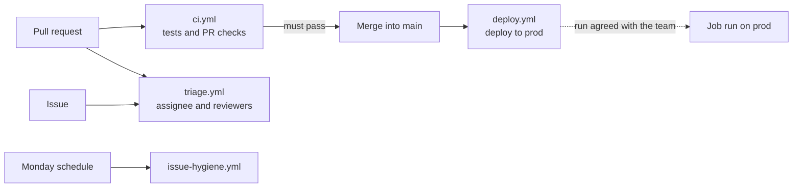

# Workflows

GitHub Actions for this repository. CI proves the code and repository behave; the data is checked by the gates inside the Databricks job. Two jobs hold a Databricks token, each from its own GitHub environment: the bundle check in CI (validate only) and the prod deploy.

| Workflow | Runs on | Jobs |
|---|---|---|
| [`ci.yml`](ci.yml) | Every pull request, every push to `main` | Repository checks (`python -m pytest tests -q`); Databricks bundle validates (`databricks bundle validate --target dev`); PR links an existing open issue and closes no parent; PR declares AI help; PR has a milestone |
| [`deploy.yml`](deploy.yml) | Push to `main` that changes `databricks.yml`, `config/`, `dashboards/`, `etl/`, or `src/`; or by hand | Deploys the bundle to `prod` with `python -m src.job.deploy_prod`; never starts a run |
| [`triage.yml`](triage.yml) | Issue opened or edited; PR opened, reopened, or ready for review | Labels an issue from its `[TAG]`; assigns the PR author; requests the author's two reviewers and posts a reviewer comment |
| [`issue-hygiene.yml`](issue-hygiene.yml) | Mondays 09:00 Manila, or by hand | Reports issues whose state disagrees with their sub-issues or the project board |

Only the checks on pull requests into `main` block merging (branch protection). The logic each workflow runs lives in [`../scripts/`](../scripts/README.md), where it is tested.

## Databricks environments

Each job's token lives in its own GitHub environment (**Settings → Environments**), so a pull request never sees the deploy token:

| Environment | Used by | Deployment branches | `DATABRICKS_HOST` (variable) | `DATABRICKS_TOKEN` (secret) |
|---|---|---|---|---|
| `ci-validate` | `ci.yml`, Databricks bundle validates | All | `https://dbc-2b6bf1c5-7bc3.cloud.databricks.com` (`dev`) | A `dev` token used only for `bundle validate` |
| `production` | `deploy.yml` | `main` only | `https://dbc-76bcfddb-1669.cloud.databricks.com` (`prod`) | A `prod` token; the job runs as its owner |

A pull request can edit `ci.yml`, so treat the `ci-validate` token as exposed to every branch: never reuse the `production` token there. Never put a token in the repository; if one leaks, revoke it in Databricks (**Settings → Developer → Access tokens**) and replace the secret.

The deploy runs the same script a teammate runs by hand, so it refuses for the same reasons ([runbook, Deploying to prod](../../docs/operations/runbook.md#deploying-to-prod)), for example when a newer merge has already moved `origin/main`; the newer merge's deploy then follows. Deploying only updates the job definition. Starting a run on `prod` is still announced to the team and done by hand.

| What you see | Likely cause | Fix |
|---|---|---|
| `Missing environment variable` or `secret` | The value is unset, or set at repository level instead of in the environment | Add it under **Settings → Environments → `ci-validate`** or **`production`** |
| `401` or another authentication error | The token expired or belongs to the other workspace | Create a new token in the right workspace and replace `DATABRICKS_TOKEN` |
| `refused: HEAD ... is not origin/main` | Another merge landed while this deploy was starting | Nothing: that merge's deploy follows. **Run workflow** redeploys the newest `main` |
| No deploy after a merge | The merge changed only files outside `deploy.yml`'s `paths` | Expected; use **Run workflow** to deploy anyway |
