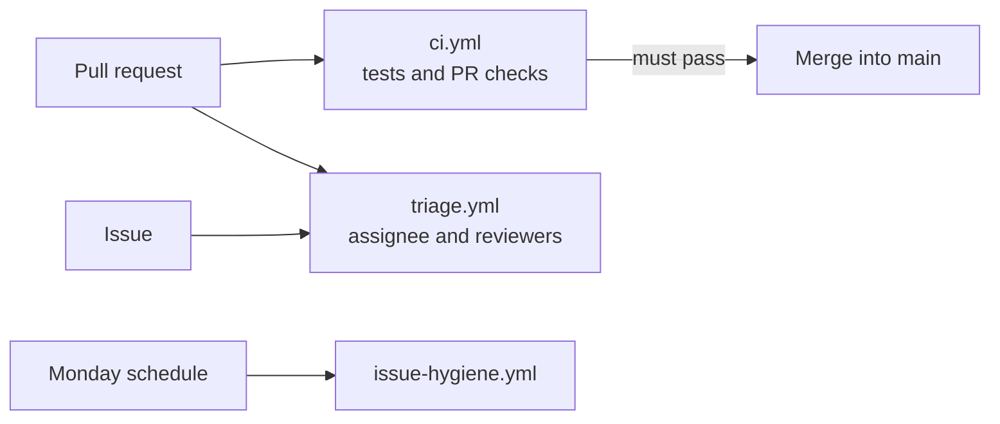

# Workflows

GitHub Actions for this repository. None of them has Databricks credentials: CI proves the code and repository behave; the data is checked by the gates inside the Databricks job.

| Workflow | Runs on | Jobs |
|---|---|---|
| [`ci.yml`](ci.yml) | Every pull request, every push to `main` | Repository checks (`python -m pytest tests -q`); PR links an existing open issue and closes no parent; PR declares AI help; PR has a milestone |
| [`triage.yml`](triage.yml) | Issue opened or edited; PR opened, reopened, or ready for review | Labels an issue from its `[TAG]`; assigns the PR author; requests the author's two reviewers and posts a reviewer comment |
| [`issue-hygiene.yml`](issue-hygiene.yml) | Mondays 09:00 Manila, or by hand | Reports issues whose state disagrees with their sub-issues or the project board |

Only the checks on pull requests into `main` block merging (branch protection). The logic each workflow runs lives in [`../scripts/`](../scripts/README.md), where it is tested.
