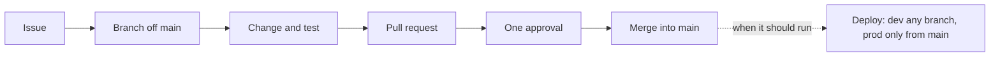

# Contributing

How to make a change safely. Laptop setup is in [terminal setup](docs/getting-started/terminal-setup.md), how to run the pipeline is in the [README](README.md#run-it), and the full walkthrough of issues, branches, and reviews is in [workflow](docs/operations/workflow.md).

## How a change gets in

1. **Start from an issue.** It records why the change is needed.
2. **Branch off `main`**, named `<type>/<issue-number>-<short-description>`, for example `feat/14-ingest-psgc`, `fix/22-duplicate-school-ids`, or `docs/9-source-card-deped-enrollment`.
3. **Make the change and test it** (checklist below).
4. **Open a pull request** with the template filled in. Write `Part of #14` while work on the issue remains, and `Closes #14` only when this pull request finishes it ([linking the issue](docs/operations/workflow.md#linking-the-issue)).
5. **Get one approval** from a teammate who is not the author. Two reviewers are requested for you.
6. **Merge with a merge commit**, then delete the branch.

## Before you open a pull request

- [ ] `python -m pytest tests -q` passes. It is what CI runs, on made-up data only.
- [ ] Every generated file you touched is regenerated. Each stage README gives the command, and a test fails if a committed file differs from its generator.
- [ ] For a pipeline change, the whole job runs locally: `RAW_DATA_DIR=... python -m src.job.local_run` exits 0.
- [ ] For a data change, row counts, duplicates, and a rerun are checked, and a claim about the data has an [evidence record](evidence/README.md#writing-a-record).
- [ ] The document that explains the behavior is updated in the same pull request. [The docs index](docs/README.md#source-of-truth) says which document owns which topic.

## What CI checks

| Check | Fails when |
|---|---|
| Repository checks | Any test fails, including the data, secret, naming, and documentation checks |
| Databricks bundle validates | `databricks bundle validate --target dev` fails on this branch, for example a task names a file that is missing or renamed |
| PR links an issue | No open issue is linked, or merging would close a parent issue or more than one issue |
| PR has a milestone | The pull request has no milestone (it is copied from the linked issue when the issue has one) |
| PR declares AI help | The [AI help](#using-ai) section is not filled in correctly |

After a merge to `main` that changes `databricks.yml`, `config/`, `dashboards/`, `etl/`, or `src/`, **CD - Deploy to Databricks prod** runs the tests on that commit and, only if they pass, deploys the bundle to `prod`. It does not start a run ([workflows](.github/workflows/README.md)).

## Commit messages

- Imperative mood, saying what changed: "Add PSGC source card", not "added stuff".
- One meaningful step per commit, so a reviewer can follow the change and a revert stays small.

## Repository rules

`tests/test_repo_policy.py` enforces these where it can.

- **Never commit data.** Raw, interim, and processed files live in raw storage or the Databricks volume. The only exception is small, made-up files under [`tests/data/`](tests/data/README.md).
- **Never commit secrets.** Use `.env` locally; it is git-ignored. Only `.env.example`, with names and no values, is committed.
- **Never modify a raw file.** Every transformation writes a new layer, and a revised delivery is approved as a new version.
- **Don't hard-code paths or dates.** Put them in `config/` or pass them as parameters.
- **Use fully qualified table names** (`` edu_access.`03-silver`.table ``) in all SQL.
- **Don't clean data silently.** Every cleaning rule is in a reviewed mapping file and records how many rows it affects.
- **Keep scripts as `.py` files,** with `# %%` cells if you want notebook-style runs, never `.ipynb`.

## Using AI

AI tools may be used for any part of the work. The person who opens the pull request is its author and answers for it, whether or not AI helped. AI help means any tool that writes or rewrites content for you, including chat assistants, code completion, and AI rewriting of text; spell-check alone does not count.

Every pull request ticks either **No AI help** or **AI helped**. If AI helped, the work must pass all four gates, and the pull request says which tool did what:

| Gate | The rule |
|---|---|
| **Data** | Give AI tools only public or made-up data. Never share keys, tokens, passwords, workspace credentials, or personal information. |
| **AI claims** | Anything the AI states as fact is checked against a source you can link: official documentation, the publisher, or our own output. |
| **Output** | You checked the result yourself. Where there is something to run, it works, it is safe to rerun, and every result can be traced to its source. |
| **Accountability** | You can explain every part of the work without the AI. |

CI can only see the ticks, so reviewers still send back work that does not really pass the gates.
