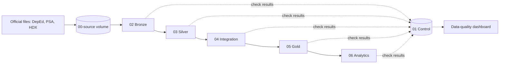

# Education Access Intelligence

[](https://github.com/reached-hq/edu-access-intelligence/actions/workflows/ci.yml)
[](https://github.com/reached-hq/edu-access-intelligence/actions/workflows/deploy.yml)

A data engineering capstone by **ReachED** for the FTW Data Engineering program.

[Architecture](docs/architecture/overview.md) ·
[Data model](docs/architecture/data-model.md) ·
[Setup](docs/getting-started/terminal-setup.md) ·
[Docs index](docs/README.md) ·
[Decisions](docs/governance/decisions.md) ·
[Evidence](evidence/README.md) ·
[Contributing](CONTRIBUTING.md)

**New here?** Read in this order: this page → [architecture overview](docs/architecture/overview.md) → [Gold data model](docs/architecture/data-model.md) → [raw files the job needs](docs/getting-started/raw-data.md) → [failure-recovery runbook](docs/operations/runbook.md). Everything else is in the [docs index](docs/README.md).

## About the project

National education totals show how many learners the Philippines enrolls, but not **where** public-school enrollment puts the most pressure on classrooms and teachers. Education Access Intelligence answers that at the level where local planning happens: every city and municipality.

It brings together official DepEd, PSA, and HDX files, matches every school to the Philippine Standard Geographic Code (PSGC), checks each layer before it is published, and produces one comparable set of measures for every city and municipality, with the coverage behind each number.

> **Business question:** How should we prioritize the provision of classrooms and teachers among cities based on their respective enrollment needs?

| | |
|---|---|
| **Who it is for** | LGU Local School Boards (provincial, city, and municipal), which decide how the Special Education Fund is spent |
| **Scope** | Public basic education, Kinder to Grade 12, in every Philippine city and municipality |
| **School years** | Enrollment SY 2020-21 to 2025-26; classrooms and teachers SY 2023-24 |
| **What it decides** | Which places to inspect first. Planners decide the response and the amount; the project organizes the evidence |

### The four analytical questions

| | Question | What the pipeline answers with |
|---|---|---|
| **AP1** | Which cities and municipalities have fewer public schools relative to their enrolled students and population? | Learners and school-age children per public school, and barangays without a public elementary school |
| **AP2** | Which have the most public-school students per classroom? | A school-by-school screen at 50 or more learners per reported instructional room, summed to the schools and learners affected in each place |
| **AP3** | Which have the most public-school students per teacher? | Learners per teacher at each level, beside the ES, JHS, and SHS review references |
| **AP4** | Which have the largest gap between school-age population and enrollment over time? | Public-school enrollment growth from SY 2020-21 to 2025-26 for priority, with the all-sector trend and census gap as context |

### What it produces

- **A planning-priority list.** D-061 combines separate classroom and teacher pressure flags with public-school enrollment growth into Priority 1 to 3, Monitor, No current pressure identified, and Data review. It orders review effort and does not estimate shortages, entitlements, or funding allocations.
- **One table per analytical question**, with its coverage and the reason when a place cannot be assessed. Every column is in [analytics outputs](docs/data/analytics-outputs.md).
- **Trusted Gold tables** of schools, places, enrollment, classrooms, teachers, population, and poverty, reusable for other questions.
- **A data-quality dashboard** that shows every check the pipeline ran, by layer and source, with job runs and source freshness.

The question wording and its limits are in [business and analytical questions](docs/business/business-analytics-problem.md); the formulas are in the [metric specification](docs/business/metric-specification.md).

## How the planning priority is set

Each city and municipality gets one of six categories from three signals: **classroom pressure** (AP2: a school with 50 or more learners per reported room, PIDS 2025-10), **teacher pressure** (AP3: an offered level above ES 35, JHS 36, or SHS 80/3 learners per teacher), and **growing enrollment** (AP4: more public-school learners in SY 2025-26 than in SY 2020-21). The signals are counted, not weighted, so every category traces back to its measures.

| Category | Classroom or teacher pressure | Growing enrollment |
|---|---|---|
| **Priority 1** | Both | Yes |
| **Priority 2** | Both | No |
| **Priority 2** | One | Yes |
| **Priority 3** | One | No |
| **Monitor** | None | Yes |
| **No current pressure identified** | None | No |
| **Data review** | None shown | A coverage check failed, or growth could not be assessed |

A pressure counts only where its measure passes a 90% coverage check, and a known pressure is never hidden by missing data. Within a category, places with more pressures and more affected learners come first. AP1 and the census gap are shown as context only. The list orders review; it does not estimate shortages, hiring, or funding. SQL: [`05_build_priority_matrix.sql`](etl/06_analytics/05_build_priority_matrix.sql); full rule: [D-061](docs/governance/decisions.md#d-061-current-pressures-and-public-enrollment-growth-set-planning-priority).

## Data sources

Nine official sources are loaded. Fifteen more were profiled and kept as context or set aside, each with a [source card](docs/data/source-inventory/README.md) saying why.

| Source | Publisher | What it adds | Period |
|---|---|---|---|
| School enrollment | DepEd | Learners per school, level, and grade | SY 2020-21 to 2025-26 |
| School facilities | DepEd | Instructional rooms and temporary or makeshift spaces | SY 2023-24 |
| School personnel | DepEd | Teachers working in each school, by level | SY 2023-24 |
| EMISD enrollment with PSGC codes | DepEd | Each school's PSGC city, municipality, and barangay | SY 2023-24 |
| Public schools with coordinates | DepEd (through PSA) | Each public school's PSGC codes and location | SY 2023-24 |
| Philippine Standard Geographic Code | PSA | The official list of regions, provinces, cities, municipalities, and barangays | 2nd quarter 2026 |
| School-age population | PSA | Residents aged 5 to 24 by single year of age and sex | 2020 and 2024 censuses |
| City and municipal poverty estimates | PSA | Poverty incidence with its precision | 2018, 2021, 2023 |
| Administrative boundaries (COD-AB) | UN OCHA through HDX | City and municipality shapes and land area | 2025-02-13 edition |

## Pipeline at a glance



<details>
<summary>End to end, with every source and table</summary>



```mermaid
flowchart LR
    subgraph sources["00 Source: 15 files, 9 sources"]
        direction TB
        s1[deped_enrollment<br/>SY 2020-21 to 2025-26]
        s2[deped_facilities]
        s3[deped_personnel]
        s4[deped_enrollment_psgc]
        s5[deped_psgc_coordinates]
        s6[psa_psgc]
        s7[psa_poverty_stat]
        s8[psa_school_age_population]
        s9[hdx_boundaries]
    end
    subgraph lanes["02 Bronze and 03 Silver: one lane per source"]
        direction TB
        raw["9 _raw tables<br/>+ Bronze gates"] --> clean["9 _clean + _quarantine tables<br/>+ Silver gates"]
    end
    subgraph integration["04 Integration"]
        direction TB
        m1[deped_school_psgc_map]
        m2[psa_poverty_psgc_map]
        m3[hdx_adm3_psgc_map]
        m4[psa_school_age_population_psgc_map]
        m5[deped_annex_mother_map]
        m6[deped_school_boundary_map]
    end
    subgraph gold["05 Gold"]
        direction TB
        dims["dim_school · dim_school_year · dim_education_level<br/>dim_city_municipality · dim_barangay · dim_city_poverty<br/>dim_school_location"]
        facts["fact_school_enrollment · fact_school_classroom_capacity<br/>fact_school_teacher_capacity · fact_city_population<br/>fact_city_school_age_population · fact_school_year_source_availability"]
        dims --> facts
    end
    subgraph analytics["06 Analytics"]
        direction TB
        ap["ap1_school_provision · ap2_classroom_pressure<br/>ap3_teacher_pressure · ap4_enrollment_trend"] --> matrix[lgu_priority_matrix<br/>D-061 planning priority]
    end
    sources --> lanes --> integration --> gold
    lanes --> gold
    gold --> analytics
    lanes & integration & gold & analytics -.->|every gate's results| control[(01 Control<br/>data_quality_results)]
    control -.-> dq[Data-quality dashboard]
    matrix -.->|in review, #224| planner[LGU planner dashboard]
```

Column-level detail: [Silver tables](docs/data/silver/README.md), [Gold data model](docs/architecture/data-model.md), [analytics outputs](docs/data/analytics-outputs.md).

</details>

Each source moves through Bronze and Silver in its own lane. From Silver on, every table is built as a candidate and replaces the published table only when its validation gate passes, so a failed check never overwrites the last good result. Details: [architecture overview](docs/architecture/overview.md).

| Layer | Holds |
|---|---|
| Bronze | 9 source tables, every value kept as received |
| Silver | 9 cleaned tables, each with a quarantine table for rows that cannot be trusted |
| Integration | 6 matching tables: schools, poverty estimates, boundaries, and census places to PSGC, annex schools to their mother schools, and school points to boundaries |
| Gold | 13 dimensions and facts at their natural grain |
| Analytics | AP1 to AP4 and the D-061 planning-priority list |

Every layer runs in one Databricks job, `edu_access_pipeline`, with a `dev` target for development and a `prod` target deployed only from `main`. The whole job has run source to Gold on Databricks twice with every gate passing and identical results ([evidence](evidence/pipeline-runs/2026-10-20-gold-databricks-dev.md)), and totals are traced from each source file to Gold in [validation](docs/operations/validation.md).

## Repository map

| Path | What is there |
|---|---|
| [`etl/`](etl/README.md) | The SQL of every stage, `01_control` to `06_analytics`; each build has a `90_validate_*` gate |
| [`src/`](src/README.md) | Python: ingestion, the generators of the Silver, Integration, and dashboard files, and the local job runner |
| [`config/`](config/README.md) | Source contracts, reviewed mappings and rules, the table registry, freshness limits |
| [`databricks.yml`](databricks.yml) | The job, its alerts, the dashboard, and the `dev` and `prod` targets (Databricks Asset Bundle) |
| [`dashboards/`](dashboards/README.md) | Generated AI/BI dashboards |
| [`tests/`](tests/README.md) | pytest suite run by CI, on made-up data only |
| [`docs/`](docs/README.md) | Architecture, business framing, source inventory, operations, decisions |
| [`evidence/`](evidence/README.md) | Recorded runs and reconciliations that back each claim |
| [`analysis/`](analysis/README.md) | Profiling and cross-source research scripts; not pipeline tasks |

Several files under `etl/`, `docs/data/silver/`, and `dashboards/` are generated from `config/`. Each stage README says which, and a test fails if a committed file differs from what its generator prints.

## Setup

Set up a laptop once with [terminal setup](docs/getting-started/terminal-setup.md), then, on macOS or Linux:

```bash
python -m venv .venv
source .venv/bin/activate
python -m pip install -r requirements-dev.txt
```

On Windows, in PowerShell:

```powershell
py -m venv .venv
.venv\Scripts\Activate.ps1
python -m pip install -r requirements-dev.txt
```

Raw files are never committed. Locally they sit in `raw-data/` beside the repository ([terminal setup, Part 8](docs/getting-started/terminal-setup.md#part-8-raw-data-and-raw_data_dir)); on Databricks they are in `` edu_access.`00-source`.raw ``. The job loads 15 files from 9 sources: [raw files the job needs](docs/getting-started/raw-data.md) lists each one with its SHA-256 and where to get it, including the 4 that were sent by email and are not published.

## Run it

| What | Command |
|---|---|
| Tests and policy checks (what CI runs) | `python -m pytest tests -q` |
| The whole job, locally on DuckDB | macOS or Linux: `RAW_DATA_DIR=~/Projects/reached-hq/raw-data python -m src.job.local_run`. Windows PowerShell: `$env:RAW_DATA_DIR = "$HOME\Projects\reached-hq\raw-data"; python -m src.job.local_run` |
| Deploy and run on `dev` | `databricks bundle deploy --target dev --profile reached-hq-dev`, then `databricks bundle run edu_access_pipeline --target dev --profile reached-hq-dev` |
| Deploy to `prod` | Automatic after a merge to `main` that changes the job ([CD workflow](.github/workflows/deploy.yml)); by hand, from a clean `main` equal to `origin/main`: `python -m src.job.deploy_prod` ([runbook, Deploying to prod](docs/operations/runbook.md#deploying-to-prod)) |

The local run writes to `local_state/edu_access.duckdb` (git-ignored) and exits 0 only when every task succeeded. Databricks compute is shared, so agree a run with the team first ([workflow, Part 5](docs/operations/workflow.md#part-5-where-code-runs)).

## Check that it worked

- **Every task succeeded** and the run's `code_revision` is the commit you deployed.
- **No gate wrote a FAIL.** The [data-quality dashboard](dashboards/README.md) shows each check's newest result; `` edu_access.`01-control`.data_quality_results `` holds them all.
- **The totals match the source.** [Validation](docs/operations/validation.md) lists the counts to compare, layer by layer.

## When something fails

The failed task names the gate or step. Its results are in `data_quality_results`, and the batch's state is in `` `01-control`.ingestion_batches ``. Reruns are safe: Bronze adds only missing rows, and every later layer rebuilds and publishes only after its gate passes. Start with the [failure-recovery runbook](docs/operations/runbook.md): the first response, what to do for each failure type, how to retry, rerun, or backfill, and how to trace a number back to its raw file.

## Changing or extending it

- **New delivery of a known source:** [approving a delivery](config/ingestion/README.md).
- **New or changed cleaning rule:** [Silver, Changing a rule](docs/operations/silver.md#changing-a-rule-or-approving-a-label), then regenerate the SQL.
- **New table:** register it in [`config/tables.yml`](config/tables.yml), add the build and its gate to its `etl/` stage and to `databricks.yml`, and list both files in the stage README.
- **A design choice:** record it in the [decision log](docs/governance/decisions.md).

Process, branches, and reviews: [CONTRIBUTING.md](CONTRIBUTING.md).

## Known limitations

- **Enrollment is counted where the school is,** not where learners live, so cross-boundary attendance affects every result.
- **The classroom screen is illustrative.** The 50-learner line comes from a PIDS study and is applied to a broader room count than K–12 classrooms; it orders review and is not an official DepEd ratio or a construction entitlement.
- **Teacher figures count personnel working in schools,** not authorized positions or vacancies, so they cannot set a teacher allocation priority.
- **Classrooms and teachers cover SY 2023-24 only;** enrollment covers SY 2020-21 to 2025-26.
- **Annex schools publish no mother-school ID,** so their counts are not consolidated with their mother schools.
- **The census gap is not an out-of-school count:** residents are counted where they live and learners where they enroll.

Every confirmed data limit, with its evidence, is in [limitations](docs/governance/limitations.md).
