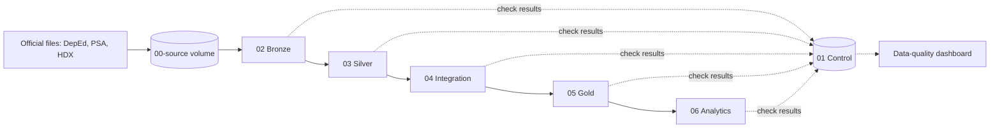

# Education Access Intelligence

A data engineering capstone by **ReachED** for the FTW Data Engineering program.

[Architecture](docs/architecture/overview.md) ·
[Data model](docs/architecture/data-model.md) ·
[Setup](docs/getting-started/terminal-setup.md) ·
[Docs index](docs/README.md) ·
[Decisions](docs/governance/decisions.md) ·
[Evidence](evidence/README.md) ·
[Contributing](CONTRIBUTING.md)

**New here?** Read in this order: this page → [architecture overview](docs/architecture/overview.md) → [Gold data model](docs/architecture/data-model.md) → [raw files the job needs](docs/getting-started/raw-data.md) → [failure-recovery runbook](docs/operations/runbook.md). Everything else is in the [docs index](docs/README.md).

## What it does

The pipeline turns official DepEd, PSA, and HDX files into city- and municipality-level measures of classroom and teacher pressure, and puts the LGUs whose schools pass a classroom congestion screen into a review queue.

> **Business question:** How should we prioritize the provision of classrooms and teachers among cities based on their respective enrollment needs?

- **Users:** LGU Local School Boards, which decide how the Special Education Fund is spent (D-057).
- **Scope:** public basic education, Kinder to Grade 12, in every Philippine city and municipality (D-003).
- **Outputs:** one table per analytical question (AP1 to AP4) and `lgu_priority_matrix`, which shows AP1 to AP4 side by side and ranks the LGUs with reported classroom congestion into a review queue (D-060). Every column is in [analytics outputs](docs/data/analytics-outputs.md).

The wording, the four analytical questions, and their limits are in [business and analytical questions](docs/business/business-analytics-problem.md); the formulas are in the [metric specification](docs/business/metric-specification.md).

## Pipeline at a glance



<details>
<summary>End to end, with every source and table</summary>



```mermaid
flowchart LR
    subgraph sources["00 Source: 15 files, 9 sources"]
        direction TB
        s1[deped_enrollment<br/>SY 2020-21 to 2025-26]
        s2[deped_facilities]
        s3[deped_personnel]
        s4[deped_enrollment_psgc]
        s5[deped_psgc_coordinates]
        s6[psa_psgc]
        s7[psa_poverty_stat]
        s8[psa_school_age_population]
        s9[hdx_boundaries]
    end
    subgraph lanes["02 Bronze and 03 Silver: one lane per source"]
        direction TB
        raw["9 _raw tables<br/>+ Bronze gates"] --> clean["9 _clean + _quarantine tables<br/>+ Silver gates"]
    end
    subgraph integration["04 Integration"]
        direction TB
        m1[deped_school_psgc_map]
        m2[psa_poverty_psgc_map]
        m3[hdx_adm3_psgc_map]
        m4[psa_school_age_population_psgc_map]
        m5[deped_annex_mother_map]
        m6[deped_school_boundary_map]
    end
    subgraph gold["05 Gold"]
        direction TB
        dims["dim_school · dim_school_year · dim_education_level<br/>dim_city_municipality · dim_barangay · dim_city_poverty<br/>dim_school_location"]
        facts["fact_school_enrollment · fact_school_classroom_capacity<br/>fact_school_teacher_capacity · fact_city_population<br/>fact_city_school_age_population · fact_school_year_source_availability"]
        dims --> facts
    end
    subgraph analytics["06 Analytics"]
        direction TB
        ap["ap1_school_provision · ap2_classroom_pressure<br/>ap3_teacher_pressure · ap4_enrollment_trend"] --> matrix[lgu_priority_matrix<br/>D-060 classroom review queue]
    end
    sources --> lanes --> integration --> gold
    lanes --> gold
    gold --> analytics
    lanes & integration & gold & analytics -.->|every gate's results| control[(01 Control<br/>data_quality_results)]
    control -.-> dq[Data-quality dashboard]
    matrix -.->|in review, #224| planner[LGU planner dashboard]
```

Column-level detail: [Silver tables](docs/data/silver/README.md), [Gold data model](docs/architecture/data-model.md), [analytics outputs](docs/data/analytics-outputs.md).

</details>

Each source moves through Bronze and Silver in its own lane. From Silver on, every table is built as a candidate and replaces the published table only when its validation gate passes, so a failed check never overwrites the last good result. Details: [architecture overview](docs/architecture/overview.md).

## Status

| | |
|---|---|
| **Implemented** | 9 sources through Bronze and Silver, 6 Integration maps, 13 Gold tables, 5 Analytics outputs, the data-quality dashboard, freshness and quality alerts. All are enabled in [`databricks.yml`](databricks.yml) and run by CI on made-up data |
| **Proven on Databricks `dev`** | Source to Gold, twice, every gate passing and identical results, at `7542cc0` ([evidence](evidence/pipeline-runs/2026-10-20-gold-databricks-dev.md)); the school-coordinates Bronze load ([evidence](evidence/pipeline-runs/2026-10-21-deped-psgc-coordinates-databricks.md)); totals traced from source file to Gold in [validation](docs/operations/validation.md) |
| **Proven locally only** | The Analytics outputs and the data-quality dashboard (tested in CI, no Databricks run in `evidence/` yet); failure recovery, rehearsed end to end ([evidence](evidence/pipeline-runs/2026-10-20-failure-recovery-local.md)); the school-coordinates Silver lane, reconciled on the real workbook ([evidence](evidence/reconciliation/2026-10-21-deped-psgc-coordinates-bronze-to-silver.md)) |
| **Not built** | A run on `prod`: the target is defined in its own workspace (D-063) but not yet deployed (#99); the LGU planner dashboard is in review (#224) |

A commit on `main` is not what runs in the workspace until it is deployed: the job records the commit it ran as `code_revision` on every row it writes.

## Repository map

| Path | What is there |
|---|---|
| [`etl/`](etl/README.md) | The SQL of every stage, `01_control` to `06_analytics`; each build has a `90_validate_*` gate |
| [`src/`](src/README.md) | Python: ingestion, the generators of the Silver, Integration, and dashboard files, and the local job runner |
| [`config/`](config/README.md) | Source contracts, reviewed mappings and rules, the table registry, freshness limits |
| [`databricks.yml`](databricks.yml) | The job, its alerts, and the dashboard (Databricks Asset Bundle) |
| [`dashboards/`](dashboards/README.md) | Generated AI/BI dashboards |
| [`tests/`](tests/README.md) | pytest suite run by CI, on made-up data only |
| [`docs/`](docs/README.md) | Architecture, business framing, source inventory, operations, decisions |
| [`evidence/`](evidence/README.md) | Recorded runs and reconciliations that back each claim |
| [`analysis/`](analysis/README.md) | Profiling and cross-source research scripts; not pipeline tasks |

Several files under `etl/`, `docs/data/silver/`, and `dashboards/` are generated from `config/`. Each stage README says which, and a test fails if a committed file differs from what its generator prints.

## Setup

Set up a laptop once with [terminal setup](docs/getting-started/terminal-setup.md), then, on macOS or Linux:

```bash
python -m venv .venv
source .venv/bin/activate
python -m pip install -r requirements-dev.txt
```

On Windows, in PowerShell:

```powershell
py -m venv .venv
.venv\Scripts\Activate.ps1
python -m pip install -r requirements-dev.txt
```

Raw files are never committed. Locally they sit in `raw-data/` beside the repository ([terminal setup, Part 8](docs/getting-started/terminal-setup.md#part-8-raw-data-and-raw_data_dir)); on Databricks they are in `` edu_access.`00-source`.raw ``. The job loads 15 files from 9 sources: [raw files the job needs](docs/getting-started/raw-data.md) lists each one with its SHA-256 and where to get it, including the 4 that were sent by email and are not published.

## Run it

| What | Command |
|---|---|
| Tests and policy checks (what CI runs) | `python -m pytest tests -q` |
| The whole job, locally on DuckDB | macOS or Linux: `RAW_DATA_DIR=~/Projects/reached-hq/raw-data python -m src.job.local_run`. Windows PowerShell: `$env:RAW_DATA_DIR = "$HOME\Projects\reached-hq\raw-data"; python -m src.job.local_run` |
| Deploy the job to `dev` | `databricks bundle deploy --target dev --profile reached-hq-dev` |
| Run the job on `dev` | `databricks bundle run edu_access_pipeline --target dev --profile reached-hq-dev` |

The local run writes to `local_state/edu_access.duckdb` (git-ignored) and exits 0 only when every task succeeded. Deploy from a clean, pushed `main`; Databricks compute is shared, so agree a run with the team first ([workflow, Part 5](docs/operations/workflow.md#part-5-where-code-runs)).

## Check that it worked

- **Every task succeeded** and the run's `code_revision` is the commit you deployed.
- **No gate wrote a FAIL.** The [data-quality dashboard](dashboards/README.md) shows each check's newest result; `` edu_access.`01-control`.data_quality_results `` holds them all.
- **The totals match the source.** [Validation](docs/operations/validation.md) lists the counts to compare, layer by layer.

## When something fails

The failed task names the gate or step. Its results are in `data_quality_results`, and the batch's state is in `` `01-control`.ingestion_batches ``. Reruns are safe: Bronze adds only missing rows, and every later layer rebuilds and publishes only after its gate passes. Start with the [failure-recovery runbook](docs/operations/runbook.md): the first response, what to do for each failure type, how to retry, rerun, or backfill, and how to trace a number back to its raw file.

## Changing or extending it

- **New delivery of a known source:** [approving a delivery](config/ingestion/README.md).
- **New or changed cleaning rule:** [Silver, Changing a rule](docs/operations/silver.md#changing-a-rule-or-approving-a-label), then regenerate the SQL.
- **New table:** register it in [`config/tables.yml`](config/tables.yml), add the build and its gate to its `etl/` stage and to `databricks.yml`, and list both files in the stage README.
- **A design choice:** record it in the [decision log](docs/governance/decisions.md).

Process, branches, and reviews: [CONTRIBUTING.md](CONTRIBUTING.md).

## Known limitations

- Enrollment is observed demand at the school's location, not learner residence, and the classroom queue is a screen for review, not a shortage count ([business framing](docs/business/business-analytics-problem.md)).
- Classroom and teacher capacity cover SY 2023-24 only; enrollment covers SY 2020-21 to 2025-26.
- Annex schools publish no mother-school ID, so their counts are not consolidated (D-044).
- `prod` is defined in its own workspace but has not run yet (D-063, #99).

Every confirmed data limit, with its evidence, is in [limitations](docs/governance/limitations.md).
