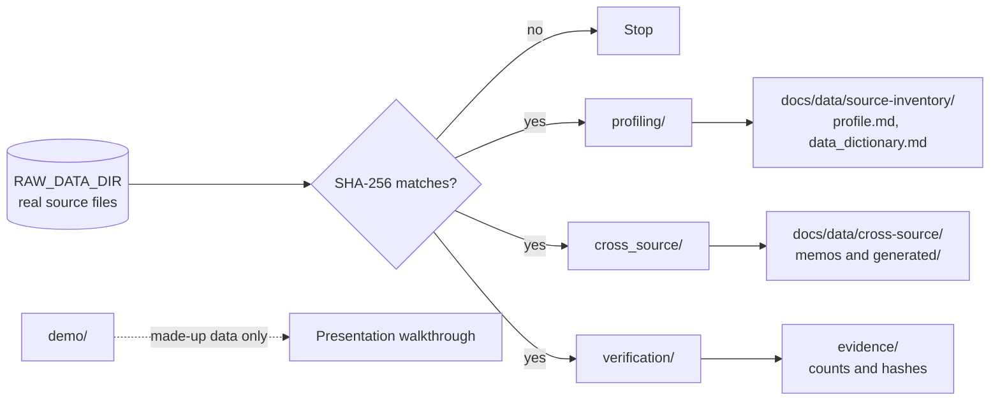

# Analysis

Reproducible research scripts. They read the real, checksum-verified source files and write documentation or evidence; they are **not** pipeline tasks and never run in the Databricks job.



| Folder | Reads | Writes | Use it to |
|---|---|---|---|
| [`profiling/`](profiling/README.md) | One source | Its profile and data dictionary | Inspect a new source or regenerate its dictionary |
| [`cross_source/`](cross_source/README.md) | Two or more sources | Cross-source memos' numbers and `generated/` lists | Test joins, coverage, and year-to-year comparability |
| [`verification/`](verification/README.md) | Real files, through the job on a scratch DuckDB | Counts and hashes for an evidence record | Prove a built layer on the real data |
| [`demo/`](demo/README.md) | Made-up workbooks only | Nothing | Show ingestion behavior without data or credentials |

## Running a script

```bash
export RAW_DATA_DIR=~/Projects/reached-hq/raw-data
python analysis/profiling/profile_psgc.py
```

Each script prints its findings under the finding IDs its source card cites (`O-1`, `S-2`, `X-1`, ...), so a claim in a document can be traced to the line that printed it.

## Rules

- Verify each file's SHA-256 against its source card before reading it.
- Generated documents are rewritten by their script; change the script and rerun it, never edit the output by hand.
- Code that a second script needs moves to [`src/profiling/`](../src/profiling/README.md). Production ingestion belongs in `src/ingestion/`, and production transformations belong in `etl/`.
