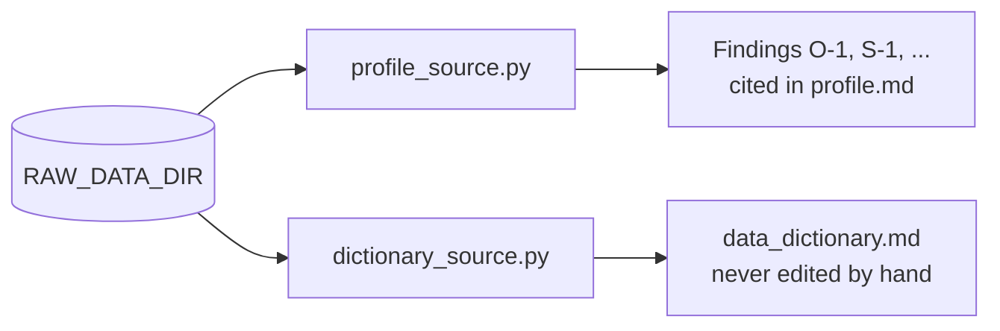

# Source profiling

One profile script per source, and a dictionary script where the dictionary is generated separately. Each verifies the source's checksums first and prints its findings under the IDs its [source card](../../docs/data/source-inventory/README.md) cites.



| Source | Profile | Dictionary |
|---|---|---|
| `deped_enrollment`, `deped_facilities` | `profile_deped.py` | `dictionary_deped.py` |
| `deped_enrollment_psgc` | `profile_deped_enrollment_psgc.py` | `dictionary_deped_enrollment_psgc.py` |
| `deped_psgc_coordinates` | `profile_deped_psgc_coordinates.py` | `dictionary_deped_psgc_coordinates.py` |
| `deped_personnel` | `profile_deped_personnel.py` | Same script |
| `deped_ellna` | `profile_deped_ellna.py` | Same script |
| `deped_nat_gr6` | `profile_deped_nat_gr6.py` | Same script |
| `psa_psgc` | `profile_psgc.py` | `dictionary_psgc.py` |
| `psa_poverty_stat` | `profile_psa_poverty.py` | `dictionary_psa_poverty.py` |
| `psa_school_age_population` | `profile_psa_school_age_population.py` | `dictionary_psa_school_age_population.py` |
| `psa_population_per_barangay` | `profile_psa_population_per_barangay.py` | Same script |
| `psa_population_per_age_group` | `profile_psa_population_per_age_group.py` | Same script |
| `psa_openstat_education` | `profile_psa_openstat.py` | Same script |
| `hdx_boundaries` | `profile_boundaries.py` | `dictionary_boundaries.py` |
| `osm_philippines` | `profile_osm.py` | `dictionary_osm.py` |
| `dti_cmci` | `profile_cmci.py` | `dictionary_cmci.py` |
| `ched_enrollment`, `ched_graduates`, `ched_school_count`, `ched_student_faculty_ratio` | `profile_ched.py` | `dictionary_ched.py` |
| `bpda_barmm_education` | `profile_bpda_barmm_education.py` | Same script |
| `bpda_barmm_social_infrastructure` | `profile_bpda_barmm_social_infrastructure.py` | Same script |
| `bpda_barmm_roads` | `profile_bpda_barmm_roads.py` | Same script |
| `bpda_mbhte_infrastructure_projects` | `profile_bpda_mbhte_infrastructure_projects.py` | Same script |

```bash
export RAW_DATA_DIR=~/Projects/reached-hq/raw-data
python analysis/profiling/profile_psgc.py
```

A new source gets `profile_<source_id>.py`, copying the pattern of `profile_deped.py`. Helpers a second script needs go to [`src/profiling/`](../../src/profiling/README.md).
