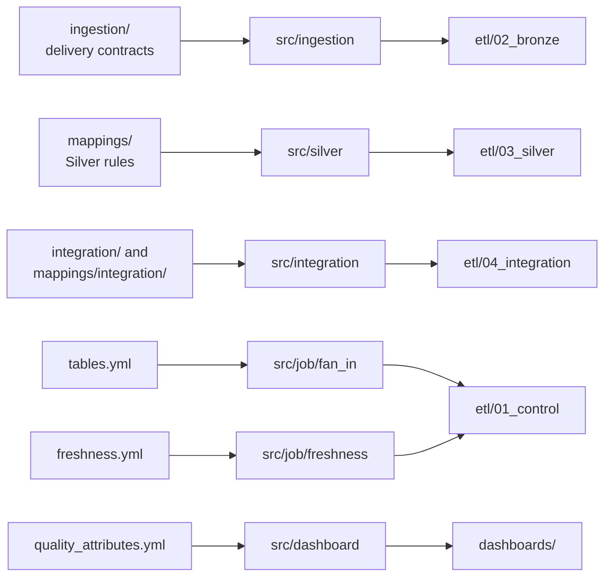
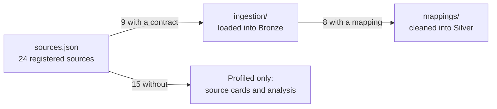

# Configuration

Non-secret, reviewed settings. Most of the pipeline's behavior is decided here and turned into SQL by a generator, so a change here plus a regenerate is how most rules change.

Every generated file has a test that fails when the committed file differs from what its generator prints, so a forgotten regenerate fails CI.

| Location | Holds | Read by |
|---|---|---|
| [`ingestion/`](ingestion/README.md) | One contract per source: approved files by SHA-256, schema versions, layout | `src/ingestion/` |
| [`mappings/`](mappings/README.md) | One reviewed Silver mapping per source: column classes, labels, flags, thresholds | `src/silver/` |
| [`integration/`](integration/README.md) | Rules and overrides for the HDX and school-age PSGC maps | `src/integration/` |
| `tables.yml` | The name, files, and grain of every table, Bronze to Analytics | Fan-in generator, naming tests, [ETL table registry](../docs/standards/tables.md) |
| `freshness.yml` | How old each source's latest batch may get, and why | `src/job/freshness.py` |
| `quality_attributes.yml` | Which quality attribute each check tests | `src/dashboard/data_quality.py` |
| `analytics_benchmarks.json` | The AP2 and AP3 reference values, their sources, derivations, and caveats (D-060) | `tests/test_analytics_priority.py`, which checks that the Analytics SQL writes the same values |
| `sources.json` | The source registry: every candidate source and its status | `src/ingestion/contract.py`, `tests/test_config.py` |
| `naming.yml` | Machine-readable naming patterns | `tests/test_naming.py` |
| `project.json` | Workspace hosts and CLI profiles for `dev` and `prod`, catalog, schema, and storage settings | `tests/test_bundle.py` |

## Which sources are loaded

Every registered source has a card in [`docs/data/source-inventory/`](../docs/data/source-inventory/README.md). Only a source with a contract here is ever loaded.

## Changing configuration

1. Edit the file in a pull request; the source or table owner named in it approves.
2. Regenerate what it feeds (each folder README gives the command).
3. Update its tests and the document that explains it in the same pull request.

Credentials, workspace tokens, raw source files, and personal paths never belong here.
