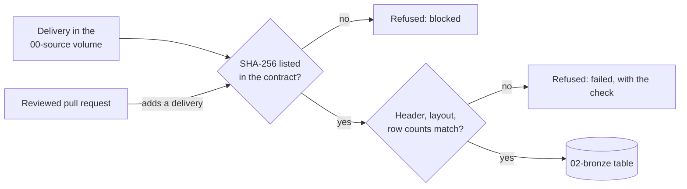

# Ingestion contracts

One file per source that is ingested, `<source_id>.json`. It says what an approved delivery of that source looks like, and lists every delivery the team has approved. The ingestion code (`src/ingestion/`) refuses anything else.

The source's name, system, and URL stay in the registry (`config/sources.json`); a contract does not repeat them, and does not change the source's `status`.

## Contracts

| Contract | Format | Landing folder | Approved deliveries | Schema versions |
|---|---|---|---|---|
| `deped_enrollment.json` | `zip_csv` | `deped/` | 6: SY 2020-21 to 2025-26 | 2 |
| `deped_facilities.json` | `zip_csv` | `deped/` | 1: SY 2023-24 | 1 |
| `deped_personnel.json` | `zip_csv` | `deped/` | 1: SY 2023-24 | 1 |
| `deped_enrollment_psgc.json` | `xlsx_report` | `deped/` | 1: SY 2023-24 (EMISD) | 1 |
| `psa_psgc.json` | `xlsx_table` | `psa/` | 1: 2026-Q2 | 1 |
| `psa_poverty_stat.json` | `xlsx_sheet` | `psa/` | 1: estimates 2018, 2021, 2023 | 1 |
| `psa_school_age_population.json` | `xlsx_census` | `psa/` | 2: censuses 2020 and 2024 | 2 |
| `hdx_boundaries.json` | `geojson_features` | `admin_boundaries/` | 1: COD-AB v03, 2025-02-13 | 1 |

A source with no contract here (CHED, BARMM, CMCI, OSM, and the others in `config/sources.json`) is profiled only and is never loaded.

## Common tasks

| Task | Do |
|---|---|
| A new school year or quarter arrives | [Approving a delivery](#approving-a-delivery) |
| The publisher revised a file already loaded | Approve it as the next `delivery_version`, with `supersedes` set to the earlier checksum |
| The header changed | Add a schema version with the exact new columns; the loader stops on any header it does not know |
| Regenerate the Bronze SQL | `python -m src.ingestion.cli ddl --source <source_id>` and `cli gate --source <source_id>` |

## What a contract holds

| Field | Meaning |
|---|---|
| `landing_dir` | Publisher folder under the raw landing root that is searched for deliveries (e.g. `deped`), in any subfolder |
| `archive_pattern` | Publisher file name, with the school year in it, e.g. `Enrollment-in-SY-2025-2026.zip` |
| `data_member_pattern` | Name of the one data file inside the archive, matched on the base name because the publisher's folder inside the zip changes between years |
| `document_members` | Publisher documents that must be in the archive (checksummed, not loaded) |
| `max_uncompressed_bytes` | Refuse an archive that expands beyond this |
| `identifier_column`, `identifier_pattern`, `required_columns` | The row identifier and the columns a delivery cannot lack |
| `schema_versions` | Each version is the exact, ordered list of the publisher's column names |
| `deliveries` | The approved deliveries (below) |

Each approved delivery pins:

| Field | Meaning |
|---|---|
| `school_year` | e.g. `2025-26`. It must agree with both the archive name and the data file name |
| `delivery_version`, `supersedes` | `1` for the first delivery of a school year. A revised file for the same year is `2`, with `supersedes` set to version 1's `archive_sha256` |
| `archive`, `archive_sha256` | The zip as downloaded |
| `data_member`, `data_member_sha256` | The CSV inside it |
| `document_sha256` | Each publisher document inside it |
| `encoding` | `utf-8` or `cp1252`, as profiled for these exact bytes |
| `schema_version` | Which schema version the header must equal |
| `row_count` | Data rows (excluding the header) found when profiling; Bronze must reconcile to it |
| `retrieved_at_utc` | When the file was downloaded |

## Approving a delivery

A delivery is approved by merging its entry in a reviewed pull request, never by the pipeline. To add one, for example a new school year:

1. Download the official zip into raw storage under its original name; do not change the file.
2. Profile it (`analysis/profiling/`) and update the source card with its checksums, encoding, and row count.
3. If the header matches no schema version, add a new version here with the exact new column list, and record the change in `profile.md`. The loader stops on any header it does not recognize.
4. Add the delivery entry, copying the values from the source card. `tests/test_ingestion_validate.py` fails unless each value here matches the card row of its own file: the zip's name and checksum, and the CSV's name, checksum, row count, and encoding.

A file whose name matches an approved delivery but whose SHA-256 does not is refused as `checksum_mismatch`. It is either damaged (download it again) or revised by the publisher (approve it as the next `delivery_version`; the earlier version is kept).

## Workbook contracts (`"format": "xlsx_sheet"`)

`psa_poverty_stat.json` describes one xlsx workbook per delivery instead of a zip (D-018). It has `workbook_pattern` instead of the archive and member patterns, `label_column` (the column that alone fills a region banner row), and `known_issues`. Each schema version adds a `layout`:

| Layout field | Meaning (PSA v1) |
|---|---|
| `first_data_row` | First body row (6) |
| `group_row`, `group_fill_from_column` | Row of the merged group labels (2), carried across the group from column D on |
| `sub_row`, `sub_row_columns` | Row 4 labels used only in these columns (A: `ID`; M to R: `Lower Limit`/`Upper Limit`) |
| `year_row` | Row of the years (5) |
| `width`, `ignored_columns` | 18 columns (A to R); column S must be empty |
| `footer_marker` | The body ends before the first row whose column A starts with `Notes:` |
| `value_columns_from` | First estimate column (D) |

Each approved workbook pins `logical_dataset`, `estimate_years` (must equal the years in its schema's column names), `delivery_version`, `supersedes`, `workbook`, `workbook_sha256`, `sheet` (and `expected_sheets` if it has more than one), `used_range` (the sheet's declared range, e.g. `A1:S1641`; every row of it is loaded), `schema_version`, `body_rows` (`first`, `last`), `unit_rows`, `banner_rows`, optional `blank_rows`, `footer_rows`, and `retrieved_at_utc`. Versions count 1, 2, 3 per `logical_dataset`; two datasets may not share an estimate year, so a republished year is approved as a revision with `supersedes`. A revision must keep every estimate year of the version it supersedes (it may add years); `current_batches` makes one version per dataset current, so a dropped year would disappear from Silver. `tests/test_ingestion_validate.py` fails unless the workbook's name, checksum, sheet, and row counts are on its source card row.

`known_issues` lists publisher quirks found in profiling. Each is recorded as a WARN with its profiled count beside the actual count; none blocks a batch, and none changes a value. Checks available: `identifier_shorter_than`, `unit_rows_all_values_blank`, `label_equals`, `number_at_most`, `number_above`, `se_disagrees_with_cv` (see `src/ingestion/workbook.py`).

## Workbook contracts (`format: xlsx_table`)

`psa_psgc.json` describes one xlsx workbook per publication quarter, delivered as is (no zip around it). The rules are in `src/ingestion/xlsx_table.py`; the decision is D-019.

| Field | Meaning |
|---|---|
| `format` | `xlsx_table`. Absent means `zip_csv`, the DepEd shape above |
| `workbook_pattern` | Publisher file name with named groups `quarter` and `year`, e.g. `PSGC-2Q-2026-Publication-Datafile.xlsx`. Searched for under `landing_dir` at any depth |
| `data_sheet`, `expected_sheets` | The sheet that holds the data, and every sheet the workbook should have. A sheet not in the list stops the batch (`unexpected_sheet`: it may hold data); a listed sheet that is missing is a WARN |
| `period_source` | Where the publication date is: the sheet and the label in column A (`Metadata`, `Publication date:`). Its quarter must equal the file name's |
| `identifier_column`, `identifier_pattern` | Bronze name of the code and its exact pattern as stored text (`^[0-9]{10}$`). A code stored as a number passes only if its stored digits already match; nothing is padded |
| `identifier_number_cells_profiled`, `error_cells_profiled` | How many codes the profile found stored as numbers (84), and how many error cells (1, the `#N/A` population). PASS at these counts, WARN when they change |
| `require_approved_deliveries` | `true`: an approved workbook missing from the landing folder fails the run |
| `master_reference_period` | The quarter the team uses as the master geographic reference (D-012). Must be an approved quarter; changed only by a team decision, never by loading |
| `schema_versions` | Each version has `columns` (snake_case Bronze names) and `source_headers` (the exact header cells, line breaks included; `""` for an empty header cell), in the same order. The header must equal one version's `source_headers` exactly |
| `quality_checks` | Known publisher characteristics with their profiled count: `blank`, `not_blank`, `equals`, `ends_with`, `not_whole_number` on one column. PASS at the profiled count, WARN when the count changes; never FAIL |
| `national_summary`, `hierarchy` | How to read the workbook's own summary sheet and the levels, for the WARN checks against it and the code-prefix hierarchy |

Each approved workbook pins:

| Field | Meaning |
|---|---|
| `publication_period` | e.g. `2026-Q2`. Must equal the quarter in the file name |
| `publication_date` | ISO date from the `Metadata` sheet, inside that quarter |
| `delivery_version`, `supersedes` | `1` for the first delivery of a quarter. A re-issued file for the same quarter is `2`, with `supersedes` set to version 1's `workbook_sha256` |
| `workbook`, `workbook_sha256` | The file as downloaded |
| `sheet`, `range` | The data sheet and its exact used range, e.g. `A1:K43769`: the header row plus `row_count` rows, one column per schema column |
| `schema_version`, `row_count` | Which header it has, and its data rows; Bronze must reconcile to it |
| `documented_population_abroad` | The publisher's documented gap between the regions and the national population (`Notes` D.2: 1,708) |
| `retrieved_at_utc` | When the file was downloaded |

To approve a new quarter, follow the PSGC runbook in [docs/operations/ingestion.md](../../docs/operations/ingestion.md#runbook-psgc). `tests/test_ingestion_validate.py` fails unless the workbook's name, checksum, row count and range sit on one row of the source card.

## Report-style workbook contracts (`format: xlsx_report`)

`deped_enrollment_psgc.json` describes one xlsx workbook per school year whose data sheet is laid out as a report: title rows, a grade and sex band, then the header in row 8 (#152). The rules are in `src/ingestion/xlsx_report.py`.

| Field | Meaning |
|---|---|
| `format` | `xlsx_report` |
| `workbook_pattern` | Publisher file name with named groups `start` and `end`, the two years of the school year, e.g. `SY 2023-2024 School Level Data on Enrollment with PSGC, Longitude and Latitude.xlsx`. Searched for under `landing_dir` at any depth |
| `data_sheet`, `expected_sheets` | As for `xlsx_table`: a sheet not in the list stops the batch |
| `header_row` | The row holding the column names (8). Rows above it are not loaded; rows below it are, every one |
| `period_cell` | The title cell that states the school year and its pattern (`A2`, `SY 2023-2024`). Its school year must equal the file name's and the approval's |
| `identifier_column`, `identifier_pattern` | The school ID and its expected pattern (`^[0-9]{6}$`). A row with no identifier is kind `no_identifier`; a row with no cells is `blank`; the rest are `unit` |
| `profiled` | Counts the profile found, each PASS at its count and WARN when it changes, never FAIL: `identifier_format` (IDs not matching the pattern), `identifier_duplicates`, `duplicate_rows`, `error_cells` (`#N/A`), `mojibake_cells` (DepEd's `Ñ`) |
| `schema_versions` | `columns` (snake_case Bronze names) and `source_headers` (the exact header cells, line breaks and trailing spaces included), in the same order. Two columns may share a header; they get distinct Bronze names by position |
| `quality_checks` | As for `xlsx_table`, counted on `unit` rows only, plus `matches` (a regular expression, e.g. a 9-digit code that lost its leading zero) |

Each approved workbook pins `school_year`, `delivery_version`, `supersedes`, `workbook`, `workbook_sha256`, `sheet`, `range` (down to `header_row` plus `row_count` rows), `schema_version`, `title_cells` (every title cell the team read, as exact text; a changed note stops the batch), `row_count` and its split into `unit_rows`, `blank_rows` and `no_identifier_rows` (Bronze reconciles each), and `retrieved_at_utc`. `tests/test_ingestion_validate.py` fails unless the workbook's name, checksum, sheet, range and every row count sit on one row of the source card.

## Census workbook contracts (`"format": "xlsx_census"`)

`psa_school_age_population.json` describes one xlsx workbook per census, delivered as is, whose sheets (`<year> Total Pop`, `<year> Household Pop`) are all loaded. The rules are in `src/ingestion/xlsx_census.py`; the issue is #157.

| Field | Meaning |
|---|---|
| `workbook_pattern` | Publisher file name with the named group `year` (the census year) |
| `sheet_suffixes` | The sheets every workbook has, after its year: `Total Pop`, `Household Pop`. A sheet not listed stops the batch |
| `notes_marker`, `source_prefix` | `Notes:` starts the notes below a 2024 table; a row starting `Source` is the source line |
| `schema_versions` | One per layout. `layout` is `wide` (2020: a row per place) or `long` (2024: a place row, then Total / Male / Female rows, mapped by `sex_labels`); `bands` (the band labels in `band_row`, by the column each starts in), `ages` in `age_row`, and `columns` (Bronze names, `label` first) |
| `known_issues` | Publisher quirks with their profiled count per sheet (`place_label_footnote_marker`, `source_line_contains`, `title_lacks`; the last two compare against a non-empty `value`). WARN whenever the quirk is present, with the profiled count shown beside the actual count; never FAIL, never a correction of the source value. Every `profiled` key must be a sheet an approved delivery declares, so profile a delivery when it is approved |

Each approved workbook pins `logical_dataset` (one per census, versions 1, 2, 3 with `supersedes`), `census_year` (must equal the file name's), `workbook`, `workbook_sha256`, `schema_version`, `retrieved_at_utc`, and per sheet `place_rows` (from the profile) and `sheet_rows` (every row to the last one holding a value). `sheet_rows` may be `null` until the first local run on the real file reports it; the load fails until it is pinned. `tests/test_ingestion_validate.py` fails unless the workbook's name, checksum, sheets and place rows are on its card row.

## GeoJSON contracts (`"format": "geojson_features"`)

`hdx_boundaries.json` describes one GeoJSON FeatureCollection per delivery, not zipped (D-026). It uses the same fields as a zip contract, with these differences:

- `archive_pattern` and `data_member_pattern` both match the file itself (`^phl_admin3\.geojson$`), and `document_members` is `[]`.
- `geometry_types`: the expected geometry types (`Polygon`, `MultiPolygon`); any other type is a WARN.
- `period_column`: the property every feature's value must equal the delivery's period (`valid_on`).
- `max_stage_bytes` (optional): rows are merged in chunks of at most this many bytes of text (64,000,000), because one polygon can be megabytes.
- Each schema version lists the properties in file order, then `geometry` last.

Each approved delivery pins the same fields as a zip delivery, but `archive` and `data_member` are both the file name, `archive_sha256` and `data_member_sha256` are both the file's SHA-256, `document_sha256` is `{}`, and `school_year` holds the file's reference date (`2025-02-13`), not a school year.