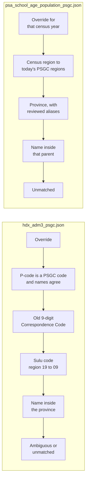

# Integration rules

One reviewed rules file per PSGC mapping table: the order of its rules, what it matches against, and every manual override with its reason, evidence, and the source release it was reviewed for. The generator in `src/integration/` turns each file into the map's build and gate SQL.

| File | Map table | Owner | Overrides | Decision |
|---|---|---|---|---|
| `hdx_adm3_psgc.json` | `hdx_adm3_psgc_map` | @saraevcldn | 12 | #93, D-052 |
| `psa_school_age_population_psgc.json` | `psa_school_age_population_psgc_map` | @maeveylain | 17, each for one census year | #159, D-055 |

The DepEd school map's rule is in [`config/mappings/integration/`](../mappings/integration/README.md); the PSA poverty and annex maps are written by hand in [`etl/04_integration/`](../../etl/04_integration/README.md).

## Rule order

Each file applies its rules top to bottom and stops at the first that decides. A row nothing decides stays in the map as `unmatched` with its reason; it is never dropped.



A name is matched only inside its parent province, never across the country, and an override applies only to the release it was reviewed for.

## Changing a rule or override

1. Edit the file in a reviewed pull request, with the evidence for each override.
2. Regenerate the SQL:

   ```bash
   python -m src.integration.hdx_adm3_psgc sql > etl/04_integration/03_map_hdx_adm3_psgc.sql
   python -m src.integration.hdx_adm3_psgc gate > etl/04_integration/90_validate_hdx_adm3_psgc_map.sql
   ```

   (`psa_school_age_population_psgc` writes `05_map_psa_school_age_population_psgc.sql` and its gate the same way.)

3. `tests/test_integration_hdx.py` and `tests/test_integration_school_age.py` fail until the committed SQL matches.
