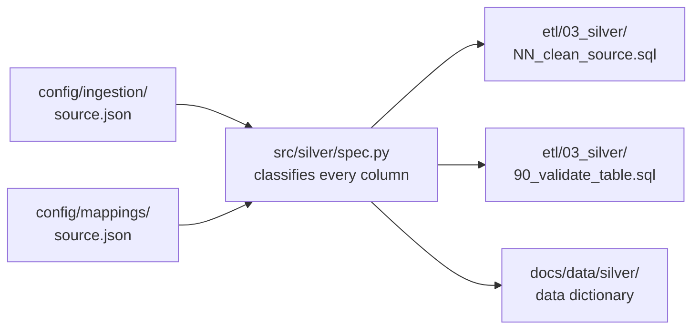

# Reviewed mappings

One file per source that decides how its Bronze text becomes typed, standardized Silver: which column is what, every accepted label, every flag, and when a row is quarantined. Nothing in Silver is decided in hand-written SQL; it is generated from these files.



A column or label that a file does not place stops the generator, and a label in the data that is not listed fails the Silver gate, so new publisher values are never cleaned silently.

## Files

| File | Owner | Generator | Decides | Decision |
|---|---|---|---|---|
| `deped_enrollment.json` | @hyenalouise | default (`spec.py`, `sql.py`) | Column classes and renames, every category and boolean label, character repairs, placeholders, overseas markers | D-022, D-023 |
| `deped_facilities.json` | @hyenalouise | `deped_facilities` | Count groups with their own maximums, the 60 yes/no columns, public scope, the missing-classroom flag | D-038 |
| `deped_personnel.json` | @mafelisilda | `deped_personnel` | Nullable integer measures, category labels, public scope, the principal-total comparison | D-041 |
| `deped_enrollment_psgc.json` | @maeveylain | `deped_enrollment_psgc` | The school-to-PSGC crosswalk: code padding, null reasons, the Sulu recode, coordinate checks | D-049 |
| `psa_psgc.json` | @maeveylain | `psa_psgc` | Codes, the income-class split, category labels, derived parent codes | D-035 |
| `psa_poverty_stat.json` | @maeveylain | `psa_poverty_stat` | The unpivot to one row per unit and year, the five measures, bounds, statistical flags | D-034 |
| `psa_school_age_population.json` | @saraevcldn | `psa_school_age_population` | The unpivot to place, sex, and age, place-label rules, levels and parents from the sums | D-053 |
| `hdx_boundaries.json` | @saraevcldn | `hdx_boundaries` | Code and date columns, exact decimals, geometry kept as published | D-040 |
| [`integration/`](integration/README.md) | | `src/integration/` | The DepEd school-to-PSGC matching rule; not a Silver mapping | D-049 |

Every file also sets its quarantine threshold, and many carry the profiled counts their gate records, with evidence for each rule.

## Changing a rule or a label

1. Edit the file in a pull request; the owner named in it approves.
2. Regenerate the Silver files:

   ```bash
   python -m src.silver.cli sql --source <source_id> > etl/03_silver/NN_clean_<source>.sql
   python -m src.silver.cli gate --source <source_id> > etl/03_silver/90_validate_<table>.sql
   python -m src.silver.cli dictionary --source <source_id> > docs/data/silver/<table-with-hyphens>.md
   ```

3. Run `python -m pytest tests -q`; the Silver tests fail until the committed files match.

Details: [Silver, Changing a rule](../../docs/operations/silver.md#changing-a-rule-or-approving-a-label). The DepEd rule lives in `integration/` because the Silver tests treat every top-level file here as a Silver mapping.
