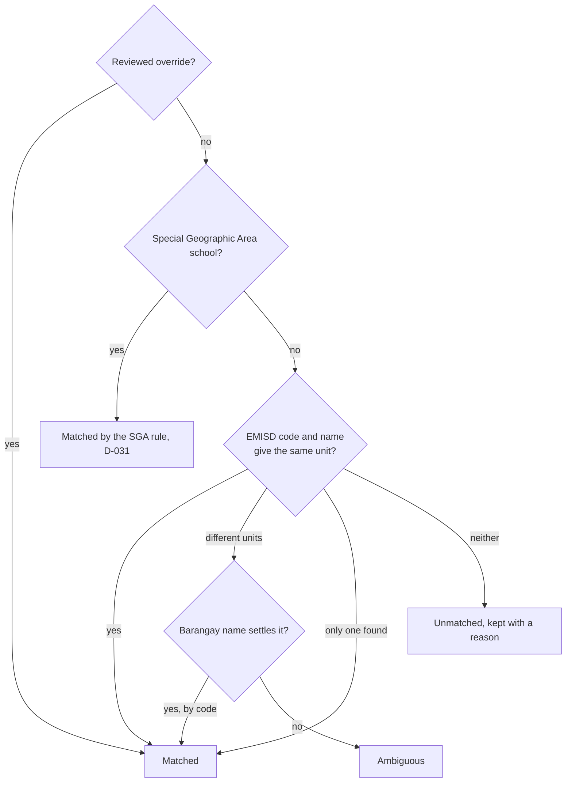

# Integration mappings

| File | Map table | Generator |
|---|---|---|
| `deped_school_psgc.json` | `deped_school_psgc_map` (#91, D-049) | `python -m src.integration.deped_school_psgc sql\|gate` |

The reviewed rule for matching each DepEd school and school year to a PSGC city or municipality, then a barangay: the rule order, Special Geographic Area handling, province splits, aliases, overrides with their evidence, the master PSGC version, and the match-rate floor the gate enforces. The city or municipality rule, in order:

The barangay rule follows the same order inside the accepted city or municipality, and a barangay outside it is marked ambiguous. The full wording of each step is in the file's `rule_order`.

The other PSGC maps keep their rules in [`config/integration/`](../../integration/README.md). How the map is built and checked: [Integration](../../../docs/operations/integration.md).
