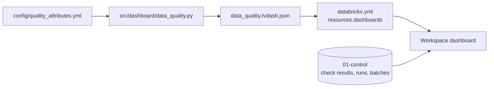
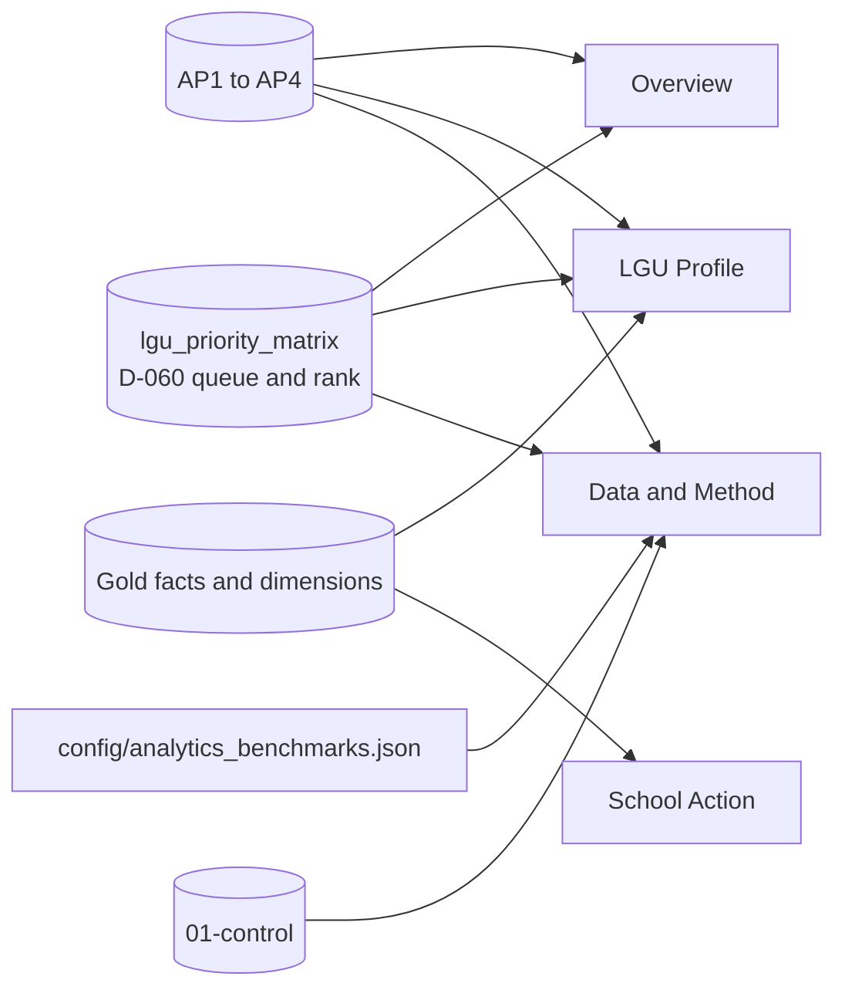

# Dashboards

Exported Databricks AI/BI dashboards (`.lvdash.json`), generated by `src/dashboard/` and deployed with the bundle: the data-quality dashboard for engineers and reviewers, and the LGU planner for planners.



| File | Dashboard | Generated by |
|---|---|---|
| `reached_planner.lvdash.json` | LGU planner (#96) | `python -m src.dashboard.planner`. Do not edit by hand; `tests/test_dashboard.py` fails if it differs |
| `data_quality.lvdash.json` | Data quality (#97) | `python -m src.dashboard.data_quality > dashboards/data_quality.lvdash.json`, from `config/quality_attributes.yml`. Do not edit by hand; `tests/test_dashboard.py` fails if it differs |

Deployed with the bundle: `resources.dashboards.data_quality` and `resources.dashboards.reached_planner` in `databricks.yml` (`databricks bundle deploy --target dev --profile reached-hq`, or **Deploy** from your workspace Git folder). On `dev` each is your own `[dev <you>]` copy. No refresh schedule during development (D-008): each refreshes when opened.

## Data quality

For data engineers and reviewers: what every gate recorded, and whether anything needs attention. It reads only the control tables in `` edu_access.`01-control` `` (`data_quality_results`, `pipeline_runs`, `ingestion_batches`, `current_batches`), never a data table, so it shows each layer, Gold included, only through what its gates recorded. All times are UTC. Counts are **check results, never data rows**; results hold counts and rules, never row values.

**Pages.** *Quality overview*: six counters, one donut per core attribute (Completeness, Uniqueness, Validity, Accuracy, Consistency, Timeliness: the pass rate of its current tests, or *No checks*; title only, the definitions are in the Definitions box), and four graphs: 1. current results by layer and status (bar, in pipeline order), 2. pass rate by source and core attribute (heatmap), 3. WARN and FAIL by source (bar), 4. result events per day (line). *Pipeline health*: latest job run, open issues (every current WARN and FAIL, with expected, actual, run, and code revision), source freshness, job runs, quarantine against the 1% limit, PSGC match rates, and Gold lineage. *Check explorer*: every result event in the date range, filterable by status (starts at WARN and FAIL), table, check, and job run. *Filters* (global): date range, layer, source.

### Current and history

`data_quality_results` is append-only, so counting all its rows would count each check once per run. The dashboard keeps two views apart:

| View | Datasets | One row per | Used for |
|---|---|---|---|
| Current | `ds_current` | Check: (`layer`, `source_id`, `table_name`, `check_name`, `batch_id`), its newest result | PASS/WARN/FAIL counters, pass rate, attribute donuts, the layer, source, and heatmap graphs, open issues, Gold lineage, quarantine, match rates |
| History | `ds_history` | Recorded result (event) in the date range, default the last 90 days | Daily trend, explorer event table |

Current rules:

- Each check keeps its own newest result, whichever run wrote it. Unlike the `quality_failures` alert (latest run only), a partial run does not hide an earlier FAIL of a check it did not run.
- `RANK`, as in the alerts: rows one gate statement wrote together all stay.
- Results of a delivery replaced by a newer version (succeeded, but no longer in `current_batches`) are left out. A failed or blocked delivery stays until it is retried.
- A check no gate runs any more, or a retired table's checks, keep their last result forever; its *Last checked* date shows how old it is. For example, a local database that ran the retired AP4 table `ap4_school_age_enrollment_gap` still shows its 23 results, 3 of them WARN, in Open issues. A database built only by the current code has none.

Other datasets: `ds_runs` (one row per job run, every run, not date-filtered; a Bronze load's own `run_id` is rolled up through `job_run_id`, and both sides are aggregated before the join, so nothing is counted twice. *Recorded steps* is what `pipeline_runs` holds; *Run status* is also `failed` when any gate recorded a FAIL as the newest result of a check in that run, because Gold and Analytics gates write no `pipeline_runs` row), `ds_freshness` (the rows the `stale_sources` alert emails).

### Metrics

| Metric | Definition |
|---|---|
| Current checks, PASS, WARN, FAIL | Sums over the current view. Empty, not 0, when nothing is recorded |
| Pass rate (tests) | PASS / (PASS + WARN + FAIL) over current results that are tests. Recorded counts are left out. Empty when there is no test result. Not a data-quality score |
| Attribute donut | The same pass rate for one core attribute's current tests; *No checks* when the attribute has none. A custom Vega-Lite widget, since standard pies have no hole |
| Stale-source WARNs | `source_fresh` WARNs in the latest freshness check (`config/freshness.yml` limits) |
| Result events | History only: how many results were recorded, so activity, not checks |

PASS: as expected. WARN: worth knowing, not necessarily wrong; the batch or build stands. FAIL: the batch or build is not trusted and its gate fails ([Data quality](../docs/architecture/overview.md#data-quality)).

### Quality attributes

`config/quality_attributes.yml` assigns each check one of Completeness, Uniqueness, Validity, Accuracy, Consistency, Timeliness, Referential integrity, Reconciliation, or Lineage, by exact name, then the name without a year, concept, school-year, or level qualifier (`_2018`, `_household`, `_total`, `_2023-24_bgy`, `/2023-24/ES`), then a declared name family (`labels_mapped_`, `level_count_`, `upstream_run_`). A Bronze sheet prefix (`2024 Total Pop: `) is removed first. *Recorded count* marks results that are always PASS by construction (rows a cleaning rule changed, matches per method, row kinds, and the counts Gold and Analytics gates record with no expected value, such as LGUs per tier or learners per level). A check that is not listed is **Unclassified**: shown, and covering no attribute. A donut that says *No checks* has no test, which is not a pass. `tests/test_dashboard.py` fails when a gate can write a check that is not listed.

### Gold and Analytics

The Gold tables follow [the data model](../docs/architecture/data-model.md): six dimensions and six facts, each published only after its `90_validate_*` gate passes, then five Analytics outputs. The dashboard shows them through those gates: current results by layer, WARN and FAIL by source (each Gold table and Analytics output is its own source), the fact-to-dimension key checks under Referential integrity (`*_in_dimension`, `*_fk_resolves`, `keys_in_dimension`), and *Gold lineage*, one `upstream_run_<table>` result per Silver or Integration table a Gold gate reads (PASS when that build succeeded in the same job run). It never reads a Gold table itself.

### Cost

Five small datasets over the control tables. Each widget runs its own query over its dataset, so the cost is kept low where it repeats:

- `ds_current`, behind most widgets, ranks to the newest result of each check first and classifies only those rows, so classifying does not grow with the history.
- History and the trend filter `checked_at_utc` itself (not a cast of it), so Delta skips files older than the range; the trend reads only its week, never the whole table.
- No refresh schedule, no new table, view, or job.

### Known limits

- Rendering in the workspace is not tested by CI: the JSON is checked for structure, and each dataset's SQL is run on DuckDB (made-up rows and a whole local job run). The first deploy must be checked by eye.
- `run_id` means the job run for every gate; a manual Bronze load outside the job has its own `run_id`.
- `expected` and `actual` are shown as recorded text, never parsed, so quarantine shares and match rates are listed, not charted. Only the DepEd school map tests its match rate (FAIL below 99%, per school year and level); the others record it.

## LGU planner

The ReachED LGU planner (#96), for LGU planners and Local School Boards. Generated by [`src/dashboard/planner.py`](../src/dashboard/planner.py) into `reached_planner.lvdash.json`; do not edit the JSON by hand.

```bash
python -m src.dashboard.planner
python -m pytest tests/test_dashboard_planner.py tests/test_local_job.py -q
```



It shows D-060's **classroom review queue**: an assessed LGU (at least 90% of learners in schools with a room count) with at least one public school at 50 or more learners per reported instructional room is in the queue, ranked by learners in those schools, then the number of those schools, then the pooled ratio; one with none is *No reported congestion*; the rest are *Data review*. The queue, its rank, and the AP3 reference statuses come from [`lgu_priority_matrix`](../etl/06_analytics/README.md) and the AP tables. The dashboard filters, labels and arranges them; it computes no rank or status. AP1, AP3, and AP4 are context and never move a place.

### The four views

| View | Question | Main content |
|---|---|---|
| **Overview** | Which places should we inspect first for crowded classrooms? | Map by review status, AP3 teacher references beside the queue, places by region and status, the ranked queue, review status against enrollment direction (context only) |
| **LGU Profile** | Why is this place in the queue, and where should the board look? | The place, its status and rank; counts of schools, classrooms, teachers and learners; four findings; the four questions answered for this place; the evidence against each reference; learners per teacher by level against its reference; enrollment, school-age population and resident children (context only); barangay access; the first schools to follow up; data coverage |
| **School Action** | Which schools should we check, and why? | The selected school, its place among schools in the same LGU, its enrollment, rooms and teachers, the exact figures to verify, the school action list |
| **Data and Method** | Can we rely on these results, and how were they produced? | How the queue is built, the published references, coverage and reasons for data review, how concentrated screened learners are, teacher references by level, enrollment-trend completeness, source years, data quality checks, limits |

### KPIs

| View | KPI | Definition |
|---|---|---|
| Overview | LGUs in the review queue | `classroom_priority_group = reported_congestion_screen` |
| | Learners in screened schools | `ap2_affected_learners`, with their share of public learners in view |
| | Screened schools | Public schools at or above 50 learners per reported room |
| | LGUs needing data review | Under 90% of learners have a room count |
| LGU Profile | Public schools, Instructional classrooms, Teachers, Public learners | AP1's school count, AP2's reported rooms, AP3's teachers, AP1's public enrollment, SY 2023-24 |
| School Action | Learners per reported room, Learners per teacher, Enrollment change, Temporary and makeshift rooms | The selected school, SY 2023-24 (enrollment change SY 2020-21 to 2025-26, when both years are complete) |
| Data and Method | Assessed LGUs, LGUs requiring data review, LGUs in the review queue, Screened schools | As on Overview, over Region, Province, and LGU type |

### Filters

Every filter is a query parameter applied after the published values are read, so a filter only narrows what is shown.

| Filter | Where it applies |
|---|---|
| Region, Province, LGU type (global) | Every view. Province options follow Region |
| City or municipality (LGU Profile; School Action) | A page filter on each of the two views. Both default to the top of the queue in Region, Province and LGU type; a choice outside them falls back to that place and says so |
| Barangay (LGU Profile; School Action) | The barangay table and school teaser on LGU Profile, and every school visual on School Action |
| Review status, Coverage status (Overview) | The KPIs, map, charts, and the queue table |
| Education level, School, School status (School Action) | Every School Action visual; status filters the action list only |
| Measure (Data and Method) | Coverage and reasons |

Databricks dashboards cannot open another page from a click or share a page filter between pages, so a planner picks the place on LGU Profile and again on School Action.

### Findings

The LGU Profile's four findings are fixed SQL rules over the same tables as its charts, one counter each, left empty when the data is incomplete: the classroom screen with the place's queue rank, the data review reason or the schools left out of the screen, the enrollment trend when every year is complete (context only), and barangays without a matched public elementary school. No generative AI is used, and no sentence states a cause.

### Limits

The dashboard cannot tell how many classrooms, teachers or schools to add, a teacher allocation priority, room type or condition, or how far learners travel. The 50-learner line is a PIDS-style illustrative screen on a broader room field, not an official DepEd ratio (D-060). Classroom and teacher figures exist only for SY 2023-24. Users validate screened schools against actual classroom counts, condition, shifts, enrolment projections, and planned projects before acting.

### Design

Theme, fonts, colors and counter styles live in the generator: `QUEUE_COLORS`, `TEACHER_COLORS`, `DIRECTION_COLORS`, the `*_STYLE` constants and `uiSettings` in [`planner.py`](../src/dashboard/planner.py). A design change made in the Databricks editor is overwritten by the next deploy, so export the dashboard and carry the change into the generator before deploying.
