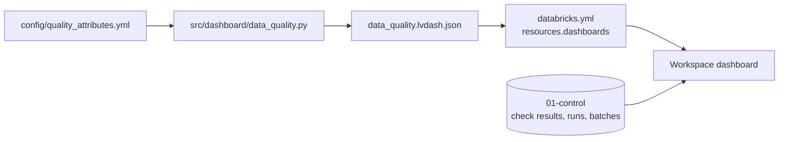
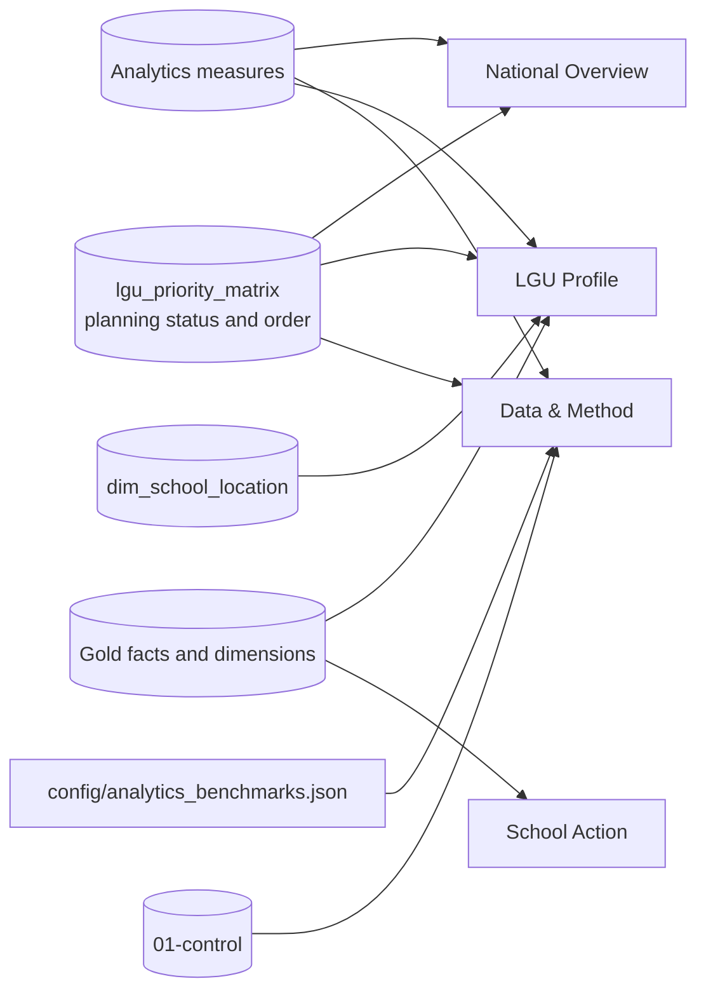

# Dashboards

Exported Databricks AI/BI dashboards (`.lvdash.json`), generated by `src/dashboard/` and deployed with the bundle: the data-quality dashboard for engineers and reviewers, and ReachED: Education Access Priority Dashboard (the LGU planner) for planners.



| File | Dashboard | Generated by |
|---|---|---|
| `reached_planner.lvdash.json` | ReachED: Education Access Priority Dashboard, the LGU planner (#96) | `python -m src.dashboard.planner`. Do not edit by hand; `tests/test_dashboard_planner.py` fails if it differs |
| `data_quality.lvdash.json` | Data quality (#97) | `python -m src.dashboard.data_quality > dashboards/data_quality.lvdash.json`, from `config/quality_attributes.yml`. Do not edit by hand; `tests/test_dashboard.py` fails if it differs |

Deployed with the bundle: `resources.dashboards.data_quality` and `resources.dashboards.reached_planner` in `databricks.yml` (`databricks bundle deploy --target dev --profile reached-hq-dev`, or **Deploy** from your workspace Git folder). On `dev` each is your own `[dev <you>]` copy. No refresh schedule during development (D-008): each refreshes when opened.

## Data quality

For data engineers and reviewers: what every gate recorded, and whether anything needs attention. It reads only the control tables in `` edu_access.`01-control` `` (`data_quality_results`, `pipeline_runs`, `ingestion_batches`, `current_batches`), never a data table, so it shows each layer, Gold included, only through what its gates recorded. All times are UTC. Counts are **check results, never data rows**; results hold counts and rules, never row values.

**Pages.** *Quality overview*: six counters, one donut per core attribute (Completeness, Uniqueness, Validity, Accuracy, Consistency, Timeliness: the pass rate of its current tests, or *No checks*; title only, the definitions are in the Definitions box), and four graphs: 1. current results by layer and status (bar, in pipeline order), 2. pass rate by source and core attribute (heatmap), 3. WARN and FAIL by source (bar), 4. result events per day (line). *Pipeline health*: latest job run, open issues (every current WARN and FAIL, with expected, actual, run, and code revision), source freshness, job runs, quarantine against the 1% limit, PSGC match rates, and Gold lineage. *Check explorer*: every result event in the date range, filterable by status (starts at WARN and FAIL), table, check, and job run. *Filters* (global): date range, layer, source.

### Current and history

`data_quality_results` is append-only, so counting all its rows would count each check once per run. The dashboard keeps two views apart:

| View | Datasets | One row per | Used for |
|---|---|---|---|
| Current | `ds_current` | Check: (`layer`, `source_id`, `table_name`, `check_name`, `batch_id`), its newest result | PASS/WARN/FAIL counters, pass rate, attribute donuts, the layer, source, and heatmap graphs, open issues, Gold lineage, quarantine, match rates |
| History | `ds_history` | Recorded result (event) in the date range, default the last 90 days | Daily trend, explorer event table |

Current rules:

- Each check keeps its own newest result, whichever run wrote it. Unlike the `quality_failures` alert (latest run only), a partial run does not hide an earlier FAIL of a check it did not run.
- `RANK`, as in the alerts: rows one gate statement wrote together all stay.
- Results of a delivery replaced by a newer version (succeeded, but no longer in `current_batches`) are left out. A failed or blocked delivery stays until it is retried.
- A check no gate runs any more, or a retired table's checks, keep their last result forever; its *Last checked* date shows how old it is. For example, a local database that ran the retired AP4 table `ap4_school_age_enrollment_gap` still shows its 23 results, 3 of them WARN, in Open issues. A database built only by the current code has none.

Other datasets: `ds_runs` (one row per job run, every run, not date-filtered; a Bronze load's own `run_id` is rolled up through `job_run_id`, and both sides are aggregated before the join, so nothing is counted twice. *Recorded steps* is what `pipeline_runs` holds; *Run status* is also `failed` when any gate recorded a FAIL as the newest result of a check in that run, because Gold and Analytics gates write no `pipeline_runs` row), `ds_freshness` (the rows the `stale_sources` alert emails).

### Metrics

| Metric | Definition |
|---|---|
| Current checks, PASS, WARN, FAIL | Sums over the current view. Empty, not 0, when nothing is recorded |
| Pass rate (tests) | PASS / (PASS + WARN + FAIL) over current results that are tests. Recorded counts are left out. Empty when there is no test result. Not a data-quality score |
| Attribute donut | The same pass rate for one core attribute's current tests; *No checks* when the attribute has none. A custom Vega-Lite widget, since standard pies have no hole |
| Stale-source WARNs | `source_fresh` WARNs in the latest freshness check (`config/freshness.yml` limits) |
| Result events | History only: how many results were recorded, so activity, not checks |

PASS: as expected. WARN: worth knowing, not necessarily wrong; the batch or build stands. FAIL: the batch or build is not trusted and its gate fails ([Data quality](../docs/architecture/overview.md#data-quality)).

### Quality attributes

`config/quality_attributes.yml` assigns each check one of Completeness, Uniqueness, Validity, Accuracy, Consistency, Timeliness, Referential integrity, Reconciliation, or Lineage, by exact name, then the name without a year, concept, school-year, or level qualifier (`_2018`, `_household`, `_total`, `_2023-24_bgy`, `/2023-24/ES`), then a declared name family (`labels_mapped_`, `level_count_`, `upstream_run_`). A Bronze sheet prefix (`2024 Total Pop: `) is removed first. *Recorded count* marks results that are always PASS by construction (rows a cleaning rule changed, matches per method, row kinds, and the counts Gold and Analytics gates record with no expected value, such as LGUs per tier or learners per level). A check that is not listed is **Unclassified**: shown, and covering no attribute. A donut that says *No checks* has no test, which is not a pass. `tests/test_dashboard.py` fails when a gate can write a check that is not listed.

### Gold and Analytics

The Gold tables follow [the data model](../docs/architecture/data-model.md): seven dimensions and six facts, each published only after its `90_validate_*` gate passes, then five Analytics outputs. The dashboard shows them through those gates: current results by layer, WARN and FAIL by source (each Gold table and Analytics output is its own source), the fact-to-dimension key checks under Referential integrity (`*_in_dimension`, `*_fk_resolves`, `keys_in_dimension`), and *Gold lineage*, one `upstream_run_<table>` result per Silver or Integration table a Gold gate reads (PASS when that build succeeded in the same job run). It never reads a Gold table itself.

### Cost

Five small datasets over the control tables. Each widget runs its own query over its dataset, so the cost is kept low where it repeats:

- `ds_current`, behind most widgets, ranks to the newest result of each check first and classifies only those rows, so classifying does not grow with the history.
- History and the trend filter `checked_at_utc` itself (not a cast of it), so Delta skips files older than the range; the trend reads only its week, never the whole table.
- No refresh schedule, no new table, view, or job.

### Known limits

- Rendering in the workspace is not tested by CI: the JSON is checked for structure, and each dataset's SQL is run on DuckDB (made-up rows and a whole local job run). The first deploy must be checked by eye.
- `run_id` means the job run for every gate; a manual Bronze load outside the job has its own `run_id`.
- `expected` and `actual` are shown as recorded text, never parsed, so quarantine shares and match rates are listed, not charted. Only the DepEd school map tests its match rate (FAIL below 99%, per school year and level); the others record it.

## LGU planner

**ReachED: Education Access Priority Dashboard** (#96), for LGU education planners and Local School Boards. It prioritizes validation, not allocation. Generated by [`src/dashboard/planner.py`](../src/dashboard/planner.py) into `reached_planner.lvdash.json`; do not edit the JSON by hand.

```bash
python -m src.dashboard.planner
python -m pytest tests/test_dashboard_planner.py tests/test_local_job.py -q
```



It shows D-061's planning priorities. A classroom-pressure signal, a teacher-pressure signal, and public-enrollment growth assign each LGU a review status: Priority 1, Priority 2, Priority 3, Monitor, No current pressure identified, or Data review. Every legend, axis, filter and table column uses the review status; the planning status (Immediate joint review and so on) is shown beside it as the plain-language reading. The status and national review order come from [`lgu_priority_matrix`](../etl/06_analytics/README.md); the dashboard only filters, labels, and presents them.

### Plain language

User-facing text never shows a rule or measure code. The database values stay unchanged: each dataset adds the planning status and a plain-language basis, so the wording can change without touching the Analytics contract.

| Review status | Planning status | Basis |
|---|---|---|
| Priority 1 | Immediate joint review | Classroom and teacher pressure are present, and enrollment is growing |
| Priority 2 | High-priority review | Both pressure signals are present, or one pressure signal is present with growing enrollment |
| Priority 3 | Targeted review | One pressure signal is present without growing enrollment |
| Monitor | Growth watchlist | Enrollment is growing, but no current pressure signal was identified |
| No current pressure identified | No current pressure identified | No pressure signal or enrollment growth was identified from available data |
| Data review | Insufficient data to assess | Coverage or growth data are incomplete and no known pressure signal is present |

| Code | Shown as |
|---|---|
| AP1 | School network context |
| AP2 | Classroom pressure |
| AP3 | Teacher pressure |
| AP4 | Enrollment direction |

Missing values are words, never `null`: **Not reported** for a missing source value, **Not assessed** when a coverage or comparability rule prevents a result, **Not assessable** for a school ratio with no usable denominator, **No verification flag** when a school was checked and has no flag, and `—` for not applicable. Zero is shown only when the source reports zero; a check that finds nothing says **None identified**. Teacher ratios show one decimal place, because the senior-high comparison point is 26.7. Table counts are written in the dataset SQL with thousands separators (`171,855`), since a table's own number format drops them. Published reasons a measure is not assessed are shown as complete labels (`REASONS` in the generator), such as *Classroom learner coverage below 90%* or *Geographic boundaries changed*.

### The four views

| View | Question | Main content |
|---|---|---|
| **National Overview** | Where should the Local School Board review first? | Planning priority map, top ten LGUs to review (with affected learners), review status by region (100% stacked bars, regions with the most Priority 1 and 2 first), what is driving priority (the two pressure signals, how many also grow, and the review status that results), the LGU review queue (city or municipality, province and region in their own columns), LGUs requiring data review and why, review status by LGU type, resident children and local enrollment by region (paired bars from the LGUs left after the filters, largest region first; no gap is calculated) |
| **LGU Profile** | What is driving the planning status in this LGU? | The LGU, its review status, planning status and basis, national review order out of all LGUs (and within the current scope when filtered), data readiness; four signal KPIs; a facts strip; why this LGU has this status; measures beside their comparison points; learners per reported teacher by level against the comparison point; enrollment over time; school-age population change; resident children and local enrollment (paired bars per census); where the LGU stands in its province (the LGUs of its province, or its region for an independent city, ranked by affected learners and coloured by review status, with the selected LGU marked and a line under the chart giving its status, affected learners and rank); school locations and barangay access (with the barangays that have no matched public elementary school); schools to validate first; data coverage and checks |
| **School Action** | Which schools should be validated first? | The selected school, what to verify first, four KPIs, classroom and teacher figures against their references (bullet bars: the room figure and one row per level, offered or not, with no number in the labels and the reference as the line), what should be verified (one row per flag with a next step), classroom and teacher pressure among schools in the LGU (learners per reported room against learners per teacher, sized by learners, coloured by the pressure each school shows (classroom and teacher, classroom only, teacher only, or neither; teacher pressure is an offered level above its own comparison point), with the classroom-screen line and the selected school drawn on top), a small school-location map (the selected school and nearby schools, coloured by school type: elementary only, secondary only, or integrated; sized by learners), how enrollment changed, reported rooms and teachers, the school validation list |
| **Data & Method** | How reliable are the results? | Coverage and freshness KPIs, the data review alert, how the review status is assigned, published comparison points, data coverage by measure, teacher-pressure assessment by level, why some LGUs need data review, enrollment trend availability, how concentrated classroom pressure is, available school years by source (Available or Not available), limitations, publication status |

### KPIs

Each KPI shows a short value, a number with its share or denominator (`219 (13.5%)`, `1,380 of 1,626`); what it means is in the card's subtitle. The value is written whole in the dataset SQL, so Databricks never abbreviates a count to `1.38K`. Cards are neutral; colour is kept for status.

| View | KPI | Value |
|---|---|---|
| National Overview | LGUs requiring immediate joint review | Priority 1, of all LGUs in view |
| | LGUs with a current pressure signal | Priority 1 to 3, of all LGUs in view |
| | Learners above classroom screen | `ap2_affected_learners`, millions shortened (share of public learners), SY 2023-24 |
| | LGUs requiring data review | Count of all LGUs in view |
| LGU Profile | Schools above classroom screen, Levels above teacher comparison, Public enrollment change, Lowest learner coverage | `84 of 411`, `1 of 3`, `+13.0%`, `99%`; Not assessed, Not comparable or Data review instead of zero |
| School Action | Learners per room, Learners per teacher, Enrollment change, Verification items | `352.5`, `88.1 vs 36` (the chosen level and only its comparison point), `+1.5%`, `2 verification items`; Not assessable, Incomplete or None when missing |
| Data & Method | Classrooms assessed, Teachers assessed, Comparable enrollment trends, Last refresh | LGUs passing each coverage or comparability rule, of LGUs in view; the date of the latest successful pipeline run |

The LGU Profile's facts strip (public schools, reported rooms, reported teachers, public learners) describes scale; it is not a KPI. Every National Overview and Data & Method count is out of the same total, all LGUs in view, so the cards can be read side by side. A filter that leaves nothing shows **No matching schools** in the school map line.

### Filters

Every filter is a query parameter applied after the published values are read, so a filter only narrows what is shown. Each filter sits beside what it changes.

| Filter | Where it applies |
|---|---|
| Region, Province, LGU type (global) | Every view. Province options follow Region |
| Review status, Data readiness (National Overview) | Every National Overview widget |
| City or municipality (LGU Profile; School Action) | A page filter on each of the two views. Both default to the top of the queue in the scope; a choice outside the scope falls back to that LGU and says so |
| Barangay (LGU Profile) | The school map, its coverage line and the barangay table only |
| School, Education level (School Action) | Every School Action widget. School is searchable |
| School status, Barangay (School Action) | The school validation list only |
| Measure (Data & Method) | Data coverage by measure and why some LGUs need data review |
| Suspected outliers (global) | Every view. *All schools (published result)* by default; *Without suspected outliers* shows every LGU figure recalculated without schools whose room or teacher ratio is past Tukey's outer fence (D-065) |

**Suspected outliers.** The default is the published result. *Without suspected outliers* reads the `without suspected outliers` rows of `lgu_priority_scenarios` in place of `lgu_priority_matrix`, `ap2_classroom_pressure` and `ap3_teacher_pressure` (the `mx`, `a2x` and `a3x` CTEs in the generator; the default reads its `published` rows, which equal those tables), so the review status, order, signals, affected learners, ratios, coverage and KPIs all change together. The LGU review list's **Outlier check** column and the LGU Profile details line say whether a result holds without those schools (*Result holds without them*, *Affected learners change*, *Coverage falls below 90%*, *A pressure signal changes*, *Review status changes*, or *No suspected outliers*). When the status or a signal changes only because the flagged schools take a coverage gate below 90%, it says *Status needs these schools verified* instead: the remaining data cannot confirm or rule out the pressure until those schools' figures are checked, which is not the same as less pressure. School Action keeps flagged schools in the validation list in both views, with *Suspected extreme figure* as a figure to verify; under *Without suspected outliers* the comparison scatter leaves them out (the selected school always stays).

Databricks dashboards cannot open another page from a click or share a page filter between pages, so a planner picks the LGU on LGU Profile and again on School Action.

### Maps

The National Overview map draws each LGU's HDX boundary once, as GeoJSON in a field named `geo_first(boundary)` (`ST_ASGEOJSON(FIRST(boundary))`) with a `custom` region pointing at it. Each LGU is coloured by its **Review status**, with the legend below the map and one colour per category in `QUEUE_COLORS`: Priority 1, Priority 2, Priority 3, Monitor, No current pressure identified, Data review. The tooltip shows the city or municipality, its review status, and its learners in screened schools. A line under the map states how many LGUs in view were drawn. LGUs without a published boundary stay in the review queue and are never read as no pressure.

The LGU Profile's **School locations and barangay access** map plots public schools from Gold `dim_school_location` with `boundary_status = 'inside'` only (SY 2023-24 published NSBI coordinates, tested against the city or municipality boundary). The line under it states `Mapped N of M public schools in view` and counts schools outside the boundary, with no usable coordinates, or with a boundary not validated. Points are coloured by school status (above the classroom screen, missing figure, zero rooms or teachers, within the screen) and sized by public learners. The map locates schools and supports discussion with the Schools Division Office; it does not show catchment areas, travel time, road access or nearest-school assignment. No barangay polygon is drawn: the repository has no reviewed barangay-boundary source yet, so barangays are filters and tooltip attributes.

School Action's **School location** map shows the selected school and the public schools within about 3 km of it (0.03 degrees either way), from the same `boundary_status = 'inside'` locations; it is empty when the selected school has no validated location.

### Limits

The dashboard cannot tell how many classrooms, teachers or schools to add, a staffing entitlement, room type or condition, or how far learners travel. The 50-learner classroom screen and teacher comparison points identify pressure signals; they do not measure shortages. Classroom and teacher figures exist only for SY 2023-24. Users validate flagged schools against actual classroom counts, condition, shifts, enrollment projections, and planned projects before acting.

Not done in the generator, because AI/BI dashboards cannot do it: a clear-filters button (each filter resets on its own), bullet and dumbbell chart types (bullets are bars against one reference line, on a share-of-reference scale), a diagonal reference line on a scatter, an outline or a different shape for one point (the selected school has its own colour; the selected LGU is marked in its name), a direct label on one bar or point (the province ranking has a line of the selected LGU's figures under it instead), direct labels on a line's latest value, collapsible sections, frozen table columns, a KPI title that changes with a filter, and a print layout. The National Overview map does not export to PDF; the point maps do.

### Design

Theme, fonts, colors and counter styles live in the generator: `QUEUE_COLORS`, `LEVEL_COLORS` (amber is beyond a reference everywhere), `COVERAGE_COLORS` (grey is assessed), `SCHOOL_COLORS`, `POINT_COLORS`, `MAP_COLORS`, `CHANGE_COLORS`, the `*_STYLE` constants and `uiSettings` in [`planner.py`](../src/dashboard/planner.py). Tables are plain text: coloured badge cells were tried and were hard to read. The selected school or LGU is the same strong blue (`SELECTED`) on every chart and map, and is drawn last so it sits on top. Point maps size each school by public learners; colour and size are the only point-map settings Databricks documents. Population increases and decreases use two neutral hues, not green and red, because growth is not always good and decline is not always bad. A design change made in the Databricks editor is overwritten by the next deploy, so export the dashboard and carry the change into the generator before deploying.
