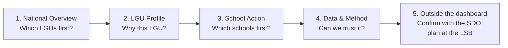
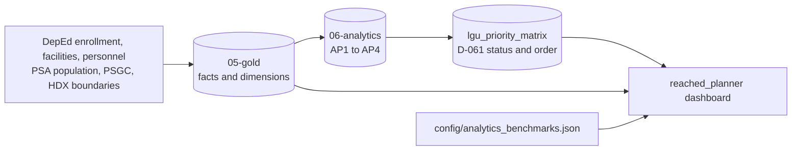

# ReachED planner: dashboard guide

A guide to **ReachED: Education Access Priority Dashboard** (`reached_planner`): who it is for, the question it answers, how every number is calculated, and what each chart is for. The technical notes on generating and deploying it are in the [dashboards README](README.md#lgu-planner).

**In one sentence:** the dashboard tells a Local School Board **which cities and municipalities, and then which schools, to review first** for classroom and teacher pressure, and says plainly where the data is not good enough to tell.

## Contents

- [What it is for](#what-it-is-for)
- [How to use it: the five steps](#how-to-use-it-the-five-steps)
- [How the review status is calculated](#how-the-review-status-is-calculated)
- [Page 1: National Overview](#page-1-national-overview)
- [Page 2: LGU Profile](#page-2-lgu-profile)
- [Page 3: School Action](#page-3-school-action)
- [Page 4: Data & Method](#page-4-data--method)
- [Filters](#filters)
- [Comparison points and where they come from](#comparison-points-and-where-they-come-from)
- [How missing data is shown](#how-missing-data-is-shown)
- [A worked example: Tanza, Cavite](#a-worked-example-tanza-cavite)
- [The national picture](#the-national-picture)
- [What the dashboard cannot tell you](#what-the-dashboard-cannot-tell-you)
- [How it is built](#how-it-is-built)
- [Glossary](#glossary)

## What it is for

| | |
|---|---|
| **Business question** | How should we prioritize the provision of classrooms and teachers among cities based on their respective enrollment needs? |
| **Users** | LGU Local School Boards (provincial, city and municipal), working with the Schools Division Superintendent. The boards decide how the Special Education Fund (SEF) is spent |
| **Unit** | City or municipality (1,642 regular LGUs), then the public schools inside one |
| **Scope** | Public basic education, Kindergarten to Grade 12 |
| **Answer it gives** | A **review status** for every LGU (Priority 1 to 3, Monitor, No current pressure identified, Data review) and a **review order** from 1 to 1,642 |
| **Decision boundary** | It prioritizes *validation*, not *allocation*. It says where to look first, never how many classrooms or teachers to add |

### How the four analytical questions feed the answer

| Analytical question | Shown as | Role in the review status |
|---|---|---|
| **AP1** Which LGUs have fewer public schools relative to students and population? | School network context: learners per public school, school map, barangays without a matched public elementary school | **Context only.** Never changes the status |
| **AP2** Which LGUs have the most public-school students per classroom? | Classroom pressure | **Signal 1** |
| **AP3** Which LGUs have the most public-school students per teacher? | Teacher pressure | **Signal 2** |
| **AP4** Which LGUs have the largest gap between school-age population and enrollment over time? | Enrollment direction; resident children and local enrollment | **Public-enrollment growth decides between levels.** The population gap is context only |

The status is a simple rule, not a weighted score. The two pressures are kept separate, and growth decides how urgent they are.

## How to use it: the five steps



1. **National Overview.** Filter to your region or province. Read the KPIs, then the **LGU review list**, to see where your LGU stands.
2. **LGU Profile.** Choose the city or municipality. The status line and **Why this LGU has this status** show which signals are present. The charts show the evidence behind each one.
3. **School Action.** Choose the same LGU. It opens on the **first school to verify**. Use the validation list to see every school in order.
4. **Data & Method.** Check how complete the data is before relying on a result.
5. **Act outside the dashboard.** Download the school validation list, confirm the flagged figures with the Schools Division Office (SDO), and bring the confirmed list to the Local School Board for SEF planning.

## How the review status is calculated

Every LGU gets two pressure signals and one growth signal. All three are built in the Analytics layer (`lgu_priority_matrix`, rule **D-061**). The dashboard only reads, filters and labels them.

### Signal 1: classroom pressure (AP2)

```text
school ratio      = school's total learners (all levels) / school's reported instructional rooms (all levels)
school passes     = school ratio >= 50
learner coverage  = learners in schools with a usable room count / all public learners in the LGU

classroom pressure = Present        when learner coverage >= 90% and at least one school passes
                     Not identified when learner coverage >= 90% and no school passes
                     Not assessed   when learner coverage < 90% or no school has a usable room count
```

- **Source:** DepEd School Facilities (NSBI) instructional rooms and DepEd enrollment, SY 2023-24.
- **Why 50:** the PIDS Discussion Paper 2025-10 illustrative congestion line. The dashboard calls it the **classroom screen** or **room reference**. It is a review screen, not an official DepEd ratio or a shortage formula.
- **Why all levels together:** rooms are shared across levels. 768 public schools have junior-high learners but report only elementary rooms.
- **Affected learners (classroom)** = all learners in the schools that pass.
- A school with no room count, or 0 rooms, is left out of the ratio and listed for verification. It is never treated as 0.

### Signal 2: teacher pressure (AP3)

```text
for each level the LGU offers (Elementary, Junior high, Senior high):
    learners per teacher = level learners / level teachers, summed over the LGU's schools
    level is above       = learners per teacher > comparison point
    (comparison points: Elementary 35.0, Junior high 36.0, Senior high 26.7)

teacher pressure = Present        when at least one level with >= 90% learner coverage is above its comparison point
                   Not identified when every covered level is at or below
                   Not assessed   when coverage fails and no level is above
```

- **Source:** DepEd personnel, SY 2023-24. Teachers are Teacher I–III, Master Teacher, Head Teacher, SPED/SNED, Special Science teachers, Instructors, and locally funded teachers. Principals and non-teaching staff are excluded.
- **Affected learners (teacher)** = learners in the levels that are above their comparison point.
- An annex that reports 0 teachers keeps its learners in the LGU total, because its teachers are counted at the mother school.

### Signal 3: enrollment growth (AP4)

```text
growing = public-school enrollment in SY 2025-26 > public-school enrollment in SY 2020-21
```

Growth is only assessed when both years are complete for the LGU and its boundaries did not change. If growth cannot be assessed, an LGU with a known pressure is placed **as if it were not growing**, so a missing trend never raises a status.

### The rule

| Classroom pressure | Teacher pressure | Growing enrollment | Review status | Planning status |
|---|---|---|---|---|
| Present | Present | Yes | **Priority 1** | Immediate joint review |
| Present | Present | No | **Priority 2** | High-priority review |
| One present | The other not | Yes | **Priority 2** | High-priority review |
| One present | The other not | No | **Priority 3** | Targeted review |
| Neither | Neither | Yes | **Monitor** | Growth watchlist |
| Neither | Neither | No | **No current pressure identified** | No current pressure identified |
| No known pressure | A coverage gate failed, or growth not assessed | — | **Data review** | Insufficient data to assess |

"One present, the other not" includes "the other not assessed": **a known pressure always counts**, even when another measure is incomplete. Missing evidence is never read as "no pressure".

### The review order

Within the statuses, LGUs are ordered by:

1. review status (Priority 1 first);
2. number of current pressures (2 before 1);
3. **affected learners**: the larger of classroom-affected and teacher-affected learners, never their sum, because the same learners can be in both;
4. classroom-affected learners;
5. number of teacher levels under pressure;
6. absolute enrollment growth, then percentage growth;
7. PSGC code, so the order is always the same.

The result is the **national review order**, 1 to 1,642. It is an order for checking, not a performance rank.

## Page 1: National Overview

**Question:** *Where should the Local School Board review first?*

| Widget | What it shows | How it is calculated | What it answers |
|---|---|---|---|
| **LGUs for immediate joint review** (KPI) | Priority 1 LGUs, of all LGUs in view | Count of `Priority 1` / count in view | How many LGUs need every kind of attention at once |
| **LGUs with a current pressure signal** (KPI) | Priority 1 to 3, of all LGUs in view | Count with at least one pressure | How widespread pressure is |
| **Learners above room reference** (KPI) | Learners in schools at or above 50 per room, and their share of public learners | Sum of classroom-affected learners / all public learners, SY 2023-24 | How many learners sit in crowded schools (AP2) |
| **LGUs needing data review** (KPI) | Data review LGUs, of all in view | Count of `Data review` | Where the dashboard cannot judge |
| **Planning priority across the Philippines** (map) | Every LGU coloured by review status | LGU boundaries from HDX, matched by PSGC code | Where Priority 1 and 2 LGUs cluster |
| **Map coverage** (line) | How many LGUs were drawn | LGUs with a published boundary / LGUs in view | Whether a blank area is missing data, not "no pressure" |
| **LGUs for priority review** (table) | The first ten LGUs in the review order, with affected learners | Top 10 by `priority_order` | The shortlist to open first |
| **Review status by region** (100% bars) | Each region's LGUs split by status | Count per region and status / LGUs in region; regions with the most Priority 1 and 2 first | Which regions carry the most pressure |
| **How review status is assigned?** (table) | Every combination of the two pressures, how many LGUs have it, how many also grow, and the status that results | Count per (classroom signal, teacher signal), and count with growth | Why LGUs end up where they are; the rule in numbers |
| **LGU review list** (table) | Every LGU in order: province, region, status, planning status, pressure signals, affected learners, data readiness | The full `lgu_priority_matrix` in `priority_order` | The complete queue, to find any LGU |
| **LGUs needing data review** (table) | The Data review LGUs and why | Published reasons, e.g. *Classroom learner coverage below 90%* | Which figures must be completed before the LGU can be judged |
| **Review status by LGU type** (bars) | Status shares for cities and municipalities | Count per type and status / LGUs of that type | Whether cities and municipalities differ |
| **Resident children and local enrollment by region** (paired bars) | Resident children aged 5–17 (2024) beside learners enrolled in local schools (SY 2024-25), per region | Sums over the LGUs in view; no gap is calculated | AP4 context: where children live versus where they enroll |

**How to read it:** start with the KPIs, look at your region in the map and the region bars, then find your LGU in the review list and open it on LGU Profile.

## Page 2: LGU Profile

**Question:** *What is driving the planning status in this LGU?* It opens on the first LGU in the review order within your filters; choose another with **City or municipality**.

### Header and KPIs

| Widget | What it shows | How it is calculated |
|---|---|---|
| **Selected city or municipality** | The LGU name | — |
| **LGU details** | Type, province or region, national review order out of 1,642 (and within the current filters), data readiness | `priority_order`; data readiness is *Assessed*, *Partly assessed* (a measure or the trend could not be assessed) or *Insufficient data* |
| **Facts** | Public schools, reported rooms, reported teachers, public learners, SY 2023-24 | Sums over the LGU's public schools. Scale, not a KPI |
| **Schools above room reference** (KPI) | e.g. `18 of 21` | Schools at or above 50 learners per room / schools with a usable room count (AP2) |
| **Levels above teacher reference** (KPI) | e.g. `3 of 3` | Levels above their comparison point / levels assessed (AP3) |
| **Public enrollment change** (KPI) | e.g. `+13.4%` | (SY 2025-26 − SY 2020-21) / SY 2020-21, public schools (AP4) |
| **Lowest learner coverage** (KPI) | e.g. `100%` | The lowest learner coverage across the classroom and teacher measures. Below 90% means a measure is not assessed |
| **Review status** | Status, planning status and the plain-language basis | From the rule above |

### Evidence

| Widget | What it shows | What it answers |
|---|---|---|
| **Why this LGU has this status** (table) | One row per signal (classroom, teacher, growth) with Yes / No / Not assessed and the exact basis, e.g. *18 of 21 schools at or above 50 learners per reported room (69,123 learners, 92.2% of public learners)* | Which signals put the LGU in its status: the core answer for the board |
| **Key measures and references** (table) | Each measure beside its comparison point and coverage: the classroom school screen, the pooled classroom ratio (context), learners per teacher for each level, learners per public school (context) | How far above or below each reference the LGU is |
| **Learners per reported teacher by level** (bars with a reference line) | Each level's ratio as a share of its comparison point; past the line is above | Which levels drive teacher pressure (AP3) |
| **Enrollment by school year** (line) | Public-school and all-sector enrollment, SY 2020-21 to 2025-26 | Whether enrollment is growing, and its shape over time (AP4) |
| **Change in school-age population, 2020–2024** (bars) | % change in resident children by age band: Kindergarten (5), Elementary (6–11), Junior high (12–15), Senior high (16–17) | Which levels will see more or fewer children (AP4 context). Two neutral colours: growth is not "good" and decline is not "bad" |
| **Resident children and local enrollment** (paired bars) | Resident children 5–17 beside all-sector enrollment in local schools, 2020 and 2024 censuses | AP4 context. Learners may cross LGU lines, so the two numbers are not a shortage |
| **Where does this LGU stand in its province?** (bars) | Every LGU in the province (or the region, for an independent city), ranked by affected learners and coloured by status; the selected LGU is marked *(selected)* | How it compares with its neighbours |
| **Selected LGU** (line under the chart) | The LGU's status, affected learners and rank in its province | The same, in words |

### Reach (AP1)

| Widget | What it shows | How it is calculated |
|---|---|---|
| **Public-school locations** (map) | Public schools with validated coordinates, coloured by status (above classroom screen, missing figure, zero rooms or teachers, within screen) and sized by learners | NSBI coordinates, SY 2023-24, kept only when they fall inside the LGU boundary |
| **School map coverage** (line) | `Mapped N of M public schools in view` and why the rest are missing | Schools outside the boundary or without usable coordinates are counted, not drawn |
| **Barangays without a matched public elementary school** (table) | Each such barangay: urban or rural, public schools in it, learners | PSGC barangays with no active public school offering elementary with elementary learners, matched by barangay code |

The barangay table follows DepEd Order No. 40, s. 2014, which expects a Kindergarten-to-Grade-6 school in every barangay. A barangay on the list may still be served by a school next door, so it is a list to check, not a count of missing schools.

### Schools and reliability

| Widget | What it shows |
|---|---|
| **Schools to verify first** (table) | The first five schools from School Action's validation list, with learners per room, verification status, why listed and the next step |
| **Data coverage and checks** (table) | The share of learners each measure covers, and schools excluded for missing or zero figures |

## Page 3: School Action

**Question:** *Which schools should be validated first?* Pick the LGU again (Databricks cannot share a page filter across pages). The page opens on the **first school to verify**.

### How schools are ordered

```text
1. schools with at least one verification item, then schools with none
2. within each group, highest learners per reported room first
3. then school name
```

Verification items, in the order shown:

| # | Item | When it is flagged | Next step |
|---|---|---|---|
| 1 | Reported room count | No instructional room count is reported | Ask the SDO for the room count in the latest facilities report |
| 2 | Reported room count | 0 rooms reported while learners are enrolled | Confirm the rooms in use with the school |
| 3 | Enrollment total | An offered level has no learner count | Confirm enrollment by level with the school |
| 4 | Teacher count | No teacher count for an offered level | Confirm teachers by level with the SDO |
| 5 | Teacher count | 0 teachers at an offered level | Confirm teachers by level with the SDO |
| 6 | Classroom pressure | Learners per room at or above 50 | Confirm rooms in use and enrollment with the school before planning |

A school with none of these shows **No verification flag**.

### Widgets

| Widget | What it shows | What it answers |
|---|---|---|
| **Selected school**, **School details** | Name; school ID, barangay, main or annex, levels, learners, the LGU's review status | Which school this is |
| **What to verify** (KPI) | The first figure to verify, e.g. *Verify reported room count and enrollment* | What to ask the school first |
| **Learners per room** (KPI) | All levels, reported rooms, against the screen of 50 | Classroom pressure at this school |
| **Learners per teacher** (KPI) | For the chosen level, against its comparison point, e.g. `53.2 vs 35` | Teacher pressure at this school |
| **Enrollment change** (KPI) | SY 2020-21 to SY 2025-26 | Whether the school is growing |
| **Figures to verify** (KPI) | Number of verification items | How much to confirm |
| **Classroom and teacher figures against their references** (bullet bars) | Learners per room and learners per teacher at each level, as a share of their reference; the line is the reference | Which figures are past their reference, on one scale |
| **What needs to be verified?** (table) | One row per verification item with why and the next step | The to-do list for this school |
| **Classroom and teacher pressure among schools in this LGU** (scatter) | Every school offering the chosen level: learners per room (x) against learners per teacher (y), sized by learners, coloured by the pressure it shows (both, classroom only, teacher only, neither); the selected school is drawn on top | Whether the school is an outlier or part of a town-wide pattern |
| **Nearby public schools** (map) | The selected school and public schools within about 3 km, coloured by type (elementary only, secondary only, integrated), sized by learners | Whether nearby schools could share the load. Straight-line distance, not travel time |
| **How has enrollment changed in this school?** (line) | Total and per-level enrollment by school year | Whether the pressure is new or long-standing |
| **Reported rooms and teachers** (table) | Learners and teachers by level, rooms for the whole school, temporary or makeshift rooms, locally funded teachers | The raw figures behind the ratios |
| **School validation list** (table, downloadable) | Every school in the LGU in validation order, with ratios, verification status, why listed and next step. Filter by **School status** and **Barangay** | **The list the LGU takes to the SDO** |

## Page 4: Data & Method

**Question:** *How reliable are the results?*

| Widget | What it shows | How it is calculated |
|---|---|---|
| **Classroom data coverage** (KPI) | LGUs with at least 90% learner coverage for classrooms | LGUs passing the AP2 gate / LGUs in view |
| **Teacher data coverage** (KPI) | LGUs with at least 90% coverage for teachers | LGUs passing the AP3 gate / LGUs in view |
| **Comparable enrollment trends** (KPI) | LGUs whose trend can be assessed | Both end years complete and boundaries unchanged |
| **Last data update** (KPI) | Date of the latest successful pipeline run | From the pipeline control tables |
| **Data review alert** | How many LGUs need data review | Count of `Data review` |
| **How the review status is assigned** (table) | The rule, one row per status | The D-061 rule above |
| **Published comparison points** (table) | 50 per room; 35, 36 and 26.7 per teacher; with their sources | `config/analytics_benchmarks.json` |
| **Data coverage by measure** (bars) | Share of LGUs with sufficient, incomplete or unavailable data per measure | Coverage gates per measure; filtered by **Measure** |
| **Teacher-pressure assessment by level** (bars) | Share of LGUs above, at or below, or not assessed, per level | Level ratio against its comparison point, LGUs offering the level |
| **Why some LGUs need data review** (bars) | The inputs that could not be assessed; one LGU can have several reasons | Published not-assessed reasons; filtered by **Measure** |
| **Enrollment trend availability** (bars) | LGUs with a comparable trend, and why the others have none | AP4 trend status |
| **Share of learners above room reference** (bars) | Assessed LGUs grouped by the share of their learners in schools at or above 50: none, under 10%, 10–25%, 25–50%, 50% or more | `ap2_affected_learner_share_pct` banded |
| **Available school years by source** (table) | Available / Not available per school year for enrollment, classrooms and teachers | Shows that classroom and teacher data exist only for SY 2023-24 |
| **What this dashboard cannot tell you** (text) | The limits listed below | — |
| **Technical data health** | A short status of the latest refresh | — |

## Filters

| Filter | Where | Effect |
|---|---|---|
| Region, Province, LGU type | Every page | Narrow the LGUs in view. Province options follow Region |
| Review status, Data readiness | National Overview | Every widget on that page |
| City or municipality | LGU Profile, School Action (separately) | Defaults to the top of the queue in the filters |
| Barangay | LGU Profile | The school map and the barangay table only |
| School, Education level | School Action | Every School Action widget. School is searchable |
| School status, Barangay | School Action | The validation list only |
| Measure | Data & Method | The coverage and data-review reason charts only |

Filters only narrow what is shown. The status and the national review order never change with a filter. LGU Profile also shows the LGU's order within the current filters.

## Comparison points and where they come from

| Measure | Value | Source | What it is not |
|---|---|---|---|
| Learners per reported room | **50** | PIDS Discussion Paper 2025-10, summarized by EDCOM 2 (illustrative congestion line) | Not an official DepEd ratio, an RA 7880 shortage calculation, or a construction entitlement |
| Elementary learners per teacher | **35.0** | World Bank Philippines Education Note, from older DepEd service standards (historical study reference) | Not a current national staffing standard |
| Junior high learners per teacher | **36.0** | DepEd DM-OUHROD-2025-1226 (CALABARZON RM 379, s. 2025): 45 learners per class × 4 classes / 5 teachers | Not a staffing entitlement |
| Senior high learners per teacher | **26.7** | Same memo: 40 learners per class × 6 classes / 9 teachers | Not a staffing entitlement |

Why derive 36 and 26.7: the memo publishes 45 and 40 as learners *per class*. A secondary class has several subject teachers, so comparing a per-teacher ratio with 45 would under-flag pressure. The memo's own teacher-to-class factors convert it to learners per teacher.

All four values live in [`config/analytics_benchmarks.json`](../config/analytics_benchmarks.json).

## How missing data is shown

| Shown as | Meaning |
|---|---|
| **Not reported** | The source has no value |
| **Not assessed** | A coverage or comparability rule prevents a result (for example, learner coverage below 90%) |
| **Not assessable** | A school ratio has no usable denominator (no rooms or no teachers) |
| **No verification flag** | The school was checked and nothing needs confirming |
| **None identified** | A check found nothing |
| **—** | Not applicable |

A missing value is never shown as 0, and missing evidence is never read as "no pressure".

## A worked example: Tanza, Cavite

Read from the sandbox dashboard data (SY 2023-24 classrooms and teachers; enrollment SY 2020-21 to 2025-26).

| Step | What the dashboard shows |
|---|---|
| National Overview | Tanza is **#7 of 1,642** in the review order: Priority 1, Immediate joint review, Classroom + Teacher, 74,952 affected learners. City of General Trias, also in Cavite, is #8 |
| Classroom pressure | **18 of 21** public schools at or above 50 learners per room; 69,123 learners, 92.2% of public learners. Pooled ratio: 65.1 learners per room |
| Teacher pressure | **3 of 3** levels above: Elementary 41.3 vs 35.0, Junior high 36.1 vs 36.0, Senior high 35.7 vs 26.7 |
| Growth | Public enrollment **+13.4%**, 63,562 (SY 2020-21) to 72,082 (SY 2025-26). It peaked at 75,099 in SY 2022-23 |
| Status | Both pressures and growth: **Priority 1** |
| Reach (context) | 25 of 41 barangays have no matched public elementary school; 23 have no matched public school at all |
| First school to verify | **Punta Elementary School** (Punta II): 3,297 learners, 137.4 per room, 53.2 per teacher. Next step: confirm rooms in use and enrollment with the school |
| Validation list | 21 schools; 18 need verification |

## The national picture

From the dashboard on 22 October 2026, all LGUs in view.

| | |
|---|---|
| Priority 1 (immediate joint review) | **219 of 1,642** (13.3%) |
| Priority 1 to 3 (at least one pressure) | **1,378 of 1,642** |
| Learners in schools at or above 50 per room | **6.48M**, 27.9% of public learners |
| Data review | **16 of 1,642** |
| LGUs drawn on the map | 1,634 of 1,642 |

| Classroom pressure | Teacher pressure | LGUs | Of which growing | Status |
|---|---|---:|---:|---|
| Present | Present | 712 | 219 | Priority 1 if growing, else 2 |
| Present | Not identified | 374 | 65 | Priority 2 if growing, else 3 |
| Present | Not assessed | 28 | 4 | Priority 2 if growing, else 3 |
| Not identified | Present | 240 | 28 | Priority 2 if growing, else 3 |
| Not assessed | Present | 24 | 19 | Priority 2 if growing, else 3 |
| Not identified | Not identified | 248 | 25 | Monitor if growing, else no current pressure |
| Not identified | Not assessed | 5 | 1 | Data review |
| Not assessed | Not identified | 7 | 1 | Data review |
| Not assessed | Not assessed | 4 | 2 | Data review |

Top ten in the review order, all Priority 1 with classroom and teacher pressure: City of Davao (171,855 affected learners), City of Antipolo (154,188), City of Zamboanga (106,930), City of Valenzuela (92,509), City of San Jose Del Monte (85,979), City of Calamba (75,346), Tanza (74,952), City of General Trias (74,604), City of Cebu (62,075), City of Pasig (58,523).

These figures change when the pipeline runs on new data. Read the live dashboard for current values.

## What the dashboard cannot tell you

- **How many** classrooms, teachers or schools to add, or a staffing entitlement.
- Room **type or condition**, shifts, or rooms under construction.
- How far learners **travel**, catchment areas, or which school a child attends.
- Where learners **live**: enrollment is counted where the school is.
- **Trends** in classroom and teacher figures: they exist only for SY 2023-24.

The classroom screen and the teacher comparison points flag pressure for review; they do not measure shortages. EDCOM 2's teacher shortage estimate (114,680) is a different kind of number and should not be compared with the dashboard's counts. Validate flagged schools against actual classroom counts, condition, shifts, enrollment projections and planned projects before acting.

## How it is built



| Part | Where |
|---|---|
| Status and order | `` edu_access.`06-analytics`.lgu_priority_matrix ``, built by [`etl/06_analytics/05_build_priority_matrix.sql`](../etl/06_analytics/README.md) and published only after its validation gate passes |
| AP measures | `ap1_school_provision`, `ap2_classroom_pressure`, `ap3_teacher_pressure`, `ap4_enrollment_trend` ([analytics outputs](../docs/data/analytics-outputs.md)) |
| School pages | Gold facts and dimensions, including `dim_school_location` for the maps |
| Dashboard | Generated by [`src/dashboard/planner.py`](../src/dashboard/planner.py) into `reached_planner.lvdash.json`. Do not edit the JSON by hand: carry editor changes into the generator |
| Formulas | [Metric specification](../docs/business/metric-specification.md) |
| Decisions | D-061 (priority rule), D-047 (levels, annexes, teacher fields) in [decisions](../docs/governance/decisions.md) |

## Glossary

| Term | Meaning |
|---|---|
| **LGU** | Local government unit: here, a city or municipality |
| **Review status** | Priority 1, 2, 3, Monitor, No current pressure identified, or Data review |
| **Planning status** | The plain-language reading of the review status, e.g. *Immediate joint review* |
| **Review order** | The LGU's place, 1 to 1,642, in the order for checking |
| **Classroom screen / room reference** | 50 learners per reported instructional room |
| **Comparison point / teacher reference** | 35, 36 or 26.7 learners per teacher, by level |
| **Affected learners** | The larger of classroom-affected learners (in schools at or above 50 per room) and teacher-affected learners (in levels above their comparison point) |
| **Learner coverage** | The share of an LGU's public learners whose school reports a usable room or teacher count. Below 90%, a measure is not assessed |
| **Data readiness** | Assessed, Partly assessed, or Insufficient data |
| **SDO** | Schools Division Office |
| **LSB / SEF** | Local School Board / Special Education Fund |
| **NSBI** | The DepEd system behind the School Facilities data |
| **PSGC** | Philippine Standard Geographic Code, used to match DepEd and PSA records |
