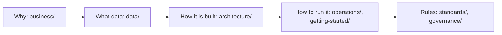

# Documentation guide

Use this page as the entry point. Each subject has one canonical location; other
documents should link to it rather than duplicate current-state claims.

| Folder | Read it for |
|---|---|
| [`business/`](business/README.md) | The planners, the approved questions, and the metric formulas |
| [`data/`](data/README.md) | Each source, the Silver tables, and how the sources join |
| [`architecture/`](architecture/README.md) | Pipeline stages, the job graph, the Gold model, and the ERD |
| [`operations/`](operations/README.md) | Running and checking each layer, and the team workflow |
| [`getting-started/`](getting-started/README.md) | Setting up a laptop |
| [`standards/`](standards/README.md) | Naming and the table registry |
| [`governance/`](governance/README.md) | Decisions and known limitations |

## Find a document

| Need | Read |
|---|---|
| Understand pipeline stages and system boundaries | [Architecture overview](architecture/overview.md) |
| Review the Gold tables, grains, keys, and columns | [Data model](architecture/data-model.md) |
| See the business entities and how they relate | [Entity-relationship diagram](architecture/erd.md) |
| Review stakeholder and question framing | [Business framing](business/README.md) |
| Read the approved business and analytical questions | [Business and analytical questions](business/business-analytics-problem.md) |
| Look up an AP formula, grain, or missing-data rule | [Metric specification](business/metric-specification.md) |
| Understand how public-school funding is authorized and delivered | [Philippine public-school funding flow](business/ph-public-school-budget-flow.md) |
| Find a source card, profile, or dictionary | [Source inventory](data/source-inventory/README.md) |
| Review joinability and coverage evidence | [Cross-source analysis](data/cross-source/README.md) |
| Look up a Silver column | [Silver tables](data/silver/README.md) |
| Set up a workstation | [Terminal setup](getting-started/terminal-setup.md) |
| Get the raw files the job loads | [Raw files the job needs](getting-started/raw-data.md) |
| Understand ingestion behavior | [Ingestion](operations/ingestion.md) |
| Understand Silver cleaning, quarantine, and checks | [Silver](operations/silver.md) |
| Understand the PSGC mapping tables | [Integration](operations/integration.md) |
| Compare totals from source file to Gold | [Validation](operations/validation.md) |
| Make and review a change | [Workflow](operations/workflow.md) |
| Read the data-quality dashboard | [Dashboards](../dashboards/README.md) |
| Understand accepted and provisional decisions | [Decision log](governance/decisions.md) |
| Understand known limits | [Limitations](governance/limitations.md) |
| Apply repository and lakehouse names | [Naming conventions](standards/naming.md) |
| Find the name and grain of any ETL table | [ETL table registry](standards/tables.md) |

Run evidence is intentionally outside this folder under [`evidence/`](../evidence/README.md).

## Source of truth

The files that run decide how the pipeline behaves; the documents explain them.
When a document disagrees with the file it explains, fix whichever is wrong in
the same pull request rather than choosing one silently.

| Topic | What decides it | What explains it |
|---|---|---|
| Job tasks, dependencies, alerts | [`databricks.yml`](../databricks.yml) | [Architecture, Orchestration](architecture/overview.md#orchestration) |
| Which deliveries are approved | `config/ingestion/<source_id>.json` | [Approving a delivery](../config/ingestion/README.md) |
| Silver cleaning rules and labels | `config/mappings/<source_id>.json` | [Silver](operations/silver.md), [Silver tables](data/silver/README.md) |
| PSGC matching rules and overrides | `config/integration/`, `config/mappings/integration/` | [Integration](operations/integration.md) |
| Table names and files | [`config/tables.yml`](../config/tables.yml) | [ETL table registry](standards/tables.md) |
| Freshness limits | [`config/freshness.yml`](../config/freshness.yml) | [Architecture, Monitoring](architecture/overview.md#monitoring) |
| Transformations and gates | [`etl/`](../etl/README.md) | Each stage README |
| What was observed in a run | [`evidence/`](../evidence/README.md) | Each record cites its run and commit |
| What runs in the workspace | The deployed job and its `code_revision` | Not this repository: a commit on `main` runs only once deployed |

## Kinds of document

- **Current contracts** describe how the pipeline works now: architecture, data
  model, operations, standards, and the stage READMEs. Change them in the same
  pull request as the behavior they describe.
- **Historical records** keep what was decided or observed at the time: the
  decision log and `evidence/`. Do not rewrite them to match the current
  pipeline; add a new decision or evidence record instead.
- **Learning material**, such as terminal setup and parts of the workflow,
  explains terms for teammates new to the tools, using the same commands as the
  rest of the documentation.
