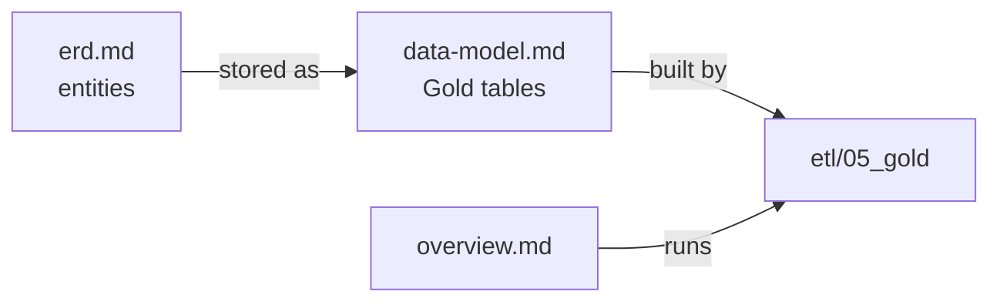

# Architecture

How the pipeline is built and what Gold looks like.

| Document | Read it for |
|---|---|
| [overview.md](overview.md) | Stages, data flow, data quality, the job graph, monitoring, workspace, and deployment |
| [data-model.md](data-model.md) | Every Gold table: grain, keys, columns, and the physical ERD |
| [erd.md](erd.md) | The conceptual ERD: real-world entities and how they relate |
| [erd.dbml](erd.dbml) | The dbdiagram.io source of the conceptual ERD; change it together with `erd.md` |

