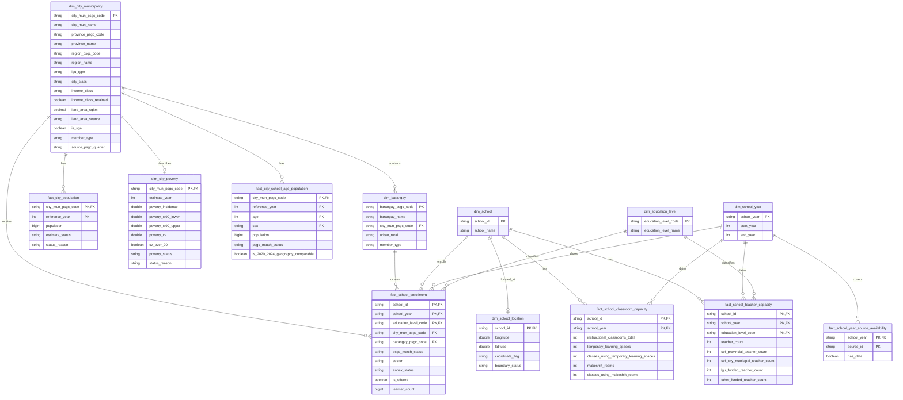

# Gold data model

**Status:** provisional model under D-048 and the implementation contract in
D-050. Tables with reviewed inputs may be built and gated independently while
the model and ERD await final mentor approval. A table is not publication-ready
until its own source, Integration, reconciliation, and validation requirements pass.

The model keeps source-aligned values at their useful analytical grains. Gold
stores keys and measures that cannot be reconstructed without losing meaning.
Ratios, coverage, ranks, priority labels, and other presentation rules belong
in Analytics views, not in these facts or in individual dashboard charts.

## Business and analytical questions

**Business question:** How should we prioritize the provision of classrooms and teachers among cities based on their respective enrollment needs?

| Analytical question | Gold inputs | Analytics rule |
|---|---|---|
| Which cities and municipalities have fewer public schools relative to their number of enrolled students and total population? | `fact_school_enrollment`, `fact_city_school_age_population` (2024, ages 5–17, per the team's BP and AP metrics), geography dimensions | Follow D-047: count a public school only when its enrollment for that school year is above 0; show zero-enrollment schools separately and do not count them as serving a barangay. Count annexes as schools, label the result "public schools (including annexes)", and show the annex count. Count only `member_type = 'regular'` barangays when identifying barangays without a public elementary school. If an LGU has a school assigned to its unknown-barangay member, label the unserved-barangay result "at most" and show the unmatched-school count. Report learners per public school and population per public school separately. Use 2024 population for every enrollment school year and label it "Population 2024". Use barangays for LGU-level context and drill-down, not as the ranking grain. |
| Which cities and municipalities have the most public-school students per classroom? | `fact_school_enrollment`, `fact_school_classroom_capacity` | Aggregate public-school learners across levels to school x school year before joining whole-school instructional rooms. Divide summed learners by summed rooms by city or municipality and show denominator coverage. Do not create level ratios because integrated schools share rooms across levels. |
| Which cities and municipalities have the most public-school students per teacher? | `fact_school_enrollment`, `fact_school_teacher_capacity` | Sum public-school learners and the approved teacher roles by city or municipality, school year, and education level. Include learners only from schools with `teacher_count > 0` at that level, except that annex learners remain when the annex reports zero teachers. Exclude other zero-teacher schools from the ratio and show their school and learner counts in coverage. Divide the LGU totals and label the result project-defined because mother-school links are unavailable. |
| Which cities and municipalities have the largest gap between school-age population and student enrollment over time? | `fact_school_enrollment`, `fact_city_school_age_population` | Compare ages 5–17 with enrollment from all sectors except Philippine Schools Overseas for 2020 with SY 2020-21 and 2024 with SY 2024-25. One row per city member and school year: every school year shows all-sector enrollment and its trend, and only SY 2020-21 and 2024-25 carry the population and gap. Use enrollment geography for each school year and disclose the residence-versus-school-location limitation. |

Poverty is contextual. `dim_city_poverty` carries the selected 2023 estimate
and availability status, but Analytics must not use poverty for priority scoring
without a separate decision.

## Dimensions

| Table | Grain | Key | Purpose |
|---|---|---|---|
| `dim_city_municipality` | One PSGC city or municipality, plus technical members | `city_mun_psgc_code` | City names, parent province and region, LGU classifications, land area, and the PSGC reference quarter |
| `dim_barangay` | One PSGC barangay, plus technical members | `barangay_psgc_code` | Barangay name, city or municipality parent, and urban/rural classification |
| `dim_school` | One DepEd school | `school_id` | Stable school identifier and latest available reported name |
| `dim_school_year` | One school year | `school_year` | Start and end calendar years of each enrollment school year |
| `dim_education_level` | One reporting level | `education_level_code` | `ES`, `JHS`, or `SHS`, with the included grades documented below |
| `dim_city_poverty` | One regular city or municipality; none for technical members | `city_mun_psgc_code` | Selected 2023 poverty estimate, uncertainty, and availability status for dashboard context |
| `dim_school_location` | One public school with a published location, SY 2023-24 | `school_id` | The school's point, its quality flag, and the boundary test against the city the reviewed map assigns it; for maps only (#217) |

`member_type` on both geography dimensions is one of `regular`, `unknown`, or
`excluded`. Each regular city or municipality has its own unknown-barangay
member so a school with a matched city but no unique barangay still rolls up to
that city. A separate global unknown city and barangay retain schools whose city
cannot be matched. `excluded` keeps a record intentionally outside Philippine
city-level analysis. Facts use these explicit members instead of silent NULL
geography keys.

Technical member codes (agreed on #174 and #193 by @saraevcldn, geography
lane, 2026-10-19): `UNKNOWN` and `EXCLUDED` in `dim_city_municipality`; in
`dim_barangay`, `<city_mun_psgc_code>-UNKNOWN` for each regular city or
municipality, plus `UNKNOWN` and `EXCLUDED` under the matching city members.
They are text, so they never collide with or pass as a ten-digit PSGC code; the
facts' `psgc_match_status` keeps the reason. Every dimension and fact uses them
the same way: `UNKNOWN` for geography not yet resolved (pending or ambiguous),
`EXCLUDED` for a record reviewed as outside city-level analysis, and
`<code>-UNKNOWN` for a known city or municipality whose barangay is unresolved.

## Facts

| Table | Grain | Key | Measures |
|---|---|---|---|
| `fact_school_enrollment` | School x school year x education level | (`school_id`, `school_year`, `education_level_code`) | Whether the level is offered and its learner count; school-year geography, sector, and annex status provide the aggregation context |
| `fact_school_classroom_capacity` | School x school year | (`school_id`, `school_year`) | Total reported instructional rooms plus all four published temporary-learning-space and makeshift measures |
| `fact_school_teacher_capacity` | School x school year x education level | (`school_id`, `school_year`, `education_level_code`) | Approved teaching roles by level, including head teachers, with the four published local-funding categories kept separately |
| `fact_city_population` | City or municipality x reference year | (`city_mun_psgc_code`, `reference_year`) | PSGC total population and its availability status |
| `fact_city_school_age_population` | City or municipality x reference year x single year of age x sex | (`city_mun_psgc_code`, `reference_year`, `age`, `sex`) | PSA single-year-age population for AP1 (2024, context) and AP4 (2020 and 2024); Analytics selects ages 5–17 |
| `fact_school_year_source_availability` | School year x DepEd source | (`school_year`, `source_id`) | Whether the reviewed enrollment, facilities, or personnel source has data for the school year, for dashboard `not available` states. Added by D-051, which revises D-048 |

`fact_school_enrollment` has exactly one row for each school, school year, and
reporting level (`ES`, `JHS`, and `SHS`). A level that is not offered has
`is_offered = false` and `learner_count = 0`. A level that is offered but whose
count was not published has `is_offered = true` and `learner_count = NULL`.
Consumers must filter `is_offered = true` when counting schools that offer a
specific level.

Classroom capacity is stored at school x school year because integrated schools
share rooms across levels. Analytics first aggregates enrollment across ES, JHS,
and SHS, then joins the whole-school room total. The classroom fact preserves
all four supporting source measures: temporary learning spaces, classes using
temporary learning spaces, makeshift rooms, and classes using makeshift rooms.
None is silently substituted into the instructional-room denominator.

Teacher capacity remains at school x school year x education level. The approved
teacher count includes Teacher I–III, Master Teacher I–IV, Head Teacher I–VI,
SPED/SNED teachers, Special Science teachers, instructors, and locally funded
teachers. Kindergarten locally funded teachers belong to ES. Principals and
non-teaching staff are excluded. SPED/SNED teachers are included because the
enrollment numerator includes non-graded SPED learners. An annex with learners
and zero teachers remains in the LGU numerator; it is not dropped. For a
non-annex school, learners at a level with zero teachers at that level are
excluded from the ratio and reported in the coverage gap. This allows annex
learners to be divided by teachers reported elsewhere in the same LGU, but the
result is project-defined because the missing mother-school ID prevents the
team from confirming that the mother school is in the same LGU.

School geography is stored on `fact_school_enrollment` because a school's
reported address can change between school years. AP1 to AP4 use the city or
municipality and barangay recorded on the enrollment row for that year. AP4 is
therefore a trend in enrollment at schools located in each LGU in each period,
not a fixed cohort of schools and not a trend by learner residence. Geography
changes and unmatched-school counts must be disclosed with the result. A
separate fixed-geography or `trend_city_mun_psgc_code` field is not part of this
model. `psgc_match_status` preserves whether the source row was `matched`,
`unmatched`, `ambiguous`, or `excluded`; technical geography members do not
erase that reason.

References remain in reviewed Analytics configuration, the national benchmark
register, and the metric specification, not in the Gold model. Under D-061, AP2
applies a PIDS-style illustrative >=50 screen to each usable school's reported
instructional-room ratio, and AP3 applies the ES 35, JHS 36, and SHS 80/3
learner-per-teacher references after coverage passes. Analytics keeps these
pressure flags separate and combines them only with public-school enrollment
growth to assign a planning-priority category. The current NSBI classroom field still cannot use
Republic Act No. 7880's 45:1 shortage rule, and the 2009 teacher deployment bands
remain historical context only.

## Columns

### `dim_city_municipality`

| Column | Type | Rule |
|---|---|---|
| `city_mun_psgc_code` | STRING | Primary key; PSGC code or an explicit technical-member code |
| `city_mun_name` | STRING | PSGC name |
| `province_psgc_code` | STRING | Parent province when applicable |
| `province_name` | STRING | Parent province name when applicable |
| `region_psgc_code` | STRING | Parent PSGC region code used as the stable region key |
| `region_name` | STRING | Parent region name used for dashboard filtering |
| `lgu_type` | STRING | City or municipality classification used by the approved PSGC rules |
| `city_class` | STRING | `HUC`, `ICC`, `CC`, or NULL for a municipality |
| `income_class` | STRING | `1st` through `5th`, or NULL when not classified |
| `income_class_retained` | BOOLEAN | Whether the published starred class means retained after downgrade |
| `land_area_sqkm` | DECIMAL(18,4) | Reviewed city or municipality land area |
| `land_area_source` | STRING | Source used when land-area values are mixed; otherwise one documented constant |
| `is_sga` | BOOLEAN | Approved Special Geographic Area rule |
| `member_type` | STRING | `regular`, `unknown`, or `excluded` |
| `source_psgc_quarter` | STRING | PSGC master reference used to build the member |

Built in `etl/05_gold/04_build_dim_city_municipality.sql`. Regular members are
the master quarter's `City` and `Mun` rows of `psa_psgc_clean` (1,642 for 2Q
2026: 149 cities, 1,493 municipalities); the two blank-level containers,
`0990100000` City of Isabela (Not a Province) and `1999900000` Special
Geographic Area, are not members (D-035). The province is Silver's
`province_code` as published, so the City of Isabela and the 8 Special
Geographic Area municipalities carry their container, and the 33 highly
urbanized cities and Pateros have none. `lgu_type` is `city` or
`municipality`. `land_area_sqkm` is the area of the HDX feature matched to the
unit in the latest HDX release (D-052), rounded to 4 decimals, with
`land_area_source = 'hdx_boundaries'`; both are NULL for the 8 Special
Geographic Area municipalities, which no HDX feature matches. Technical members
carry only their code, name, `member_type`, `is_sga = false`, and the quarter.
The gate (`90_validate_dim_city_municipality.sql`) reconciles the regular
members to Silver and FAILs on a repeated key or a broken rule; it WARNs on
members without land area.

### `dim_barangay`

| Column | Type |
|---|---|
| `barangay_psgc_code` | STRING |
| `barangay_name` | STRING |
| `city_mun_psgc_code` | STRING |
| `urban_rural` | STRING |
| `member_type` | STRING |

Built in `etl/05_gold/05_build_dim_barangay.sql` from `psa_psgc_clean` only
(D-051). Regular members are the master quarter's `Bgy` rows (42,010 for 2Q
2026). `city_mun_psgc_code` is Silver's `city_municipality_code`, except that
the City of Manila's 897 barangays, which PSGC places under its 14 `SubMun`
districts, roll up to the City of Manila (`1380600000`), since Gold has no
sub-municipality grain. `urban_rural` is `U`, `R`, or NULL where PSGC publishes
`-` (38 barangays). Each of the 1,642 cities and municipalities has one
`<code>-UNKNOWN` member, and `UNKNOWN` and `EXCLUDED` sit under the matching
city members: 43,654 rows in all. The gate FAILs on a repeated key, a barangay
whose parent is not a PSGC city or municipality, or a missing unknown member,
and WARNs on barangays without `urban_rural`.

### `dim_school`

| Column | Type |
|---|---|
| `school_id` | STRING |
| `school_name` | STRING |

`school_name` uses the name from the latest available enrollment school year.
It is a current display label, not a historical attribute.

### `dim_school_year`

| Column | Type |
|---|---|
| `school_year` | STRING |
| `start_year` | INT |
| `end_year` | INT |

The members come from enrollment Silver alone, the source that defines which
school years exist, so a failed facilities or personnel lane cannot stop this
dimension or the facts that join it (D-051). Which sources have data for each
year is in `fact_school_year_source_availability`.

### `dim_education_level`

| Column | Type |
|---|---|
| `education_level_code` | STRING |
| `education_level_name` | STRING |

The reviewed codes are `ES`, `JHS`, and `SHS`. ES includes Kindergarten,
Grades 1–6, and ES non-graded learners. JHS includes Grades 7–10 and JHS
non-graded learners. SHS includes Grades 11–12. Classroom capacity has no level
key, so no `ALL` education-level member is needed.

### `dim_city_poverty`

| Column | Type |
|---|---|
| `city_mun_psgc_code` | STRING |
| `estimate_year` | INT |
| `poverty_incidence` | DOUBLE |
| `poverty_ci90_lower` | DOUBLE |
| `poverty_ci90_upper` | DOUBLE |
| `poverty_cv` | DOUBLE |
| `cv_over_20` | BOOLEAN |
| `poverty_status` | STRING |
| `status_reason` | STRING |

The selected estimate year is 2023. `poverty_status` is `estimated`,
`no_estimate`, or `not_in_source`, following D-046; it is not named
`estimate_status` because `fact_city_population` uses that name for other
values. This contextual dimension has one row for every regular city or
municipality (1,642), including those without an estimate, and none for the
`unknown` and `excluded` members. The measures keep Silver's DOUBLE type
(D-034), so published values are not rounded. `cv_over_20` supports the
dashboard's `less precise` label. `status_reason` is NULL when estimated and
otherwise one of the reasons listed in D-046.

Built by `06_build_dim_city_poverty.sql` from `dim_city_municipality` and
`psa_poverty_psgc_map` (D-054), which carries each Silver estimate unchanged. A
regular member takes the 2023 map row matched to it at city or municipality
level; with none it is `not_in_source`. The City of Manila reason goes to the
member whose sub-municipality districts have 2023 map rows, so no code is
written into the rule; the gate fails unless that one member is the highly
urbanized city named City of Manila with its 14 district rows. `cv_over_20` is
`poverty_cv > 20`, NULL without an estimate. A Silver `partial_estimate` row is
carried as it is so the gate fails it. The gate
`90_validate_dim_city_poverty.sql` also fails a 2023 map row at city or
municipality level that is unmatched or ambiguous, or matched to no regular
member, so no PSA estimate leaves Gold unseen.

Not in v1: a flag for 2023 estimates whose territory changed after 2023 (the
Special Geographic Area parent towns, Makati and Taguig after EMBO), which D-054
leaves for Gold. D-046 defers it to #174; until then the value describes the
2023 territory, as the limitations log says.

### `dim_school_location`

| Column | Type |
|---|---|
| `school_id` | STRING |
| `longitude` | DOUBLE |
| `latitude` | DOUBLE |
| `coordinate_flag` | STRING |
| `boundary_status` | STRING |

One row per school in `deped_psgc_coordinates_clean`: the 47,818 public schools of the public-only DepEd workbook, SY 2023-24, with coordinates from the National School Building Inventory as of 2025-07-07. It joins `dim_school` on `school_id`, one to zero or one: `dim_school` has every school of every year and sector, and only these have a published location. It is a separate table, not columns on `dim_school`, so a problem in the coordinates lane can never stop `dim_school` or the facts that gate against it.

It carries **no PSGC code**. A school's city and barangay come only from `deped_school_psgc_map` through the facts (D-049), so there is one path from a school to its LGU; a map of schools takes the LGU from `fact_school_enrollment` and the point from here.

All four values are copied from the Integration map `deped_school_boundary_map` (`06_map_deped_school_boundary.sql`), which keeps one row per school of `deped_psgc_coordinates_clean`. `longitude`, `latitude` and `coordinate_flag` are Silver's, unchanged: NULL for `#N/A` or blank, with the flag `missing`, `zero` or `outside_philippines`. `boundary_status` is the map's boundary test S-1 at city or municipality level, the point against the HDX ADM3 boundary of the city the school PSGC map assigns the school for SY 2023-24 (latest HDX release, matched and valid features, any of a city's features):

| `boundary_status` | Meaning | Real batch (2026-10-21, local) |
|---|---|---:|
| `inside` | Inside its city's boundary. The only status fit for a map (D-061, proposed) | 44,968 |
| `outside` | A boundary exists and the point is not inside it; a point on the edge counts as outside | 1,997 |
| `no_usable_point` | `coordinate_flag` is set, so there is nothing to test | 738 |
| `no_matched_city` | The map has no matched city for the school in SY 2023-24 (`ambiguous`, `excluded`) | 18 |
| `no_boundary` | The city is matched but has no HDX boundary: the 8 Special Geographic Area municipalities | 97 |

Counts from the [real-data local run](../../evidence/reconciliation/2026-10-21-dim-school-location-gold.md).

The status is a check, never a correction: nothing is moved, geocoded, or dropped. The test is at city level only; the barangay boundaries (HDX ADM4) are not in Silver.

Built by `07_build_dim_school_location.sql`, a projection of the map; the gate `90_validate_dim_school_location.sql` fails on a repeated or NULL key, a row count other than the map's, a school not in `dim_school`, a value that differs from the map, a status outside the five, and a map run that did not succeed. The spatial work and the status rules are Integration's: the map's gate checks each status against its inputs without redoing the geometry, warns on `outside`, and records the count per status; `tests/test_integration_school_boundary.py` checks the geometry on known shapes. Nothing waits for the dimension.

### `fact_school_enrollment`

| Column | Type |
|---|---|
| `school_id` | STRING |
| `school_year` | STRING |
| `education_level_code` | STRING |
| `city_mun_psgc_code` | STRING |
| `barangay_psgc_code` | STRING |
| `psgc_match_status` | STRING |
| `sector` | STRING |
| `annex_status` | STRING |
| `is_offered` | BOOLEAN |
| `learner_count` | BIGINT |

`psgc_match_status` is `matched`, `unmatched`, `ambiguous`, or `excluded` and
preserves the Integration result even when a technical geography member is
used. NULL learner counts remain distinct from reported zero. `is_public`, overseas
exclusion, and enrollment-status labels are derived in reviewed Analytics
views from the standardized source values.

Built by `10_build_fact_school_enrollment.sql` from `deped_enrollment_clean` and
`deped_school_psgc_map` (D-049): three rows for every Silver row, overseas
schools included. `learner_count` follows the metric specification's
missingness rules, with each level's applicable cells taken from that
specification (the unique-strand cells from SY 2024-25, the Strengthened SHS
cells from SY 2025-26). Geography is the map's result for that school year: a
matched city keeps its code; an unmatched or ambiguous one takes `UNKNOWN`, an
excluded one `EXCLUDED`; a matched city with no single barangay takes its
`<city_mun_psgc_code>-UNKNOWN` barangay. `psgc_match_status` is the city or
municipality status. The candidate also carries three audit columns
(`applicable_cells`, `null_cells`, `published_cell_sum`) for the gate, which
publishes only the columns above.

### `fact_school_classroom_capacity`

| Column | Type |
|---|---|
| `school_id` | STRING |
| `school_year` | STRING |
| `instructional_classrooms_total` | INT |
| `temporary_learning_spaces` | INT |
| `classes_using_temporary_learning_spaces` | INT |
| `makeshift_rooms` | INT |
| `classes_using_makeshift_rooms` | INT |

`instructional_classrooms_total` sums the nonblank ES, JHS, and SHS
instructional-room counts. It is NULL, not 0, when all three source counts are
blank, following D-047. The other four columns retain the complete source
distinction between spaces or rooms and the classes using them. The source
publishes those measures as ES and combined HS, so Gold sums them to the
whole-school row without pretending that HS can be split between JHS and SHS.
NULL remains distinct from zero. Classroom availability and denominator
usability are derived under the reviewed metric contract.

Example:

| School | School year | Instructional classrooms total | Temporary learning spaces | Classes using temporary learning spaces | Makeshift rooms | Classes using makeshift rooms |
|---|---|---:|---:|---:|---:|---:|
| School A | 2023-24 | 17 | 2 | 4 | 5 | 6 |

### `fact_school_teacher_capacity`

| Column | Type |
|---|---|
| `school_id` | STRING |
| `school_year` | STRING |
| `education_level_code` | STRING |
| `teacher_count` | INT |
| `sef_provincial_teacher_count` | INT |
| `sef_city_municipal_teacher_count` | INT |
| `lgu_funded_teacher_count` | INT |
| `other_funded_teacher_count` | INT |

NULL remains distinct from zero. Personnel availability and denominator
usability are derived from these measures under the reviewed metric contract.
`teacher_count` includes the reviewed teaching roles for the level, head
teachers, and all four locally funded categories. Each funding column is a
subset of `teacher_count` for the dashboard funding split and must not be added
to `teacher_count` again. AP3 uses `fact_school_enrollment.is_offered` at the
same school, school-year, and education-level grain to distinguish a level the
school does not offer from an offered level whose personnel value is blank.
Each classroom or teacher fact row resolves to exactly one Silver source row on
(`school_id`, `school_year`); that row provides `batch_id`, `source_sha256`,
`delivery_version`, `schema_version`, `run_id`, and `code_revision` for lineage.

### `fact_city_population`

| Column | Type |
|---|---|
| `city_mun_psgc_code` | STRING |
| `reference_year` | INT |
| `population` | BIGINT |
| `estimate_status` | STRING |
| `status_reason` | STRING |

`estimate_status` is `available`, `missing`, `provisional`, or `excluded`.
`status_reason` explains a non-available value and is NULL when available.

Built by `13_build_fact_city_population.sql` from `dim_city_municipality` and
PSGC Silver's `2024 Population` column (D-033): one row per regular member, all
with `reference_year = 2024`, and none for the technical members. Population is
as published, 0 stays 0. A member with no population is `missing`, its reason
from Silver's `population_null_reason`; `provisional` and `excluded` have no rule
yet, so no row takes them, and the gate fails one until a rule is approved. The
gate fails a value, status or reason that differs from Silver and a
total that differs from the total of every City and Mun row of Silver's master
quarter, so a city the dimension lacks fails too, and warns when the total
differs from the 18 regions' total.

### `fact_city_school_age_population`

| Column | Type |
|---|---|
| `city_mun_psgc_code` | STRING |
| `reference_year` | INT |
| `age` | INT |
| `sex` | STRING |
| `population` | BIGINT |
| `psgc_match_status` | STRING |
| `is_2020_2024_geography_comparable` | BOOLEAN |

The source supplies 2020 and 2024 single-year-age population by sex and city or
municipality. `sex` contains only `male` and `female`; the published total row is
used for reconciliation and is not stored as another fact row. Analytics sums
the male and female rows for ages 5–17, avoiding double counting. The row-level
`psgc_match_status` retains the reviewed name-to-PSGC result.
`is_2020_2024_geography_comparable` is false where a boundary change, such as
the Makati/Taguig transfer or the new Special Geographic Area municipalities,
prevents a like-for-like trend for that city or municipality (see below for
province and region changes). This fact must not be filled by
interpolating or substituting the broader PSA ages 5–24 category.

Built in `etl/05_gold/14_build_fact_city_school_age_population.sql` from
`psa_school_age_population_clean` (`population_concept = 'total'`, D-042) and
its PSGC map (D-055). Every published age, 5 to 24, is kept. A place the map
reviewed as having no PSGC unit (the 8 2020 Special Geographic Area clusters,
96,899 people, which are not LGUs) goes to the `EXCLUDED` city member; a place
not yet reviewed (pending or ambiguous; none today) goes to `UNKNOWN`. Places
on the same member are summed into one row per age and sex, so no population is
dropped, and `psgc_match_status` keeps the map's status.

`is_2020_2024_geography_comparable` describes a unit's own trend. It is true
only for a code matched in both census years whose territory did not change
between them. False: Makati and Taguig (EMBO barangays) and the six Cotabato
towns whose barangays formed the Special Geographic Area (Carmen, Kabacan,
Midsayap, Pigkawayan, Pikit, Aleosan), listed in the build; the 8 Special
Geographic Area municipalities, which exist only in 2024; and the technical
members: 17 codes, 1,000 rows. Province and region changes (the Negros Island
Region, Sulu, the Maguindanao split) leave the unit itself unchanged, as the
metric specification's AP4 comparability section notes, so they do not make
it false: Gold groups both years by the one PSGC 2Q 2026 hierarchy in
`dim_city_municipality`, so a province or region total compares like with
like. A presentation that groups by census-year regions must disclose those
changes itself.

The gate rebuilds every expected row from the Silver male and female cells
and FAILs if any fact row differs in any column (`cells_match_silver`), so a
swapped sex or population moved between cities is caught even when totals
still add up. It also reconciles each year's population and each city, year
and age's male plus female to the published total row, checks every key
against `dim_city_municipality`, and WARNs on population held on `EXCLUDED`
or `UNKNOWN`. The two dimension gates likewise rebuild every expected row from
PSGC (and HDX) and FAIL on any difference (`values_match_source`), including a
barangay moved to another valid city or municipality.

Each of the three gates also records one result per distinct upstream
Silver or Integration `run_id` it read, and FAILs when that run has no
succeeded `silver_build` or `integration_build` row in `pipeline_runs`
(metric specification, integrity rule 1).

### `fact_school_year_source_availability`

| Column | Type |
|---|---|
| `school_year` | STRING |
| `source_id` | STRING |
| `has_data` | BOOLEAN |

One row for each school year in `dim_school_year` and each of `deped_enrollment`,
`deped_facilities`, and `deped_personnel`. `has_data` is true when that reviewed
source has data for the school year. It supports dashboard `not available` states
for years without facilities or personnel data. It does not assert that every
school or education level has a usable value; fact-level coverage must still be
shown. It is built after the three DepEd Silver gates, apart from the dimension,
so only this table waits for facilities and personnel (D-051).

## ERD

## Build and publication gates

A Gold table may be built independently when all requirements that apply to it
are true. Building a source-aligned table does not constitute final mentor
approval of the full model or make a downstream analytical output publishable.

1. Its grain, keys, fields, and null behavior follow D-048, D-050, and the
   relevant source decision.
2. A geography-dependent table waits for its reviewed PSGC mappings and explicit
   unknown or excluded behavior. Tables that do not read geography do not wait
   for unrelated Integration lanes, following D-051.
3. D-047 supplies the classroom and teacher denominator definitions, and D-050
   supplies the implementation contract.
4. Each dimension build has a uniqueness check on its declared key.
5. Every fact foreign key resolves to a regular, unknown, or excluded dimension
   member; no records disappear through inner joins.
6. Gold candidate tables are validated before they replace the last good build,
   following the repository's publish-after-gate rule.
