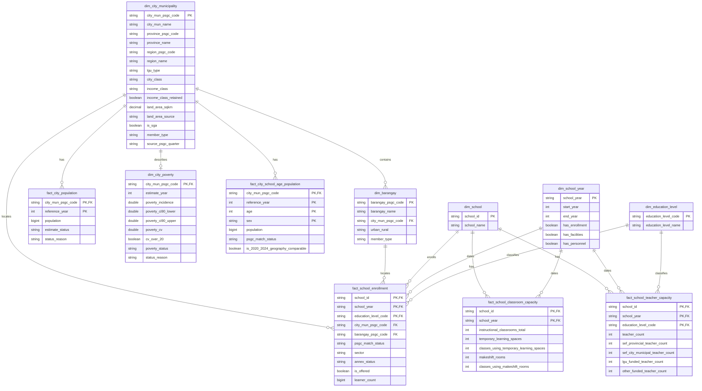

# Gold data model

**Status:** proposed for team and mentor review under #45. Do not build these
tables until the design is approved and Integration prerequisite #44 is ready.

The model keeps source-aligned values at their useful analytical grains. Gold
stores keys and measures that cannot be reconstructed without losing meaning.
Ratios, coverage, ranks, priority labels, and other presentation rules belong
in Analytics views, not in these facts or in individual dashboard charts.

## Business and analytical questions

**Business question:** How should we prioritize the provision of classrooms and teachers among cities based on their respective enrollment needs?

| Analytical question | Gold inputs | Analytics rule |
|---|---|---|
| Which cities and municipalities have fewer public schools relative to their number of enrolled students and total population? | `fact_school_enrollment`, `fact_city_population`, geography dimensions | Follow D-047: count a public school only when its enrollment for that school year is above 0; show zero-enrollment schools separately and do not count them as serving a barangay. Count annexes as schools, label the result "public schools (including annexes)", and show the annex count. Count only `member_type = 'regular'` barangays when identifying barangays without a public elementary school. If an LGU has a school assigned to its unknown-barangay member, label the unserved-barangay result "at most" and show the unmatched-school count. Report learners per public school and population per public school separately. Use 2024 population for every enrollment school year and label it "Population 2024". Use barangays for LGU-level context and drill-down, not as the ranking grain. |
| Which cities and municipalities have the most public-school students per classroom? | `fact_school_enrollment`, `fact_school_classroom_capacity` | Aggregate public-school learners across levels to school x school year before joining whole-school instructional rooms. Divide summed learners by summed rooms by city or municipality and show denominator coverage. Do not create level ratios because integrated schools share rooms across levels. |
| Which cities and municipalities have the most public-school students per teacher? | `fact_school_enrollment`, `fact_school_teacher_capacity` | Sum public-school learners and the approved teacher roles by city or municipality, school year, and education level. Include learners only from schools with `teacher_count > 0` at that level, except that annex learners remain when the annex reports zero teachers. Exclude other zero-teacher schools from the ratio and show their school and learner counts in coverage. Divide the LGU totals and label the result project-defined because mother-school links are unavailable. |
| Which cities and municipalities have the largest gap between school-age population and student enrollment over time? | `fact_school_enrollment`, `fact_city_school_age_population` | Compare ages 5–17 with enrollment from all sectors except Philippine Schools Overseas for 2020 with SY 2020-21 and 2024 with SY 2024-25. Other school years are not available for AP4. Use enrollment geography for each school year and disclose the residence-versus-school-location limitation. |

Poverty is contextual. `dim_city_poverty` carries the selected 2023 estimate
and availability status, but Analytics must not use poverty for priority scoring
without a separate decision.

## Dimensions

| Table | Grain | Key | Purpose |
|---|---|---|---|
| `dim_city_municipality` | One PSGC city or municipality, plus technical members | `city_mun_psgc_code` | City names, parent province and region, LGU classifications, land area, and the PSGC reference quarter |
| `dim_barangay` | One PSGC barangay, plus technical members | `barangay_psgc_code` | Barangay name, city or municipality parent, and urban/rural classification |
| `dim_school` | One DepEd school | `school_id` | Stable school identifier and latest available reported name |
| `dim_school_year` | One school year | `school_year` | Start and end calendar years, plus source availability for enrollment, facilities, and personnel |
| `dim_education_level` | One reporting level | `education_level_code` | `ES`, `JHS`, or `SHS`, with the included grades documented below |
| `dim_city_poverty` | One regular city or municipality; none for technical members | `city_mun_psgc_code` | Selected 2023 poverty estimate, uncertainty, and availability status for dashboard context |

`member_type` on both geography dimensions is one of `regular`, `unknown`, or
`excluded`. Each regular city or municipality has its own unknown-barangay
member so a school with a matched city but no unique barangay still rolls up to
that city. A separate global unknown city and barangay retain schools whose city
cannot be matched. `excluded` keeps a record intentionally outside Philippine
city-level analysis. Facts use these explicit members instead of silent NULL
geography keys.

## Facts

| Table | Grain | Key | Measures |
|---|---|---|---|
| `fact_school_enrollment` | School x school year x education level | (`school_id`, `school_year`, `education_level_code`) | Whether the level is offered and its learner count; school-year geography, sector, and annex status provide the aggregation context |
| `fact_school_classroom_capacity` | School x school year | (`school_id`, `school_year`) | Total reported instructional rooms plus all four published temporary-learning-space and makeshift measures |
| `fact_school_teacher_capacity` | School x school year x education level | (`school_id`, `school_year`, `education_level_code`) | Approved teaching roles by level, including head teachers, with the four published local-funding categories kept separately |
| `fact_city_population` | City or municipality x reference year | (`city_mun_psgc_code`, `reference_year`) | PSGC total population and its availability status |
| `fact_city_school_age_population` | City or municipality x reference year x single year of age x sex | (`city_mun_psgc_code`, `reference_year`, `age`, `sex`) | PSA single-year-age population for AP4; Analytics selects ages 5–17 |

`fact_school_enrollment` has exactly one row for each school, school year, and
reporting level (`ES`, `JHS`, and `SHS`). A level that is not offered has
`is_offered = false` and `learner_count = 0`. A level that is offered but whose
count was not published has `is_offered = true` and `learner_count = NULL`.
Consumers must filter `is_offered = true` when counting schools that offer a
specific level.

Classroom capacity is stored at school x school year because integrated schools
share rooms across levels. Analytics first aggregates enrollment across ES, JHS,
and SHS, then joins the whole-school room total. The classroom fact preserves
all four supporting source measures: temporary learning spaces, classes using
temporary learning spaces, makeshift rooms, and classes using makeshift rooms.
None is silently substituted into the instructional-room denominator.

Teacher capacity remains at school x school year x education level. The approved
teacher count includes Teacher I–III, Master Teacher I–IV, Head Teacher I–VI,
SPED/SNED teachers, Special Science teachers, instructors, and locally funded
teachers. Kindergarten locally funded teachers belong to ES. Principals and
non-teaching staff are excluded. SPED/SNED teachers are included because the
enrollment numerator includes non-graded SPED learners. An annex with learners
and zero teachers remains in the LGU numerator; it is not dropped. For a
non-annex school, learners at a level with zero teachers at that level are
excluded from the ratio and reported in the coverage gap. This allows annex
learners to be divided by teachers reported elsewhere in the same LGU, but the
result is project-defined because the missing mother-school ID prevents the
team from confirming that the mother school is in the same LGU.

School geography is stored on `fact_school_enrollment` because a school's
reported address can change between school years. AP1 to AP4 use the city or
municipality and barangay recorded on the enrollment row for that year. AP4 is
therefore a trend in enrollment at schools located in each LGU in each period,
not a fixed cohort of schools and not a trend by learner residence. Geography
changes and unmatched-school counts must be disclosed with the result. A
separate fixed-geography or `trend_city_mun_psgc_code` field is not part of this
model. `psgc_match_status` preserves whether the source row was `matched`,
`unmatched`, `ambiguous`, or `excluded`; technical geography members do not
erase that reason.

Benchmarks remain in the national benchmark register and metric specification,
not in the Gold model. Analytics may use a reference only after the team approves
it for a compatible project metric, including the same numerator, denominator,
education level, geography, period, and intended use. Incompatible and legacy
references remain documentation only. In particular, the current NSBI classroom
field cannot use Republic Act No. 7880's 45:1 rule, and the 2009 teacher
deployment bands are not an active current benchmark.

## Columns

### `dim_city_municipality`

| Column | Type | Rule |
|---|---|---|
| `city_mun_psgc_code` | STRING | Primary key; PSGC code or an explicit technical-member code |
| `city_mun_name` | STRING | PSGC name |
| `province_psgc_code` | STRING | Parent province when applicable |
| `province_name` | STRING | Parent province name when applicable |
| `region_psgc_code` | STRING | Parent PSGC region code used as the stable region key |
| `region_name` | STRING | Parent region name used for dashboard filtering |
| `lgu_type` | STRING | City or municipality classification used by the approved PSGC rules |
| `city_class` | STRING | `HUC`, `ICC`, `CC`, or NULL for a municipality |
| `income_class` | STRING | `1st` through `5th`, or NULL when not classified |
| `income_class_retained` | BOOLEAN | Whether the published starred class means retained after downgrade |
| `land_area_sqkm` | DECIMAL(18,4) | Reviewed city or municipality land area |
| `land_area_source` | STRING | Source used when land-area values are mixed; otherwise one documented constant |
| `is_sga` | BOOLEAN | Approved Special Geographic Area rule |
| `member_type` | STRING | `regular`, `unknown`, or `excluded` |
| `source_psgc_quarter` | STRING | PSGC master reference used to build the member |

### `dim_barangay`

| Column | Type |
|---|---|
| `barangay_psgc_code` | STRING |
| `barangay_name` | STRING |
| `city_mun_psgc_code` | STRING |
| `urban_rural` | STRING |
| `member_type` | STRING |

### `dim_school`

| Column | Type |
|---|---|
| `school_id` | STRING |
| `school_name` | STRING |

`school_name` uses the name from the latest available enrollment school year.
It is a current display label, not a historical attribute.

### `dim_school_year`

| Column | Type |
|---|---|
| `school_year` | STRING |
| `start_year` | INT |
| `end_year` | INT |
| `has_enrollment` | BOOLEAN |
| `has_facilities` | BOOLEAN |
| `has_personnel` | BOOLEAN |

The three availability flags indicate whether the corresponding reviewed source
has data for the school year. They support dashboard `not available` states for
years without facilities or personnel data. They do not assert that every school
or education level has a usable value; fact-level coverage must still be shown.

### `dim_education_level`

| Column | Type |
|---|---|
| `education_level_code` | STRING |
| `education_level_name` | STRING |

The reviewed codes are `ES`, `JHS`, and `SHS`. ES includes Kindergarten,
Grades 1–6, and ES non-graded learners. JHS includes Grades 7–10 and JHS
non-graded learners. SHS includes Grades 11–12. Classroom capacity has no level
key, so no `ALL` education-level member is needed.

### `dim_city_poverty`

| Column | Type |
|---|---|
| `city_mun_psgc_code` | STRING |
| `estimate_year` | INT |
| `poverty_incidence` | DOUBLE |
| `poverty_ci90_lower` | DOUBLE |
| `poverty_ci90_upper` | DOUBLE |
| `poverty_cv` | DOUBLE |
| `cv_over_20` | BOOLEAN |
| `poverty_status` | STRING |
| `status_reason` | STRING |

The selected estimate year is 2023. `poverty_status` is `estimated`,
`no_estimate`, or `not_in_source`, following D-046; it is not named
`estimate_status` because `fact_city_population` uses that name for other
values. This contextual dimension has one row for every regular city or
municipality (1,642), including those without an estimate, and none for the
`unknown` and `excluded` members. The measures keep Silver's DOUBLE type
(D-034), so published values are not rounded. `cv_over_20` supports the
dashboard's `less precise` label. `status_reason` is NULL when estimated and
otherwise one of the reasons listed in D-046.

### `fact_school_enrollment`

| Column | Type |
|---|---|
| `school_id` | STRING |
| `school_year` | STRING |
| `education_level_code` | STRING |
| `city_mun_psgc_code` | STRING |
| `barangay_psgc_code` | STRING |
| `psgc_match_status` | STRING |
| `sector` | STRING |
| `annex_status` | STRING |
| `is_offered` | BOOLEAN |
| `learner_count` | BIGINT |

`psgc_match_status` is `matched`, `unmatched`, `ambiguous`, or `excluded` and
preserves the Integration result even when a technical geography member is
used. NULL learner counts remain distinct from reported zero. `is_public`, overseas
exclusion, and enrollment-status labels are derived in reviewed Analytics
views from the standardized source values.

### `fact_school_classroom_capacity`

| Column | Type |
|---|---|
| `school_id` | STRING |
| `school_year` | STRING |
| `instructional_classrooms_total` | INT |
| `temporary_learning_spaces` | INT |
| `classes_using_temporary_learning_spaces` | INT |
| `makeshift_rooms` | INT |
| `classes_using_makeshift_rooms` | INT |

`instructional_classrooms_total` sums the nonblank ES, JHS, and SHS
instructional-room counts. It is NULL, not 0, when all three source counts are
blank, following D-047. The other four columns retain the complete source
distinction between spaces or rooms and the classes using them. The source
publishes those measures as ES and combined HS, so Gold sums them to the
whole-school row without pretending that HS can be split between JHS and SHS.
NULL remains distinct from zero. Classroom availability and denominator
usability are derived under the reviewed metric contract.

Example:

| School | School year | Instructional classrooms total | Temporary learning spaces | Classes using temporary learning spaces | Makeshift rooms | Classes using makeshift rooms |
|---|---|---:|---:|---:|---:|---:|
| School A | 2023-24 | 17 | 2 | 4 | 5 | 6 |

### `fact_school_teacher_capacity`

| Column | Type |
|---|---|
| `school_id` | STRING |
| `school_year` | STRING |
| `education_level_code` | STRING |
| `teacher_count` | INT |
| `sef_provincial_teacher_count` | INT |
| `sef_city_municipal_teacher_count` | INT |
| `lgu_funded_teacher_count` | INT |
| `other_funded_teacher_count` | INT |

NULL remains distinct from zero. Personnel availability and denominator
usability are derived from these measures under the reviewed metric contract.
`teacher_count` includes the reviewed teaching roles for the level, head
teachers, and all four locally funded categories. Each funding column is a
subset of `teacher_count` for the dashboard funding split and must not be added
to `teacher_count` again.

### `fact_city_population`

| Column | Type |
|---|---|
| `city_mun_psgc_code` | STRING |
| `reference_year` | INT |
| `population` | BIGINT |
| `estimate_status` | STRING |
| `status_reason` | STRING |

`estimate_status` is `available`, `missing`, `provisional`, or `excluded`.
`status_reason` explains a non-available value and is NULL when available.

### `fact_city_school_age_population`

| Column | Type |
|---|---|
| `city_mun_psgc_code` | STRING |
| `reference_year` | INT |
| `age` | INT |
| `sex` | STRING |
| `population` | BIGINT |
| `psgc_match_status` | STRING |
| `is_2020_2024_geography_comparable` | BOOLEAN |

The source supplies 2020 and 2024 single-year-age population by sex and city or
municipality. `sex` contains only `male` and `female`; the published total row is
used for reconciliation and is not stored as another fact row. Analytics sums
the male and female rows for ages 5–17, avoiding double counting. The row-level
`psgc_match_status` retains the reviewed name-to-PSGC result.
`is_2020_2024_geography_comparable` is false where boundary or hierarchy changes,
including the Makati/Taguig transfer and the new Special Geographic Area
municipalities, prevent a like-for-like trend. This fact must not be filled by
interpolating or substituting the broader PSA ages 5–24 category.

## ERD

## Build gate

The design becomes buildable only after all of these are true:

1. The team and mentor approve this ERD and the grains above.
2. #44 provides reviewed PSGC mappings and explicit unknown/excluded behavior.
3. D-047 supplies the approved classroom and teacher denominator definitions;
   #66 must resolve only any implementation detail that remains open.
4. Each dimension build has a uniqueness check on its declared key.
5. Every fact foreign key resolves to a regular, unknown, or excluded dimension
   member; no records disappear through inner joins.
6. Gold candidate tables are validated before they replace the last good build,
   following the repository's publish-after-gate rule.
