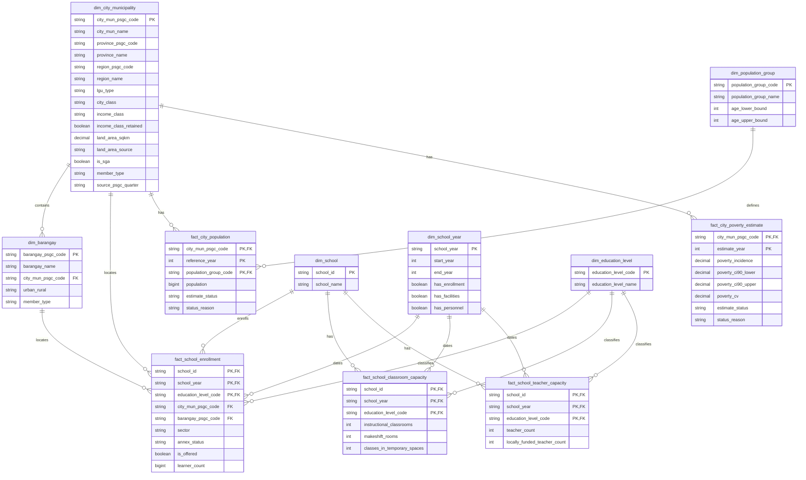

# Gold data model

**Status:** proposed for team and mentor review under #45. Do not build these
tables until the design is approved and Integration prerequisite #44 is ready.

The model keeps source-aligned values at their useful analytical grains. Gold
stores keys and measures that cannot be reconstructed without losing meaning.
Ratios, coverage, ranks, priority labels, and other presentation rules belong
in Analytics views, not in these facts or in individual dashboard charts.

## Business and analytical questions

**Business question:** How should we prioritize the provision of classrooms and teachers among cities based on their respective enrollment needs?

| Analytical question | Gold inputs | Analytics rule |
|---|---|---|
| Which cities and municipalities have fewer public schools relative to their number of enrolled students and total population? | `fact_school_enrollment`, `fact_city_population`, geography dimensions | Count distinct public schools and sum learners by city. Report learners per public school and population per public school separately. |
| Which cities and municipalities have the most public-school students per classroom? | `fact_school_enrollment`, `fact_school_classroom_capacity` | Join learners and instructional classrooms at school x school year x education level, restrict to public schools with a positive classroom denominator, then divide summed learners by summed classrooms for each level. Show coverage. |
| Which cities and municipalities have the most public-school students per teacher? | `fact_school_enrollment`, `fact_school_teacher_capacity` | Join learners and teachers at school x school year x education level, restrict to public schools with a positive teacher denominator, then divide summed learners by summed teachers for each level. The teacher count includes head teachers. Show coverage. |
| Which cities and municipalities have the largest gap between school-age population and student enrollment over time? | `fact_school_enrollment`, `fact_city_population` | Compare enrollment with the `school_age` population group for aligned years and use the enrollment geography recorded for each school year. Total population must not stand in for school-age population. |

Poverty is contextual.
`fact_city_poverty_estimate` is retained because its source is already in scope,
but Analytics must not use it for priority scoring without a separate decision.

## Dimensions

| Table | Grain | Key | Purpose |
|---|---|---|---|
| `dim_city_municipality` | One PSGC city or municipality, plus technical members | `city_mun_psgc_code` | City names, parent province and region, LGU classifications, land area, and the PSGC reference quarter |
| `dim_barangay` | One PSGC barangay, plus technical members | `barangay_psgc_code` | Barangay name, city or municipality parent, and urban/rural classification |
| `dim_school` | One DepEd school | `school_id` | Stable school identifier and name |
| `dim_school_year` | One school year | `school_year` | Start and end calendar years, plus source availability for enrollment, facilities, and personnel |
| `dim_education_level` | One reporting level | `education_level_code` | `ES`, `JHS`, `SHS`, and the whole-school `ALL` member |
| `dim_population_group` | One population definition | `population_group_code` | Separates `total` from a future approved `school_age` population and records its age bounds |

`member_type` on both geography dimensions is one of `regular`, `unknown`, or
`excluded`. `unknown` keeps an in-scope record whose geography did not match.
`excluded` keeps a record intentionally outside Philippine city-level analysis.
Facts use these explicit members instead of silent NULL geography keys.

## Facts

| Table | Grain | Key | Measures |
|---|---|---|---|
| `fact_school_enrollment` | School x school year x education level | (`school_id`, `school_year`, `education_level_code`) | Whether the level is offered and its learner count; school-year geography, sector, and annex status provide the aggregation context |
| `fact_school_classroom_capacity` | School x school year x education-level scope | (`school_id`, `school_year`, `education_level_code`) | ES/JHS/SHS rows hold instructional classrooms; the `ALL` row holds whole-school makeshift rooms and classes in temporary spaces |
| `fact_school_teacher_capacity` | School x school year x education level | (`school_id`, `school_year`, `education_level_code`) | Teachers recorded for that education level, including head teachers; locally funded teachers remain visible as a subset |
| `fact_city_population` | City or municipality x reference year x population group | (`city_mun_psgc_code`, `reference_year`, `population_group_code`) | Population and its availability status |
| `fact_city_poverty_estimate` | City or municipality x estimate year | (`city_mun_psgc_code`, `estimate_year`) | Poverty incidence, interval, coefficient of variation, and estimate status |

Enrollment, classroom capacity, and teacher capacity share the same school x
school year x education-level grain. Both capacity ratios therefore join on all
three key columns. The classroom ratio compares each level's learners with that
level's instructional classrooms. The teacher ratio compares each level's
learners with the teachers recorded for that level, including head teachers.
The Analytics views must show denominator coverage and retain a reported zero as
different from a missing classroom or teacher count.

The classroom fact also has one `ALL` row per school-year. Makeshift rooms and
classes in temporary spaces are summed to the whole-school level and stored only
on that row because the source splits them into ES and combined HS, not separate
JHS and SHS values. They are supporting whole-school measures and are not used
as the denominator of the level-specific learners-per-classroom ratio.

School geography is stored on `fact_school_enrollment` because a school's
reported address can change between school years. AP1 to AP4 use the city or
municipality and barangay recorded on the enrollment row for that year. AP4 is
therefore a trend in enrollment at schools located in each LGU in each period,
not a fixed cohort of schools and not a trend by learner residence. Geography
changes and unmatched-school counts must be disclosed with the result. A
separate fixed-geography or `trend_city_mun_psgc_code` field is not part of this
model.

Benchmarks remain in the national benchmark register and metric specification,
not in the Gold model. Analytics may use a reference only after the team approves
it for a compatible project metric, including the same numerator, denominator,
education level, geography, period, and intended use. Incompatible and legacy
references remain documentation only. In particular, the current NSBI classroom
field cannot use Republic Act No. 7880's 45:1 rule, and the 2009 teacher
deployment bands are not an active current benchmark.

## Columns

### `dim_city_municipality`

| Column | Type | Rule |
|---|---|---|
| `city_mun_psgc_code` | STRING | Primary key; PSGC code or an explicit technical-member code |
| `city_mun_name` | STRING | PSGC name |
| `province_psgc_code` | STRING | Parent province when applicable |
| `province_name` | STRING | Parent province name when applicable |
| `region_psgc_code` | STRING | Parent PSGC region code used as the stable region key |
| `region_name` | STRING | Parent region name used for dashboard filtering |
| `lgu_type` | STRING | City or municipality classification used by the approved PSGC rules |
| `city_class` | STRING | `HUC`, `ICC`, `CC`, or NULL for a municipality |
| `income_class` | STRING | `1st` through `5th`, or NULL when not classified |
| `income_class_retained` | BOOLEAN | Whether the published starred class means retained after downgrade |
| `land_area_sqkm` | DECIMAL(18,4) | Reviewed city or municipality land area |
| `land_area_source` | STRING | Source used when land-area values are mixed; otherwise one documented constant |
| `is_sga` | BOOLEAN | Approved Special Geographic Area rule |
| `member_type` | STRING | `regular`, `unknown`, or `excluded` |
| `source_psgc_quarter` | STRING | PSGC master reference used to build the member |

### `dim_barangay`

| Column | Type |
|---|---|
| `barangay_psgc_code` | STRING |
| `barangay_name` | STRING |
| `city_mun_psgc_code` | STRING |
| `urban_rural` | STRING |
| `member_type` | STRING |

### `dim_school`

| Column | Type |
|---|---|
| `school_id` | STRING |
| `school_name` | STRING |

### `dim_school_year`

| Column | Type |
|---|---|
| `school_year` | STRING |
| `start_year` | INT |
| `end_year` | INT |
| `has_enrollment` | BOOLEAN |
| `has_facilities` | BOOLEAN |
| `has_personnel` | BOOLEAN |

The three availability flags indicate whether the corresponding reviewed source
has data for the school year. They support dashboard `not available` states for
years without facilities or personnel data. They do not assert that every school
or education level has a usable value; fact-level coverage must still be shown.

### `dim_education_level`

| Column | Type |
|---|---|
| `education_level_code` | STRING |
| `education_level_name` | STRING |

The reviewed codes are `ES`, `JHS`, `SHS`, and `ALL`. Enrollment and teacher
capacity use the three education levels. Classroom capacity also uses `ALL` for
measures that are available only at whole-school scope.

### `dim_population_group`

| Column | Type |
|---|---|
| `population_group_code` | STRING |
| `population_group_name` | STRING |
| `age_lower_bound` | INT |
| `age_upper_bound` | INT |

The initial `total` member has no age bounds. Do not add `school_age` until its
source and age definition are approved.

### `fact_school_enrollment`

| Column | Type |
|---|---|
| `school_id` | STRING |
| `school_year` | STRING |
| `education_level_code` | STRING |
| `city_mun_psgc_code` | STRING |
| `barangay_psgc_code` | STRING |
| `sector` | STRING |
| `annex_status` | STRING |
| `is_offered` | BOOLEAN |
| `learner_count` | BIGINT |

NULL learner counts remain distinct from reported zero. `is_public`, overseas
exclusion, and enrollment-status labels are derived in reviewed Analytics
views from the standardized source values.

### `fact_school_classroom_capacity`

| Column | Type |
|---|---|
| `school_id` | STRING |
| `school_year` | STRING |
| `education_level_code` | STRING |
| `instructional_classrooms` | INT |
| `makeshift_rooms` | INT |
| `classes_in_temporary_spaces` | INT |

NULL remains distinct from zero. Classroom availability and denominator
usability are derived under the reviewed metric contract. For `ES`, `JHS`, and
`SHS`, `instructional_classrooms` is populated and the two whole-school measures
are not applicable. For `ALL`, `makeshift_rooms` and
`classes_in_temporary_spaces` are populated and `instructional_classrooms` is
not used for the level-specific ratio.

Example:

| School | School year | Level | Instructional classrooms | Makeshift rooms | Classes in temporary spaces |
|---|---|---|---:|---:|---:|
| School A | 2023-24 | ES | 10 | NULL | NULL |
| School A | 2023-24 | JHS | 5 | NULL | NULL |
| School A | 2023-24 | SHS | 2 | NULL | NULL |
| School A | 2023-24 | ALL | NULL | 5 | 4 |

### `fact_school_teacher_capacity`

| Column | Type |
|---|---|
| `school_id` | STRING |
| `school_year` | STRING |
| `education_level_code` | STRING |
| `teacher_count` | INT |
| `locally_funded_teacher_count` | INT |

NULL remains distinct from zero. Personnel availability and denominator
usability are derived from these measures under the reviewed metric contract.
`teacher_count` includes the reviewed teaching roles for the level, head
teachers, and locally funded teachers. `locally_funded_teacher_count` is a subset
for funding context and must not be added to `teacher_count` again.

### `fact_city_population`

| Column | Type |
|---|---|
| `city_mun_psgc_code` | STRING |
| `reference_year` | INT |
| `population_group_code` | STRING |
| `population` | BIGINT |
| `estimate_status` | STRING |
| `status_reason` | STRING |

`estimate_status` is `available`, `missing`, `provisional`, or `excluded`.
`status_reason` explains a non-available value and is NULL when available.

### `fact_city_poverty_estimate`

| Column | Type |
|---|---|
| `city_mun_psgc_code` | STRING |
| `estimate_year` | INT |
| `poverty_incidence` | DECIMAL(12,6) |
| `poverty_ci90_lower` | DECIMAL(12,6) |
| `poverty_ci90_upper` | DECIMAL(12,6) |
| `poverty_cv` | DECIMAL(12,6) |
| `estimate_status` | STRING |
| `status_reason` | STRING |

The status preserves the Silver distinction between `estimated`,
`partial_estimate`, and `no_estimate`. A reason may explain a missing mapping or
an intentional exclusion; it is NULL for a normal estimate.

## ERD

## Build gate

The design becomes buildable only after all of these are true:

1. The team and mentor approve this ERD and the grains above.
2. #44 provides reviewed PSGC mappings and explicit unknown/excluded behavior.
3. #66 approves the classroom and teacher denominator definitions.
4. Each dimension build has a uniqueness check on its declared key.
5. Every fact foreign key resolves to a regular, unknown, or excluded dimension
   member; no records disappear through inner joins.
6. Gold candidate tables are validated before they replace the last good build,
   following the repository's publish-after-gate rule.
