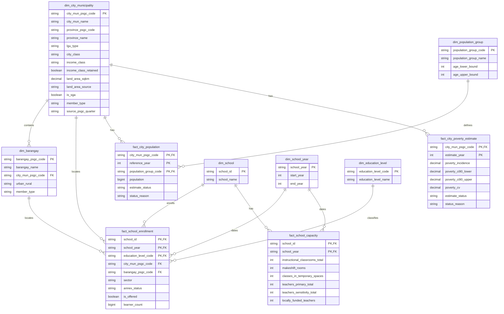

# Gold data model

**Status:** proposed for team and mentor review under #45. Do not build these
tables until the design is approved and Integration prerequisite #44 is ready.

The model keeps source-aligned values at their useful analytical grains. Gold
stores keys and measures that cannot be reconstructed without losing meaning.
Ratios, coverage, ranks, priority labels, and other presentation rules belong
in Analytics views, not in these facts or in individual dashboard charts.

## Business and analytical questions

**Business question:** How should we prioritize the provision of classrooms and
teachers among cities and municipalities based on their respective enrollment
needs?

| Analytical question | Gold inputs | Analytics rule |
|---|---|---|
| Which areas have fewer schools relative to their number of students and population? | `fact_school_enrollment`, `fact_city_population`, geography dimensions | Count distinct public schools and sum learners by city. Report learners per public school and population per public school separately. |
| Which areas have the most students per classroom? | `fact_school_enrollment`, `fact_school_capacity` | Aggregate enrollment to school-year before the one-to-one capacity join, restrict to public schools with a positive classroom denominator, then divide summed learners by summed classrooms. Show coverage. |
| Which areas have the most students per teacher? | `fact_school_enrollment`, `fact_school_capacity` | Use the same-school numerator and denominator, divide summed learners by the reviewed teacher total, and show coverage. The primary and sensitivity teacher definitions remain subject to #66. |
| Which areas have the largest gap between school-age population and student enrollment over time? | `fact_school_enrollment`, `fact_city_population` | Compare enrollment with the `school_age` population group for aligned years. This answer remains unavailable until a reviewed multi-year city-level school-age population source is approved. Total population must not stand in for school-age population. |

Poverty is contextual and does not answer one of the four approved questions.
`fact_city_poverty_estimate` is retained because its source is already in scope,
but Analytics must not use it for priority scoring without a separate decision.

## Dimensions

| Table | Grain | Key | Purpose |
|---|---|---|---|
| `dim_city_municipality` | One PSGC city or municipality, plus technical members | `city_mun_psgc_code` | City names, parent province, LGU classifications, land area, and the PSGC reference quarter |
| `dim_barangay` | One PSGC barangay, plus technical members | `barangay_psgc_code` | Barangay name, city or municipality parent, and urban/rural classification |
| `dim_school` | One DepEd school | `school_id` | Stable school identifier and name |
| `dim_school_year` | One school year | `school_year` | Start and end calendar years |
| `dim_education_level` | One reporting level | `education_level_code` | `ES`, `JHS`, and `SHS` labels |
| `dim_population_group` | One population definition | `population_group_code` | Separates `total` from a future approved `school_age` population and records its age bounds |

`member_type` on both geography dimensions is one of `regular`, `unknown`, or
`excluded`. `unknown` keeps an in-scope record whose geography did not match.
`excluded` keeps a record intentionally outside Philippine city-level analysis.
Facts use these explicit members instead of silent NULL geography keys.

## Facts

| Table | Grain | Key | Measures |
|---|---|---|---|
| `fact_school_enrollment` | School x school year x education level | (`school_id`, `school_year`, `education_level_code`) | Whether the level is offered and its learner count; school-year geography, sector, and annex status provide the aggregation context |
| `fact_school_capacity` | School x school year | (`school_id`, `school_year`) | Total instructional classrooms, makeshift rooms, classes in temporary spaces, and reviewed teacher totals |
| `fact_city_population` | City or municipality x reference year x population group | (`city_mun_psgc_code`, `reference_year`, `population_group_code`) | Population and its availability status |
| `fact_city_poverty_estimate` | City or municipality x estimate year | (`city_mun_psgc_code`, `estimate_year`) | Poverty incidence, interval, coefficient of variation, and estimate status |

The enrollment fact is longer than the capacity fact because education level is
a row, not a repeated set of ES, JHS, and SHS columns. Before joining capacity,
queries must aggregate enrollment to one row per school and school year. A raw
join on only `school_id` and `school_year` would repeat each capacity row once
per education level.

Headline classroom and teacher ratios use all-level totals. The source files do
not support reliable primary ratios by level for integrated schools, because a
school may report learners at several levels while reporting rooms or personnel
under only one level.

## Columns

### `dim_city_municipality`

| Column | Type | Rule |
|---|---|---|
| `city_mun_psgc_code` | STRING | Primary key; PSGC code or an explicit technical-member code |
| `city_mun_name` | STRING | PSGC name |
| `province_psgc_code` | STRING | Parent province when applicable |
| `province_name` | STRING | Parent province name when applicable |
| `lgu_type` | STRING | City or municipality classification used by the approved PSGC rules |
| `city_class` | STRING | `HUC`, `ICC`, `CC`, or NULL for a municipality |
| `income_class` | STRING | `1st` through `5th`, or NULL when not classified |
| `income_class_retained` | BOOLEAN | Whether the published starred class means retained after downgrade |
| `land_area_sqkm` | DECIMAL(18,4) | Reviewed city or municipality land area |
| `land_area_source` | STRING | Source used when land-area values are mixed; otherwise one documented constant |
| `is_sga` | BOOLEAN | Approved Special Geographic Area rule |
| `member_type` | STRING | `regular`, `unknown`, or `excluded` |
| `source_psgc_quarter` | STRING | PSGC master reference used to build the member |

### `dim_barangay`

| Column | Type |
|---|---|
| `barangay_psgc_code` | STRING |
| `barangay_name` | STRING |
| `city_mun_psgc_code` | STRING |
| `urban_rural` | STRING |
| `member_type` | STRING |

### `dim_school`

| Column | Type |
|---|---|
| `school_id` | STRING |
| `school_name` | STRING |

### `dim_school_year`

| Column | Type |
|---|---|
| `school_year` | STRING |
| `start_year` | INT |
| `end_year` | INT |

### `dim_education_level`

| Column | Type |
|---|---|
| `education_level_code` | STRING |
| `education_level_name` | STRING |

### `dim_population_group`

| Column | Type |
|---|---|
| `population_group_code` | STRING |
| `population_group_name` | STRING |
| `age_lower_bound` | INT |
| `age_upper_bound` | INT |

The initial `total` member has no age bounds. Do not add `school_age` until its
source and age definition are approved.

### `fact_school_enrollment`

| Column | Type |
|---|---|
| `school_id` | STRING |
| `school_year` | STRING |
| `education_level_code` | STRING |
| `city_mun_psgc_code` | STRING |
| `barangay_psgc_code` | STRING |
| `sector` | STRING |
| `annex_status` | STRING |
| `is_offered` | BOOLEAN |
| `learner_count` | BIGINT |

NULL learner counts remain distinct from reported zero. `is_public`, overseas
exclusion, and enrollment-status labels are derived in reviewed Analytics
views from the standardized source values.

### `fact_school_capacity`

| Column | Type |
|---|---|
| `school_id` | STRING |
| `school_year` | STRING |
| `instructional_classrooms_total` | INT |
| `makeshift_rooms` | INT |
| `classes_in_temporary_spaces` | INT |
| `teachers_primary_total` | INT |
| `teachers_sensitivity_total` | INT |
| `locally_funded_teachers` | INT |

NULL remains distinct from zero. Availability and denominator-usability flags
are derived from these measures under the reviewed metric contract.

### `fact_city_population`

| Column | Type |
|---|---|
| `city_mun_psgc_code` | STRING |
| `reference_year` | INT |
| `population_group_code` | STRING |
| `population` | BIGINT |
| `estimate_status` | STRING |
| `status_reason` | STRING |

`estimate_status` is `available`, `missing`, `provisional`, or `excluded`.
`status_reason` explains a non-available value and is NULL when available.

### `fact_city_poverty_estimate`

| Column | Type |
|---|---|
| `city_mun_psgc_code` | STRING |
| `estimate_year` | INT |
| `poverty_incidence` | DECIMAL(12,6) |
| `poverty_ci90_lower` | DECIMAL(12,6) |
| `poverty_ci90_upper` | DECIMAL(12,6) |
| `poverty_cv` | DECIMAL(12,6) |
| `estimate_status` | STRING |
| `status_reason` | STRING |

The status preserves the Silver distinction between `estimated`,
`partial_estimate`, and `no_estimate`. A reason may explain a missing mapping or
an intentional exclusion; it is NULL for a normal estimate.

## ERD

## Build gate

The design becomes buildable only after all of these are true:

1. The team and mentor approve this ERD and the grains above.
2. #44 provides reviewed PSGC mappings and explicit unknown/excluded behavior.
3. #66 approves the classroom and teacher denominator definitions.
4. Each dimension build has a uniqueness check on its declared key.
5. Every fact foreign key resolves to a regular, unknown, or excluded dimension
   member; no records disappear through inner joins.
6. Gold candidate tables are validated before they replace the last good build,
   following the repository's publish-after-gate rule.
