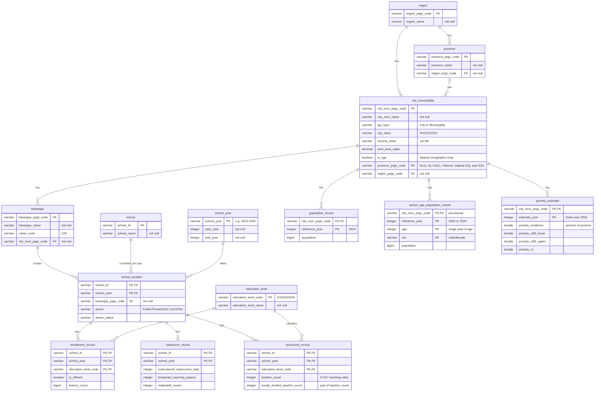

# Entity-relationship diagram

The real-world entities the project tracks and how they relate. This is the conceptual view. How each entity is stored in Gold, including technical geography members for unmatched schools, match statuses, availability flags, and every column, is in the [data model](data-model.md) (#138). One entity can be stored across several Gold tables, and one Gold table can hold several entities: region, province, and city or municipality are all stored in `dim_city_municipality` (see [Entities](#entities)).

The team edits the diagram on [dbdiagram.io](https://dbdiagram.io/d/ReachED-ERD-6acf49c2aebfe7a21fe5f61c); [`erd.dbml`](erd.dbml) is a copy of its code. The diagram below is the same model in Mermaid so GitHub renders it. Change both in the same pull request.

In short: a region has provinces and cities or municipalities; a province has cities or municipalities; a city or municipality has barangays; each school is located in a barangay **for each school year** (`school_location`); and each school location has enrollment and teacher records by education level and one classroom record. A city or municipality also has its population, school-age population, and poverty estimates.

## Entities

| Entity | Gold table(s) | One per | Source |
|---|---|---|---|
| `region` | `dim_city_municipality` (region columns) | Region | `psa_psgc` Silver ([D-035](../governance/decisions.md#d-035-psgc-silver)) |
| `province` | `dim_city_municipality` (province columns) | Province | `psa_psgc` Silver ([D-035](../governance/decisions.md#d-035-psgc-silver)) |
| `city_municipality` | `dim_city_municipality` | City or municipality | `psa_psgc` Silver ([D-035](../governance/decisions.md#d-035-psgc-silver)); land area from `hdx_boundaries` (D-042) |
| `barangay` | `dim_barangay` | Barangay | `psa_psgc` Silver ([D-035](../governance/decisions.md#d-035-psgc-silver)) |
| `school` | `dim_school` | School | DepEd Silver |
| `school_year` | `dim_school_year` | School year | DepEd Silver |
| `education_level` | `dim_education_level` | Reporting level | Reviewed list ([D-047](../governance/decisions.md#d-047-question-v1-metric-counting-rules)) |
| `school_location` | `fact_school_enrollment` (location, `sector`, and `annex_status` columns) | School and school year | `deped_enrollment` Silver; barangay from the Integration crosswalk ([D-029](../governance/decisions.md#d-029-one-set-of-match-columns-for-every-crosswalk), #91) |
| `enrollment_record` | `fact_school_enrollment` | School, school year, and education level | `deped_enrollment` Silver |
| `classroom_record` | `fact_school_classroom_capacity` | School and school year | `deped_facilities` Silver ([D-038](../governance/decisions.md#d-038-deped-facilities-silver)) |
| `personnel_record` | `fact_school_teacher_capacity` | School, school year, and education level | `deped_personnel` Silver ([D-041](../governance/decisions.md#d-041-deped-personnel-silver)) |
| `population_record` | `fact_city_population` | City or municipality and reference year | PSGC's `2024 Population` column ([D-033](../governance/decisions.md#d-033-barangay-population-source)) |
| `school_age_population_record` | `fact_city_school_age_population` | City or municipality, reference year, age, and sex | **Provisional.** PSA Total Population by Single-Year Age, Sex, and City/Municipality, 2020 CPH and 2024 POPCEN ([source](../business/dataset-use-map.md#school-age-population-source)); not yet profiled or ingested |
| `poverty_estimate` | `dim_city_poverty` (2023 only) | City or municipality and estimate year | `psa_poverty_stat` Silver ([D-034](../governance/decisions.md#d-034-psa-poverty-stat-silver-unpivot-to-one-row-per-unit-and-estimate-year)); D-046 (#151) |

`fact_school_year_source_availability` ([D-051](../governance/decisions.md#d-051-each-downstream-task-starts-from-the-gates-it-reads-the-source-lane-fan-in-is-an-audit)) has no business entity: it records which DepEd source has data for each school year, so the dashboard can label a year `not available`.

## Definitions

- **Education levels** ([D-047](../governance/decisions.md#d-047-question-v1-metric-counting-rules)): ES is Kindergarten, Grades 1–6, and ES non-graded; JHS is Grades 7–10 and JHS non-graded; SHS is Grades 11–12.
- **`learner_count`**: learners enrolled at the level. `is_offered` tells a level the school does not offer apart from a missing count.
- **`instructional_classrooms_total`**: instructional rooms across ES, JHS, and SHS. Temporary learning spaces and makeshift rooms are kept beside it, never added to it.
- **`teacher_count`**: Teacher I–III, Master Teacher I–IV, Head Teacher I–VI, SPED/SNED teachers, Special Science teachers, Instructors, and locally funded teachers, by level (D-047). Principals and non-teaching staff are not teachers. `locally_funded_teacher_count` is part of `teacher_count`.
- **School-age population**: by single year of age and by sex (`male`, `female`). AP4 uses ages 5–17, both sexes.
- **Poverty**: context only, never used to rank, flag, or score. PSA publishes 2018, 2021, and 2023; Gold uses 2023 (D-046).

Missing learner, classroom, and teacher counts are missing, never zero ([D-023](../governance/decisions.md#d-023-silver-never-invents-a-value)).

## Notes

- **A school's location can change between school years**, and AP4 compares 2020 with 2024, so the school's barangay is recorded per school year in `school_location`, not on `school`. The barangay gives the city or municipality.
- **Barangays without a public elementary school** (AP1, D-045) come from the barangay → school location link.
- **Not every city or municipality has a province.** In PSGC, the 33 highly urbanized cities (16 of them in NCR), Pateros, the City of Isabela, and the 8 Special Geographic Area municipalities have no province; the independent component cities (Dagupan, Santiago, Naga, Ormoc, Cotabato) do. So every city or municipality links to its region, and all but these to a province.
- **Population, school-age population, and poverty are at city/municipality level**, because AP1 to AP4 rank cities and municipalities.
- **Storage rules are in the data model, not here**: how schools that could not be matched to a barangay or city are kept, the match status of each school, which sources cover each school year, and the status of each population and poverty value. See [data-model.md](data-model.md).

## Resolved questions

Answered from the team's decisions (#45):

1. **Year alignment.** School years and PSA reference years stay separate. Pairing is done in Analytics: D-027 for poverty, and the two census points for AP4 (2020 with SY 2020–21 and 2024 with SY 2024–25).
2. **School-age population.** AP4 uses ages 5–17 at city/municipality level from the PSA 2020 and 2024 tables. The source remains provisional until it is profiled and ingested.
3. **Missing counts.** Missing learner, classroom, and teacher counts remain missing, never zero.