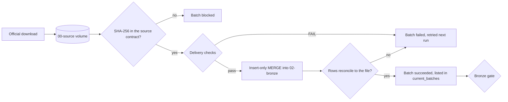
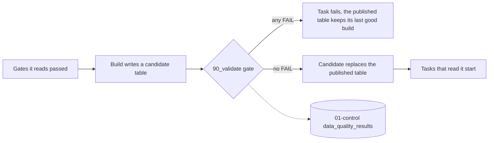
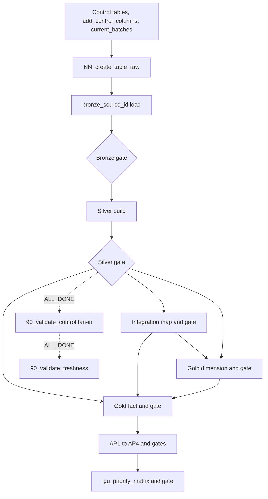

# Architecture

How the pipeline is built and run. What it answers and for whom is in the [root README](../../README.md); deployment beyond `dev` is in [Environments and deployment](#environments-and-deployment).

## Overview

One Databricks job, `edu_access_pipeline`, loads nine approved DepEd, PSA, and HDX sources from a Unity Catalog volume, cleans each source on its own, matches the sources to PSGC geography, builds Gold dimensions and facts, and publishes the AP1 to AP4 outputs and the LGU priority table. Every table from Silver on is written as a candidate and published only after its own validation gate passes, and every check is recorded in `01-control`. The same job runs locally on DuckDB (`python -m src.job.local_run`), so it can be checked without Databricks compute.

## Pipeline stages

The stage numbers follow one rule: a stage number matches its `etl/` folder and its Unity Catalog schema. Schema names start with a digit and contain a hyphen, so SQL must quote them with backticks: ``SELECT * FROM edu_access.`02-bronze`.some_table``. Schemas are created when their stage starts.

| Stage | Layer | Responsibility | Code | Schema |
|---|---|---|---|---|
| 00 | Source | Raw files exactly as received | `src/ingestion/` | `` edu_access.`00-source` `` (volume `raw`, no tables) |
| 01 | Control | Pipeline runs, ingestion batches, DQ results | `etl/01_control/` | `` edu_access.`01-control` `` |
| 02 | Bronze | Source landed unchanged, plus origin fields | `etl/02_bronze/` | `` edu_access.`02-bronze` `` |
| 03 | Silver | Typed, standardized, deduplicated, same grain; quarantine | `etl/03_silver/`, `src/silver/` | `` edu_access.`03-silver` `` (created by the first Silver build) |
| 04 | Integration | Matching across sources (e.g. to PSGC) | `etl/04_integration/` | `` edu_access.`04-integration` `` |
| 05 | Gold | Facts and dimensions for the approved question | `etl/05_gold/` | `` edu_access.`05-gold` `` |
| 06 | Analytics | One dataset per business question | `etl/06_analytics/` | `` edu_access.`06-analytics` `` |

## File naming and layout

- Each `etl/` stage README lists the files in that stage.
- SQL files in each `etl/` folder are named `NN_<verb>_<object>.sql`. `NN` sorts the files; it is not the run order. The job runs each file when the tasks it depends on in `databricks.yml` have finished, so files with different numbers can run in parallel.
- Each layer's checks are in `90_validate_<object>.sql`.
- `config/` holds non-secret settings, including the source registry.

## Data flow

Source to Bronze ([ingestion](../operations/ingestion.md)):



Six delivery formats share this flow, chosen by the source's contract: a zip with one CSV per school year (DepEd, `zip_csv`), a workbook sheet covering several estimate years (`psa_poverty_stat`, `xlsx_sheet`, D-018), an xlsx workbook per publication quarter (`psa_psgc`, `xlsx_table`, D-019), a report-style workbook per school year with title rows above the header (`deped_enrollment_psgc`, `xlsx_report`, #152), a census workbook whose two sheets are both loaded (`psa_school_age_population`, `xlsx_census`, #157), and one GeoJSON file per boundary edition (`hdx_boundaries`, `geojson_features`, D-026). Only discovery, the period, and how a file is read and checked differ.

From Silver on, every table is published the same way: Silver ([Silver](../operations/silver.md)), Integration maps ([Integration](../operations/integration.md)), Gold, and Analytics. Silver reads only the Bronze rows of `current_batches`.



Silver also records each run in `pipeline_runs` (`failed` or `succeeded`); Gold and Analytics gates record only their check results.

## Sources

See the [source inventory](../data/source-inventory/).

## Workspace

| Item | Value |
|---|---|
| Platform | Databricks Free Edition, one workspace shared by the team |
| Host | `https://dbc-2b6bf1c5-7bc3.cloud.databricks.com` |
| CLI profile | `reached-hq` (see [terminal setup, Part 12](../getting-started/terminal-setup.md#part-12-logging-in-to-databricks)) |
| Catalog | `edu_access`: managed, Default Storage, bound to this workspace only (isolated) |
| Owner of the catalog, schemas, and volume | The `reached-hq` group (all five teammates), so no single account is a bottleneck |
| SQL warehouse | Serverless Starter Warehouse, 2X-Small, auto-stop 10 minutes |
| Free Edition limits | Not yet recorded (#1) |

## Storage

Raw files go to the managed volume `` edu_access.`00-source`.raw ``, one folder per publisher, keeping original filenames. A raw file is never overwritten: any later download goes into a dated subfolder (D-016, provisional):

```
/Volumes/edu_access/00-source/raw/
├── deped/
│   ├── Enrollment-in-SY-2023-2024.zip      first downloads, uploaded 2026-09-30
│   ├── Enrollment-in-SY-2024-2025.zip
│   ├── Enrollment-in-SY-2025-2026.zip
│   ├── SHA256SUMS.txt                      covers every file in this folder
│   ├── ...                                 other DepEd sources
│   └── 2027-08-15/                         a later download (example date)
│       ├── Enrollment-in-SY-2026-2027.zip
│       └── SHA256SUMS.txt
├── psa/
│   ├── 2_2023 SAE_with PSGC_noHUC_06Feb2026.xlsx   psa_poverty_stat, uploaded 2026-09-30
│   ├── SHA256SUMS.txt
│   └── ...                                         other PSA files
└── admin_boundaries/
    ├── phl_admin3.geojson                  hdx_boundaries (ADM3), uploaded 2026-10-06
    ├── phl_admin4.geojson                  ADM4, not ingested
    └── SHA256SUMS.txt
```

Ingestion identifies files by SHA-256, not by path (D-014). A PSA Poverty Stat workbook is one delivery covering several estimate years (D-018); a PSGC workbook is one delivery per publication quarter (D-019). PSA replaces the quarterly PSGC file at a stable URL, so a re-download goes into a dated subfolder and never over the earlier file. A COD-AB boundary file is one GeoJSON delivery whose geometry is kept as text (D-026).

This is provisional (D-009): if the mentor approves the course R2 bucket, an R2-backed volume is added next to it. Local copies for profiling live outside the repository in `raw-data/` ([terminal setup, Part 8](../getting-started/terminal-setup.md#part-8-raw-data-and-raw_data_dir)).

## Data quality

Every check writes one row to `` edu_access.`01-control`.data_quality_results `` (#42 columns, plus `batch_id`, `source_id`, `code_revision`); results hold counts and rules, never row values.

| Status | Meaning | Action |
|---|---|---|
| PASS | As expected | None |
| WARN | Worth knowing, not wrong in Bronze (e.g. a publisher's duplicate school) | Recorded; rows are loaded as received; Silver decides |
| FAIL | The batch cannot be trusted | The batch is not marked succeeded, so downstream does not read it; the run exits nonzero |

Bronze checks are listed in [ingestion, Validation](../operations/ingestion.md#validation).

Silver adds its own gate per source (`etl/03_silver/90_validate_<table>.sql`, `layer = 'silver'`): reconciliation with Bronze per school year (rows and learners), unique non-NULL keys, counts non-negative and integer-typed, NULLs kept as NULL, every label in the reviewed mapping, complete lineage, and the quarantine rate; it also records how many rows each cleaning rule changed or flagged. For Silver, WARN means rows were quarantined (at most 1% of a school year) and the build stands; FAIL means the candidate build cannot be trusted: the task fails before publishing, the run is marked `failed`, and the Silver tables keep the last build that passed (D-025). Details: [Silver, The gate](../operations/silver.md#the-gate).

Integration, Gold, and Analytics gates (`layer` is `integration`, `gold`, or `analytics`) check grain, keys, foreign keys, reconciliation with the tables they read, and coverage; each stage README says what its gates add. Totals traced from source file to Gold are in [validation](../operations/validation.md).

The [data-quality dashboard](../../dashboards/README.md) shows these results: each check's newest result (current) apart from every recorded result (history), by layer, source, and quality attribute, with job runs and source freshness. It reads only `01-control`.

## Orchestration

`databricks.yml` defines one job, `edu_access_pipeline` (D-020). The shape of one source lane and what follows it:



Each source has its own lane, and the lanes run in parallel. Solid arrows run only when the task before succeeded; dotted arrows run when it has finished, passed or not. The tasks:

| Task | Type | Runs on | Runs when |
|---|---|---|---|
| `01_create_pipeline_runs` through `04_create_data_quality_results` | SQL | SQL warehouse | At job start, once, in order |
| `add_control_columns`: add columns that older control tables lack (`src/ingestion/cli.py columns`) | Python | serverless job compute | The control tables exist |
| `05_create_current_batches` | SQL | SQL warehouse | The columns it reads exist |
| `NN_create_<table>_raw` | SQL | SQL warehouse | Control setup succeeded; all source DDL tasks fan out in parallel |
| `bronze_<source_id>`: check each delivery against its contract, load, reconcile (`src/ingestion/cli.py ingest --no-gate --no-setup`) | Python | serverless job compute | That source's raw table exists |
| `90_validate_<table>_raw`: the Bronze gate (`etl/02_bronze/90_validate_<table>_raw.sql`) | SQL | SQL warehouse | The load succeeded |
| Silver clean and validation files from `etl/`, one task each | SQL | SQL warehouse | The preceding task in the same source lane succeeded |
| `90_validate_control`: the source-lane fan-in (`etl/01_control/90_validate_control.sql`, generated by `src/job/fan_in.py`) | SQL | SQL warehouse | Every Silver gate has finished, passed or not (`ALL_DONE`); fails if any Silver lane switched on did not succeed, so the job run fails. Only freshness follows it (D-051) |
| `90_validate_freshness`: one `source_fresh` result per loaded source (`etl/01_control/90_validate_freshness.sql`, generated by `src/job/freshness.py`) | SQL | SQL warehouse | `90_validate_control` has finished, passed or not (`ALL_DONE`), so every Bronze load has too; records WARN for a stale source and never fails (D-043) |
| Integration, dimension, fact, and analytics files from `etl/`, one task each | SQL | SQL warehouse | The gates of the tasks it reads succeeded, and nothing else (D-051): Silver gates for a map, Silver or map gates for a dimension, dimension gates for a fact, fact gates for an analytics output |

Python is used only where SQL cannot do the work: the deliveries are zipped CSVs with a declared encoding, Excel workbooks, or a GeoJSON file with polygons of several megabytes. Every SQL file is its own task, so a failed check shows as its own failed task. After the shared control bootstrap, source lanes start in parallel and do not depend on each other. Within each lane, tasks run in order and stop if their own upstream task fails. `90_validate_control` is the source-lane fan-in: it runs once every Silver gate has finished, records each Silver lane switched on, and fails if one did not succeed, so the job run fails. It is an audit: only freshness follows it, and no Integration, Gold, or Analytics task waits for it (D-051). Each mapping task starts from the Silver gates of the sources it reads, each dimension from the Silver or map gates it reads, each fact from the dimension gates it joins (its keys) and the one Silver or Integration gate that holds its numbers, and each analytics output from its fact gates. So one failing source stops only the tasks that read it. SQL tasks receive the job parameters `code_revision` and `run_id` (`{{job.run_id}}`) as `:code_revision` and `:run_id`. The job has no schedule during development, allows only one whole job run at a time, and is safe to rerun. `python -m src.job.local_run` checks the same DAG in a deterministic topological order on DuckDB ([src/job](../../src/job/README.md)).

### Monitoring

A job that succeeds has only run; it has not shown the data is right. So the job reports how it ran, and two SQL alerts report what its checks found (D-043):

| Signal | Set in | Fires when | Tells |
|---|---|---|---|
| Failure email | `email_notifications.on_failure` | A run fails, including a timeout. Cancelled and skipped runs are not reported | Which run and task failed |
| Duration warning | `health` rule `RUN_DURATION_SECONDS` (`duration_warning_seconds`, 45 minutes) | A run is still going after 45 minutes | The run is slow. Observed whole runs took 6 min 43 s to 18 min 22 s; the first took 39 minutes, 35.5 of them waiting for Free Edition capacity (D-017) |
| Timeout | `timeout_seconds` (`job_timeout_seconds`, 90 minutes) | A run is still going after 90 minutes | The run is stopped and counts as failed, so the failure email follows |
| `quality_failures` alert | `resources.alerts` | The latest run's newest result for any check is FAIL | The email lists each FAIL: layer, source, table, check, expected, actual |
| `stale_sources` alert | `resources.alerts` | The latest freshness check found a source whose latest succeeded batch is older than its limit in `config/freshness.yml` | The email lists each stale source with its limit and last load date |

- **Who is told.** The job's emails and the alerts go to whoever deployed them (`${workspace.current_user.userName}`, resolved at deploy time), so on `dev` only the person who ran it hears about it, and no address is committed. On `prod` the whole team will be told; that target and its recipients come with #99.
- **When the alerts evaluate.** Daily at 08:00 Asia/Manila (`alert_schedule`). Development mode pauses alert schedules, so on `dev` an alert is evaluated by hand from its page in the workspace.
- **Latest run only.** `quality_failures` reads the latest run that wrote any result, so a partial run (`--only`) after a failing one hides that run's FAILs until the next full run.
- **Testing.** Each threshold is a bundle variable, and `freshness_as_of` is a job parameter, so every signal can be made to fire once without changing code or data: deploy with `--var duration_warning_seconds=60`, run only `90_validate_control` (no Silver lane ran in that run, so it records FAILs and fails), and run only `90_validate_freshness` with `freshness_as_of` set years ahead. Tested on `dev` on 2026-10-13 ([evidence](../../evidence/pipeline-runs/2026-10-13-monitoring-alerts.md)).

## Environments and deployment

<!-- TODO(Phase 6): prod target, CD workflow, secrets handling. -->

- `dev` is the only bundle target so far (`mode: development`); `prod` is not defined yet. `dev` and `prod` are deploy targets, not branches (D-005).
- The job runs the commit it was deployed from (`git_source.git_commit: ${bundle.git.commit}`), and records the same value as `code_revision` on every row it writes. New code needs a deploy from a clean, pushed `main`.
- Only `accepted` sources may load into `prod`; `profiled` sources load into `local` and `dev` only.
