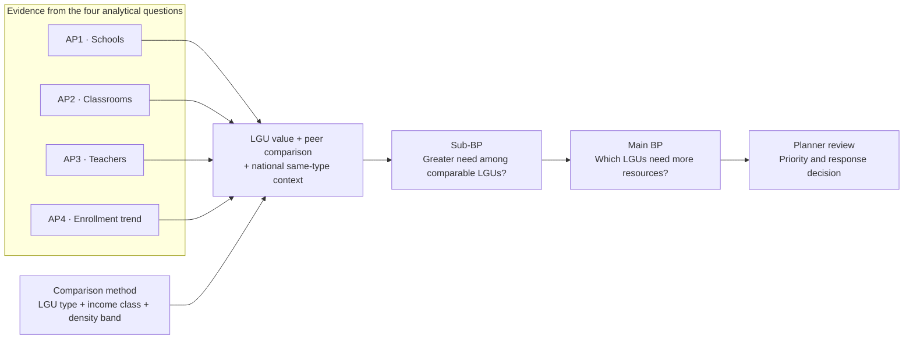
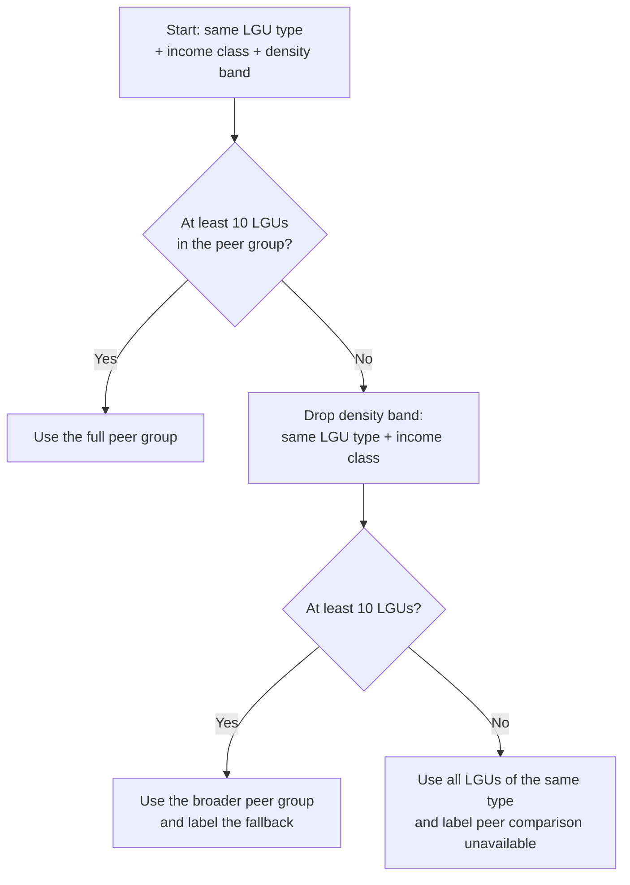

# Business and analytics problem: Question v1

**Status:** Draft for team approval (#9). Recorded as D-042. The business and analytical question wording is fixed in this draft; the implementation choices under [Decisions needed](#decisions-needed) still require team confirmation.

| | |
|---|---|
| **Primary users** | LGU education planners (D-013). Whether the primary user is the provincial planner specifically is open. |
| **Focus** | Students, measured as enrolled learners (observed demand) |
| **Education scope** | Basic education: Kinder to Grade 12 (D-003) |
| **Unit of analysis** | City or municipality |
| **Decision boundary** | The analysis organizes evidence for local review. Planners remain responsible for prioritization and intervention decisions. |

## Business problem

LGU education planners need to know whether their cities and municipalities have enough public schools, classrooms, and teachers for their students. National totals do not answer this. A raw ranking of all 1,642 cities and municipalities also lacks context because cities and municipalities differ in fiscal capacity, settlement pattern, and scale.

Planners need a fairer reference point: how an LGU compares with LGUs like it. If an LGU has far more students per classroom than its selected peers, that is an additional signal for closer review. It does not prove what caused the difference or which intervention is appropriate.

Enrollment is **observed demand** only. It does not include children who are not enrolled. The analysis therefore cannot measure total unmet need or prescribe an intervention.

## Business questions

### Main business question

> **Which cities and municipalities need more schools, classrooms, and teachers based on their student population and enrollment demand?**

### Sub-business question

> **Among cities and municipalities with the same income class and population density, which show greater need for additional schools, classrooms, or teachers?**

### Method: peer groups

To compare consistently, each city or municipality is grouped with LGUs of the same type (city or municipality), the same income class, and the same population-density band. Cities and municipalities are separated before income class is applied because their income-class brackets differ. Each LGU's result is read against its peer group and against the national distribution for the same LGU type. The peer group is a descriptive comparison method, not an analytical question or a claim that income or density causes education need (see Peer groups).

### Decision supported

The analysis helps planners decide which cities and municipalities to look at more closely and which school, classroom, or teacher measure signals pressure. It does not decide where to build a school, hire teachers, or construct classrooms.

## How the questions fit together

AP1 to AP3 provide the school, classroom, and teacher measures. AP4 adds the direction of enrollment demand over time. The peer-group method supplies the comparison required by the sub-business question. Poverty incidence (PSA small area estimates, 2023) is context only and has no question of its own.

Peer comparison is not an adequacy standard. Each LGU's own values show the observed level of provision or capacity; the peer comparison shows how unusual that value is for the selected comparison group. Both are shown with national same-type context because a whole peer group can experience pressure even when no member stands out within the group.

## Peer groups

A **peer group** is the set of LGUs that a city or municipality is compared with. It provides a consistent reference point; it does not prove that the LGUs are identical, control for every relevant difference, or establish a required level of education provision. It is a method, not an analytical question.

### Criteria

| Criterion | Rule | Source |
|---|---|---|
| LGU type | Same type: city or municipality | PSGC 2Q 2026 `Geographic Level` (`City`, `Mun`) |
| Income class | Same class | PSGC 2Q 2026 `Income Classification (DOF DO No. 074.2024)` |
| Population density | Same density band (bands open) | 2024 population (PSGC) ÷ land area (source open) |

The 14 Manila sub-municipalities (`SubMun`) are not LGUs and are not peers; Manila is compared as one city.

### How the comparison is read

The recommended display gives three pieces of information together:

1. **LGU value:** the observed metric for the city or municipality.
2. **Peer context:** the peer median and the LGU's percentile position within the peer group.
3. **National context:** the median for all LGUs of the same type, shown separately for cities and municipalities.

This supports the sub-business question without treating the peer median as a minimum standard. A high peer-relative ratio is evidence for closer review, not proof of a shortage, cause, or required intervention.

### Small-group fallback

This is the recommended fallback, not yet a team decision. The dashboard must show which comparison level was used.

### Why city class (HUC, ICC, CC) is not a criterion

City class overlaps strongly with income class in the current PSGC counts and would create smaller groups if added to the peer definition. PSGC 2Q 2026 shows the overlap:

| City class | 1st | 2nd | 3rd | 4th | Total |
|---|---|---|---|---|---|
| HUC | 33 | | | | 33 |
| ICC | 4 | 1 | | | 5 |
| CC | 48 | 24 | 30 | 9 | 111 |
| **All cities** | **85** | **25** | **30** | **9** | **149** |

Every HUC is 1st class, and only component cities vary across all four income classes. Question v1 therefore keeps HUC, ICC, and CC as descriptive governance context rather than an additional peer-group criterion. This choice can be revisited if planner research shows that administrative city class materially changes the comparison they need.

### Why city vs. municipality is kept

Income class uses separate brackets for cities and for municipalities (RA 11964, DOF DO No. 074.2024), so a 1st class city and a 1st class municipality are not the same income level. Grouping them by income class alone would put unlike LGUs together. LGU type is therefore the split inside which income class is compared, not a separate factor.

City status is also a legal status set by a charter law, and it does not change when income or population changes later. Becoming a city requires meeting income and population or land-area thresholds (Local Government Code Sec. 450, as amended), so the two overlap, but one does not define the other.

### Group sizes

| Municipalities | 1st | 2nd | 3rd | 4th | 5th | No class | Total |
|---|---|---|---|---|---|---|---|
| Count | 696 | 247 | 242 | 236 | 64 | 8 | 1,493 |

- 696 of 1,493 municipalities (47%) are 1st class, so density does most of the work in separating them.
- The smallest city group, 4th class, has 9 cities, so splitting it by density may leave very few peers.
- The 8 municipalities with no income class (`-`) are the 8 Special Geographic Area municipalities (Kapalawan, Old Kaabakan, Kadayangan, Nabalawag, Pahamuddin, Malidegao, Ligawasan, Tugunan). They have no peer group, and their schools are already excluded from city- and municipality-level results (D-031).

**Dashboard option:** users may narrow the comparison (for example to the same region or province). The criteria above are what Question v1 answers.

## Analytical questions

| # | Analytical question | Metric or output | Approximate formula | Grain | Primary sources | Main limitation |
|---|---|---|---|---|---|---|
| AP1 | Which areas have fewer schools relative to their number of students and population? | Learners per public school; public schools per 10,000 residents; barangays with no public school offering the level | `public-school learners at level / public schools offering level`; `public schools offering level / 2024 population * 10,000`; count of barangays with none | City/municipality × education level × school year | DepEd enrollment (school roster and `offers_*` flags), SY 2023-24; PSGC 2024 population | Total population, not school-age population; a barangay with no school may be near one in the next barangay |
| AP2 | Which areas have the most students per classroom? | Learners per instructional classroom; classroom-data coverage | `learners in schools with usable classroom data / instructional classrooms reported by those schools` | City/municipality × education level × school year | DepEd enrollment and facilities, public schools, SY 2023-24 | One school year only; classroom counts missing for some schools |
| AP3 | Which areas have the most students per teacher? | Learners per teacher; personnel-data coverage | `learners in schools with usable personnel data / teachers reported by those schools` (which positions count is open) | City/municipality × education level × school year | DepEd enrollment and personnel, public schools, SY 2023-24 | Working-personnel counts, not plantilla (personnel profile O-13) |
| AP4 | Which areas have student enrollment increasing or decreasing over time? | Public learner count; absolute and percentage change | `current - prior`; `(current - prior) / prior * 100` | City/municipality × education level × school year | DepEd enrollment, SY 2023-24 to 2025-26 | **Provisional** until cross-year comparability is validated (#8) |

For AP1 to AP4, each LGU's result shows its own value, the recommended peer median and percentile, and the national median for the same LGU type. Every result also reports how much of the LGU's schools and enrolled learners the measure covers. Until the team adopts a cited adequacy standard, values and rankings are treated as evidence of relative pressure rather than confirmed shortages (see Decisions needed).

### Interpretation controls

- **AP1 measures provision, not access.** An LGU with few schools for its population may still have schools close by in a neighbouring LGU, and a barangay with no public school may be near one in the next barangay.
- **Schools per 10,000 residents uses total population,** because school-age population is not available at city or municipality level. The denominator is labelled as total population.
- **AP1 to AP4 cover public schools only,** because classroom and teacher data cover public schools only (personnel profile O-3), and the same scope keeps the measures comparable.
- **Enrollment follows the school, not learner residence.** The data count learners enrolled in public schools located in the LGU; they do not show where those learners live or capture children who are not enrolled. Cross-boundary enrollment may therefore affect an LGU's ratios.
- **Annex schools:** AP2 and AP3 add annex enrollment and capacity to the mother school where a verified annex crosswalk exists, following DepEd's ratio method (personnel profile O-14). Results without that step are labelled provisional.
- **Numerator and denominator use the same schools.** AP2 and AP3 include learners in the ratio only when the same schools have usable classroom or personnel data. Missing values stay NULL, never 0 (D-023), and each result reports both school and learner coverage.
- **A peer result is descriptive.** Being worse than the peer median does not by itself prove a shortage or identify its cause. HUC, ICC, and CC status remains visible as context even though it is not a grouping criterion.
- **AP4 reports both absolute and percentage change.** Percentage change is undefined when the prior value is 0. Rising enrollment alone does not prove a shortage, and falling enrollment does not prove a surplus.
- **The analysis does not decide.** Planners, not the query, decide whether an LGU is a priority and what response to investigate.

## Decisions needed

The wording of the main business question, sub-business question, and AP1 to AP4 is fixed for this draft. The team still needs to decide how the questions will be implemented. A recommendation is included so the team can approve it or choose an alternative; recommendations are not decisions until recorded in D-042.

| Decision | Recommended choice | Other choices and tradeoffs | Why this is recommended | Status |
|---|---|---|---|---|
| **Primary user** | LGU education planners generally, with the provincial planner as the first dashboard persona | Provincial planner only; this is more focused but does not directly fit HUCs and ICCs, which plan outside provinces | Keeps the nationwide city/municipality question coherent while retaining the team's detailed provincial-planner user story | Team decision needed |
| **Question wording** | Keep the Main BP, Sub-BP, and AP1 to AP4 exactly as written above | Rewording could make public-school scope or peer comparison explicit, but the team asked to preserve the agreed wording | Stability for mentor and team review; scope qualifications remain in the metric definitions and interpretation controls | **Fixed in this draft** |
| **Density bands** | Calculate density terciles separately for cities and municipalities, then combine them with income class | One national set of bands is simpler but compares unlike city and municipality distributions; bands within every income class balance cells but make “high density” mean something different in every class; municipalities-only bands leave city comparisons less consistent | Type-specific terciles preserve the city/municipality split and give each type a transparent low/middle/high density meaning | Team decision needed |
| **Small peer groups** | Require at least 10 LGUs; otherwise drop density and use type + income class; if that still has fewer than 10, show same-type national context and label peer comparison unavailable | Minimum 5 preserves more narrow groups but produces unstable medians; immediate same-type fallback discards useful income context too early | Gives a predictable hierarchy and avoids presenting very small groups as robust benchmarks | Team decision needed |
| **Comparison statistic** | Show the peer median and percentile rank, plus the national median for the same LGU type | Mean is familiar but sensitive to extremes; rank alone hides the size of the difference; a full distribution is informative but harder to read | Median is robust, percentile gives position, and same-type national context prevents a weak peer group from looking adequate | Team decision needed |
| **Meaning of “need” and “gap”** | In Question v1, show values and rankings as evidence for review; use a binary gap flag only after adopting a cited adequacy standard | Worst 20% gives a simple flag but always labels a fixed share; worst peer quartile does the same within every group; a team-set cutoff is usable but is not an official standard | Avoids presenting a relative rank as proof that a resource shortage exists | Team decision needed |
| **AP3 teacher count** | Exclude head teachers from the main ratio, show a sensitivity ratio that includes them, and include LGU-funded teachers in the total while reporting funding source separately | Include head teachers in the main ratio; simpler but assumes a teaching load that is not documented. Exclude LGU-funded teachers; comparable to national staffing but understates actual classroom personnel | Keeps the main measure conservative and makes both assumptions visible | Team decision needed |
| **BARMM** | Include BARMM with explicit coverage and geography limitations | Exclude BARMM; simpler comparisons but removes a large and policy-relevant part of the country despite usable enrollment, facilities, and personnel data | Preserves national coverage without hiding known limitations | Team decision needed |
| **Land area source** | Profile and use PSA OpenSTAT; use HDX `area_sqkm` only as a documented fallback or cross-check | Use HDX immediately; it is already profiled but its area field is undocumented by the publisher | Population density should use an official source when it determines peer membership | Team decision needed |
| **Time and geography reference** | Use one documented current peer definition across the three enrollment years and flag LGUs affected by boundary changes | Reconstruct peer groups for every year; historically cleaner but requires comparable annual population, income, and boundary data that are not currently available | Keeps trend comparisons stable and makes the available-data limitation explicit | Team decision needed |

**If BARMM is included,** these limits go with its results:

- All 2,603 BARMM public schools are in the SY 2023-24 enrollment, facilities, and personnel files.
- About 93% of BARMM public schools have classroom counts, against about 99% elsewhere. AP2 shows this coverage and never treats a missing count as 0.
- School-level NAT Grade 6 and ELLNA extracts do not cover BARMM, and must not be used to infer BARMM learning outcomes.
- DepEd's SY 2023-24 files place Sulu in BARMM; PSGC 2Q 2026 places it in Region IX. Regional results for SY 2023-24 use DepEd's region column (D-012).
- The 112 Special Geographic Area schools stay excluded from city- and municipality-level results until their barangays are matched (D-031).

## Deferred analysis

### Physical access (stretch)

> **Where is physical access to schools most limited?**

Distance or travel time to the nearest school offering each level is deferred until school locations are complete and verified. Until then, AP1's barangays with no public school are a provision count, not a measure of distance.

### Candidate locations (second stage)

> **If an additional school or service point is selected for investigation, where could candidate locations improve coverage?**

Center of gravity, clustering (K-means), or network accessibility belong to this stage. Its results would be candidate locations for local assessment, not recommendations to build. It starts only after planners decide that a new service point is the response worth investigating.

## Planner needs

Under D-001, a question resting mostly on **assumed** needs cannot be approved. The needs behind AP1 to AP4 are cited and tagged in #7 (`docs/business/planner-needs.md`). The stakeholders, sponsors, and user story are in [stakeholders.md](stakeholders.md). Until #7 lands, the comparison-with-peers framing is **mentor-reviewed and pending confirmation** (program mentor review, 2026-10-12), and the remaining needs are **assumed**.

## Revision history

| Version | Date | Change |
|---|---|---|
| Question v1 (this draft) | 2026-10-12 | Preserved the agreed Main BP, Sub-BP, and four APs word-for-word. Peer groups are the comparison method, not an AP or a causal test. Added recommended choices with alternatives and tradeoffs, a small-group fallback, coverage-aligned ratios, and explicit interpretation limits. |
| Draft (#9 thread) | 2026-10-05 | Consolidated by @mafelisilda: provision, classroom, teacher, enrollment-trend, and overlap questions at barangay and city/municipality level |

## Follow-up work

- **Decisions needed:** approve or replace each recommended choice above and record the result in `docs/governance/decisions.md`.
- **Planner needs:** cite and tag them (#7).
- **Cross-year comparability:** validate SY 2023-24 to 2025-26 enrollment at the same geography and level before AP4 leaves provisional (#8).
- **Metric contracts:** exact filters, source columns, grade-to-level mapping, missing-data rules, and final formulas.
- **Gold model:** fact-table names, grain statements, and keys (milestone 03).
