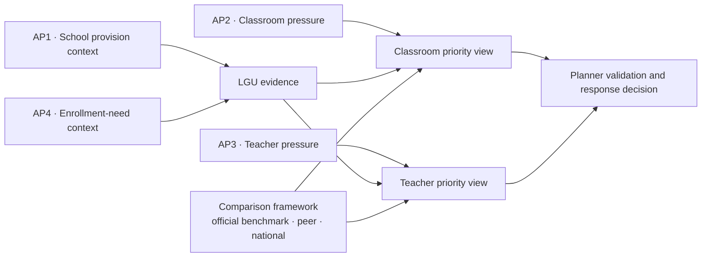
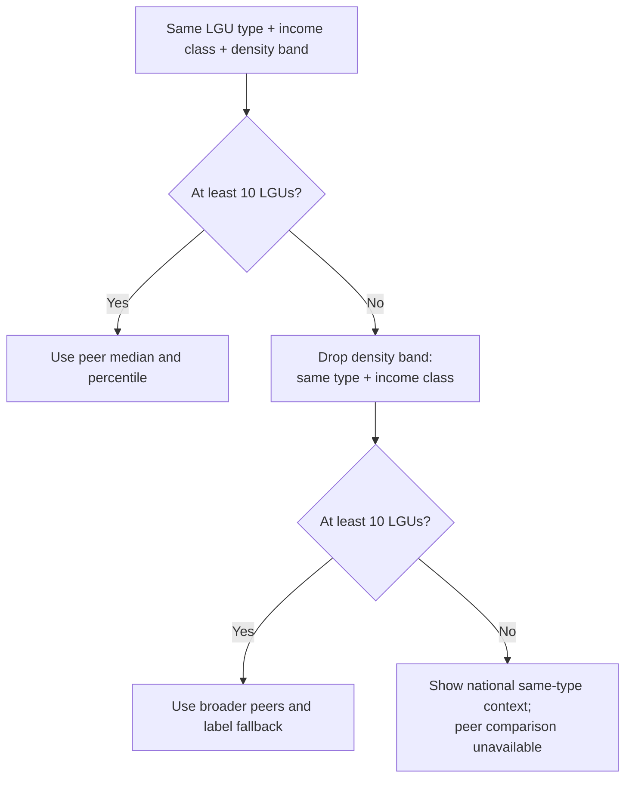

# Business and analytical questions

**Status:** The question wording below was approved through mentor review on 2026-10-14. The implementation choices under [Decisions still needed](#decisions-still-needed) remain open and are recorded in D-042.

| | |
|---|---|
| **Primary users** | Local education planners: DepEd Schools Division Offices and LGU Local School Boards |
| **Action** | Prioritize classroom provision and teacher allocation |
| **Wider resource context** | Public schools, classrooms, and teachers |
| **Purpose** | Address capacity pressure in relation to enrollment need |
| **Education scope** | Public basic education, Kinder to Grade 12 (D-003) |
| **Unit of analysis** | City or municipality |
| **Decision boundary** | ReachED organizes evidence for prioritization and local validation. Planners decide the response and the amount to provide or allocate. |

## Business problem

Local education planners need a consistent way to identify where public-school enrollment places the greatest pressure on classroom and teacher capacity. A raw national total does not show which locations warrant attention, while a rank without context can make unlike local government units appear directly comparable.

Enrollment is **observed demand**: learners enrolled in public schools located in an LGU. It does not include every school-age resident, identify learner residence, or by itself establish how many classrooms or teachers must be added. The analysis therefore supports prioritization and validation rather than prescribing a final intervention.

## Business question

> **How should we prioritize the provision of classrooms and teachers among cities based on their respective enrollment needs?**

The concise business question uses “cities,” while the approved analytical scope explicitly covers both **cities and municipalities**. There is no sub-business question.

## Analytical questions

1. **Which cities and municipalities have fewer public schools relative to their number of enrolled students and total population?**
2. **Which cities and municipalities have the most public-school students per classroom?**
3. **Which cities and municipalities have the most public-school students per teacher?**
4. **Which cities and municipalities have the largest gap between school-age population and student enrollment over time?**

### How the analytical questions support the decision

| Question | Role in the business decision | Primary output |
|---|---|---|
| **AP1 · Schools** | Supporting context on the availability of public schools; it does not independently recommend construction | Learners per public school and public schools relative to total population |
| **AP2 · Classrooms** | Direct evidence for classroom prioritization | Public-school learners per usable instructional classroom, with coverage |
| **AP3 · Teachers** | Direct evidence for teacher-allocation prioritization | Public-school learners per approved teacher count, with coverage |
| **AP4 · Population and enrollment** | Supporting context on the difference between school-age residents and observed public-school enrollment | School-age population minus aligned student enrollment, by comparable period |

Classroom and teacher priorities remain separate. A city or municipality may show classroom pressure without teacher pressure, or the reverse. A combined score is not part of the approved question and requires a later decision on weights and interpretation.

## Comparison and prioritization framework

Peer groups, national indicators, and official benchmarks are **methods used to interpret the analytical results**. They are not a sub-business question or additional analytical questions.

For each applicable indicator, the dashboard should distinguish four kinds of evidence:

| Evidence | Meaning | Interpretation rule |
|---|---|---|
| **LGU observed value** | The city or municipality's own metric | Primary evidence for the local result |
| **Official benchmark** | A cited, applicable DepEd or other authoritative standard | May support a benchmark gap only when the definition, level, and effective period match the metric |
| **Peer comparison** | Median and percentile among comparable LGUs | Relative context; not proof of adequacy or shortage |
| **National same-type comparison** | Median or distribution for cities or municipalities separately | Descriptive national reference; not an official standard |

A peer or national median must never be labelled a national baseline or adequacy standard. Until a validated official benchmark is adopted, the dashboard reports **relative pressure**, not a confirmed capacity shortage.

### Peer-group method

The proposed peer group compares an LGU with others of the same:

1. LGU type: city or municipality;
2. income class; and
3. population-density band.

Cities and municipalities are separated before income class is applied because their statutory income brackets differ. Peer grouping does not claim that income class or density causes education pressure.

The proposed display shows the LGU value, peer median, peer percentile, and national same-type median together. National context remains visible because an entire peer group may experience pressure even when no member stands out within that group.

The criteria, density-band construction, and small-group fallback remain implementation decisions. They must be approved before peer ranks are published.

## Metric definitions and current feasibility

| # | Metric or output | Approximate formula | Grain | Primary sources | Current limitation |
|---|---|---|---|---|---|
| AP1 | Learners per public school; public schools per 10,000 total residents | `public-school learners / public schools`; `public schools / total population * 10,000` | City/municipality × education level × school year | DepEd enrollment; PSGC population | Provision is not physical access; school size varies |
| AP2 | Learners per instructional classroom | `learners in schools with usable classroom data / classrooms reported by those schools` | City/municipality × school year, with level detail where valid | DepEd enrollment and facilities | Facilities are available only for SY 2023-24; missing rooms are not zero |
| AP3 | Learners per teacher | `learners in schools with usable personnel data / approved teacher count for those schools` | City/municipality × education level × school year | DepEd enrollment and personnel | Personnel are available only for SY 2023-24; included positions require approval |
| AP4 | School-age-population and enrollment difference over time | `school-age population - aligned student enrollment` | City/municipality × comparable period | DepEd enrollment; official LGU school-age population source still needed | No profiled nationwide LGU-level school-age-population time series currently supports the question |

### Interpretation controls

- **Public-school scope:** classroom and personnel measures cover public schools, so the prioritization outputs use public-school enrollment.
- **School location is not learner residence:** enrollment is assigned to the location of the school. Cross-boundary attendance can affect every LGU result.
- **Matched coverage:** AP2 and AP3 include learners in a ratio only when the same schools have usable denominator data. Missing values remain NULL, never zero, and coverage is reported.
- **AP1 is provision context:** fewer schools per learner or resident does not by itself prove that a new school is required.
- **AP4 is not an out-of-school count:** when school-age population is compared with public-school enrollment, the difference may include private-school learners, cross-boundary enrollment, age-grade mismatch, and non-enrollment.
- **Comparable periods are required:** population reference years and school years must be aligned or their mismatch labelled explicitly.
- **Official standards require validation:** a benchmark enters the dashboard only after its source, scope, formula, applicable level, and effective period are documented.
- **The analysis supports the decision:** planners validate local conditions and decide whether the response is provision, reallocation, another operational action, or no action.

## Decisions still needed

The BP and AP wording is fixed. These implementation choices remain for the team and the data-model, ERD, analytics, and dashboard workstreams.

| Decision | Recommended choice | Status |
|---|---|---|
| **Prioritization output** | Publish separate classroom and teacher priority views; do not create a combined score without approved weights | Team decision needed |
| **Peer criteria** | Use LGU type, income class, and type-specific density bands; retain national same-type context | Team decision needed |
| **Small peer groups** | Require at least 10 LGUs, then fall back to type + income class, then national same-type context | Team decision needed |
| **Comparison statistic** | Show median and percentile, not rank alone | Team decision needed |
| **Official benchmarks** | Use only cited standards that match the indicator definition and period; keep descriptive medians separate | Source and team approval needed |
| **AP3 teacher count** | Approve which personnel positions enter the denominator and show funding source separately | Team decision needed |
| **AP4 age definition** | Approve the school-age range appropriate to public basic education | Team decision needed |
| **AP4 source and period** | Acquire and profile an official city/municipality school-age-population time series before publishing AP4 | Data gap |
| **BARMM** | Include with explicit coverage and geography limitations | Team decision needed |
| **Land area for density** | Prefer a complete official source; use HDX only as a documented fallback | Team decision needed |

## Workstream boundary

This document fixes the business and analytical meaning. Follow-on pull requests own the implementation:

- the **data model** defines facts, dimensions, grains, and benchmark/reference structures;
- the **ERD** defines business entities and their relationships;
- the **analytics layer** implements formulas, peer membership, national distributions, benchmark comparisons, and validation;
- the **dashboard** presents separate classroom and teacher priorities with their comparison context and limitations.

The [dataset use map](dataset-use-map.md) records which profiled sources can support each question and which source gaps remain.
