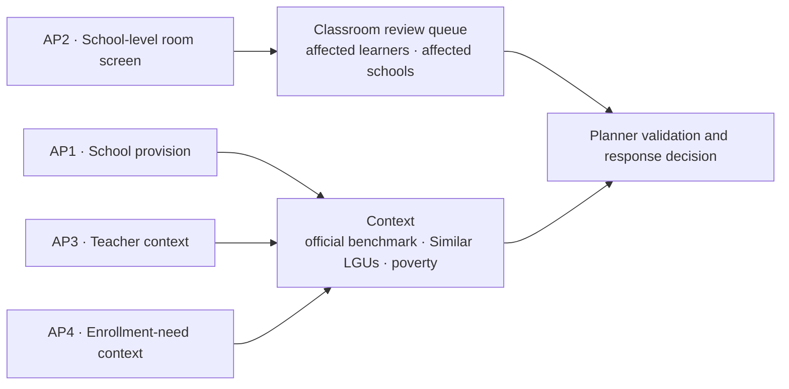

# Business and analytical questions

**Status:** The question wording below was approved through mentor review on 2026-10-14. D-060 replaces the earlier percentile-tier rule with a bounded classroom review queue; the calculations are in the separate [metric specification](metric-specification.md).

| | |
|---|---|
| **Primary users** | LGU Local School Boards (provincial, city, and municipal), which decide how the Special Education Fund is spent |
| **Action** | Prioritize classroom provision and teacher allocation |
| **Wider resource context** | Public schools, classrooms, and teachers |
| **Purpose** | Address capacity pressure in relation to enrollment need |
| **Education scope** | Public basic education, Kinder to Grade 12 (D-003) |
| **Unit of analysis** | City or municipality |
| **Decision boundary** | ReachED organizes evidence for prioritization and local validation. Planners decide the response and the amount to provide or allocate. |

## Business problem

Local education planners need a consistent way to identify where public-school enrollment places the greatest pressure on classroom and teacher capacity. A raw national total does not show which locations warrant attention, while a rank without context can make unlike local government units appear directly comparable.

Enrollment is **observed demand**: learners enrolled in public schools located in an LGU. It does not include every school-age resident, identify learner residence, or by itself establish how many classrooms or teachers must be added. The analysis therefore supports prioritization and validation rather than prescribing a final intervention.

## Business question

> **How should we prioritize the provision of classrooms and teachers among cities based on their respective enrollment needs?**

In this question, “cities” means cities and municipalities, the same unit the analytical questions use. The approved wording is kept as it is.

## Analytical questions

1. **Which cities and municipalities have fewer public schools relative to their number of enrolled students and total population?**
2. **Which cities and municipalities have the most public-school students per classroom?**
3. **Which cities and municipalities have the most public-school students per teacher?**
4. **Which cities and municipalities have the largest gap between school-age population and student enrollment over time?**

### How the analytical questions support the decision

| Question | Role in the business decision | Primary output |
|---|---|---|
| **AP1 · Schools** | Descriptive school-provision and access-screen context; it is not ranked and does not by itself recommend construction | Learners per public school, school-age population (5–17, 2024) per public school, and barangays without a public elementary school |
| **AP2 · Classrooms** | Bounded classroom review prioritization under D-060 | School-level PIDS-style illustrative screen at >=50 learners per reported NSBI instructional room, aggregated to affected schools and learners with coverage |
| **AP3 · Teachers** | Teacher-planning context pending compatible current DepEd requirements data | Public-school enrollment relative to reported teaching personnel, with coverage; ES uses a historical 35:1 study reference, while JHS and SHS use derived deployment comparisons |
| **AP4 · Population and enrollment** | Supporting context on the difference between school-age residents and enrolled learners | Enrollment in all sectors for every school year and whether it goes up or down (`increasing`, `decreasing`, `no change`); on SY 2020-21 and 2024-25, population aged 5–17, the gap and the gap rate, and the change in gap between them; the public-school share beside it |

Schools, classrooms, and teachers are measured and shown separately. D-060 ranks only LGUs with one or more schools passing the classroom review screen; it does not combine unlike measures. A teacher rank or weighted combined score requires compatible current requirements data and a later approved decision.

## Analytical boundaries

- **Public-school scope:** the classroom and personnel sources cover public schools, so AP1 to AP3 use public-school enrollment.
- **AP4 enrollment scope:** AP4 compares all school-age residents with all enrolled learners, so it counts enrollment in every sector (public, private, and SUC/LUC) except Philippine Schools Overseas, and shows the public-school share beside it.
- **AP4 "over time" means two matched points:** the 2020 Census with SY 2020-21 enrollment, and the 2024 Census with SY 2024-25 enrollment. School years without a census in the same year have no AP4 value; nothing is interpolated or projected.
- **School location is not learner residence:** enrollment is assigned to the LGU where the school is located. Cross-boundary attendance can affect every result.
- **AP1 is not a construction recommendation:** it is descriptive context; fewer schools per learner or resident does not establish that a new school should be built.
- **AP2 and AP3 require matched coverage:** missing classroom or personnel values remain missing, not zero, and must be reported with coverage.
- **AP4 is not an out-of-school count:** population is counted where people live, while enrollment is counted where the school is. The difference can include cross-boundary attendance, learners outside ages 5–17, and non-enrollment, and it can be negative where a city or municipality enrolls learners from neighboring areas.
- **Comparison is not an adequacy claim:** national summaries and Similar LGUs are descriptive. Only a cited standard that matches the metric's definition, level, and period may be called an official benchmark.
- **References have bounded uses:** AP2's illustrative school screen sets only the classroom review queue. AP3's historical and derived comparisons do not set a teacher rank.
- **Class size is not teacher ratio:** RM 379's published JHS 45 and SHS 40 values are learners per class. AP3 is learners per teacher, so it uses the memorandum's teacher-to-class factors to derive compatible references of 36 and 26.67. The derived values flag pressure for review but are not directly published teacher-ratio standards or teacher-shortage estimates.
- **Planners make the response decision:** the evidence can lead to provision, reallocation, further investigation, another operational action, or no action.

## Implementation boundary

This document fixes the approved business and analytical meaning; it does not approve formulas or dashboard fields. The separate [metric and dashboard specification](metric-specification.md) owns implementation-ready calculations, required columns, comparison rules, validation status, and unresolved choices. The [dataset use map](dataset-use-map.md) owns source routing and source gaps.

Follow-on workstreams use those contracts as follows:

- the **data model** defines facts, dimensions, grains, and reference structures;
- the **ERD** defines business entities and their relationships;
- the **analytics layer** implements only metrics marked ready in the metric specification and tests their exact behavior;
- the **dashboard** presents only approved outputs, with their coverage and limitations.
