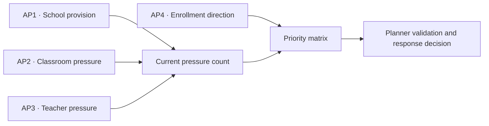

# Business and analytical questions

**Status:** The business question and the four analytical questions below are the wording approved through mentor review on 2026-10-14, unchanged. D-058 revises only the **metrics** that answer them and the priority method previously recorded in D-057; the metric changes are pending mentor confirmation. The implementation-ready calculations are in the separate [metric specification](metric-specification.md).

| | |
|---|---|
| **Primary users** | LGU Local School Boards |
| **Action** | Prioritize investigation of school, classroom, and teacher pressure |
| **Purpose** | Organize observed capacity and demand evidence without prescribing an intervention |
| **Education scope** | Basic education, Kindergarten to Grade 12 |
| **Unit of analysis** | City or municipality |
| **Decision boundary** | ReachED identifies evidence for review. Planners validate local conditions and decide the response. |

## Business problem

Local education planners need an auditable way to identify cities and municipalities where resident demand, classroom capacity, and teacher capacity show pressure, then distinguish places where enrollment is also growing. A raw national total does not identify which places warrant attention, while a percentile cutoff can hide the observed relationship between demand and resources.

ReachED compares each city with the pooled national city ratio and each municipality with the pooled national municipality ratio. Coverage and quality gates run before classification. The result is relative pressure, not an official shortage, resource requirement, or allocation order.

## Business question

> **How should we prioritize the provision of classrooms and teachers among cities based on their respective enrollment needs?**

In this approved wording, “cities” includes cities and municipalities.

## Analytical questions

1. **Which cities and municipalities have fewer public schools relative to their number of enrolled students and total population?**
2. **Which cities and municipalities have the most public-school students per classroom?**
3. **Which cities and municipalities have the most public-school students per teacher?**
4. **Which cities and municipalities have the largest gap between school-age population and student enrollment over time?**

The wording above is unchanged. Under D-058 each question is answered with the metric in the table below: AP1 with school-age population per active public school, AP2 and AP3 with learners per classroom and per teacher against the pooled same-type reference, and AP4 with the enrollment trend over time.

### How the analytical questions support the decision

| Question | Role | Primary output |
|---|---|---|
| **AP1 · School provision** | Resident demand relative to active public schools | School-age population aged 5–17 per active public school, same-type reference, coverage, and classification |
| **AP2 · Classroom pressure** | Current classroom-capacity pressure | Learners per reported instructional classroom, same-type reference, coverage, quality flag, and classification |
| **AP3 · Teacher pressure** | Current teaching-capacity pressure | Learners per approved teacher count, same-type reference, coverage, quality flag, and classification |
| **AP4 · Enrollment direction** | Demand-growth urgency signal | Annual enrollment, endpoint change, and `Growing`, `Declining`, or `Stable` direction |

The final matrix sends an LGU to `Data Review` when any current-pressure measure fails its coverage or quality gate. Otherwise, it combines the number of AP1 to AP3 `Above Reference` results with AP4 growth. It uses no percentile flag and no weighted score.

## Analytical boundaries

- AP1 uses 2024 school-age population aged 5–17 and SY 2024-25 active public schools, the school year aligned with the 2024 census. It is not a school-construction recommendation. Each output carries its own school year, so AP1 (SY 2024-25) and AP2 and AP3 (SY 2023-24) are never presented as one year.
- AP2 and AP3 use public-school enrollment for SY 2023-24, the year shared with the facilities and personnel sources.
- AP3 pools the approved ES, JHS, and SHS teacher and learner contributions into one LGU ratio after applying the existing level-specific eligibility and annex rules.
- AP4 uses enrollment in public, private, and SUC/LUC schools and excludes Philippine Schools Overseas. It is a direction signal, not current pressure. A change within ±5% is `Stable`. The first year, SY 2020-21, is a pandemic year, so growth from it is read with that caveat.
- Enrollment is assigned to the LGU where the school is located, not the learner's residence. Cross-boundary attendance can affect the results.
- Missing values remain missing. Outliers remain in observed totals and are never capped or removed. A school-level outlier sends an LGU to `Data Review` only when leaving it out moves the LGU across the reference.
- The 90% gate is applied before AP1 to AP3 classification. An unresolved material quality flag also produces `Data Review`.
- Cities compare only with cities and municipalities only with municipalities. The reference is a pooled ratio, not an average of LGU ratios.
- Poverty, Similar LGUs, and other context fields never change an AP classification or priority.
- Planners decide whether the evidence supports provision, reallocation, further investigation, another response, or no action.

## Implementation boundary

The [metric specification](metric-specification.md) owns the formulas, required columns, classifications, and validation rules. The [dataset use map](dataset-use-map.md) owns source routing. Gold contains reusable dimensions and facts; `etl/06_analytics` owns the business comparisons and priority logic.
