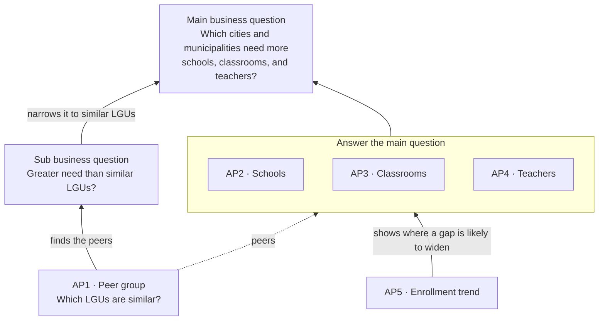

# Business and analytics problem: Question v1

**Status:** Draft for team approval (#9). Recorded as D-042. Eight choices are still open (see Open decisions).

| | |
|---|---|
| **Primary users** | LGU education planners (D-013). Whether the primary user is the provincial planner specifically is open. |
| **Focus** | Students, measured as enrolled learners (observed demand) |
| **Education scope** | Basic education: Kinder to Grade 12 (D-003) |
| **Unit of analysis** | City or municipality |
| **Decision boundary** | The analysis organizes evidence for local review. Planners remain responsible for prioritization and intervention decisions. |

## Business problem

LGU education planners need to know whether their cities and municipalities have enough public schools, classrooms, and teachers for their students. National totals do not answer this. A raw ranking of all 1,642 cities and municipalities does not answer it either, because a 1st class city and a 5th class municipality differ in budget and size, so their numbers will always look different.

Planners need a fair reference point: how an LGU compares with LGUs like it. If an LGU has far more students per classroom than LGUs with the same income class and population density, its gap is not explained by being poorer or smaller, and it should be looked at more closely.

Enrollment is **observed demand** only. It does not include children who are not enrolled. The analysis therefore cannot measure total unmet need or prescribe an intervention.

## Business questions

### Main business question

> **Which cities and municipalities need more schools, classrooms, and teachers based on their student population and enrollment demand?**

### Sub-business question

> **Among cities and municipalities with the same income class and population density, which show greater need for additional schools, classrooms, or teachers?**

### Decision supported

The analysis helps planners decide which cities and municipalities to look at more closely, and whether the gap is in schools, classrooms, or teachers. It does not decide where to build a school, hire teachers, or construct classrooms.

## How the questions fit together

AP2 to AP4 answer the main question. AP1 finds the similar LGUs each place is compared with, which is what the sub question needs. AP5 shows where a gap is likely to widen. Poverty incidence (PSA small area estimates, 2023) is context only and has no question of its own.

Peer comparison is not the only basis for need. Each LGU's own values show *whether* it has a gap; the peer comparison shows *how unusual* that gap is for an LGU like it. Both are shown together, because a whole peer group can be behind: if every LGU in a group has crowded classrooms, none stands out from its peers, but all of them still need attention.

## Peer groups

A **peer group** is the set of LGUs that a city or municipality is compared with. It exists so that comparisons are fair, not to rank LGUs into fixed tiers. AP1 does not compare anything by itself; it sets the reference point that AP2 to AP5 are read against.

### Criteria

| Criterion | Rule | Source |
|---|---|---|
| LGU type | Same type: city or municipality | PSGC 2Q 2026 `Geographic Level` (`City`, `Mun`) |
| Income class | Same class | PSGC 2Q 2026 `Income Classification (DOF DO No. 074.2024)` |
| Population density | Same density band (bands open) | 2024 population (PSGC) ÷ land area (source open) |

The 14 Manila sub-municipalities (`SubMun`) are not LGUs and are not peers; Manila is compared as one city.

### Why city class (HUC, ICC, CC) is not a criterion

City class is set largely by income and population, so it repeats what income class and density already measure. PSGC 2Q 2026 shows the overlap:

| City class | 1st | 2nd | 3rd | 4th | Total |
|---|---|---|---|---|---|
| HUC | 33 | | | | 33 |
| ICC | 4 | 1 | | | 5 |
| CC | 48 | 24 | 30 | 9 | 111 |
| **All cities** | **85** | **25** | **30** | **9** | **149** |

Every HUC is 1st class, and only component cities vary. Adding city class would split the 149 cities into smaller groups without adding much information.

### Why city vs. municipality is kept

Income class uses separate brackets for cities and for municipalities (RA 11964, DOF DO No. 074.2024), so a 1st class city and a 1st class municipality are not the same income level. Grouping them by income class alone would put unlike LGUs together. LGU type is therefore the split inside which income class is compared, not a separate factor.

City status is also a legal status set by a charter law, and it does not change when income or population changes later. Becoming a city requires meeting income and population or land-area thresholds (Local Government Code Sec. 450, as amended), so the two overlap, but one does not define the other.

### Group sizes

| Municipalities | 1st | 2nd | 3rd | 4th | 5th | No class | Total |
|---|---|---|---|---|---|---|---|
| Count | 696 | 247 | 242 | 236 | 64 | 8 | 1,493 |

- 696 of 1,493 municipalities (47%) are 1st class, so density does most of the work in separating them.
- The smallest city group, 4th class, has 9 cities, so splitting it by density may leave very few peers.
- The 8 municipalities with no income class (`-`) are the 8 Special Geographic Area municipalities (Kapalawan, Old Kaabakan, Kadayangan, Nabalawag, Pahamuddin, Malidegao, Ligawasan, Tugunan). They have no peer group, and their schools are already excluded from city- and municipality-level results (D-031).

**Dashboard option:** users may narrow the comparison (for example to the same region or province). The criteria above are what Question v1 answers.

## Analytical questions

| # | Analytical question | Metric or output | Approximate formula | Grain | Primary sources | Main limitation |
|---|---|---|---|---|---|---|
| AP1 | Which LGUs are similar to each city or municipality in income class and population density, so their schools, classrooms, and teachers can be fairly compared? | Peer group per LGU; peer count | Same type + same income class + same density band; density = `2024 population / land area (km²)` | City/municipality | PSGC 2Q 2026; land area (source open) | Density bands, small-group rule, and land area source are open |
| AP2 | Which areas have fewer schools relative to their number of students and population? | Learners per public school; public schools per 10,000 residents; barangays with no public school offering the level | `public-school learners at level / public schools offering level`; `public schools offering level / 2024 population * 10,000`; count of barangays with none | City/municipality × education level × school year | DepEd enrollment (school roster and `offers_*` flags), SY 2023-24; PSGC 2024 population | Total population, not school-age population; a barangay with no school may be near one in the next barangay |
| AP3 | Which areas have the most students per classroom? | Learners per instructional classroom; classroom-data coverage | `public-school learners at level / instructional classrooms` | City/municipality × education level × school year | DepEd enrollment and facilities, public schools, SY 2023-24 | One school year only; classroom counts missing for some schools |
| AP4 | Which areas have the most students per teacher? | Learners per teacher; personnel-data coverage | `public-school learners at level / teachers` (which positions count is open) | City/municipality × education level × school year | DepEd enrollment and personnel, public schools, SY 2023-24 | Working-personnel counts, not plantilla (personnel profile O-13) |
| AP5 | Which areas have student enrollment increasing or decreasing over time? | Public learner count; absolute and percentage change | `current - prior`; `(current - prior) / prior * 100` | City/municipality × education level × school year | DepEd enrollment, SY 2023-24 to 2025-26 | **Provisional** until cross-year comparability is validated (#8) |

For AP2 to AP5, each LGU's result shows its own value, how it compares with its peers, and the national value for the same LGU type, so a group that is behind as a whole is still visible. Every result also reports how much of the LGU's learners the measure covers. How a value becomes a "gap" is open (see Open decisions).

### Interpretation controls

- **AP2 measures provision, not access.** An LGU with few schools for its population may still have schools close by in a neighbouring LGU, and a barangay with no public school may be near one in the next barangay.
- **Schools per 10,000 residents uses total population,** because school-age population is not available at city or municipality level. The denominator is labelled as total population.
- **AP2 to AP5 cover public schools only,** because classroom and teacher data cover public schools only (personnel profile O-3), and the same scope keeps the measures comparable.
- **Annex schools:** AP3 and AP4 add annex enrollment and capacity to the mother school where a verified annex crosswalk exists, following DepEd's ratio method (personnel profile O-14). Results without that step are labelled provisional.
- **No ratio from a zero or missing denominator.** Missing classroom or personnel values stay NULL, never 0 (D-023), and every result reports its coverage.
- **AP5 reports both absolute and percentage change.** Percentage change is undefined when the prior value is 0. Rising enrollment alone does not prove a shortage, and falling enrollment does not prove a surplus.
- **The analysis does not decide.** Planners, not the query, decide whether an LGU is a priority and what response to investigate.

## Open decisions

These must be settled and recorded before #9 can close. Each lists the options or suggestions raised so far.

| Decision | Options or suggestions | Raised in |
|---|---|---|
| **Main user** | (a) Provincial LGU education planner, with HUCs and ICCs kept as national context and peers, since they plan outside the province; (b) LGU education planners in general | Problem framing draft; D-013 |
| **AP2 to AP5 wording** | (a) Keep "Which areas have…"; (b) start each with "Compared with similar LGUs, …" so the peer comparison is explicit; (c) change "areas" to "cities and municipalities" to match the grain | Mentor check in the problem framing draft |
| **Density bands** | Suggestions: (a) national terciles of people per km², cut at 221 and 473 (dashboard sample); (b) density bands for municipalities only, with cities grouped by income class alone, since almost all cities are dense; (c) bands within each type and income class (for example terciles), so every group splits evenly | Dashboard sample; data-model check |
| **Too few peers** | Cutoff: under 5 (prototype) or under 10 (dashboard sample). Fallback: (a) drop the density band and keep type + income class (dashboard sample); (b) all LGUs of the same type nationwide (prototype). Also needs a rule for the 9 4th-class cities | Prototype; dashboard sample |
| **Gap definition** | (a) A ratio in the worst 20% of all 1,642 cities and municipalities for that level; (b) (a) plus a split: a **local gap** is also in the worst quarter of its peer group, a **structural gap** is typical for its peers; (c) no flags in Question v1, values and rankings only, until a threshold can be cited | Problem framing draft; #9 consolidation (2026-10-05) |
| **AP4 teacher count** | Head teachers: (a) excluded, with a second ratio that adds them back, since their teaching load is not documented (#64); (b) included. LGU-funded teachers: (a) included (dashboard sample); (b) reported separately by funding source | #64; problem framing draft |
| **BARMM** | (a) Include, with its limits stated (below); (b) exclude, with the reason stated | #9 (2026-10-05); #64 |
| **Land area source** | (a) PSA OpenSTAT, official but a new source to profile; (b) HDX ADM3 `area_sqkm`, already profiled but undocumented by the publisher (observed only), matched through `Correspondence Code` (D-030) | Problem framing draft |

**If BARMM is included,** these limits go with its results:

- All 2,603 BARMM public schools are in the SY 2023-24 enrollment, facilities, and personnel files.
- About 93% of BARMM public schools have classroom counts, against about 99% elsewhere. AP3 shows this coverage and never treats a missing count as 0.
- School-level NAT Grade 6 and ELLNA extracts do not cover BARMM, and must not be used to infer BARMM learning outcomes.
- DepEd's SY 2023-24 files place Sulu in BARMM; PSGC 2Q 2026 places it in Region IX. Regional results for SY 2023-24 use DepEd's region column (D-012).
- The 112 Special Geographic Area schools stay excluded from city- and municipality-level results until their barangays are matched (D-031).

## Deferred analysis

### Physical access (stretch)

> **Where is physical access to schools most limited?**

Distance or travel time to the nearest school offering each level is deferred until school locations are complete and verified. Until then, AP2's barangays with no public school are a provision count, not a measure of distance.

### Candidate locations (second stage)

> **If an additional school or service point is selected for investigation, where could candidate locations improve coverage?**

Center of gravity, clustering (K-means), or network accessibility belong to this stage. Its results would be candidate locations for local assessment, not recommendations to build. It starts only after planners decide that a new service point is the response worth investigating.

## Planner needs

Under D-001, a question resting mostly on **assumed** needs cannot be approved. The needs behind AP1 to AP5, and the stakeholders and user story, are documented and tagged in #7 (`docs/business/needs.md`). Until #7 lands, the comparison-with-peers framing is **mentor-validated** (program mentor review, 2026-10-12), and the remaining needs are **assumed**.

## Revision history

| Version | Date | Change |
|---|---|---|
| Question v1 (this draft) | 2026-10-12 | Reframed after mentor review around city and municipality need compared with similar LGUs. City class (HUC/ICC/CC) dropped as a criterion; city vs. municipality kept as the split for income class; AP1 rephrased as finding each LGU's peers; AP2 scoped to public schools plus barangays with no public school; the overlap question folded into the peer comparison; eight choices listed as open decisions |
| Draft (#9 thread) | 2026-10-05 | Consolidated by @mafelisilda: provision, classroom, teacher, enrollment-trend, and overlap questions at barangay and city/municipality level |

## Follow-up work

- **Open decisions:** settle the eight above and record them in `docs/governance/decisions.md`.
- **Planner needs, stakeholders, and user story:** cite and tag them (#7).
- **Cross-year comparability:** validate SY 2023-24 to 2025-26 enrollment at the same geography and level before AP5 leaves provisional (#8).
- **Metric contracts:** exact filters, source columns, grade-to-level mapping, missing-data rules, and final formulas.
- **Gold model:** fact-table names, grain statements, and keys (milestone 03).
