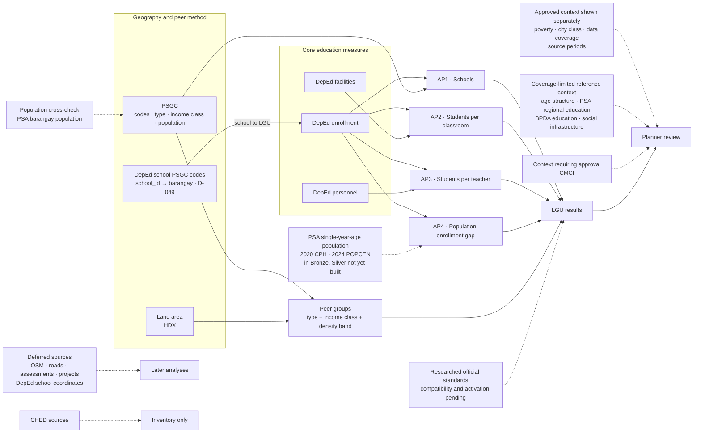

# Dataset use map for the approved questions

**Status:** The BP and AP wording was approved through mentor review on 2026-10-14. Dataset roles and implementation choices remain subject to D-042.

This map assigns every profiled source in `config/sources.json` to a defined role. A dataset being available does not mean it should enter an analytical metric. The map separates sources that calculate the four APs from sources used only for comparison, context, validation, deferred analysis, or the project record.

## Role definitions

| Role | Meaning | May change an AP value or ranking? |
|---|---|---|
| **Core** | Directly supplies a numerator, denominator, trend, or LGU assignment used by AP1 to AP4 | Yes |
| **Method support** | Defines geography, peers, or a proposed density input | It may change comparison membership, but not the underlying education measure |
| **Context or cross-check** | Helps a planner interpret a result or verifies another source | No; it is displayed or documented separately and is never folded into a need score |
| **Deferred** | Reserved for a later physical-access, candidate-location, outcome, or response-specific analysis | No in the approved questions |
| **Out of scope** | Retained in the inventory for traceability but excluded from the basic-education question | No |

## End-to-end map

Solid paths are supported by profiled sources. A dotted path into an AP or result marks a required source or decision that is not yet production-ready; other dotted paths are context or deferred work.

## Question-to-dataset mapping

| Question or method | Required datasets | How each dataset is used | Output |
|---|---|---|---|
| **AP1: schools relative to students and population** | `deped_enrollment`; `psa_psgc` | Enrollment supplies public-school learners, the school roster, and level-offering flags. PSGC supplies the city/municipality assignment, total 2024 population, and the barangay list used for the barangay roll-up and drill-down. | City/municipality learners per public school; public schools per 10,000 total residents; count and share of the LGU's barangays with no public school offering elementary |
| **AP2: students per classroom** | `deped_enrollment`; `deped_facilities`; `psa_psgc` | Enrollment supplies learners; facilities supplies instructional classrooms; PSGC supplies the LGU assignment. Learners enter the ratio only for schools with usable classroom data. | Learners per instructional classroom and coverage of schools and learners |
| **AP3: students per teacher** | `deped_enrollment`; `deped_personnel`; `psa_psgc` | Enrollment supplies learners; personnel supplies teacher counts and funding source; PSGC supplies the LGU assignment. Learners enter the ratio only for schools with usable personnel data. | Learners per teacher and coverage of schools and learners |
| **AP4: school-age population and enrollment gap over time** | `deped_enrollment` (SY 2024-25 acquired and loaded; SY 2020-21 acquired and profiled in #160, approved as the fourth delivery in #172, and loaded in Bronze and Silver on Databricks dev (#175)); PSA Total Population by single-year age for 2020 (CPH) and 2024 (POPCEN) (`psa_school_age_population`), in Bronze (#165) but not yet in Silver; `psa_psgc` | Enrollment supplies learner counts in all sectors except Philippine Schools Overseas, the public-school share, and school location. The PSA workbooks supply population aged 5–17 for every city and municipality. PSGC supplies geographic alignment through a name match. | Population aged 5–17 minus enrollment for 2020 and 2024, gap share, and the change between them, with period, comparability, and coverage labels |
| **Peer comparison method** | `psa_psgc`; `hdx_boundaries` | PSGC supplies LGU type, income class, population, codes, and hierarchy. `hdx_boundaries.area_sqkm` is the current land-area source for density, joined to PSGC through the reviewed HDX-to-PSGC crosswalk (#139). [PSA OpenSTAT table 1A6DLPD0](https://openstat.psa.gov.ph/PXWeb/pxweb/en/DB/DB__1A__PO_2024/0221A6DLPD0.px/), which publishes city/municipality land area and 2024 population density, may be acquired and profiled later as a cross-check or replacement. | Comparison inputs and peer-membership fields; exact statistics belong to the metric specification |
| **School-to-LGU assignment (all APs, D-049)** | `deped_enrollment_psgc`; `deped_enrollment`; `psa_psgc` | DepEd's own barangay PSGC code per `school_id` places each school in its city or municipality, ahead of name matching: 98.1–99.0% of schools in SY 2023-24 to 2025-26 have a code (profile X-4). Where both place a public school, the code and the name match agree for 46,652 and differ for 170, mostly the 2024 Special Geographic Area towns and EMBO, where the code follows the current boundaries (X-3). Sulu's late-2024 codes are recoded to 2Q 2026 (`19066` → `09066`, X-2). Name matching stays the fallback for schools without a code: those with `#N/A` codes and schools new after SY 2023-24. Enrollment counts still come from `deped_enrollment` only, because this file's counts are identical (X-1) | The PSGC code and match method recorded per school, used by AP1 to AP4 |
| **Approved context beside results** | `psa_poverty_stat`; `psa_psgc` | Poverty 2023 is displayed under its own year label and never used to group or flag. PSGC city class is visible as governance context but is not a peer criterion. | Context fields with their own source, year, and missingness labels |
| **Coverage-limited or broader-grain reference context** | `psa_population_per_age_group`; `psa_openstat_education`; `bpda_barmm_education`; `bpda_barmm_social_infrastructure` | Age structure is shown only for its published geographies; OpenSTAT education remains regional or national reference; BPDA sources retain their historical periods and published geographic grain. None is copied onto an LGU as if it were a current LGU value. | Clearly labelled reference panels, coverage notes, or BARMM-specific context—not AP inputs |
| **Context requiring approval** | `dti_cmci` | CMCI can add LGU socioeconomic or service-capacity context after reviewed PSGC matching, but it is not part of the agreed questions or current method. | Optional context panel only after a recorded team decision |

### Scope rules

- “Students” in AP1 to AP3 means learners enrolled in public schools in the DepEd files. It does not mean every school-age resident.
- The approved analytical and ranking grain is city/municipality. Barangay enters AP1 only as a roll-up to the city or municipality (barangays with no public elementary school) and otherwise supports school-location drill-down and match validation. Barangays are never ranked or given their own ratios.
- AP4 uses enrollment in all sectors except Philippine Schools Overseas, because its population side counts every resident child; the public-school share is shown beside it. Its difference is not an out-of-school count: population is counted where people live and enrollment where the school is, so it can include cross-boundary attendance, learners outside ages 5–17, and non-enrollment.
- Total population comes from PSGC's `2024 Population` field. `psa_population_per_barangay` remains its cross-check under D-033 and is not a second denominator.
- Context fields never change an AP value, percentile, ranking, or future flag unless the team revises the approved method and records that decision.
- An available dataset with a different grain is not silently aggregated into an LGU result. Regional, provincial, historical-division, and sample assessment sources keep their published grain.
- Every displayed value keeps its source period. Poverty 2023, population 2024, SY 2023-24 capacity, and later enrollment years are not presented as one common date.

## School-age population source

The project has found an official city/municipality source for AP4. It is **in Bronze, but not yet in Silver**: [psa_school_age_population](../data/source-inventory/psa_school_age_population/README.md) (#154). The registered `psa_population_per_age_group` source covers regions, provinces, HUCs, Pateros, Isabela City, and the Special Geographic Area—not all municipalities—so it cannot answer AP4 nationwide. AP1 continues to use total population and labels that denominator explicitly.

### Found source

PSA publishes **Total Population by Single-Year Age, Sex, Region, Province, and City/Municipality** for both census points AP4 uses:

| AP4 period | Census | Reference date | Workbook sheet used | Matching enrollment |
|---|---|---|---|---|
| **2020** | 2020 Census of Population and Housing (CPH) | May 1, 2020 | `2020 Total Pop` | SY 2020-21, acquired and profiled (#160), approved as the fourth delivery (#172) |
| **2024** | 2024 Census of Population (POPCEN) | July 1, 2024 | `2024 Total Pop` | SY 2024-25, acquired |

Each workbook has a Total Population sheet and a Household Population sheet, with single-year ages 5 to 24. AP4 uses the Total Population sheet and ages 5–17 (columns B to N in both workbooks), both sexes. Checked on local copies, the 2024 national total for ages 5–17 is 27,569,038 and the 2020 total is 28,680,299.

Before ingestion:

- **Names only, no PSGC codes.** Cities and municipalities must be matched to PSGC by name under the D-029 match columns, as was done for other name-only sources.
- **Different layouts.** The 2020 workbook places Both Sexes, Male, and Female side by side as column blocks, one row per area. The 2024 workbook places Total, Male, and Female as three stacked rows under each area name. Each needs its own parsing rule.
- **Footnotes carry geography changes.** The 2024 workbook footnotes the Makati and Taguig barangay transfer, the Negros Island Region, Sulu's move to Region IX, the Maguindanao split, and the eight Special Geographic Area municipalities. The 2020 workbook shows the Special Geographic Area as three "Pikit Cluster" rows instead. These feed the 2020-to-2024 comparability flag in the [metric specification](metric-specification.md#ap4--school-age-population-and-enrollment-gap).
- **SY 2020-21 enrollment is acquired and profiled (#160)** and approved as the fourth delivery of `deped_enrollment` (#172), and loaded in Bronze and Silver locally and on Databricks dev (#175).

### Age definition

PSA uses **5–24 years old** for its published "school-age population." AP4 instead uses **5–17**, the official school ages for Kindergarten to Grade 12 in the [DepEd School Characteristics Technical Notes](https://www.deped.gov.ph/wp-content/uploads/School-Characteristics-Technical-Notes.pdf) (pp. 4–5): Kindergarten age 5, Grades 1–6 ages 6–11, Grades 7–10 ages 12–15, and Grades 11–12 ages 16–17. The single-year ages allow this range exactly. PSA's 5–24 band is not used.

### Rules kept

- **No modelled values in version 1.** Population is not interpolated or extrapolated to school years without a census in the same year. SY 2023-24 and SY 2025-26 show AP4 as not available.
- **Do not substitute total population into AP4.** Total population remains the explicitly labelled AP1 denominator only.

## Known gap: compatible classroom and teacher benchmarks

The [national benchmark register](national-benchmarks-and-indicators.md) identifies a statutory 45:1 classroom-shortage reference and legacy teacher-deployment bands, but neither is currently approved for the project metric. The classroom reference is incompatible with the current broad NSBI room field, and the teacher bands require current-applicability confirmation. Peer and national same-type medians remain descriptive references rather than standards.

Before a dashboard value is labelled against an official benchmark, the team must record:

1. the issuing authority and source document;
2. the effective period;
3. the applicable education level and school type;
4. the exact numerator and denominator definition; and
5. whether the source defines a target, ceiling, planning norm, or another kind of reference.

The data-model work may reserve a standards/reference structure, but it must not populate or enforce an invented threshold.

## All registered sources

This table accounts for all 23 profiled sources in `config/sources.json`.

| Dataset | Role in the approved questions | Destination or use | Why it does or does not enter the calculation |
|---|---|---|---|
| [`deped_enrollment`](../data/source-inventory/deped_enrollment/) | **Core: AP1–AP4** | School roster, level offerings, enrolled learners, trend, and school location used for LGU assignment | Only source that supplies school-level enrollment for all four APs; AP1 to AP3 use public schools, while AP4 uses all sectors except Philippine Schools Overseas; SY 2020-21 is acquired, profiled (#160), approved as the fourth delivery (#172), and loaded on Databricks dev (#175) |
| [`deped_enrollment_psgc`](../data/source-inventory/deped_enrollment_psgc/) | **Method support (D-049) + deferred coordinates** | `school_id` → barangay PSGC crosswalk for SY 2023-24 to 2025-26 (98.1–99.0% of schools, X-4), ahead of name matching; school coordinates kept, flagged, for a later AP1 nearest-school check | Supplies location, not counts: its enrollment equals `deped_enrollment` for every shared school, so it is not a second enrollment source. Urban/rural and income class are taken from `psa_psgc` through the code instead of from this file; `URP`, DepEd's own undocumented classification (O-9), stays unused until S-4. Coordinates wait for the boundary test (S-1): 23% are missing and at least 2,275 lie over 100 km from their municipality. Derived outputs are not published until EMISD confirms the terms |
| [`deped_facilities`](../data/source-inventory/deped_facilities/) | **Core: AP2** | Instructional-classroom denominator and classroom-data coverage | Direct capacity source; available for SY 2023-24 only |
| [`deped_personnel`](../data/source-inventory/deped_personnel/) | **Core: AP3** | Teacher denominator, personnel coverage, and reported funding-category detail | Direct staffing source; the exact teacher positions remain a team decision, and locally funded categories cannot be attributed to a specific LGU without a verified crosswalk |
| [`psa_psgc`](../data/source-inventory/psa_psgc/) | **Core + method support** | Master geography, LGU type, income class, 2024 total population, hierarchy, and city-class context | Common reference for LGU assignment, AP1 population, and peer construction |
| [`psa_poverty_stat`](../data/source-inventory/psa_poverty_stat/) | **Context** | Poverty 2023 beside the education measures; a missing LGU shows its status and reason, never 0 (D-046) | Useful for interpretation but not a peer criterion, denominator, or gap flag under D-042 |
| [`psa_population_per_barangay`](../data/source-inventory/psa_population_per_barangay/) | **Cross-check** | Verifies PSGC's coded 2024 population values | D-033 selects PSGC population for downstream use, so this source is not separately ingested into the approved metrics |
| [`psa_population_per_age_group`](../data/source-inventory/psa_population_per_age_group/) | **Partial AP4 candidate + limitation evidence** | Shows 2024 age structure only where its published geography permits and documents why a new source is needed | Does not cover every municipality or provide the required LGU time series, so it cannot answer AP4 nationwide; the PSA single-year-age workbooks for 2020 and 2024 are the AP4 source instead |
| [`psa_school_age_population`](../data/source-inventory/psa_school_age_population/) | **Core: AP4 (in Bronze, not yet in Silver)** | Population aged 5–17 for every city and municipality, from the total-population sheets (`2020 Total Pop`, `2024 Total Pop`), both sexes (D-042), by single-year age, 2020 (CPH) and 2024 (POPCEN) (#154). The household-population sheets are not mixed in (profile O-5) | The only source found that covers every city and municipality at single-year age; it enters AP4 once ingested and name-matched to PSGC, as the AP4 row above describes. The 8 Special Geographic Area units do not match one-to-one between the two years: 2020 groups their barangays into 8 clusters by former Cotabato town, not the 8 municipalities created in 2024 (O-7, S-1), so the 2020–2024 comparison for that area waits on S-1 (see D-031). Licensing is UNVERIFIED (PSA sent the files "for your academic research"), so derived results are not published until PSA confirms the terms |
| [`psa_openstat_education`](../data/source-inventory/psa_openstat_education/) | **Context / validation only** | Regional or national education and literacy reference | Its regional grain cannot answer the city/municipality APs and must not be joined as though it were LGU data |
| [`hdx_boundaries`](../data/source-inventory/hdx_boundaries/) | **Method support + deferred** | Map geometry; `area_sqkm` as the current land-area source for density; later spatial analysis | Area is present for all 1,642 cities and municipalities, but the publisher does not document how it is computed, and PSGC joins go through the reviewed crosswalk (#139); boundaries do not measure education need |
| [`dti_cmci`](../data/source-inventory/dti_cmci/) | **Available context, not approved as an input** | Optional LGU socioeconomic or service-capacity context after reviewed PSGC matching | CMCI is not part of the agreed questions or peer definition; adding it to a score or group would require a new decision |
| [`deped_ellna`](../data/source-inventory/deped_ellna/) | **Deferred outcome context** | Possible later learning-outcome view | Selected schools and regions only, with no BARMM coverage; it cannot be treated as a national LGU outcome |
| [`deped_nat_gr6`](../data/source-inventory/deped_nat_gr6/) | **Deferred outcome context** | Possible later Grade 6 learning-outcome view | Selected schools and regions only, with no BARMM coverage; outside the current provision-and-capacity questions |
| [`bpda_barmm_education`](../data/source-inventory/bpda_barmm_education/) | **BARMM historical context** | Descriptive comparison and interpretation of older BARMM division-level indicators | Historical school-division grain does not match the current city/municipality AP grain |
| [`bpda_barmm_social_infrastructure`](../data/source-inventory/bpda_barmm_social_infrastructure/) | **BARMM context / deferred** | Background on published education infrastructure in BARMM | Mixed, partly unstated periods and mixed geographic levels prevent direct use in current ratios |
| [`bpda_barmm_roads`](../data/source-inventory/bpda_barmm_roads/) | **Deferred physical-access context** | Possible later interpretation of transport constraints | Undated historical-area road totals cannot measure present travel time to a school |
| [`bpda_mbhte_infrastructure_projects`](../data/source-inventory/bpda_mbhte_infrastructure_projects/) | **Deferred response context** | Example of monitored education-infrastructure projects after an intervention is selected for investigation | Sixteen Basilan project records are not a national measure of current provision or capacity |
| [`osm_philippines`](../data/source-inventory/osm_philippines/) | **Deferred physical access and candidate locations** | Possible roads, settlements, school-location validation, routing, and service-area analysis | OSM completeness and school identity must be verified before distance or travel-time analysis; it does not enter AP1's provision count |
| [`ched_enrollment`](../data/source-inventory/ched_enrollment/) | **Out of scope** | Inventory only | Higher education is excluded by D-003, and the regional grain does not answer the approved questions |
| [`ched_graduates`](../data/source-inventory/ched_graduates/) | **Out of scope** | Inventory only | Higher education is excluded by D-003 |
| [`ched_school_count`](../data/source-inventory/ched_school_count/) | **Out of scope** | Inventory only | Higher education is excluded by D-003, and HEI counts are not basic-education school counts |
| [`ched_student_faculty_ratio`](../data/source-inventory/ched_student_faculty_ratio/) | **Out of scope** | Inventory only | Higher education is excluded by D-003; the regional student-faculty ratio cannot substitute for AP3 |

## Source decisions still open

This map owns only source-selection and source-routing decisions. Formula, comparison-statistic, priority, and dashboard-field decisions belong to the [metric specification](metric-specification.md).

1. **Land area:** `hdx_boundaries.area_sqkm` is the current source; it is used once the HDX-to-PSGC crosswalk (#139) is reviewed. PSA OpenSTAT table `1A6DLPD0` may be acquired and profiled later as a cross-check or replacement.
2. **BARMM:** decide inclusion and geography treatment. BPDA sources remain context, not replacements for the DepEd indicators.
3. **School-age population:** build the Silver layer of the PSA 2020 and 2024 single-year-age workbooks (in Bronze, #165) and name-match them to PSGC. AP4 stays blocked until these are done.
4. **Official benchmarks:** resolve the data-compatibility and current-applicability conditions in the [national benchmark register](national-benchmarks-and-indicators.md) before routing a standard into an analytical comparison.
5. **DepEd school PSGC crosswalk:** recorded as [D-049](../governance/decisions.md#d-049-the-emisd-workbook-is-a-school-to-psgc-crosswalk-not-a-second-enrollment-source) (#164): `deped_enrollment_psgc` is the first DepEd match method, with names as the fallback, and D-012 and D-031 carry "Revisited" notes. Still open: Integration (#44) builds the match, including bringing the 112 Special Geographic Area schools back into city and municipality results once they are matched by code (D-031). The coordinates stay deferred until the boundary test (S-1) and EMISD's reply.
6. **Optional context:** any use of CMCI, assessments, age-group population, BPDA data, or another context source inside a peer definition, score, threshold, or flag requires a recorded scope decision.
