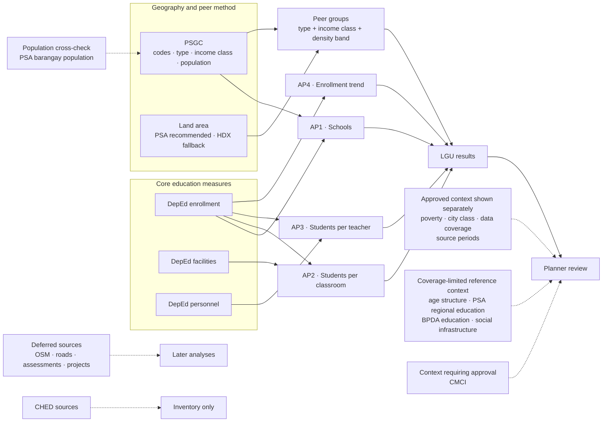
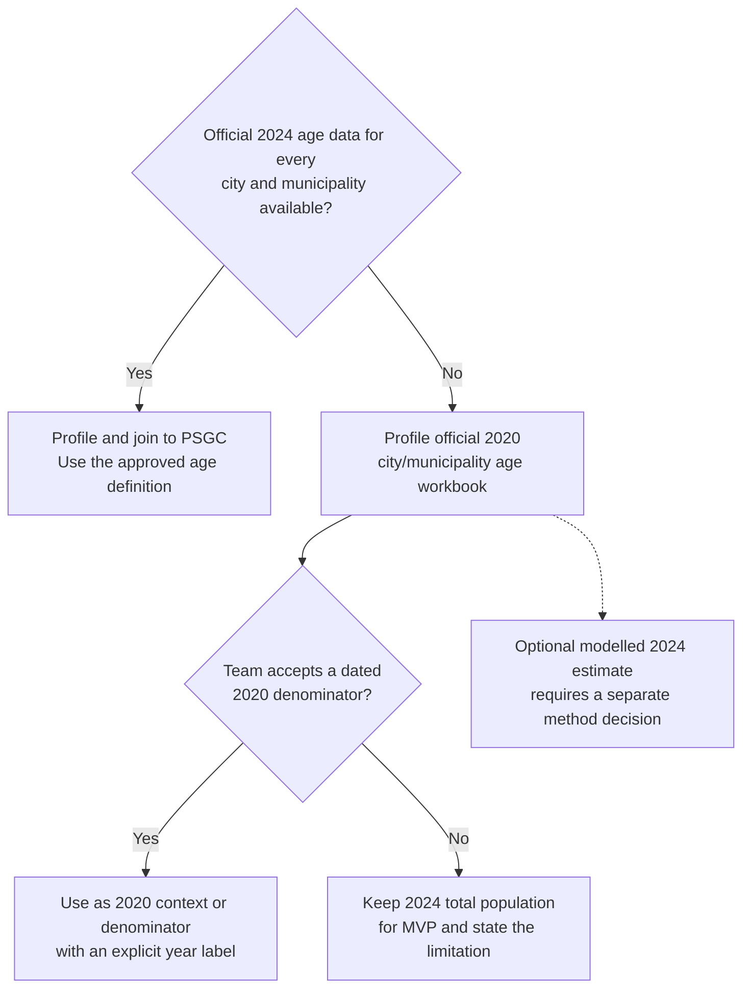
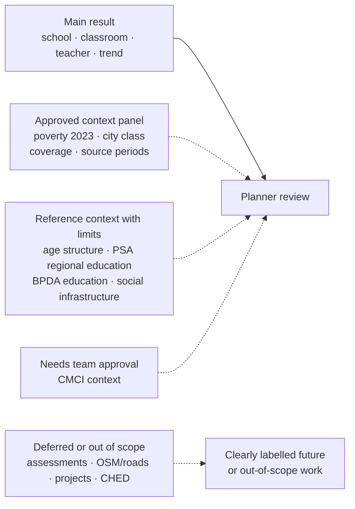

# Dataset use map for Question v1

**Status:** Draft for team approval with Question v1 (#9, D-042).

This map assigns every profiled source in `config/sources.json` to a defined role. A dataset being available does not mean it should enter an analytical metric. The map separates sources that calculate the four APs from sources used only for comparison, context, validation, deferred analysis, or the project record.

## Role definitions

| Role | Meaning | May change an AP value or ranking? |
|---|---|---|
| **Core** | Directly supplies a numerator, denominator, trend, or LGU assignment used by AP1 to AP4 | Yes |
| **Method support** | Defines geography, peers, or a proposed density input | It may change comparison membership, but not the underlying education measure |
| **Context or cross-check** | Helps a planner interpret a result or verifies another source | No; it is displayed or documented separately and is never folded into a need score |
| **Deferred** | Reserved for a later physical-access, candidate-location, outcome, or response-specific analysis | No in Question v1 |
| **Out of scope** | Retained in the inventory for traceability but excluded from the basic-education question | No |

## End-to-end map

The solid path is Question v1. Dotted paths are intentionally outside the current calculations.

## Question-to-dataset mapping

| Question or method | Required datasets | How each dataset is used | Output |
|---|---|---|---|
| **AP1: schools relative to students and population** | `deped_enrollment`; `psa_psgc` | Enrollment supplies public-school learners, the school roster, and level-offering flags. PSGC supplies the city/municipality assignment, total 2024 population, and barangay hierarchy. | Learners per public school; public schools per 10,000 total residents; barangays with no public school offering the level |
| **AP2: students per classroom** | `deped_enrollment`; `deped_facilities`; `psa_psgc` | Enrollment supplies learners; facilities supplies instructional classrooms; PSGC supplies the LGU assignment. Learners enter the ratio only for schools with usable classroom data. | Learners per instructional classroom and coverage of schools and learners |
| **AP3: students per teacher** | `deped_enrollment`; `deped_personnel`; `psa_psgc` | Enrollment supplies learners; personnel supplies teacher counts and funding source; PSGC supplies the LGU assignment. Learners enter the ratio only for schools with usable personnel data. | Learners per teacher and coverage of schools and learners |
| **AP4: enrollment change** | `deped_enrollment`; `psa_psgc` | Enrollment supplies comparable public learner counts for SY 2023-24 to 2025-26; PSGC supplies the documented current LGU reference. | Learner count, absolute change, and percentage change |
| **Peer comparison method** | `psa_psgc`; official land area source still to be approved | PSGC supplies LGU type, income class, population, codes, and hierarchy. Density is population divided by approved land area. `hdx_boundaries.area_sqkm` is only the documented fallback unless the team selects it. | Peer-group ID, peer count, peer median, percentile rank, fallback level, and national same-type median |
| **Approved context beside results** | `psa_poverty_stat`; `psa_psgc` | Poverty 2023 is displayed under its own year label and never used to group or flag. PSGC city class is visible as governance context but is not a peer criterion. | Context fields with their own source, year, and missingness labels |
| **Coverage-limited or broader-grain reference context** | `psa_population_per_age_group`; `psa_openstat_education`; `bpda_barmm_education`; `bpda_barmm_social_infrastructure` | Age structure is shown only for its published geographies; OpenSTAT education remains regional or national reference; BPDA sources retain their historical periods and published geographic grain. None is copied onto an LGU as if it were a current LGU value. | Clearly labelled reference panels, coverage notes, or BARMM-specific context—not AP inputs |
| **Context requiring approval** | `dti_cmci` | CMCI can add LGU socioeconomic or service-capacity context after reviewed PSGC matching, but it is not part of the agreed questions or current method. | Optional context panel only after a recorded team decision |

### Scope rules

- “Students” in AP1 to AP3 means learners enrolled in public schools in the DepEd files. It does not mean every school-age resident.
- Total population comes from PSGC's `2024 Population` field. `psa_population_per_barangay` remains its cross-check under D-033 and is not a second denominator.
- Context fields never change an AP value, percentile, ranking, or future flag unless the team revises Question v1 and records that decision.
- An available dataset with a different grain is not silently aggregated into an LGU result. Regional, provincial, historical-division, and sample assessment sources keep their published grain.
- Every displayed value keeps its source period. Poverty 2023, population 2024, SY 2023-24 capacity, and later enrollment years are not presented as one common date.

## Known gap: school-age population

The project does not currently have a current school-age-population count for every city and municipality. The registered `psa_population_per_age_group` source covers regions, provinces, HUCs, Pateros, Isabela City, and the Special Geographic Area—not all municipalities—so it cannot replace total population in AP1 nationwide.

### Best official acquisition path

1. **Profile the PSA 2020 CPH city/municipality workbook first.** PSA's [2020 Age and Sex Distribution release](https://psa.gov.ph/content/age-and-sex-distribution-philippine-population-2020-census-population-and-housing) includes an official Excel attachment titled **Household Population by Age Group, Sex, Region, Province and City/Municipality**. This is the strongest available nationwide official source at the required LGU grain, but it is a 2020 household-population baseline.
2. **Ask PSA for a 2024 city/municipality age tabulation.** PSA's [2024 Age and Sex Distribution release](https://psa.gov.ph/content/age-and-sex-distribution-philippine-population-2024-census-population) reports 5–24 school-age population nationally, while the project's acquired 2024 age-group table does not cover every municipality. The preferred production source is an official 2024 table at city/municipality grain, ideally by single year of age or bands that can isolate the chosen basic-education ages.
3. **Do not manufacture a municipal figure silently.** Applying a national or provincial school-age share to every LGU would assume identical local age structures. If the team estimates 2024 LGU values from the 2020 distribution, the result must be labelled **modelled**, carry its assumptions and uncertainty, and remain separate from an official count.
4. **Keep total population for the MVP if the official current table is unavailable.** Label it plainly and show the 2020 school-age figure only as dated context after it is profiled and matched to the current PSGC.

### Age definition must be decided first

PSA uses **5–24 years old** for its published “school-age population.” That is broader than the Kinder-to-Grade-12 population relevant to Question v1. Before acquisition becomes a metric, the team must choose whether the denominator means:

- PSA school-age population, ages **5–24**;
- a basic-education-age population such as **5–17**, if single-year ages are available; or
- separate age ranges for Kinder, elementary, junior high school, and senior high school.

The selected age definition must match the analytical purpose and the source's actual age bands. It must not be inferred from grade level without documenting the mapping.

### Recommendation

Acquire and profile the official 2020 city/municipality workbook now, while submitting a PSA data request for the equivalent 2024 city/municipality table. Keep total population in the main AP1 metric until the team approves both an age definition and an official or explicitly modelled LGU-level source.

## All registered sources

This table accounts for all 21 profiled sources in `config/sources.json`.

| Dataset | Role in Question v1 | Destination or use | Why it does or does not enter the calculation |
|---|---|---|---|
| [`deped_enrollment`](../data/source-inventory/deped_enrollment/) | **Core: AP1–AP4** | School roster, level offerings, enrolled learners, trend, and school location used for LGU assignment | Only source that supplies school-level enrollment for all four APs; public-school scope is applied with the other DepEd measures |
| [`deped_facilities`](../data/source-inventory/deped_facilities/) | **Core: AP2** | Instructional-classroom denominator and classroom-data coverage | Direct capacity source; available for SY 2023-24 only |
| [`deped_personnel`](../data/source-inventory/deped_personnel/) | **Core: AP3** | Teacher denominator, personnel coverage, and funding-source detail | Direct staffing source; the exact teacher positions remain a team decision |
| [`psa_psgc`](../data/source-inventory/psa_psgc/) | **Core + method support** | Master geography, LGU type, income class, 2024 total population, hierarchy, and city-class context | Common reference for LGU assignment, AP1 population, and peer construction |
| [`psa_poverty_stat`](../data/source-inventory/psa_poverty_stat/) | **Context** | Poverty 2023 beside the education measures, with missing LGUs left blank | Useful for interpretation but not a peer criterion, denominator, or gap flag under D-042 |
| [`psa_population_per_barangay`](../data/source-inventory/psa_population_per_barangay/) | **Cross-check** | Verifies PSGC's coded 2024 population values | D-033 selects PSGC population for downstream use, so this source is not separately ingested into Question v1 |
| [`psa_population_per_age_group`](../data/source-inventory/psa_population_per_age_group/) | **Context / limitation evidence** | Shows 2024 age structure only where its published geography permits and documents why a new source is needed | Does not cover every municipality, so it cannot supply a common school-age-population denominator for AP1; the official 2020 CPH city/municipality workbook is the recommended new source to profile |
| [`psa_openstat_education`](../data/source-inventory/psa_openstat_education/) | **Context / validation only** | Regional or national education and literacy reference | Its regional grain cannot answer the city/municipality APs and must not be joined as though it were LGU data |
| [`hdx_boundaries`](../data/source-inventory/hdx_boundaries/) | **Method-support candidate + deferred** | Map geometry; possible `area_sqkm` fallback for density; later spatial analysis | Land-area use still needs a team decision; boundaries do not measure education need |
| [`dti_cmci`](../data/source-inventory/dti_cmci/) | **Available context, not approved for Question v1** | Optional LGU socioeconomic or service-capacity context after reviewed PSGC matching | CMCI is not part of the agreed questions or peer definition; adding it to a score or group would require a new decision |
| [`deped_ellna`](../data/source-inventory/deped_ellna/) | **Deferred outcome context** | Possible later learning-outcome view | Selected schools and regions only, with no BARMM coverage; it cannot be treated as a national LGU outcome |
| [`deped_nat_gr6`](../data/source-inventory/deped_nat_gr6/) | **Deferred outcome context** | Possible later Grade 6 learning-outcome view | Selected schools and regions only, with no BARMM coverage; outside the current provision-and-capacity questions |
| [`bpda_barmm_education`](../data/source-inventory/bpda_barmm_education/) | **BARMM historical context** | Descriptive comparison and interpretation of older BARMM division-level indicators | Historical school-division grain does not match the current city/municipality AP grain |
| [`bpda_barmm_social_infrastructure`](../data/source-inventory/bpda_barmm_social_infrastructure/) | **BARMM context / deferred** | Background on published education infrastructure in BARMM | Mixed, partly unstated periods and mixed geographic levels prevent direct use in current ratios |
| [`bpda_barmm_roads`](../data/source-inventory/bpda_barmm_roads/) | **Deferred physical-access context** | Possible later interpretation of transport constraints | Undated historical-area road totals cannot measure present travel time to a school |
| [`bpda_mbhte_infrastructure_projects`](../data/source-inventory/bpda_mbhte_infrastructure_projects/) | **Deferred response context** | Example of monitored education-infrastructure projects after an intervention is selected for investigation | Sixteen Basilan project records are not a national measure of current provision or capacity |
| [`osm_philippines`](../data/source-inventory/osm_philippines/) | **Deferred physical access and candidate locations** | Possible roads, settlements, school-location validation, routing, and service-area analysis | OSM completeness and school identity must be verified before distance or travel-time analysis; it does not enter AP1's provision count |
| [`ched_enrollment`](../data/source-inventory/ched_enrollment/) | **Out of scope** | Inventory only | Higher education is excluded by D-003, and the regional grain does not answer Question v1 |
| [`ched_graduates`](../data/source-inventory/ched_graduates/) | **Out of scope** | Inventory only | Higher education is excluded by D-003 |
| [`ched_school_count`](../data/source-inventory/ched_school_count/) | **Out of scope** | Inventory only | Higher education is excluded by D-003, and HEI counts are not basic-education school counts |
| [`ched_student_faculty_ratio`](../data/source-inventory/ched_student_faculty_ratio/) | **Out of scope** | Inventory only | Higher education is excluded by D-003; the regional student-faculty ratio cannot substitute for AP3 |

## Context-panel recommendation

For Question v1, keep the main result and its context visually separate:

This prevents a contextual variable from being mistaken for part of the need calculation while keeping every potentially useful source discoverable. “Reference context with limits” must retain the dataset's actual geography and period; it must not be presented as a current city/municipality value when the source does not support that grain.

## Decisions connected to this map

The dataset routes depend on five unresolved choices listed in Question v1:

1. **Land area:** PSA OpenSTAT is recommended; HDX is the fallback.
2. **BARMM:** inclusion is recommended with the documented coverage and geography limits. BPDA sources remain context, not replacements for the DepEd indicators.
3. **Teacher count:** the selected personnel positions determine the AP3 denominator; funding source remains visible.
4. **Time and geography:** one documented current peer definition is recommended across the three enrollment years, with boundary-change flags.
5. **School-age population:** approve the age range, acceptable reference year, and whether a modelled estimate is allowed. Until then, AP1 retains total population and labels it explicitly.

Any future decision to use CMCI, assessment results, age-group population, BPDA data, or another context source inside a peer group, score, threshold, or flag changes the analytical definition and must be recorded before implementation.
