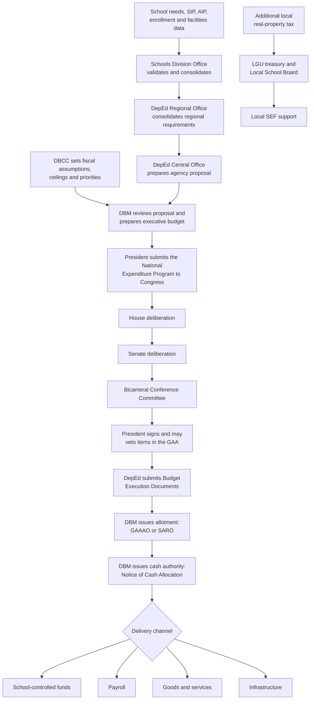
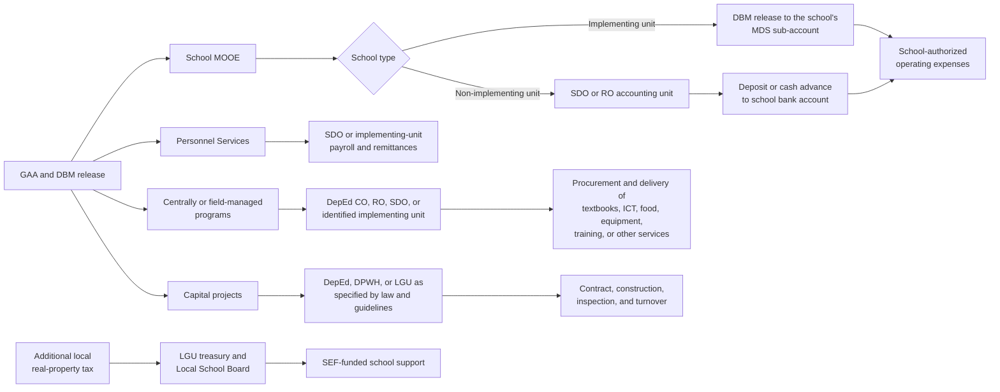
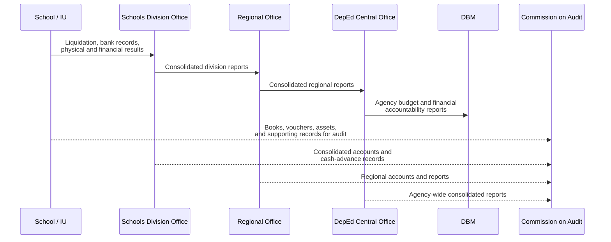

# How Philippine public-school funding reaches schools

**Status:** research brief · Closes #131  
**Research date:** 2026-10-13  
**Scope:** national and local funding for DepEd-supervised public basic education

## Executive summary

There is no single pipeline that carries the whole Department of Education
(DepEd) budget into school bank accounts. School needs and administrative data
inform division, regional, and national planning. DepEd's proposed budget is
then reviewed within the national fiscal framework, authorized through the
General Appropriations Act (GAA), and converted by the Department of Budget and
Management (DBM) into allotment and cash authority. After that common process,
funding separates into several delivery channels.

School Maintenance and Other Operating Expenses (School MOOE) can reach a
qualified implementing-unit school directly. For a non-implementing-unit
school, the Schools Division Office (SDO) remains the accounting unit and
deposits the school's operating budget as a cash advance that the school head
must liquidate. Salaries normally remain in operating-unit payroll; textbooks,
computers, equipment, feeding, and other programs may arrive as goods or
services procured above the school; major facilities are implemented as
projects; and the local Special Education Fund (SEF) follows a separate
LGU–Local School Board route.

The practical implication for analysis is that a school does not "receive" all
public spending made for it. A defensible funding measure must distinguish:

1. appropriations authorized for DepEd or another implementing agency;
2. allotments and cash authority released to operating units;
3. funds placed under school-level control;
4. goods, services, payroll, or facilities delivered on a school's behalf; and
5. obligations and disbursements actually recorded.

## Scope and exclusions

This brief covers public kindergarten, elementary, junior high school, senior
high school, and Alternative Learning System delivery under DepEd. It does not
map the distinct appropriation routes for state universities and colleges,
Commission on Higher Education programs, Technical Education and Skills
Development Authority institutions, or private-school subsidy recipients.
Bangsamoro Autonomous Region in Muslim Mindanao arrangements also require a
separate legal and fiscal treatment and should not be inferred from this
national DepEd flow.

## End-to-end allocation and release flow

This figure is a conceptual map, not a claim that funds physically pass through
every box. Republic Act No. 9155 requires direct allocation and immediate DBM
release of resources intended for DepEd field offices. A regional office can
therefore validate or consolidate a requirement without serving as the bank
account through which every later payment passes.

## Stage 1: school, division, and regional planning

The school head develops the School Improvement Plan (SIP) and manages the
school's personnel, physical, and fiscal resources. The Annual Implementation
Plan (AIP) translates school priorities into scheduled activities, resource
requirements, accountable persons, and possible funding sources. These plans
provide local evidence, but they do not themselves appropriate money.

The SDO develops the Division Education Development Plan, manages division
resources, and monitors national- and local-government funds provided to
schools. The Regional Office formulates the budget supporting its regional
education plan, taking account of division and district plans. These duties are
set out in the [Governance of Basic Education Act of 2001][ra9155]. DepEd's
[Basic Education Development Plan 2030][bedp] describes the vertical planning
relationship among the school, division, regional, and national levels.

Facility needs have an additional planning track. Under [DepEd Order No. 18,
s. 2023][do18], SDO engineers prepare a Comprehensive School Facilities
Development Plan, prioritize schools using needs analysis, and use the plan as
the basis for annual Basic Education Facilities budget proposals. Regional
engineers validate these plans.

## Stage 2: executive budget preparation

The Development Budget Coordination Committee (DBCC) establishes the fiscal
envelope within which DepEd competes with other government priorities. Its
current composition brings together DBM, the Department of Finance, the
Department of Economy, Planning, and Development, and the Office of the
President, with the Bangko Sentral ng Pilipinas as a resource institution. The
committee reviews macroeconomic targets, revenue, borrowing, the aggregate
budget level, and expenditure priorities. See the [DBM description of the
DBCC][dbcc] and [DEPDev's current legal mandate][depdev].

DBM issues the Budget Call, receives agency proposals, and assesses them against
government priorities, fiscal space, past performance, implementation capacity,
and project readiness. DepEd Central Office consolidates continuing operations
and proposed programs into Personnel Services (PS), Maintenance and Other
Operating Expenses (MOOE), Capital Outlay (CO), and program-specific
requirements. After executive review, the President's proposed allocations
appear in the National Expenditure Program. DBM describes this preparation and
review sequence in its [national budget process overview][budget-process].

## Stage 3: congressional authorization

The President submits the proposed budget to Congress. Appropriation legislation
originates in the House of Representatives, is considered by the Senate, and is
reconciled through a bicameral conference committee. Both chambers ratify the
result before it goes to the President, who may sign it and veto particular
items. The enacted GAA is legal spending authority, subject to its general and
special provisions.

The constitutional controls matter: the President must submit a budget;
appropriation bills originate in the House; Congress may not increase the total
appropriation recommended by the President for government operations; and no
money may be paid from the Treasury without an appropriation made by law. See
Article VI, Sections 22, 24, 25, and 29 of the [1987 Constitution][constitution].
The [FY 2026 GAA repository][gaa2026] is the current enacted example at the
research date.

## Stage 4: release is not the same as appropriation

The following terms describe different points in execution and must not be used
interchangeably:

| Term | Meaning for this flow |
|---|---|
| Appropriation | Legal authority in the GAA for a specified purpose. |
| Allotment | The limit and authority for an agency or operating unit to incur obligations. Many items are released through the GAA as an allotment order; others require a Special Allotment Release Order (SARO). |
| Obligation | A binding commitment, such as an authorized payroll item or awarded supply contract. |
| Notice of Cash Allocation (NCA) | DBM authority enabling an agency or operating unit to pay obligations through an authorized government servicing bank. |
| Disbursement | Actual settlement or payment of an obligation. |

These definitions follow DBM's [Budget 101 terminology][budget-terms]. Under the
Modified Disbursement System, DBM issues the NCA for credit to agency or
operating-unit sub-accounts in authorized government servicing banks. The
[COA-DBM-Bureau of the Treasury joint rules][mds] define the NCA and MDS banking
mechanism.

## Stage 5: the delivery channels separate

### Channel A: School MOOE

An implementing unit (IU) has the financial capability, staff, books, agency
code, and bank sub-account to administer its own funds. DBM can release the
allotment and corresponding cash allocation directly to that unit.

A non-IU does not maintain the complete accounting structure of an IU. Its SDO
or, in applicable cases, Regional Office remains the accounting unit. The
operating budget or program fund is deposited into the school's bank account as
a cash advance to the school head, who submits supporting records and
liquidation to the responsible operating unit. The [COA-DBM-DepEd Joint
Circular No. 2019-1][cash-advance] states that liquidation covering at least 75%
of the cash advance is the basis for the next monthly or quarterly release. It
also requires reconciliation of the school bank account against reported
disbursements and supporting documents.

[DepEd Order No. 13, s. 2016][do13] establishes the direct-release structure:
DBM releases allotments to implementing units and issues cash allocations to
their MDS sub-accounts, while SDO accounts cover non-IU schools. Republic Act
No. 9155 supplies the statutory basis for direct release to field offices.

This SDO-administered route is the usual case, not an edge case. The [EDCOM II
Year Two Report][edcom-y2] states that 94% of the country's 45,225 public
schools were non-IUs; only 2,661 were IUs, based on data submitted by DepEd's
Finance Service. For most schools, access to School MOOE therefore depends on
cash-advance requests and liquidation through the division office rather than a
direct DBM release to a school MDS sub-account.

For FY 2026, DepEd announced use of a Simplified Normative Funding Formula based
on enrollment and basic school data to estimate the minimum operating budget
needed to meet service standards. The current school-level allocations are
published through DepEd's [transparency page][deped-transparency]. See DepEd's
[April 2026 explanation of the formula][snff] for the current policy description.

### Channel B: personnel compensation

Teacher and non-teaching compensation is classified under Personnel Services
and administered through the responsible DepEd operating-unit payroll. It is
public spending attributable to the education system, but it is not part of the
school head's discretionary School MOOE balance. Analyses must not treat the
entire PS appropriation as cash downloaded to schools.

### Channel C: goods, services, and program support

Textbooks, learning materials, computers, laboratory equipment, connectivity,
feeding, training, and other program inputs may be procured by DepEd Central
Office, a Regional Office, an SDO, or another identified implementing unit. The
recipient school may receive an asset, meal, subscription, or service instead of
cash.

DBM defines Centrally Managed Items as budgeted funds or items for which the
recipient operating unit or its specific allocation is not yet identified in
the GAA. Release requires the agency to identify the implementing units and
amounts. See the [DBM COMPASS glossary][compass]. The [FY 2026 DepEd GAA
details][deped-gaa] illustrate separate output targets for classrooms, learning
materials, equipment, feeding beneficiaries, and other programs.

### Channel D: classrooms and facilities

Major facilities normally reach a school through project implementation, not a
cash transfer to the school head. The GAA and implementing guidelines determine
whether DepEd, the Department of Public Works and Highways (DPWH), or an LGU
procures and manages the project. The implementing entity contracts the work,
inspects it, and turns over the completed facility.

The [Fair and Equitable Access to Education Act (RA 7880)][ra7880], commonly
called the Roxas Law, allocates DepEd capital outlay from its second year onward
by three criteria: 50% in proportion to each legislative district's student
population, 40% among districts with classroom shortages, and 10% as determined
by DepEd in implementing the law. The [EDCOM II Year Two Report][edcom-y2]
notes that the classroom-shortage data used in this process may be up to three
years old. Analyses of classroom need and allocation should therefore preserve
the reference year of both the enrollment and facilities data instead of
assuming that an allocation reflects current-year conditions.

As a current example, DBM reported an April 2026 SARO release of PHP 17.27
billion to DepEd for 4,960 classrooms under the FY 2026 Basic Education
Facilities Fund, with implementation tied to the national classroom program and
DepEd-LGU partnership. This example should not be generalized to every year or
every facilities item; the applicable GAA and release document control. See
[DBM's official release notice][classrooms2026].

### Channel E: the local Special Education Fund

The SEF is supplementary local funding rather than a sub-allocation of DepEd's
national appropriation. The additional real-property tax accrues to the local
SEF and is automatically released to Local School Boards. The board determines
supplementary public-school needs and authorizes the local treasurer to disburse
against the approved school-board budget.

Sections 98–100 and 272 of the [Local Government Code][lgc] establish the Local
School Board and authorize SEF use for school operation and maintenance,
construction and repair, facilities and equipment, educational research, books
and periodicals, and sports development. [Joint Circular No. 01, s.
2025][sef-guidelines], issued by DepEd, DBM, DILG, and DOF and posted by DBM in
January 2026, expands the eligible uses to include early childhood care and
development, Alternative Learning System programs, school-based feeding, ARAL
Program tutors, and locally hired teachers where DepEd's teacher-deployment
analysis identifies shortages.

The same circular makes the Schools Division Superintendent responsible for
preparing the Local School Board budget and requires the budget to align with
School Improvement Plans and the Division Education Development Plan. It also
distinguishes local revenue arrangements: cities retain their additional 1%
real-property-tax proceeds for their city SEF, while proceeds collected on
property in a province are divided equally between the provincial SEF and the
SEFs of the component municipalities where the property is located. City and
municipality SEF amounts should therefore remain separate in peer-group or
school-funding comparisons.

## Agencies and decision rights

| Institution | Principal role before resources reach a school |
|---|---|
| School head and planning team | Identify needs, prepare the SIP and AIP, manage school-controlled resources, and account for use. |
| Schools Division Office | Consolidate needs, manage division resources, administer non-IU accounts and payroll, release applicable school funds, and monitor utilization. |
| DepEd Regional Office | Consolidate and validate division requirements, formulate the regional education budget, and manage regional implementation. |
| DepEd Central Office | Consolidate the national proposal, set policy and allocations, identify implementing units, and manage national programs. |
| DBCC | Recommend the fiscal program, aggregate expenditure ceiling, and expenditure priorities. |
| DBM | Issue the Budget Call, review proposals, prepare budget documents, and issue allotment and cash authorities. |
| President and Cabinet | Approve the executive proposal; the President submits the budget and signs or vetoes GAA items. |
| House and Senate | Deliberate, amend, reconcile, and authorize appropriations. |
| Bureau of the Treasury and servicing banks | Support government cash management and the MDS payment channel. |
| DPWH | Implement designated school-infrastructure projects when assigned by the GAA or program rules. |
| LGUs and Local School Boards | Budget and spend SEF and other authorized local education support. |
| GPPB and PhilGEPS | Provide procurement policy and transparency infrastructure; they do not allocate the education budget. |
| Commission on Audit | Audit government receipts, expenditures, funds, property, recording, and liquidation. |

Government procurement is governed by Republic Act No. 12009 and its approved
Implementing Rules and Regulations. The Government Procurement Policy Board
confirms that the official IRR was approved on 4 February 2025, published on 10
February 2025, and took effect on 25 February 2025. See the [GPPB official
notice][ngpa].

## Accountability travels back up the system

The [COA-DBM reporting instructions][reporting] require DepEd's lower operating
units to report appropriations, allotments, obligations, disbursements, and
balances upward for consolidation, while also submitting to DBM and providing
reports to audit teams. Article IX-D of the [1987 Constitution][constitution]
gives COA authority to examine and audit public revenue, expenditure, funds,
and property.

## Analytical implications for this project

Future dataset design should keep the following measures distinct:

| Measure | Suitable interpretation | Common error to avoid |
|---|---|---|
| GAA appropriation | Amount legally authorized for the agency, program, or item | Calling it cash received by a school |
| Allotment | Amount available to incur obligations at the identified unit | Treating it as an actual payment |
| NCA | Cash authority made available through the government banking system | Assuming it has already been spent |
| Obligation | Contractual or payroll commitment | Treating it as delivered output |
| Disbursement | Payment made against an obligation | Assuming the beneficiary school controlled the payment |
| School MOOE allocation | Operating budget assigned to a named school | Adding centrally procured goods as if they were MOOE cash |
| In-kind or project delivery | Asset, service, meal, equipment, or completed facility delivered for school use | Omitting it because no cash entered the school account |
| Local SEF spending | LGU-funded supplementary education expenditure | Mixing it into DepEd national releases without a separate source flag |

Any future school-level funding table should therefore record at least the
fiscal year, funding source, appropriation or program, implementing agency,
implementing unit, recipient school where identified, release type, expense
class, delivery mode, and the available appropriation/allotment/obligation/
disbursement amounts as separate fields.

## Source validation

All factual sources used here are primary government publications or official
legal repositories, accessed on 2026-10-13. Press releases are used only to
describe a dated 2026 implementation example or DepEd's own current-policy
announcement; the enduring process rests on statutes, the Constitution, the
GAA, and joint or department issuances.

| Source | Authority and use | Validation note |
|---|---|---|
| 1987 Constitution, Official Gazette | Budget authorization and COA authority | Controlling constitutional text |
| RA 9155, Lawphil | DepEd governance and direct field-office release | Statutory text in the Supreme Court-hosted legal repository |
| RA 7160, Official Gazette | Local School Boards and SEF | Statutory text |
| RA 7880, Senate Legislative Reference Bureau | Capital-outlay allocation criteria | Statutory text in an official legislative repository |
| FY 2026 GAA, DBM | Current appropriations and output structure | Enacted budget, not the proposed NEP |
| DepEd Orders 13/2016 and 18/2023 | School MOOE and facilities planning | Official department issuances |
| COA-DBM-DepEd JC 2019-1 | Non-IU cash advances and liquidation | Official inter-agency circular |
| Joint Circular No. 01, s. 2025 | Current SEF governance, eligible uses, and revenue sharing | Official inter-agency circular hosted by DBM |
| EDCOM II Year Two Report | IU prevalence and classroom-allocation data limitations | Official congressional commission report |
| COA-DBM and COA-DBM-BTr issuances | Reporting, cash authority, and MDS | Official oversight and treasury rules |
| DBM and DEPDev mandate pages | DBCC roles and current agency name | Official current-government pages |
| GPPB notice | Current procurement IRR | Official procurement-policy authority |

[bedp]: https://www.deped.gov.ph/wp-content/uploads/2022/05/DO_s2022_024.pdf
[budget-process]: https://www.dbm.gov.ph/index.php/the-secretary-2/speeches/3799-the-national-budget-process-turning-plans-and-priorities-to-quality-public-services
[budget-terms]: https://www.dbm.gov.ph/wp-content/uploads/AboutDBM/Budget%20101_Reader%20View.pdf
[cash-advance]: https://www.dbm.gov.ph/wp-content/uploads/Issuances/2019/Joint-Circular/COA-DBM-DEPED-JOINT-CIRCULAR-NO-1-s-2019.pdf
[classrooms2026]: https://www.dbm.gov.ph/index.php/management-2/3953-pbbm-orders-p17-27b-release-to-build-4-960-classrooms-nationwide-close-learning-gaps
[compass]: https://compass.dbm.gov.ph/glossary
[constitution]: https://officialgazette.gov.ph/constitutions/1987-constitution/
[dbcc]: https://www.dbm.gov.ph/index.php/about-the-dbcc
[deped-gaa]: https://www.dbm.gov.ph/wp-content/uploads/GAA/GAA2026/VolumeII/DEPED/A.pdf
[deped-transparency]: https://www.deped.gov.ph/transparency/
[depdev]: https://dro5.depdev.gov.ph/legal-mandates/
[do13]: https://www.deped.gov.ph/wp-content/uploads/2016/03/DO_s2016_13.pdf
[do18]: https://www.deped.gov.ph/wp-content/uploads/DO_s2023_018.pdf
[edcom-y2]: https://edcom2.gov.ph/media/2025/01/EDCOM-2-Year-2-Report-Fixing-the-Foundations-2025.pdf
[gaa2026]: https://www.dbm.gov.ph/index.php/2026/general-appropriations-act-gaa-fy-2026
[lgc]: https://officialgazette.gov.ph/1991/10/10/republic-act-no-7160/
[mds]: https://www.treasury.gov.ph/wp-content/uploads/2022/03/COA-DBM-BTr-Joint-Circular-No.-1-s.-2022-1.pdf
[ngpa]: https://www.gppb.gov.ph/public-advisory-no-09-2026/
[ra7880]: https://issuances-library.senate.gov.ph/legislative%2Bissuances/Republic%20Act%20No.%207880
[ra9155]: https://lawphil.net/statutes/repacts/ra2001/ra_9155_2001.html
[reporting]: https://www.dbm.gov.ph/wp-content/uploads/Issuances/2019/Joint-Circular/COA-DBM-JOINT-CIRCULAR-NO-2019-1-DATED-JANUARY-1-2019.pdf
[sef-guidelines]: https://www.dbm.gov.ph/index.php/dbm-issuances/joint-circulars?catid=390&id=3897%3Ajoint-circular-no-1-s-2025-deped-dbm-dilg-dof&view=article
[snff]: https://www.deped.gov.ph/2026/04/13/angara-nagdagdag-ng-pondo-para-palakasin-ang-classroom-resources/
