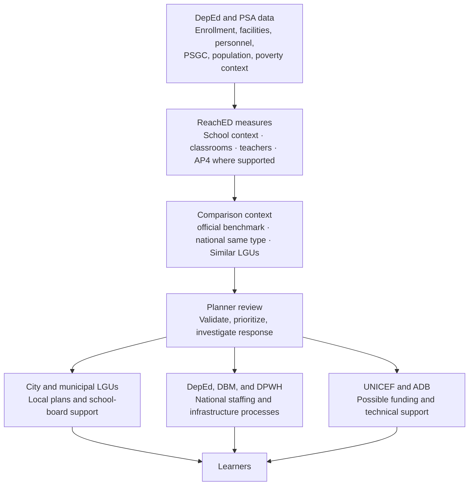

# Stakeholders and user story

**Status:** Updated for the BP and AP wording approved through mentor review on 2026-10-14. The user group was narrowed to LGU Local School Boards in D-057 (2026-10-19).

Local education planners ask the question and make the planning decision. The primary users are LGU Local School Boards: the provincial, city, and municipal school boards that decide how the Special Education Fund is spent (D-057). DepEd Schools Division Offices are partners that validate the results and act on teacher deployment and DepEd classroom programs. The provincial planner, working with the Provincial School Board, remains the first dashboard persona.

## Stakeholders

| Role | Who | What they decide or need | What ReachED gives them |
|---|---|---|---|
| First dashboard persona | Provincial LGU education planner | Which component cities and municipalities warrant closer review for classroom support or a request to DepEd | Each LGU's priority tier and its school, classroom, and teacher measures, with enrollment context |
| Primary decision users | LGU Local School Boards (provincial, city, and municipal) | Special Education Fund spending on classrooms and locally funded teachers, validation, and requests to DepEd or another agency | A priority list of cities and municipalities (D-057) with each school, classroom, and teacher measure shown on its own, official benchmarks where validated, national same-type context, Similar LGUs, coverage, and drill-down |
| Other decision users | City and municipal LGU education planners | Their own local school board spending, including Special Education Fund support and locally funded teachers | Their LGU's measures, comparison position, data coverage, and school-level drill-down |
| Sponsors and funding partners | UNICEF and ADB | Which places warrant further assessment for possible support or investment | Comparable indicators, the enrolled learners covered by each measure, and stated data limitations |
| Partner stakeholders | DepEd regional offices and Schools Division Offices | Teacher deployment and classroom-construction priorities | Areas with high classroom or teacher pressure indicators, with school-level detail for validation |
| Intended beneficiaries | Learners, especially in underserved communities | Adequate education provision and capacity | More transparent evidence for planning decisions |

Highly urbanized and independent component cities plan on their own, outside the province. They stay in the data, in the same-type comparison and as national context.

## Stakeholder connection

ReachED turns DepEd and PSA data into comparable measures for planner review. The measures do not determine the cause, responsible agency, funding source, or intervention. The planner validates the evidence locally and then coordinates with the relevant LGU, government agency, or funding partner.

## Sponsor connection

UNICEF and ADB fund the platform, but the business question stays in the planner's voice; the sponsors' own questions are answered by the same outputs. The mentor's guidance is that a funder's question differs from a planner's, and that a funder's agenda is not ours to adopt, so each sponsor question is kept to education.

| Sponsor | Their education question | What ReachED shows them | Link to a shared goal |
|---|---|---|---|
| UNICEF | Which cities and municipalities show the greatest school, classroom, or teacher pressure, and how many enrolled learners are covered by the evidence? | Measures by city and municipality, national same-type context, Similar LGUs, poverty context, and coverage limitations | SDG 4.a (build and upgrade education facilities) and 4.c (increase the supply of qualified teachers) |
| ADB | Which classroom and teacher pressure indicators warrant further assessment for possible investment? | Comparable measures, enrollment-need context where supported, rankings without an unsupported adequacy claim, and school-level drill-down for validation | SDG 4.a and 4.c, through investment in basic education infrastructure |

Sponsors receive the same evidence and limitations as planners. Whether support should be local, national, or externally funded remains a planning decision outside the analytical result.

## Government agencies connected

No single office controls all three resources. DepEd and DBM are involved in national teacher positions, DepEd and DPWH in national classroom programs, and LGUs may supplement provision using local funds. The indicators help planners identify what to validate before deciding whom to involve.

| Agency | Role in schools, classrooms, and teachers | How it connects to ReachED | From the sponsor meeting |
|---|---|---|---|
| DepEd | Hires and deploys teachers; plans and funds classroom construction; runs public schools | Main data source; validates and interprets classroom and teacher pressure indicators | Yes |
| DPWH | Often builds school buildings funded through DepEd's budget | Possible implementation partner after DepEd and local validation; no DPWH data is used | Yes |
| DBM | Creates and funds new national teacher positions that DepEd fills | Possible partner when validated evidence supports a request for national teacher items | Added |
| Provincial, city, and municipal LGUs | Local school boards decide how the Special Education Fund is spent, including classroom repair and construction and locally funded teachers | Decision users and implementation partners; personnel data shows reported locally funded teacher counts by school and category, but not the responsible funding LGU | Yes |
| DSWD | Runs 4Ps, whose cash grants require children to stay in school | Context for enrollment demand; 4Ps data is not part of this project | Yes |
| PSA | Publishes the PSGC, the 2024 population count, and poverty estimates | Data source for geography, population, income class, and poverty context | Added |
| MBHTE (BARMM) | Runs basic education in BARMM instead of DepEd | Matters for the BARMM inclusion decision, which remains open under D-042 | Added |

DSWD stays as context unless the team adds 4Ps data; without it, the analysis cannot show whether 4Ps changes enrollment in a given town.

## Who the education planners are

"Provincial LGU education planner" is not one job title. In practice it is the provincial planning office working with the Provincial School Board, and each needs something different from the dashboard.

| Planner | Where they sit | What they plan or decide | What the dashboard must give them |
|---|---|---|---|
| Provincial Planning and Development Coordinator and staff (first persona) | Provincial Planning and Development Office | The province's development plan, including where education support goes across its cities and municipalities | A province view of every town, comparable pressure indicators, and figures they can copy into plan documents |
| Provincial School Board | Co-chaired by the governor and the schools division superintendent | How the provincial Special Education Fund is spent | Classroom and teacher measures, enrollment-need context where supported, and reported locally funded teacher categories with attribution limitations |
| City and Municipal Planning and Development Coordinators | City and municipal planning offices | Their own development plan and local school board budget | Their town against the national same-type distribution and against similar towns |
| Schools division superintendent and division planning officers | DepEd schools division office | Teacher deployment and the division's school-building priorities | Teacher and classroom pressure indicators by level, down to the school |
| Governor, mayors, and sanggunian education committees | Local chief executives and councils | Approving budgets and requests | One sentence per place they can trust: the sponsor's test is whether a mayor can zoom in and trust the numbers |

What this means for the dashboard:

- **Province first.** The default view opens on one province's cities and municipalities, not the whole country.
- **Plain numbers with their source.** Planners copy figures into plans, so every number shows its year and source.
- **Reported funding category of teachers.** The personnel data separates locally funded categories at the school level, but it does not identify the responsible province, city, or municipality or the funding period. Attribution to a specific LGU requires a verified crosswalk.
- **Drill-down to the school.** Division planners work school by school.

**Evidence (D-001):** these roles are **documented**: Joint Circular No. 01, s. 2025 states them, cited as R-01 to R-03 in [planner-needs.md](planner-needs.md#planner-roles). The team has not interviewed these planners. Which role is the first persona stays **assumed** (A-07) until the mentor or a sponsor contact confirms it.

## User story

> As a Local School Board member, I want a priority list of cities and municipalities that shows where school, classroom, and teacher pressure are high, each measure shown on its own and supported by enrollment need, validated official benchmarks, similar LGUs, and national context, so that I can decide which results require local validation and where provision or allocation may need to go first.

The story is done when the planner can:

1. See every city and municipality in scope with its public-school learners per school, per classroom, and per teacher.
2. See each LGU's priority tier and which measures are high, with each measure and its enrolled-learner and source coverage shown on its own.
3. Compare an LGU with a validated official benchmark where available and the national distribution for the same LGU type, and see its Similar LGUs.
4. See AP4 only where comparable school-age population and enrollment periods are supported, with the gap's limitations visible.
5. Drill down to a single school and trace every number to its source and period.

### Persona stories

The mentor suggested that team members role-play the other personas to test whether the output answers them too.

| Persona | Story |
|---|---|
| City or municipal LGU | As a municipal planner, I want to know whether our classroom pressure is greater than in similar towns, so I can investigate what our Special Education Fund can address and what may need DepEd support. |
| DepEd division office | As a division planner, I want to see which schools and towns have high learners-per-teacher measures at each level, so I can validate them before prioritising deployment. |
| UNICEF | As a funding partner, I want to know which LGUs show the greatest provision and capacity pressure, with poverty and data coverage visible, so potential support can be assessed transparently. |
| ADB | As a funding partner, I want to know which classroom and teacher indicators warrant further assessment, so proposed financing is grounded in comparable evidence. |
