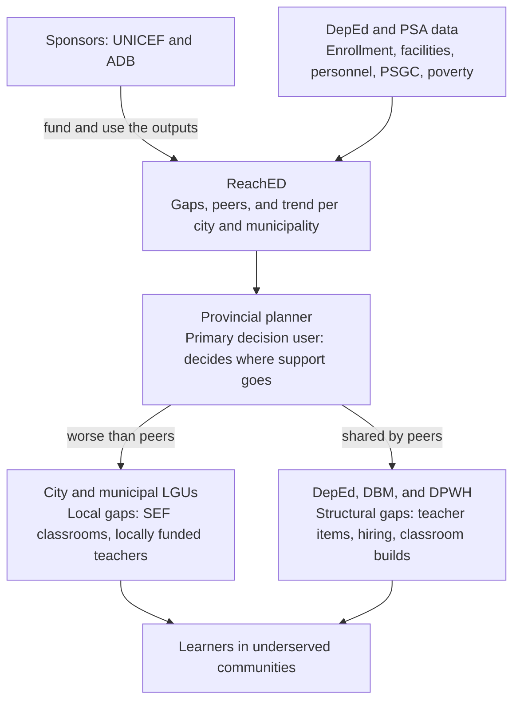

# Stakeholders and user story

**Status:** Draft for team approval, alongside Question v1 (#9, D-042). The primary user is still an open decision in [Question v1](business-analytics-problem.md#open-decisions); this document follows the team's problem framing draft, which names the provincial planner.

The provincial planner asks the question and makes the decision. Everyone else funds it, acts on it, or benefits from it.

## Stakeholders

| Role | Who | What they decide or need | What ReachED gives them |
|---|---|---|---|
| Primary decision user | Provincial LGU education planner | Where the province's education support goes first across its component cities and municipalities, through the Provincial School Board and requests to DepEd | Each city and municipality's school, classroom, and teacher gaps, how enrollment is moving, and how it compares with similar LGUs |
| Sponsors and funding partners | UNICEF and ADB | Which places to support or invest in, with evidence they can defend | The same gaps, the learners affected, and whether a gap is local or shared by similar LGUs |
| Partner stakeholders | City and municipal LGUs | Their own local school board spending (Special Education Fund) and locally funded teachers | Where their town stands against national cutoffs and against peers |
| Partner stakeholders | DepEd (regional and division offices) | Teacher deployment and classroom construction | Which towns are short at which level, with school-level detail |
| Intended beneficiaries | Learners, especially in underserved communities | A school, a classroom, and a teacher within reach | Planning that reaches the places they live |

Highly urbanized and independent component cities plan on their own, outside the province. They stay in the data as national context and as peers.

## Stakeholder connection

ReachED turns DepEd and PSA data into one view for the provincial planner. The planner sends local gaps (worse than similar LGUs) to the city or municipality, which can act with its own Special Education Fund. Structural gaps (shared by similar LGUs) go to DepEd, which works with DBM on teacher items and with DPWH on classroom builds. Both paths end with the learners.

The local and structural split depends on the gap definition, which is still open in Question v1.

## Sponsor connection

UNICEF and ADB fund the platform, but the business question stays in the planner's voice; the sponsors' own questions are answered by the same outputs. The mentor's guidance is that a funder's question differs from a planner's, and that a funder's agenda is not ours to adopt, so each sponsor question is kept to education.

| Sponsor | Their education question | What ReachED shows them | Link to a shared goal |
|---|---|---|---|
| UNICEF | Which learners are furthest from a school, a classroom, and a teacher, and where do they live? | Gaps by city and municipality, the learners living in places with two or more gaps, and poverty as context | SDG 4.a (build and upgrade education facilities) and 4.c (increase the supply of qualified teachers) |
| ADB | Where would investment in classrooms and teachers close the largest gaps? | Ranked gaps, the learners affected, and whether a gap is local or structural, which tells who should co-fund | SDG 4.a and 4.c, through investment in basic education infrastructure |

The split between local and structural gaps connects the sponsors to the planner. An LGU can close a local gap with its own Special Education Fund; a structural gap needs outside help from DepEd or a funding partner.

## Government agencies connected

No single office closes all three gaps. DepEd and DBM decide teachers, DepEd and DPWH build most classrooms, and LGUs fill in with their own funds. That is why the planner needs to know which gap a town has before knowing whom to ask.

| Agency | Role in schools, classrooms, and teachers | How it connects to ReachED | From the sponsor meeting |
|---|---|---|---|
| DepEd | Hires and deploys teachers; plans and funds classroom construction; runs public schools | Main data source (enrollment, school facilities, school personnel); receives the structural teacher and classroom gaps | Yes |
| DPWH | Often builds the school buildings funded through DepEd's budget | Receives classroom gaps through DepEd; no DPWH data used | Yes |
| DBM | Creates and funds new teacher positions (items) that DepEd fills | Explains why a teacher gap can be structural: the town cannot hire national teachers itself | Added |
| Provincial, city, and municipal LGUs | Local school boards decide how the Special Education Fund is spent, including classroom repair and construction and locally funded teachers | The decision user (province) and the partners who act on local gaps; personnel data shows how many teachers each LGU already funds | Yes |
| DSWD | Runs 4Ps, whose cash grants require children to stay in school | Context for enrollment demand; 4Ps data is not part of this project | Yes |
| PSA | Publishes the PSGC, the 2024 population count, and poverty estimates | Data source for geography, population, income class, and poverty context | Added |
| MBHTE (BARMM) | Runs basic education in BARMM instead of DepEd | Matters for the BARMM decision, still open in Question v1 | Added |

DSWD stays as context unless the team adds 4Ps data; without it, the analysis cannot show whether 4Ps changes enrollment in a given town.

## Who the education planners are

"Provincial LGU education planner" is not one job title. In practice it is the provincial planning office working with the Provincial School Board, and each needs something different from the dashboard.

| Planner | Where they sit | What they plan or decide | What the dashboard must give them |
|---|---|---|---|
| Provincial Planning and Development Coordinator and staff (primary user) | Provincial Planning and Development Office | The province's development plan, including where education support goes across its cities and municipalities | A province view of every town, ranked gaps, and figures they can copy into plan documents |
| Provincial School Board | Chaired by the governor, co-chaired by the schools division superintendent | How the provincial Special Education Fund is spent | Classroom gaps and how many teachers are already locally funded, by funding source |
| City and Municipal Planning and Development Coordinators | City and municipal planning offices | Their own development plan and local school board budget | Their town against national cutoffs and against similar towns |
| Schools division superintendent and division planning officers | DepEd schools division office | Teacher deployment and the division's school-building priorities | Teacher and classroom gaps by level, down to the school |
| Governor, mayors, and sanggunian education committees | Local chief executives and councils | Approving budgets and requests | One sentence per place they can trust: the sponsor's test is whether a mayor can zoom in and trust the numbers |

What this means for the dashboard:

- **Province first.** The default view opens on one province's cities and municipalities, not the whole country.
- **Plain numbers with their source.** Planners copy figures into plans, so every number shows its year and source.
- **Funding source of teachers.** The school board needs Special Education Fund and LGU-funded teachers split out, which the personnel data already has.
- **Drill-down to the school.** Division planners work school by school.

**Evidence (D-001):** these roles come from the Local Government Code and DepEd's structure. The team has not interviewed these planners, so the roles are **assumed** until they are cited in #7 (`docs/business/planner-needs.md`) or checked with the mentor or a sponsor contact.

## User story

> As a provincial LGU education planner, I want to see which of our cities and municipalities have too few public schools, classrooms, or teachers for the learners enrolled there, and whether they are worse off than similar LGUs, so that I can decide where our Provincial School Board support and our requests to DepEd should go first.

The story is done when the planner can:

1. See every city and municipality in the province with its learners per school, per classroom, and per teacher at each level.
2. See which ones fall short, and how many learners live there (the gap definition is open in Question v1).
3. See whether enrollment is growing or shrinking, so a crowded place that is still growing stands out.
4. Compare one city or municipality with similar LGUs (same income class and density band) and tell a local gap from a structural one.
5. Drill down to a single school, and trust where every number comes from.

### Persona stories

The mentor suggested that team members role-play the other personas to test whether the output answers them too.

| Persona | Story |
|---|---|
| City or municipal LGU | As a municipal planner, I want to know whether our classroom gap is worse than similar towns, so I can decide what our Special Education Fund can fix and what to request from DepEd. |
| DepEd division office | As a division planner, I want to see which schools and towns are short of teachers at each level, so I can prioritise deployment. |
| UNICEF | As a funding partner, I want to know where learners are furthest from a school, classroom, and teacher, so our support reaches the most underserved communities. |
| ADB | As a funding partner, I want to know where classroom and teacher investment closes the largest gaps, so our financing goes where it is most needed. |
