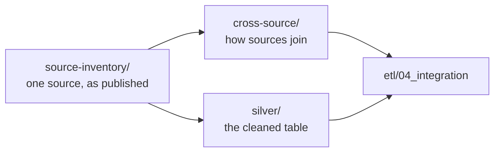

# Data documentation

What each source holds and how the sources fit together.

| Folder | Holds | Written |
|---|---|---|
| [`source-inventory/`](source-inventory/README.md) | One folder per source: card, profile, and data dictionary | Cards and profiles by hand; dictionaries by `analysis/profiling/` |
| [`silver/`](silver/README.md) | One data dictionary per Silver table | By `python -m src.silver.cli dictionary` |
| [`cross-source/`](cross-source/README.md) | Joins, coverage, comparability, and exception lists across sources | Memos by hand; lists by `analysis/cross_source/` |

The scripts that produce these findings live in [`analysis/`](../../analysis/README.md).
