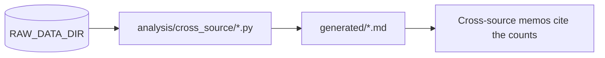

# Generated cross-source lists

Exception lists written by the scripts in [`analysis/cross_source/`](../../../../analysis/cross_source/README.md). **Never edit them by hand**: change the script and rerun it. What each list holds is in the [cross-source index](../README.md#generated-lists-in-generated-never-edit-by-hand-rerun-the-script).

| File | Written by |
|---|---|
| [`deped_psgc_unmatched.md`](deped_psgc_unmatched.md) | `cross_source_deped.py` (other cross-source scripts rerun it first and rewrite it unchanged) |
| [`deped_year_changes.md`](deped_year_changes.md) | `cross_source_deped_years.py` |
| [`deped_annexes_without_mother.md`](deped_annexes_without_mother.md) | `cross_source_deped_annex.py` |
| [`psa_population_psgc_unmatched.md`](psa_population_psgc_unmatched.md) | `cross_source_psa_population_per_barangay.py` |
| [`dti_cmci_psgc_match.md`](dti_cmci_psgc_match.md) | `cross_source_dti_cmci.py` |
| [`hdx_boundaries_psgc_unmatched.md`](hdx_boundaries_psgc_unmatched.md) | `cross_source_hdx_boundaries.py` |

