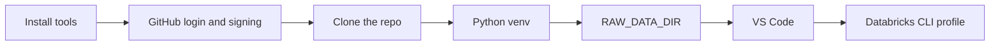

# Getting started

| Document | Read it for |
|---|---|
| [terminal-setup.md](terminal-setup.md) | Setting up a laptop once: terminal, Git and signed commits, Python, `RAW_DATA_DIR`, DuckDB, VS Code, and the Databricks CLI |
| [raw-data.md](raw-data.md) | The 15 raw files the job loads, where to get each one, and its SHA-256 |

It is written for teammates new to the terminal, so experienced engineers can skim to the checklist at the end. After setup, day-to-day work is in [workflow](../operations/workflow.md).

