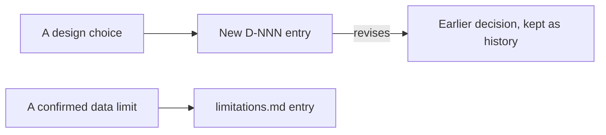

# Governance

| Document | Read it for |
|---|---|
| [decisions.md](decisions.md) | Every design decision, D-001 onward: the problem, the decision, the reason, and the consequence |
| [limitations.md](limitations.md) | What the data and methods cannot support, with evidence |

Decisions are history: a later decision revises an earlier one instead of rewriting it. Add an ownership document when responsibilities for production datasets, operations, and dashboards are approved.
