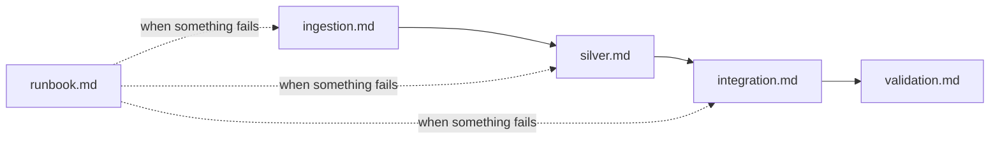

# Operations

How to run, check, and change the pipeline, layer by layer.

| Document | Covers | Read it when |
|---|---|---|
| [ingestion.md](ingestion.md) | Source → Control → Bronze, per source: validation, batches, reruns, backfills, failure and recovery | A load fails or a new delivery arrives |
| [silver.md](silver.md) | Bronze → Silver, per source: cleaning rules, quarantine, the gate | A Silver gate fails or a rule changes |
| [integration.md](integration.md) | The DepEd school-to-PSGC map and its work tables | A map gate fails or match rates change |
| [validation.md](validation.md) | Totals from source file to Gold, layer by layer | Checking a run end to end |
| [runbook.md](runbook.md) | Failure recovery: first response, failure types, retry, rerun and backfill, redeploying a fix, tracing a number to its raw file | A task, check, or alert fails, or a dashboard number looks wrong |
| [workflow.md](workflow.md) | Issues, branches, pull requests, reviews, and where code runs | Making any change |

Job setup, monitoring, and deployment are in the [architecture overview](../architecture/overview.md#orchestration). The [failure-recovery runbook](runbook.md) covers every layer.
