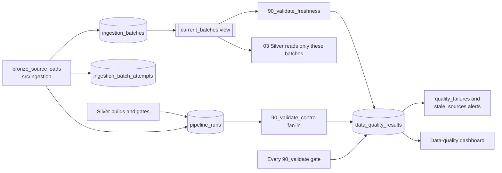

# 01 Control

Tables that record pipeline runs, ingestion batches, and data-quality results. They answer "was this file already loaded?", "what happened in that run?", and "which Bronze rows may downstream read?".

| Writes here | Reads from here |
|---|---|
| The Bronze loader (runs, batches, attempts, its own checks), every gate (check results), Silver (its run record) | Silver (`current_batches`), the fan-in and freshness checks, the alerts, the data-quality dashboard |

| File | Object | Holds |
|---|---|---|
| `01_create_pipeline_runs.sql` | `pipeline_runs` | One row per run: source, environment, status, timings, batch counts, failure, `code_revision`, and `job_run_id` (the Databricks job run whose gate task checked it; D-020) |
| `02_create_ingestion_batches.sql` | `ingestion_batches` | The processed-file manifest: one row per distinct archive (by SHA-256) and its current state. Upserted with MERGE |
| `03_create_ingestion_batch_attempts.sql` | `ingestion_batch_attempts` | Append-only: one row per batch per run, including skips and blocks |
| `04_create_data_quality_results.sql` | `data_quality_results` | Append-only: one row per check (PASS, WARN, FAIL), counts only, never row values. Columns follow #42 |
| `05_create_current_batches.sql` | `current_batches` (view) | For each source and period (school year; publication quarter for `psa_psgc`; or logical dataset for an estimate-year workbook), the latest succeeded delivery version: what downstream reads (D-015, D-018) |
| `90_validate_control.sql` | `data_quality_results` rows (`layer = 'control'`) | The source-lane fan-in, run after every Silver gate has finished, passed or not (`run_if: ALL_DONE`): one result per Silver lane switched on, PASS when that source's `silver_build` run in this job run succeeded. It fails the task on any FAIL, so the job run fails; only freshness follows it, and no Integration, Gold, or Analytics task waits for it (D-051). Generated by `python -m src.job.fan_in`; do not edit by hand. Run on `dev` at `1962bce` ([evidence](../../evidence/pipeline-runs/2026-10-11-source-lane-fan-in.md)), and as an audit at `135c1ac` ([evidence](../../evidence/pipeline-runs/2026-10-18-per-lane-job.md)) |
| `90_validate_freshness.sql` | `data_quality_results` rows (`layer = 'control'`, `check_name = 'source_fresh'`) | Source freshness, run after the fan-in has finished, passed or not (`run_if: ALL_DONE`), so after every Bronze load: one result per loaded source, PASS when its latest succeeded batch in `current_batches` is within its limit in `config/freshness.yml`, WARN when older or when it has none. Never fails the task; the `stale_sources` alert reports the WARNs (D-043). The `:freshness_as_of` parameter checks as of another time. Generated by `python -m src.job.freshness`; do not edit by hand |

Batch statuses: `validating` → `loading` → `succeeded`, or `failed` (retried by the next run), `blocked` (not an approved delivery), `skipped` (a re-zipped copy of an approved file). The `succeeded` status is written last, after Bronze is reconciled, so it marks the batch as committed (D-015).

Files follow `NN_<verb>_<object>.sql` (see [File naming and layout](../../docs/architecture/overview.md#file-naming-and-layout)). The Databricks job runs them as explicit bootstrap tasks before its source lanes, with `add_control_columns` (`src/ingestion/cli.py columns`) between the tables and the view, so tables created before a column was added gain it before the view reads it. Standalone ingestion creates them automatically unless `--no-setup` is passed, so a manual first run needs no separate setup.

`logical_dataset`, `estimate_years_covered` and `source_sheet` (in `ingestion_batches`; the first two also in `ingestion_batch_attempts`) were added for workbook sources (D-018). They are NULL for school-year sources. Tables created before them gain them from `src/ingestion/control.py` (`ADDED_COLUMNS`, `ALTER TABLE … ADD COLUMN` only if missing) before the view is replaced.

The period column is named `school_year`. For `psa_psgc` it holds the publication quarter, e.g. `2026-Q2` (D-019): quarters sort the same way, so backfill detection and `current_batches` work unchanged. Filter by `source_id` when reading it. For `psa_psgc`, `logical_dataset` and `estimate_years_covered` are NULL and `source_sheet` is `PSGC`; `current_batches` partitions by `COALESCE(school_year, logical_dataset)`, so it still takes one current version per quarter.
