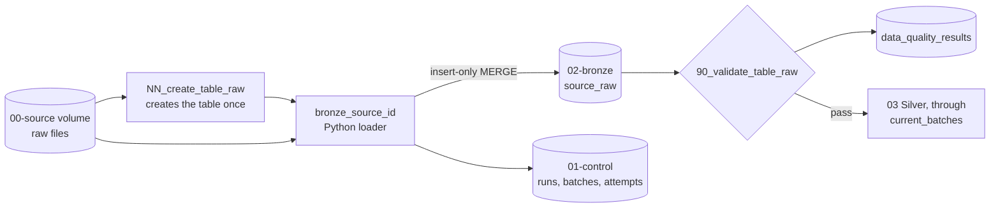

# 02 Bronze

Each source landed unchanged, every column as text, plus provenance columns saying where each row came from.

| File | What it does |
|---|---|
| `NN_create_<table>.sql` | One table per logical source, including all delivery years. `NN` is the source order in `config/tables.yml`. Generated from `config/ingestion/<source_id>.json` once that source has an ingestion contract (`python -m src.ingestion.cli ddl --source <source_id>`); a test fails if it differs |
| `90_validate_<table>.sql` | Bronze gate, run after every load (in the job, as its own SQL task right after the load): no pipeline duplicates, every row has a known batch, every succeeded batch reconciles to its file. Writes to `data_quality_results` and fails on any FAIL. Reads `:run_id` and `:code_revision`. Generated the same way (`cli gate`) |

What each source's rows carry, beyond the publisher's columns as text:

| Source | Format | A row is identified by | Also carries |
|---|---|---|---|
| `deped_enrollment`, `deped_facilities`, `deped_personnel` | `zip_csv` | The zip's SHA-256 and the CSV row number | `school_year` |
| `psa_psgc` | `xlsx_table` | The workbook's SHA-256 and the Excel row number | `source_sheet`, `publication_period`, `publication_date` |
| `psa_poverty_stat` | `xlsx_sheet` | The workbook's SHA-256 and the Excel row number | `source_sheet`, `source_row_kind`; title, header, and footer rows kept |
| `deped_enrollment_psgc` | `xlsx_report` | The workbook's SHA-256 and the Excel row number | `school_year`, `source_sheet`, `source_row_kind`; blank rows kept |
| `psa_school_age_population` | `xlsx_census` | The workbook's SHA-256, the sheet, and the Excel row number | `logical_dataset`, `census_year`, `source_row_kind`; both sheets loaded |
| `hdx_boundaries` | `geojson_features` | The file's SHA-256 and the feature's position | Geometry as raw GeoJSON text |
[ETL table registry](../../docs/standards/tables.md).

## Files

| Source | Table | Create | Gate |
|---|---|---|---|
| `deped_enrollment` | `deped_enrollment_raw` | `01_create_deped_enrollment_raw.sql` | `90_validate_deped_enrollment_raw.sql` |
| `deped_facilities` | `deped_facilities_raw` | `02_create_deped_facilities_raw.sql` | `90_validate_deped_facilities_raw.sql` |
| `deped_personnel` | `deped_personnel_raw` | `03_create_deped_personnel_raw.sql` | `90_validate_deped_personnel_raw.sql` |
| `psa_psgc` | `psa_psgc_raw` | `04_create_psa_psgc_raw.sql` | `90_validate_psa_psgc_raw.sql` |
| `psa_poverty_stat` | `psa_poverty_stat_raw` | `05_create_psa_poverty_stat_raw.sql` | `90_validate_psa_poverty_stat_raw.sql` |
| `hdx_boundaries` | `hdx_adm3_raw` | `06_create_hdx_adm3_raw.sql` | `90_validate_hdx_adm3_raw.sql` |
| `deped_enrollment_psgc` | `deped_enrollment_psgc_raw` | `07_create_deped_enrollment_psgc_raw.sql` | `90_validate_deped_enrollment_psgc_raw.sql` |
| `psa_school_age_population` | `psa_school_age_population_raw` | `08_create_psa_school_age_population_raw.sql` | `90_validate_psa_school_age_population_raw.sql` |

Loading is Python (`src/ingestion/`), because the files arrive as zips with a declared encoding, as workbooks whose cells must be kept exactly as stored, or as one GeoJSON file with polygons of several megabytes. The rules:

- Values are kept exactly as received, as text. A blank stays `''`; a column that a year's file does not have is `NULL`. No trimming, relabeling, typing, or deduplication: that is Silver.
- A row is identified by `(source_sha256, source_row_number)`, and loaded with an insert-only MERGE, so loading a file again adds nothing (D-015). Rows the publisher repeated are all kept and flagged as WARN.
- Downstream reads only rows whose batch is in `` `01-control`.current_batches ``.

Files follow `NN_<verb>_<object>.sql`, with checks in `90_validate_<object>.sql` (see [File naming and layout](../../docs/architecture/overview.md#file-naming-and-layout)).
