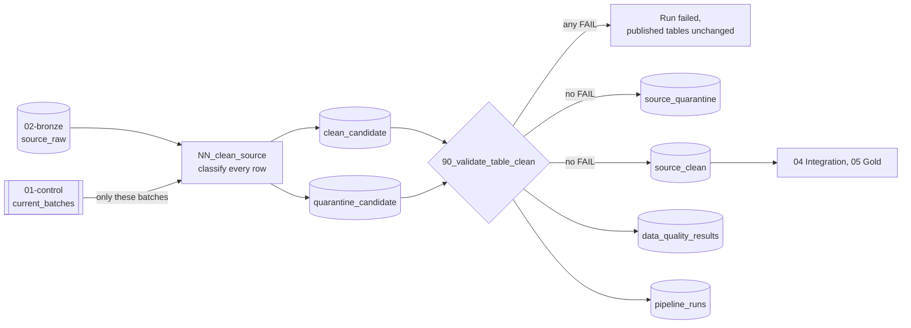

# 03 Silver

Typed, standardized, and validated data at the source's own grain, with a quarantine for rows that cannot be trusted. Design, rules, counts, and runbook: [docs/operations/silver.md](../../docs/operations/silver.md).



Every Bronze row of a current batch lands in exactly one of the two tables: `_clean` when it can be trusted, `_quarantine` with every reason when it cannot. The gate checks that clean plus quarantine reconciles to Bronze, so no row is lost. A quarantine above 1% of a period is a FAIL.

| File | What it does |
|---|---|
| `NN_clean_<source>.sql` | Job task: rebuilds the source's two candidate tables (`<table>_candidate`, `<quarantine>_candidate`) from the Bronze rows of `` `01-control`.current_batches `` only, on every run. `NN` matches the source order in `config/tables.yml`. It keeps one run stamp in session variables (`:run_id`, `:code_revision`, one timestamp), records the run as `running` in `pipeline_runs`, classifies every row in a temporary view (cleaned values and quarantine reasons), then runs two `CREATE OR REPLACE TABLE ... AS SELECT`, each commented as an unpublished build not to read and handed to `reached-hq`. It never writes the Silver tables |
| `90_validate_<table>.sql` | Job task after the build, on the candidate tables: reconciliation with Bronze per school year, keys, ranges, NULLs, labels, lineage, quarantine rate, and a record of each rule's affected rows. Writes to `data_quality_results` (`layer = 'silver'`). On any FAIL it records the run `failed` and fails the task before publishing; otherwise it copies the candidates to the Silver tables (quarantine, then clean) and records the run `succeeded` (D-025). Reads `:run_id` and `:code_revision` |

Both files are generated from the Bronze contract (`config/ingestion/<source_id>.json`) and the reviewed Silver mapping (`config/mappings/<source_id>.json`); a test fails if they differ:

```bash
python -m src.silver.cli sql --source deped_enrollment > etl/03_silver/01_clean_deped_enrollment.sql
```

```bash
python -m src.silver.cli gate --source deped_enrollment > etl/03_silver/90_validate_deped_enrollment_clean.sql
```

On Windows, set `PYTHONUTF8=1` first (in PowerShell, `$env:PYTHONUTF8 = "1"`), or the files are written in cp1252 and the `Ñ` repair breaks the build.

Implemented. Regenerate any of them with `--source <source_id>`; grain and columns are in each data dictionary:

| Source | Clean table | Build | Gate | Dictionary | Decision | Read by |
|---|---|---|---|---|---|---|
| `deped_enrollment` | `deped_enrollment_clean` | `01_clean_deped_enrollment.sql` | `90_validate_deped_enrollment_clean.sql` | [deped-enrollment-clean](../../docs/data/silver/deped-enrollment-clean.md) | D-022, D-023 | `deped_school_psgc_map`, `deped_annex_mother_map`, `dim_school`, `dim_school_year`, `fact_school_enrollment`, `fact_school_year_source_availability` |
| `deped_facilities` | `deped_facilities_clean` | `02_clean_deped_facilities.sql` | `90_validate_deped_facilities_clean.sql` | [deped-facilities-clean](../../docs/data/silver/deped-facilities-clean.md) | D-038 | `fact_school_classroom_capacity`, `fact_school_year_source_availability` |
| `deped_personnel` | `deped_personnel_clean` | `03_clean_deped_personnel.sql` | `90_validate_deped_personnel_clean.sql` | [deped-personnel-clean](../../docs/data/silver/deped-personnel-clean.md) | D-041 | `fact_school_teacher_capacity`, `fact_school_year_source_availability` |
| `psa_psgc` | `psa_psgc_clean` | `04_clean_psa_psgc.sql` | `90_validate_psa_psgc_clean.sql` | [psa-psgc-clean](../../docs/data/silver/psa-psgc-clean.md) | D-035 | Every PSGC map, `dim_city_municipality`, `dim_barangay`, `fact_city_population` |
| `psa_poverty_stat` | `psa_poverty_stat_clean` | `05_clean_psa_poverty_stat.sql` | `90_validate_psa_poverty_stat_clean.sql` | [psa-poverty-stat-clean](../../docs/data/silver/psa-poverty-stat-clean.md) | D-034 | `psa_poverty_psgc_map` |
| `hdx_boundaries` | `hdx_adm3_clean` | `06_clean_hdx_adm3.sql` | `90_validate_hdx_adm3_clean.sql` | [hdx-adm3-clean](../../docs/data/silver/hdx-adm3-clean.md) | D-040 | `hdx_adm3_psgc_map`, `dim_city_municipality` |
| `deped_enrollment_psgc` | `deped_enrollment_psgc_clean` | `07_clean_deped_enrollment_psgc.sql` | `90_validate_deped_enrollment_psgc_clean.sql` | [deped-enrollment-psgc-clean](../../docs/data/silver/deped-enrollment-psgc-clean.md) | D-049 | `deped_school_psgc_map` |
| `psa_school_age_population` | `psa_school_age_population_clean` | `08_clean_psa_school_age_population.sql` | `90_validate_psa_school_age_population_clean.sql` | [psa-school-age-population-clean](../../docs/data/silver/psa-school-age-population-clean.md) | D-053 | `psa_school_age_population_psgc_map`, `fact_city_school_age_population` |

Each clean table has a `_quarantine` table beside it.

The SQL uses only what Databricks and DuckDB share; `src/ingestion/store.py` translates `regexp_like` and `regexp_replace` for DuckDB. Files follow `NN_<verb>_<object>.sql`, with checks in `90_validate_<object>.sql` (see [File naming and layout](../../docs/architecture/overview.md#file-naming-and-layout)).
