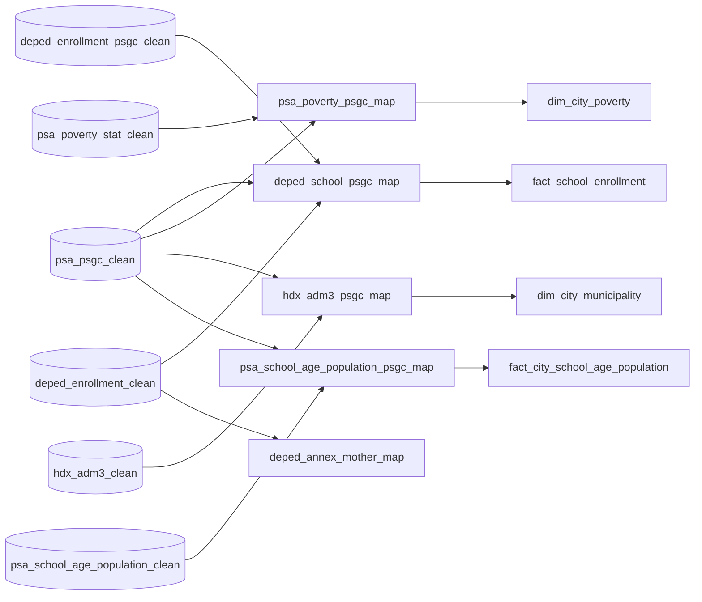

# 04 Integration

Matches the sources to one shared geography, PSGC, so Gold can join them. Each map keeps one row per source row, including the ones it cannot match, with a match method, a status, and a reason.

Each map waits only for the Silver gates of the tables it reads (D-051), and, like every layer from Silver on, builds a candidate that replaces the published map only when its gate passes.

## Maps

| Map | Build | Gate | Written | Matches | Decision |
|---|---|---|---|---|---|
| `deped_school_psgc_map` | `01_map_deped_school_psgc.sql` | `90_validate_deped_school_psgc_map.sql` | Generated from [`config/mappings/integration/`](../../config/mappings/integration/README.md) | Each school, school year, and level (`city_mun`, `bgy`): EMISD code first, reviewed name as fallback | #91, D-049 |
| `psa_poverty_psgc_map` | `02_map_psa_poverty_psgc.sql` | `90_validate_psa_poverty_psgc_map.sql` | By hand | Each poverty estimate row, by `Correspondence Code` only; estimates copied unchanged | #92, D-054 |
| `hdx_adm3_psgc_map` | `03_map_hdx_adm3_psgc.sql` | `90_validate_hdx_adm3_psgc_map.sql` | Generated from [`config/integration/`](../../config/integration/README.md) | Each COD-AB ADM3 feature, by code and name together | #93, D-052 |
| `deped_annex_mother_map` | `04_map_deped_annex_mother.sql` | `90_validate_deped_annex_mother_map.sql` | By hand | Each annex school and year to its mother school | D-044 |
| `psa_school_age_population_psgc_map` | `05_map_psa_school_age_population_psgc.sql` | `90_validate_psa_school_age_population_psgc_map.sql` | Generated from [`config/integration/`](../../config/integration/README.md) | Each census place, inside its province | #159, D-055 |

Regenerate a generated map with `python -m src.integration.<module> sql|gate` ([src/integration](../../src/integration/README.md)); its test fails until the committed SQL matches.

## Notes per map

- **`deped_school_psgc_map`** matches each distinct (province, municipality) and barangay place once, then joins the decisions back to schools, so the warehouse never builds a school-by-PSGC cross product. Its gate fails below the match-rate floor in its rules file, requires the configured PSGC version, and blocks publication when reviewed counts change. Its expensive stages are run-specific work tables named with a hash of `run_id`, dropped after a successful build ([Integration, Internal work tables](../../docs/operations/integration.md#internal-work-tables)).
- **`psa_poverty_psgc_map`** compares names but never matches by them. Manila's 14 districts keep their own sub-municipality codes, and the gate counts the PSGC cities and municipalities with no PSA row in each estimate year (D-028).
- **`hdx_adm3_psgc_map`**: COD-AB P-codes are not PSGC codes, so a code counts only when the names agree. The 8 Special Geographic Area units stay unmatched.
- **`deped_annex_mother_map`**: the DepEd releases name annexes but not their mother schools, so every row is `unmatched` with its evidence, and no totals are consolidated until a reviewed crosswalk exists. Nothing downstream reads it yet.
- **`psa_school_age_population_psgc_map`**: census regions are mapped to today's PSGC regions first, then names are matched inside their province only.

Files follow `NN_<verb>_<object>.sql`, with checks in `90_validate_<object>.sql`.
