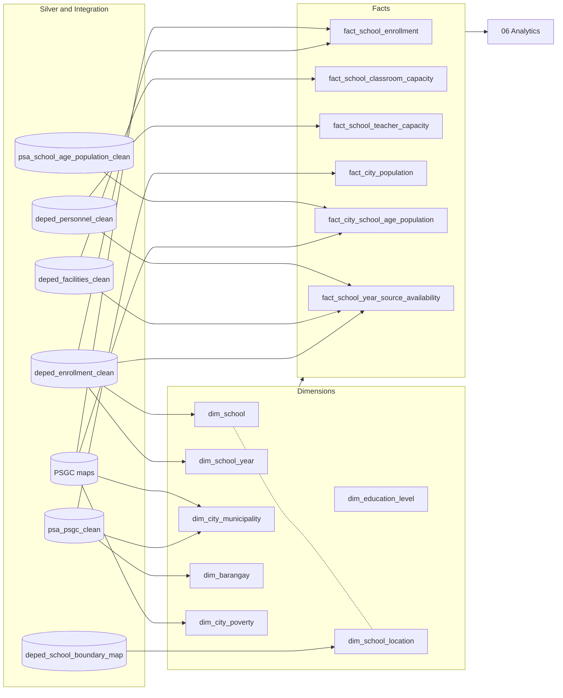

# 05 Gold

Facts and dimensions for the approved business question.

The provisional model, grains, keys, analytical-question mapping, and ERD are in
[`docs/architecture/data-model.md`](../../docs/architecture/data-model.md).
The AP1 to AP4 implementation contract is D-050. Building these source-aligned
tables does not by itself make an analytical result or dashboard output ready.

Gold holds keys and measures at their natural grain and no ratios or ranks; those belong to Analytics. `dim_education_level` is a fixed list (ES, JHS, SHS) and reads no table.

All seven dimensions and six facts are implemented and enabled in the job. Grains are in the [ETL table registry](../../docs/standards/tables.md#gold-names).

| Table | Build | Gate |
|---|---|---|
| `dim_school` | `01_build_dim_school.sql` | `90_validate_dim_school.sql` |
| `dim_school_year` | `02_build_dim_school_year.sql` | `90_validate_dim_school_year.sql` |
| `dim_education_level` | `03_build_dim_education_level.sql` | `90_validate_dim_education_level.sql` |
| `dim_city_municipality` | `04_build_dim_city_municipality.sql` | `90_validate_dim_city_municipality.sql` |
| `dim_barangay` | `05_build_dim_barangay.sql` | `90_validate_dim_barangay.sql` |
| `dim_city_poverty` | `06_build_dim_city_poverty.sql` | `90_validate_dim_city_poverty.sql` |
| `dim_school_location` | `07_build_dim_school_location.sql` | `90_validate_dim_school_location.sql` |
| `fact_school_enrollment` | `10_build_fact_school_enrollment.sql` | `90_validate_fact_school_enrollment.sql` |
| `fact_school_classroom_capacity` | `11_build_fact_school_classroom_capacity.sql` | `90_validate_fact_school_classroom_capacity.sql` |
| `fact_school_teacher_capacity` | `12_build_fact_school_teacher_capacity.sql` | `90_validate_fact_school_teacher_capacity.sql` |
| `fact_city_population` | `13_build_fact_city_population.sql` | `90_validate_fact_city_population.sql` |
| `fact_city_school_age_population` | `14_build_fact_city_school_age_population.sql` | `90_validate_fact_city_school_age_population.sql` |
| `fact_school_year_source_availability` | `15_build_fact_school_year_source_availability.sql` | `90_validate_fact_school_year_source_availability.sql` |

Enrollment and `dim_school_year` cover SY 2020-21 through SY 2025-26. Classroom
and teacher capacity currently cover SY 2023-24 only.
`fact_school_year_source_availability` records those source-level gaps separately
from the school-level coverage checks.

Each build writes a candidate table. Its `90_validate_*` gate checks grain, foreign keys, source reconciliation, and coverage before replacing the published table. A failed gate leaves the last good Gold table unchanged. Job dependencies follow D-051, so each table waits only for the source and dimension gates it reads.

The `dim_city_municipality`, `dim_barangay` and `fact_city_school_age_population`
gates write their one-row check summary to a table named for the run
(`<table>_gate_summary_r_<sha256(run_id)>`) and drop it once the checks are
recorded, as the DepEd school-PSGC gate does (c64e949). Read many times as a
temporary view, the summary made Databricks SQL's optimizer fail with
INTERNAL_ERROR.
