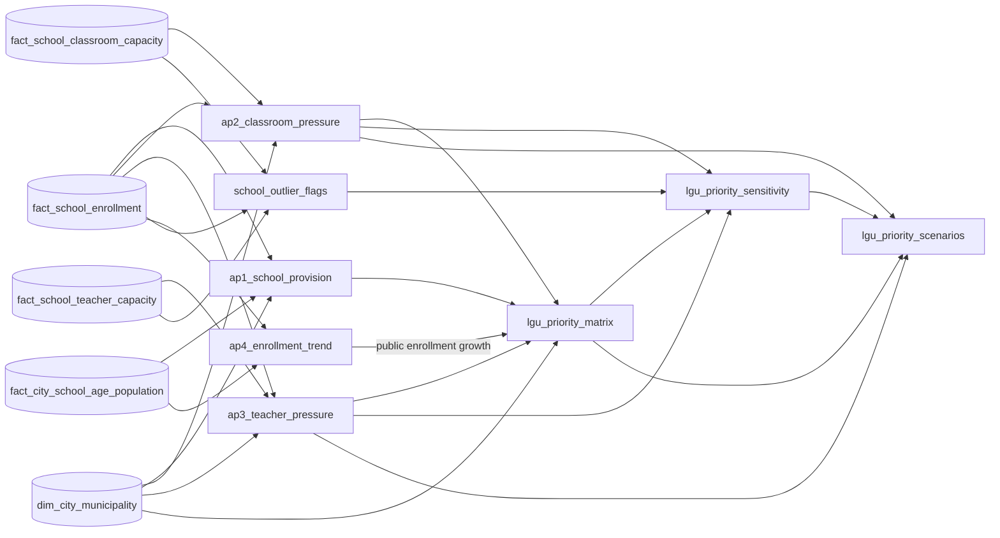

# 06 Analytics

This layer publishes one dataset per analytical question and an evidence-based LGU planning table. The metrics follow the [metric specification](../../docs/business/metric-specification.md). Gold remains reusable and contains no prioritization rule.

AP1 to AP3, the planning table and the sensitivity table have one row per regular city or municipality; the outlier flags have one row per school and measure. AP4 has one row per city member and school year. Each build writes a candidate table, its paired `90_validate_*` gate independently recomputes the result from Gold, and only a passing candidate replaces the published table.

| Build | Gate | Output | Approved use |
|---|---|---|---|
| `01_answer_ap1.sql` | `90_validate_ap1.sql` | `ap1_school_provision` | Descriptive school-provision context; not a school-establishment or priority measure |
| `02_answer_ap2.sql` | `90_validate_ap2.sql` | `ap2_classroom_pressure` | School-level PIDS-style illustrative screen at >=50 learners per reported NSBI instructional room, aggregated to the LGU |
| `03_answer_ap3.sql` | `90_validate_ap3.sql` | `ap3_teacher_pressure` | ES, JHS and SHS learner-per-teacher pressure references; not an official shortage estimate |
| `04_answer_ap4.sql` | `90_validate_ap4.sql` | `ap4_enrollment_trend` | Public-school enrollment growth for priority; all-sector trend and census gap as context |
| `05_build_priority_matrix.sql` | `90_validate_priority_matrix.sql` | `lgu_priority_matrix` | D-061 priority categories from separate AP2 and AP3 pressure flags and AP4 public-enrollment growth |
| `06_flag_school_outliers.sql` | `90_validate_school_outlier_flags.sql` | `school_outlier_flags` | Every AP2 and AP3 school ratio with its Tukey outer fences and suspected-outlier flag (D-065); a quality result, never a correction |
| `07_build_priority_sensitivity.sql` | `90_validate_priority_sensitivity.sql` | `lgu_priority_sensitivity` | The published D-061 priority beside the same priority without suspected extreme schools, with an outlier-sensitivity status (D-065) |
| `08_build_priority_scenarios.sql` | `90_validate_priority_scenarios.sql` | `lgu_priority_scenarios` | Both scenarios in the published tables' column names, one row per LGU and scenario, so the planner dashboard's *Suspected outliers* filter reads one row (D-065) |

## D-061 planning-priority method

Every column of these outputs is in [analytics outputs](../../docs/data/analytics-outputs.md).

AP2 evaluates each usable school first. A school passes the illustrative screen when its complete all-level enrollment divided by its reported total NSBI instructional rooms is at least 50. The LGU row reports the number of screened schools, affected learners, and affected-learner share.

AP2 flags classroom pressure when at least one school passes and learner coverage is at least 90%. If coverage is below 90% or the ratio is unavailable, AP2 adds no classroom pressure, and the LGU goes to Data review unless teacher pressure is known; it is never read as having no pressure.

AP3 flags teacher pressure when any adequately covered offered level exceeds its reference: ES 35, JHS 36, or SHS 80/3 learners per eligible teacher. AP2 and AP3 remain separate current pressures. AP4 flags growth only when public-school enrollment increases from SY 2020-21 to SY 2025-26 and both endpoint years have at least one complete public school and no public school with an incomplete enrollment total.

`current_pressure_count` is the sum of the two Boolean pressure flags. Priority 1 means both current pressures and growth. Priority 2 means both pressures without growth, or one pressure with growth. Priority 3 means one pressure without growth. Monitor means growth without a current pressure. No current pressure identified means neither pressure nor growth. A known pressure always counts. Where growth cannot be assessed, an LGU with a known pressure is placed as if it were not growing, with `growth_not_assessed_reason`. Data review is for LGUs with no known pressure where an AP2 or AP3 coverage gate failed or growth cannot be assessed.

`priority_order` sorts the categories in that order, then uses current pressure count, affected learners, classroom-affected learners, pressured teacher levels, absolute growth, percentage growth, and PSGC code. Classroom and teacher affected learners remain separate; `priority_affected_learners` uses their larger value rather than adding potentially overlapping learners.

The PIDS paper defines its 1:50 line for illustration and analyzes congestion at school and education-level grain. The current Gold facilities data provide a broader all-level NSBI instructional-room total, including room types outside a K–12-classroom-only denominator. The implementation is therefore labelled **PIDS-style illustrative reported-room screen** and does not claim to reproduce the paper or DepEd's official classroom–learner indicator.

## D-065 outlier sensitivity

`school_outlier_flags` compares each school's classroom ratio with the other schools of its LGU type, and each teacher ratio with the same level and LGU type. A ratio beyond Tukey's outer fence (3 × IQR beyond the quartiles; above it only, for the classroom ratio) is a suspected extreme outlier. Every school stays in the published measures.

`lgu_priority_sensitivity` repeats AP2, AP3 and the D-061 rule without the flagged schools (scenario B) and compares it with the published matrix (scenario A). Its gate fails unless scenario A is the published matrix and every LGU without a flagged school is identical in both. `outlier_sensitivity_status` names the most serious change: Priority-sensitive, Classification-sensitive, Coverage-sensitive, Magnitude-sensitive, Stable, or No suspected outliers. The published category stays the review status; the status tells planners which LGUs to verify first.

## Teacher-pressure interpretation

AP3 preserves ES 35 as a **historical study reference** and JHS 36 and SHS 80/3 as **derived deployment comparisons**. The latter convert published class-size maxima and teacher-to-class factors into a compatible unit. None is a current national staffing entitlement or teacher-shortage formula, so AP3 does not assign a teacher priority rank.

The overall AP3 status is `pressure signal identified` when any offered, adequately covered level is above its reference, even if another offered level is incomplete. It is `not fully assessed` only when no passing level is above reference and at least one offered level fails coverage. This preserves the usable evidence without treating missing data as absence of pressure.

All outputs retain coverage and missingness fields. A recorded zero remains zero; an all-NULL component total remains NULL. Every gate writes a one-row run-specific summary, records its checks, and removes the temporary summary after validation.

Files follow `NN_<verb>_<object>.sql`, with checks in `90_validate_<object>.sql` (see [File naming and layout](../../docs/architecture/overview.md#file-naming-and-layout)).
