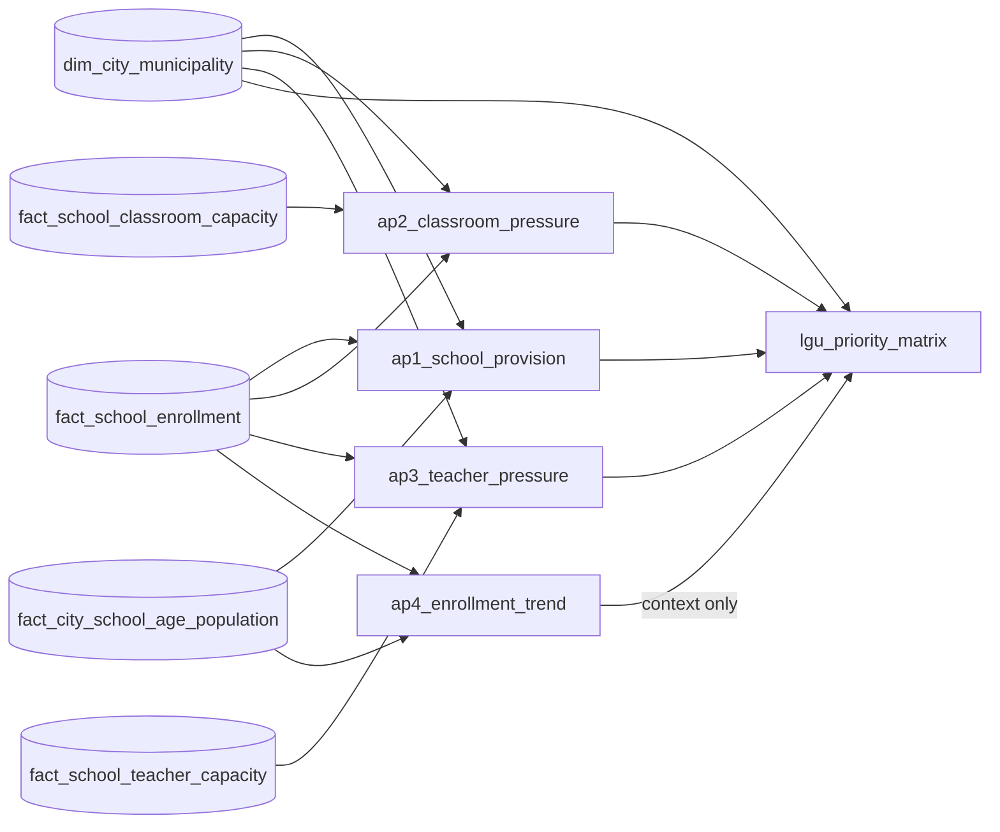

# 06 Analytics

This layer publishes one dataset per analytical question and an evidence-based LGU planning table. The metrics follow the [metric specification](../../docs/business/metric-specification.md). Gold remains reusable and contains no prioritization rule.

AP1 to AP3 and the planning table have one row per regular city or municipality. AP4 has one row per city member and school year. Each build writes a candidate table, its paired `90_validate_*` gate independently recomputes the result from Gold, and only a passing candidate replaces the published table.

| Build | Gate | Output | Approved use |
|---|---|---|---|
| `01_answer_ap1.sql` | `90_validate_ap1.sql` | `ap1_school_provision` | Descriptive school-provision context; not a school-establishment or priority measure |
| `02_answer_ap2.sql` | `90_validate_ap2.sql` | `ap2_school_classroom_pressure`, `ap2_classroom_pressure` | Raw school classroom pressure, national percentile and top-decile review flag, plus the separate PIDS-style >=50 screen, aggregated to the LGU |
| `03_answer_ap3.sql` | `90_validate_ap3.sql` | `ap3_teacher_pressure` | Descriptive ES, JHS and SHS learner-per-teacher comparisons; not a teacher-shortage rank |
| `04_answer_ap4.sql` | `90_validate_ap4.sql` | `ap4_enrollment_trend` | Enrollment trend and census-year population context |
| `05_build_priority_matrix.sql` | `90_validate_priority_matrix.sql` | `lgu_priority_matrix` | D-061 top-decile classroom review queue; no composite multi-domain tier or teacher rank |

## D-061 classroom review queue

AP2 evaluates each usable school first. `ap2_school_classroom_pressure` publishes its complete all-level enrollment divided by reported total NSBI instructional rooms, its `PERCENT_RANK()` among all denominator-usable public schools nationally in SY 2023-24, and a top-decile review flag at `>=0.90`. It also preserves the independent PIDS-style illustrative screen at `>=50`.

An LGU is queued as `top_decile_relative_pressure` when at least one usable school is in the national top decile and AP2 learner coverage is at least 90%. It is `below_top_decile_relative_pressure` when assessed with no flagged school, and `data_review` when coverage is below 90% or the ratio is unavailable.

Only LGUs in `top_decile_relative_pressure` receive `classroom_priority_rank`. `DENSE_RANK()` orders them by learners in top-decile schools, top-decile school count, affected-learner share, then pooled reported-room ratio, all descending. Exact ties share a rank. These are triage ranks for validating classroom conditions, not official shortage or construction-entitlement ranks.

The percentile is a relative review position adapted from CDC/ATSDR SVI and governed by OECD/JRC guidance: its comparison population, raw value, missing-data exclusions, and limitations stay visible. The PIDS paper defines its 1:50 line for illustration and analyzes congestion at school and education-level grain. The current Gold facilities data provide a broader all-level NSBI instructional-room total, so neither flag is an official DepEd classroom–learner indicator or shortage estimate.

## Teacher context

AP3 preserves ES 35 as a **historical study reference** and JHS 36 and SHS 80/3 as **derived deployment comparisons**. The latter convert published class-size maxima and teacher-to-class factors into a compatible unit. None is a current national staffing entitlement or teacher-shortage formula, so AP3 does not assign a teacher priority rank.

The overall AP3 status is `pressure signal identified` when any offered, adequately covered level is above its reference, even if another offered level is incomplete. It is `not fully assessed` only when no passing level is above reference and at least one offered level fails coverage. This preserves the usable evidence without treating missing data as absence of pressure.

All outputs retain coverage and missingness fields. A recorded zero remains zero; an all-NULL component total remains NULL. Every gate writes a one-row run-specific summary, records its checks, and removes the temporary summary after validation.

Files follow `NN_<verb>_<object>.sql`, with checks in `90_validate_<object>.sql` (see [File naming and layout](../../docs/architecture/overview.md#file-naming-and-layout)).

**Known dependency gap.** `04_answer_ap4.sql` reads `fact_city_school_age_population`, but its task in `databricks.yml` waits only for `90_validate_fact_school_enrollment`. If the school-age gate fails, AP4 still builds, from the last published school-age table.
