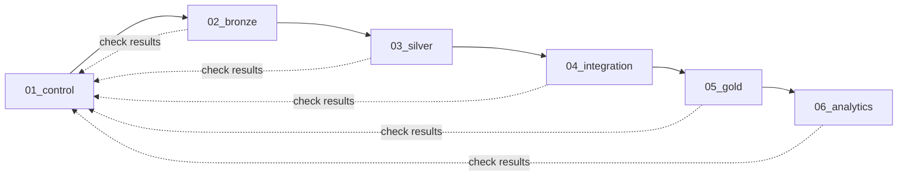
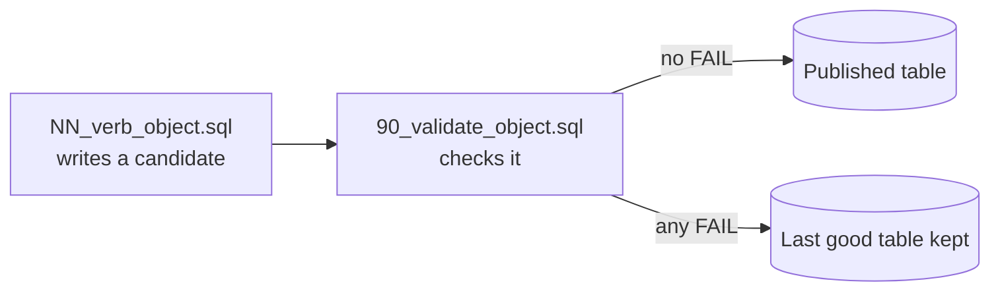

# ETL

The SQL of every pipeline stage. Each stage folder matches a Unity Catalog schema, and each SQL file is one task of the `edu_access_pipeline` job in [`databricks.yml`](../databricks.yml).

| Folder | Schema | Builds | Written |
|---|---|---|---|
| [`01_control/`](01_control/README.md) | `` edu_access.`01-control` `` | Run, batch, and check-result tables; fan-in and freshness checks | By hand, except the two generated checks |
| [`02_bronze/`](02_bronze/README.md) | `` edu_access.`02-bronze` `` | One `_raw` table per source, every value as text | Generated from `config/ingestion/` |
| [`03_silver/`](03_silver/README.md) | `` edu_access.`03-silver` `` | One `_clean` and one `_quarantine` table per source | Generated from `config/mappings/` |
| [`04_integration/`](04_integration/README.md) | `` edu_access.`04-integration` `` | Five `_map` tables: four to PSGC geography, one annex school to its mother school | Three generated, two by hand |
| [`05_gold/`](05_gold/README.md) | `` edu_access.`05-gold` `` | Six `dim_` and six `fact_` tables | By hand |
| [`06_analytics/`](06_analytics/README.md) | `` edu_access.`06-analytics` `` | AP1 to AP4 and `lgu_priority_matrix` | By hand |

The name and grain of every table are in the [ETL table registry](../docs/standards/tables.md); how the stages connect is in the [architecture overview](../docs/architecture/overview.md#data-flow).

## Files in a stage

From Silver on, every build and its gate work like this. Bronze creates its table once, and the Python loader in `src/ingestion/` fills it.

- `NN_<verb>_<object>.sql` builds; the verb says how (`create`, `clean`, `map`, `build`, `answer`).
- `90_validate_<object>.sql` is its gate. Gates write to `` `01-control`.data_quality_results `` and fail the task on any FAIL.
- The number orders files for reading. The order they run in is the task dependencies in `databricks.yml`.
- Every persisted table is named `` edu_access.`NN-stage`.table ``; the schema names need backticks.

## Adding or changing a file

1. Register the table in [`config/tables.yml`](../config/tables.yml).
2. Write the build and its gate, or regenerate them if the stage is generated.
3. Add both as tasks in `databricks.yml`, each depending only on the gates it reads (D-051).
4. List both files in the stage README; a test fails until you do.
5. Run `python -m pytest tests -q`; `tests/test_local_job.py` runs the whole job on made-up data.
