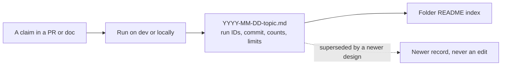

# Evidence

Records that prove a claim about the pipeline: that a load is idempotent, that a layer reconciles, that a gate stops a bad build. Each record cites its job run and commit, so a claim in a pull request or a document can link to proof.

| Folder | Holds | Records |
|---|---|---|
| [`pipeline-runs/`](pipeline-runs/README.md) | Loads, reruns, blocked files, gates, alerts, and whole-job runs, on Databricks `dev` or locally, grouped by layer | 38 |
| [`reconciliation/`](reconciliation/README.md) | Counts and totals compared from one layer to the next, grouped by layer | 16 |

Records that a changed or unapproved file is blocked before Bronze are under *Source to Bronze* in [`pipeline-runs/`](pipeline-runs/README.md#source-to-bronze); the gates' own results are in `` edu_access.`01-control`.data_quality_results ``, not in files. Totals compared from source file to Gold, across layers, are in [validation](../docs/operations/validation.md).

## Writing a record

- One file per claim, named `YYYY-MM-DD-<topic>.md`, with the claim as its title.
- Include the job run IDs, `code_revision`, the commands or queries, the results, and what the run does not prove.
- Say where it ran: Databricks `dev`, Databricks `prod`, or local DuckDB, and for Databricks the workspace host.
- Counts and identifiers only: never source rows, table exports, logs, credentials, or screenshots with personal data.
- Records are history. Do not edit an old result to match the current pipeline; add a new record and mark the old one superseded in the index.
- Add the record to its folder's index in the same pull request.
