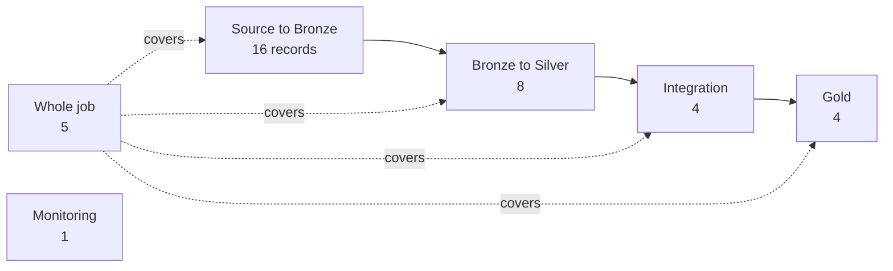

# Pipeline-run evidence

Records of the pipeline doing what it claims: loading once, rebuilding identically, stopping on a failed gate, alerting. Each names its job run IDs and commit, and says whether it ran on Databricks `dev`, Databricks `prod`, or local DuckDB. How to write one: [evidence](../README.md#writing-a-record).

Analytics has no run record yet. Records are grouped by layer, then by source; Whole job lists the newest first.

## Whole job

Start here: the latest record shows the whole job passing on Databricks.

| Date | Source | Claim |
|---|---|---|
| 2026-10-21 | All, with DepEd PSGC coordinates | [The whole job, with the school boundary map and dim_school_location, succeeds on Databricks `dev`](2026-10-21-dim-school-location-databricks.md) |
| 2026-10-20 | All | [The whole job runs on Databricks `dev`, source to Gold, twice, with every gate passing and identical results](2026-10-20-gold-databricks-dev.md) |
| 2026-10-20 | All | [Failure recovery, local: a failed gate keeps the last good tables published, and a new run of the fixed code rebuilds every published table exactly as before](2026-10-20-failure-recovery-local.md) |
| 2026-10-18 | All | [Downstream tasks start from the gates they read, and the fan-in is an audit](2026-10-18-per-lane-job.md) |
| 2026-10-11 | All | [The source-lane fan-in checks every Silver lane on Databricks, and Integration starts only from it](2026-10-11-source-lane-fan-in.md) |
| 2026-10-08 | All Bronze lanes | [The edu_access_pipeline DAG runs every Bronze lane and gate on Databricks, a second run inserts nothing, and each load joins to its gate](2026-10-08-pipeline-dag-databricks-idempotency.md) |

## Monitoring

| Date | Source | Claim |
|---|---|---|
| 2026-10-13 | All | [Every monitoring signal fires once on Databricks, and each alert email lists its rows](2026-10-13-monitoring-alerts.md) |

## Source to Bronze

Each load runs twice; the second must insert nothing. Changed or unapproved files must be blocked.

| Date | Source | Claim |
|---|---|---|
| 2026-10-06 | DepEd enrollment | [Loading DepEd enrollment into Bronze twice inserts nothing the second time](2026-10-06-deped-enrollment-idempotency.md) |
| 2026-10-18 | DepEd enrollment | [DepEd enrollment SY 2020-21 loads on Databricks `dev` as a backfill, Silver passes every check, and a second run inserts nothing](2026-10-18-deped-enrollment-2020-21-databricks.md) |
| 2026-10-19 | DepEd enrollment | [DepEd enrollment SY 2021-22 and 2022-23 load on Databricks `dev`, the other four years skip, and Silver passes every check](2026-10-19-deped-enrollment-2021-23-databricks.md) |
| 2026-10-06 | DepEd facilities | [DepEd facilities loads into Bronze once, and a second run inserts nothing](2026-10-06-deped-facilities-idempotency.md) |
| 2026-10-09 | DepEd personnel | [Deped_personnel: Databricks dev load, rerun, and DAG gate confirmation, 2026-10-09](2026-10-09-deped-personnel-databricks-idempotency.md) |
| 2026-10-16 | DepEd EMISD | [The real EMISD workbook loads into Bronze locally once, and a second run inserts nothing](2026-10-16-deped-enrollment-psgc-local-idempotency.md) |
| 2026-10-16 | DepEd EMISD | [The EMISD workbook loads into Bronze on Databricks `dev` once, and a second run inserts nothing](2026-10-16-deped-enrollment-psgc-databricks-idempotency.md) |
| 2026-10-21 | DepEd PSGC coordinates | [The public-only DepEd PSGC and coordinates workbook loads into Bronze locally once, every check passes, and a second run inserts nothing](2026-10-21-deped-psgc-coordinates-local-idempotency.md) |
| 2026-10-21 | DepEd PSGC coordinates | [On Databricks `dev` the public-only workbook loads into Bronze, and a missing workbook fails the load instead of passing empty; the second-run skip is still to record](2026-10-21-deped-psgc-coordinates-databricks.md) |
| 2026-10-07 | PSA PSGC | [The real PSGC 2Q 2026 workbook loads into Bronze locally once, and a second run inserts nothing](2026-10-07-psa-psgc-local-idempotency.md) |
| 2026-10-08 | PSA PSGC | [PSGC 2Q 2026 loads into Bronze on Databricks once, and a second run inserts nothing](2026-10-08-psa-psgc-databricks-idempotency.md) |
| 2026-10-07 | PSA poverty | [PSA Poverty Stat ingestion is idempotent and incremental (local: made-up workbooks and the real workbook)](2026-10-07-psa-poverty-stat-local-idempotency.md) |
| 2026-10-16 | PSA school-age | [The real PSA school-age population workbooks load into Bronze locally once, and later runs insert nothing](2026-10-16-psa-school-age-population-local-idempotency.md) |
| 2026-10-16 | PSA school-age | [The PSA school-age population workbooks load into Bronze on Databricks `dev` once, and a second run inserts nothing](2026-10-16-psa-school-age-population-databricks-idempotency.md) |
| 2026-10-08 | HDX boundaries | [Hdx_boundaries (ADM3): local load and idempotency, 2026-10-08](2026-10-08-hdx-boundaries-local-idempotency.md) |
| 2026-10-08 | HDX boundaries | [Hdx_boundaries (ADM3): Databricks dev load and idempotency, 2026-10-08](2026-10-08-hdx-boundaries-databricks-idempotency.md) |

## Bronze to Silver

Each build passes its gate, and a rerun rebuilds identical rows.

| Date | Source | Claim |
|---|---|---|
| 2026-10-09 | DepEd enrollment | [Silver publishes only a build that passes its gate, and a failed build leaves the last good one in place](2026-10-09-silver-publish-after-gate.md) |
| 2026-10-09 | DepEd enrollment | [DepEd enrollment Silver builds and passes its gate on Databricks, and a second run rebuilds identical rows](2026-10-09-deped-enrollment-silver.md) |
| 2026-10-11 | DepEd facilities | [DepEd facilities Silver builds and passes its gate on Databricks, and a second run rebuilds identical rows](2026-10-11-deped-facilities-silver.md) |
| 2026-10-11 | DepEd personnel | [DepEd Personnel Silver builds and passes its gate on Databricks](2026-10-11-deped-personnel-silver.md) *(superseded by [2026-10-12](2026-10-12-deped-personnel-silver.md))* |
| 2026-10-12 | DepEd personnel | [DepEd Personnel Silver passes on Databricks](2026-10-12-deped-personnel-silver.md) |
| 2026-10-16 | DepEd EMISD | [The DepEd school-to-PSGC crosswalk builds, reconciles, and passes its Silver gate on Databricks `dev`, with the same result in every run](2026-10-16-deped-enrollment-psgc-silver-databricks.md) |
| 2026-10-18 | PSA school-age | [PSA school-age population Silver builds and passes its gate on Databricks, with identical content on a rerun](2026-10-18-psa-school-age-population-silver-databricks.md) |
| 2026-10-09 | HDX boundaries | [HDX ADM3 Silver builds and passes its gate on Databricks, and a second run rebuilds the same result](2026-10-09-hdx-adm3-silver-databricks.md) |

## Integration

| Date | Source | Claim |
|---|---|---|
| 2026-10-19 | DepEd schools | [The DepEd school-to-PSGC map builds on Databricks with its work-table stages, and its gate passes](2026-10-19-deped-psgc-work-tables-databricks.md) |
| 2026-10-19 | PSA poverty | [The PSA poverty to PSGC map builds and passes its gate on Databricks, with the same result as locally](2026-10-19-psa-poverty-psgc-map-databricks.md) |
| 2026-10-19 | PSA school-age | [The PSA school-age population to PSGC map builds and passes its gate on Databricks, with the same result as locally](2026-10-19-psa-school-age-population-psgc-map-databricks.md) |
| 2026-10-15 | HDX boundaries | [The HDX ADM3 to PSGC map builds and passes its gate on Databricks, after the source-lane fan-in, with the same result as locally](2026-10-15-hdx-adm3-psgc-map-databricks.md) |

## Gold

Local runs on the real data; the Databricks run of all of Gold is under Whole job.

| Date | Source | Claim |
|---|---|---|
| 2026-10-19 | DepEd enrollment | [Fact_school_enrollment builds and passes its gate locally on all six enrollment school years](2026-10-19-gold-fact-school-enrollment-local.md) |
| 2026-10-19 | PSGC, PSA school-age | [The city and barangay dimensions and the school-age population fact build, pass their gates, and reconcile](2026-10-19-gold-geography-school-age-local.md) |
| 2026-10-19 | PSA PSGC | [Fact_city_population builds and passes its gate locally on real data](2026-10-19-gold-fact-city-population-local.md) |
| 2026-10-19 | PSA poverty | [Dim_city_poverty builds and passes its gate locally on real data, with D-046's counts](2026-10-19-gold-dim-city-poverty-local.md) |
