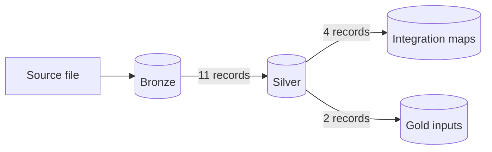

# Reconciliation evidence

Counts and totals compared from one layer to the next, so a number in Gold can be traced back to the file. Totals across every layer, source file to Gold, are in [validation](../../docs/operations/validation.md). How to write one: [evidence](../README.md#writing-a-record).

## Bronze to Silver

Rows and totals in Silver, clean plus quarantine, equal Bronze per period.

| Date | Source | Claim |
|---|---|---|
| 2026-10-07 | DepEd enrollment | [DepEd enrollment Silver reconciles with Bronze, and a second run skips](2026-10-07-deped-enrollment-bronze-to-silver.md) *(superseded by [2026-10-09](2026-10-09-deped-enrollment-bronze-to-silver.md))* |
| 2026-10-09 | DepEd enrollment | [DepEd enrollment Silver reconciles with Bronze, and every run rebuilds the same rows](2026-10-09-deped-enrollment-bronze-to-silver.md) |
| 2026-10-16 | DepEd enrollment | [DepEd enrollment SY 2020-21 loads into the existing Bronze and Silver lane, reconciles per school year, and reruns change nothing](2026-10-16-deped-enrollment-2020-21-bronze-to-silver.md) |
| 2026-10-19 | DepEd enrollment | [DepEd enrollment SY 2021-22 and 2022-23 load into the existing Bronze table, reconcile per school year, and reruns change nothing](2026-10-19-deped-enrollment-2021-23-bronze.md) |
| 2026-10-19 | DepEd enrollment | [DepEd enrollment SY 2021-22 and 2022-23 reconcile from Bronze to Silver per school year, one malformed ID is quarantined, and the other four years are unchanged](2026-10-19-deped-enrollment-2021-23-silver.md) |
| 2026-10-11 | DepEd facilities | [DepEd facilities Silver reconciles with Bronze, and every run rebuilds the same rows](2026-10-11-deped-facilities-bronze-to-silver.md) |
| 2026-10-16 | DepEd EMISD | [The DepEd school-to-PSGC crosswalk reconciles from Bronze to Silver locally, row by row, and a rebuild gives the same rows](2026-10-16-deped-enrollment-psgc-bronze-to-silver.md) |
| 2026-10-21 | DepEd PSGC coordinates | [The public-only DepEd workbook's Silver keeps 47,818 school locations, reconciles row by row to Bronze, passes all 36 checks, and rebuilds identically; the two DepEd workbooks compared school by school](2026-10-21-deped-psgc-coordinates-bronze-to-silver.md) |
| 2026-10-10 | PSA PSGC | [PSGC 2Q 2026 Bronze reconciles to Silver, and a rebuild gives the same content](2026-10-10-psa-psgc-bronze-to-silver.md) |
| 2026-10-09 | PSA poverty | [PSA Poverty Stat Silver reconciles with Bronze per estimate year, and every run rebuilds the same rows](2026-10-09-psa-poverty-stat-bronze-to-silver.md) |
| 2026-10-18 | PSA school-age | [PSA school-age population Bronze reconciles to Silver, and a rebuild gives the same content](2026-10-18-psa-school-age-population-bronze-to-silver.md) |

## Silver to Integration

Every source row is in its map, matched or kept with a reason.

| Date | Source | Claim |
|---|---|---|
| 2026-10-19 | DepEd schools | [DepEd schools map to PSGC at city and barangay level](2026-10-19-deped-school-psgc-integration.md) |
| 2026-10-19 | PSA poverty | [Every PSA poverty estimate row maps to one PSGC unit by Correspondence Code, and the 44 uncovered cities and municipalities are counted](2026-10-19-psa-poverty-psgc-map.md) |
| 2026-10-19 | PSA school-age | [Every PSA school-age population place maps to PSGC 2Q 2026, except the 8 2020 Interim Province clusters, which are reviewed unmatched](2026-10-19-psa-school-age-population-psgc-map.md) |
| 2026-10-15 | HDX boundaries | [HDX ADM3 features map to PSGC one-to-one except the 8 Special Geographic Area units, with every exception reviewed](2026-10-15-hdx-adm3-psgc-map.md) |

## Gold inputs

| Date | Source | Claim |
|---|---|---|
| 2026-10-16 | PSA poverty | [The 2023 poverty statuses behind D-046 recount from Silver](2026-10-16-psa-poverty-2023-city-recount.md) |
| 2026-10-21 | DepEd PSGC coordinates | [The school boundary map and dim_school_location reconcile to Silver on the real data, every school gets one boundary status, and a rebuild is identical](2026-10-21-dim-school-location-gold.md) |
