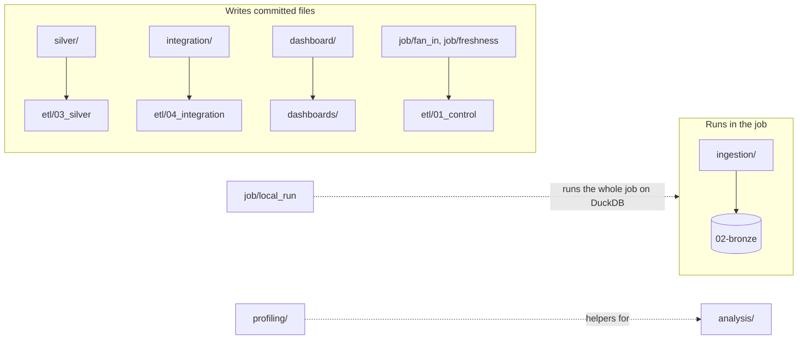

# Python source

Python does two jobs here: it **loads** files that SQL cannot read (zips, workbooks, GeoJSON) into Bronze, and it **generates** the SQL and dashboard files that the job runs, from reviewed configuration. Everything from Silver on runs as SQL under [`etl/`](../etl/README.md).

| Folder | Kind | What it does |
|---|---|---|
| [`ingestion/`](ingestion/README.md) | Job task | Validates approved deliveries, tracks batches, loads source-preserving Bronze rows |
| [`silver/`](silver/README.md) | Generator | Silver build and gate SQL and the Silver data dictionaries, from `config/mappings/` |
| [`integration/`](integration/README.md) | Generator | PSGC map build and gate SQL, from `config/integration/` |
| [`dashboard/`](dashboard/README.md) | Generator | The data-quality and LGU planner dashboard JSON |
| [`job/`](job/README.md) | Generator and runner | The fan-in and freshness SQL, and the local runner of the whole job |
| [`profiling/`](profiling/README.md) | Library | Workbook helpers shared by `analysis/` scripts |

## Two rules

- **Never edit a generated file by hand.** Change the generator or its configuration and regenerate; a test compares every committed file with its generator's output.
- **Run modules from the repository root** (`python -m src.silver.cli ...`), so `src` imports resolve the same way they do in tests and on Databricks.
